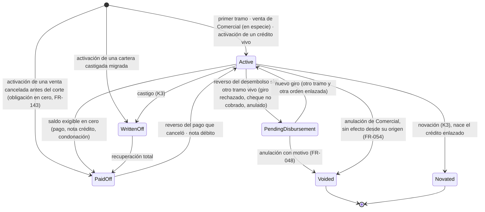
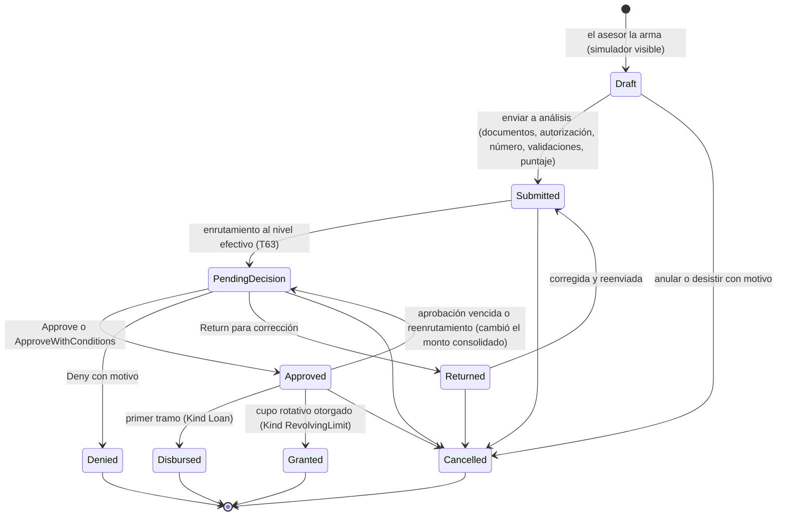
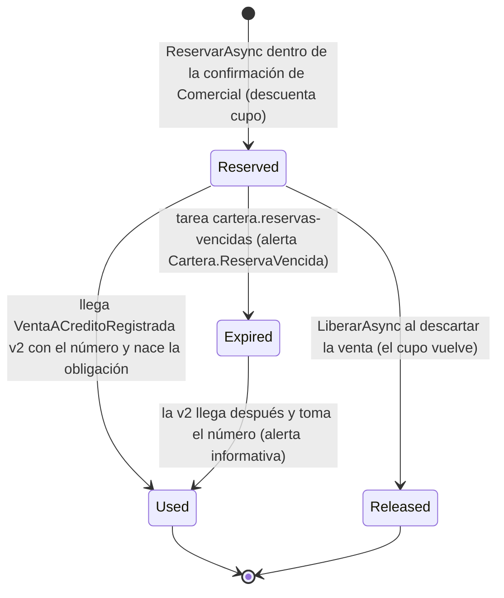
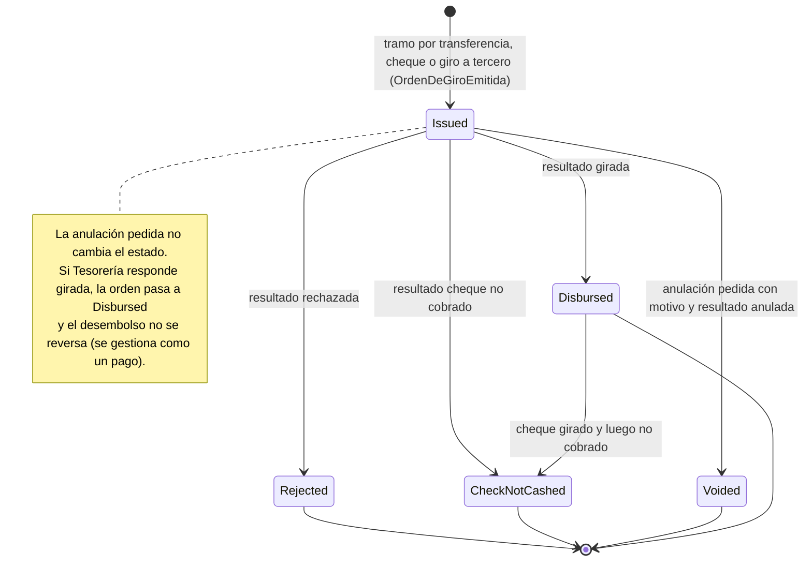

# Data Model — 013 Cartera financiera

Parte 1 (§0–§11): configuración, originación, gobierno, crédito, libro, proyecciones y operaciones. Parte 2 (§20–§32): integración, procesos, riesgo, libranza, novedades, cobranza, documentos, migración y activación. Parte 3: plataforma y otros módulos, enums, errores, alertas, parámetros, retiro y migraciones.

# Data Model (parte 1): Cartera financiera — configuración, originación, gobierno, crédito, libro y operaciones

**Feature**: 013 | **Fecha**: 2026-10-05 | **Rama**: `013-cartera-financiera` | **Parte**: 1 de 3

Esta parte cubre las tablas `LND_` de **configuración** (§1), **originación** (§2), **gobierno** (§3),
**crédito** (§4), **libro** (§5), **proyecciones** (§6) y **operaciones** (§7), los diagramas de estados del
crédito, la solicitud, la reserva y la orden de giro (§8), los códigos de error que producen (§9), los nombres
que este documento fija (§10) y la conciliación con `decisiones-transversales.md` §7 (§11). La segunda parte (§20–§32) cubre
integración y procesos (`LND_InboundMessages*`, `LND_AccountingFactParts`, `LND_ProcessRuns*`), mensajes al
deudor, riesgo y cierres (incluida `LND_RiskPolicyVersions`, §23.10), reclamación al seguro e insolvencia, libranza,
novedades, cobranza, documentos, regulatorio, migración y activación, el lado contable (`ACC_`), la plataforma
(`ADM_`, `COR_`) y las enmiendas (`PAY_`, `INV_`, `CMP_`). Aquí sólo se nombran cuando una tabla de esta parte
las referencia.

Fuente de los nombres: `decisiones-transversales.md` (T1..T102, §2), copiados literalmente. Lo que ese
documento no nombra lo nombra éste con las reglas T1–T4 y lo marca **(fijado aquí)** la primera vez; la lista
completa está en §10. Las columnas de detalle no llevan marca (T1, «Lo que no nombra»).

---

## 0. Convenciones

### 0.1 Entidad base

- **Herencia**. Toda entidad hereda `AuditableEntity`: `int Id`, `PublicId` (uniqueidentifier, UK
  `UK_{Tabla}_PublicId`), `IsDeleted`/`DeletedAt`/`DeletedBy`, `RowVersion`, `CreatedAt/By`,
  `UpdatedAt/By`. Esas columnas no se repiten abajo. `AuditableEntityLong` (`bigint Id`) sólo en los hechos de
  alto volumen: `LND_LoanOperations`, `LND_LoanTransactions`, `LND_LoanDailyPositions` (§2.3 de las
  transversales) y `LND_RepaymentInstallments` (§4.5, C43: un plan se regenera entero en cada versión).
- **Carpetas** (T4, §2.2): `Domain/Entities/Lending/{Configuration, Origination, Governance, Loans, Schedules,
  Operations, Transactions, Projections}`. `LoanTransaction` vive en `Transactions`, el espacio que ya vigila
  `PrincipioXI_ContableImmutable` (se activa solo). Configuraciones en `Persistence/Configurations/Lending`.
- **Borrado lógico** (Principio VII). Toda configuración declara `HasQueryFilter(e => !e.IsDeleted)`. Los
  catálogos con código llevan UK filtrado `[IsDeleted] = 0`. Hechos, proyecciones, controles y créditos **nunca
  se dan de baja** y sus UK van **sin** filtro.
- **Claves foráneas**: `Restrict` siempre; nada en cascada. Hacia otros módulos sólo hay FK a lo que la lista
  cerrada de interfaces admite como plataforma o maestro: `COR_People` (personas, I-1, Principio V),
  `COR_Branches` (oficina, T62), `SEC_Users` (actor, T66), `COR_Banks` y `COR_BankFileFormats` (archivos
  planos, FR-149). Los adjuntos se referencian por `…AttachmentPublicId` (Guid de `COR_Attachments`, sin FK,
  como `PAY_BankDisbursementFiles`). **Nunca** hay FK ni navegación hacia `ACC_`, `INV_`, `PAY_` ni hacia
  tablas de Ahorros (`LaCarteraSoloSeTocaPorSusInterfaces`, FR-008): lo que llega de ellos se guarda como dato
  (PublicId, número, código).

### 0.2 Hechos inmutables (marca H)

- **H** = `IHechoInmutable`: se inserta una vez; `GuardaDeInmutabilidad` (desde
  `ApplicationDbContext.SaveChangesAsync`) rechaza `Modified` y `Deleted`, salvo las propiedades marcadas
  `[EscrituraUnica]` que pasan de nulo a valor (lo fija `LosHechosInmutablesNoSeModifican`).
- **Documentos con estado** (crédito, solicitud, reserva, orden de giro, garantía, pagaré, sesión): son
  entidades mutables, pero cada tabla dice qué columnas pueden cambiar, en qué estados y por qué comando.
  Ninguna se borra; se anulan o cierran.
- **Corregir** algo que es hecho es siempre otra fila: una versión nueva (§0.6), una operación de reverso
  (§7.8) o una fila espejo con `ReversesTransactionId` (§5.1, Principio XI, FR-002).

### 0.3 PublicId y números

- La API, los mensajes, las pantallas y la auditoría identifican todo por `PublicId` (Principio VI). En los
  puertos, la obligación es `ObligationPublicId` = `LND_Loans.PublicId`.
- El **número** (`Number`, nvarchar(20)) es un dato visible y un criterio de búsqueda, nunca un identificador de
  ruta. Lo asigna `NumeradorDeCartera` (§1.10), único que toca `LND_NumberSequences`, **al final** del orden de
  cerrojos (T34): un borrador no consume número.

### 0.4 Precisión decimal (`PrecisionDeCartera`, T35)

`Persistence/Configurations/Lending/PrecisionDeCartera`. La convención global (18,2) no cambia y PostgreSQL
`numeric(18,2)` **redondea en silencio**: cada propiedad decimal declara su alias, y
`LosSaldosYTasasDeCarteraTienenSuPrecision` lo exige. En las tablas se escribe el alias:

| Alias | Tipo | Dónde |
|---|---|---|
| `Monto` | decimal(18,2) | pesos: libro, plan, posiciones, operaciones, cupos, garantías, órdenes, archivos |
| `TasaAnual` | decimal(9,6) | toda tasa **como fracción** (0,265000 = 26,5 % EA): EA pactada, usura, índice, margen, piso, techo, tasa de mora fija, factor relativo de mora, tarifa de seguro |
| `TasaEquivalente` | decimal(28,18) | tasas derivadas selladas o explicadas: diaria, del período, sobretasa de cargos (`ChargesSpread`) |
| `ValorUvr` | decimal(18,4) | K6b: valores en UVR (`CarteraVivienda`, sólo si hace falta) |
| `Fraccion` **(fijado aquí)** | decimal(9,6) | proporciones que no son tasas: cobertura mínima, veces los aportes, pesos del puntaje, umbral de coincidencia de nombre, retención de prima |
| `Puntaje` **(fijado aquí)** | decimal(12,4) | puntajes propios y de centrales (admite escalas de 0 a 1.000 con decimales) |

- Una tasa pactada con más de 6 decimales de fracción **se rechaza** (`Lending.Rate.TooPrecise`, fijado aquí),
  nunca se redondea.
- El redondeo de los montos lo sella la línea y lo copia el crédito: unidad (`RoundingUnit`, `Monto`: 0,01; 1;
  10; 100; 1.000), modo (`RoundingMode`) y momento (`RoundingMoment`). El residuo queda visible en la
  explicación (`RedondeoDeCartera`).
- Los porcentajes no se guardan como 0–100: siempre fracción. Días, meses y cuotas son `int`.

### 0.5 Fechas

- `…Date` y `…On` son `date` (fecha de negocio, propuesta con `IDateTimeService.HoyLocal`, America/Bogota;
  T9, `LaCarteraUsaLaFechaLocal`). `…At` es `datetime` en UTC.
- **Tres fechas** en toda operación y transacción (FR-012):
  - `ValueDate`: desde cuándo cuenta para intereses y mora;
  - `AccountingDate`: la que calcula `FechaContable` con `IContabilidadParaCartera.EstadoDelPeriodoAsync`
    (T36): la fecha valor si su mes no tiene cierre de Cartera y está abierto en Contabilidad; si no, el primer
    día del primer mes que cumpla las dos cosas. La causación del día d se fecha d;
  - `RegisteredAt`: cuándo se supo; **monótono por crédito** bajo el cerrojo:
    `max(UtcNow, LoanControl.LastRegisteredAt + 1 tick)` (T34).
- **Liquidar a (D, R)** (T24): D es la fecha de lo que se pregunta y R el instante de la información; por
  defecto R = ahora. En `/loans/*`, `/risk/ratings` y `/api/core/national-values` viajan como `date` (D) y
  **`recordedAsOf`** (R); en informes y tablero, `asOf` es la fecha de corte, como en la 012 (C83).

### 0.6 Vigencias y bitemporalidad

Hay tres familias de datos con vigencia; las dos primeras son de la plataforma:

| Familia | Dónde | Regla de lectura a (D, R) |
|---|---|---|
| Valores nacionales y documentos normativos | `COR_NationalValues`, `COR_RegulatoryDocuments` (parte 3, §4) | `VigenciaBitemporal.Vigente` con `ValidFrom`, `Sequence` y `KnownAt` (T38) |
| Parámetros de la cooperativa | `COR_ParameterVersions`, módulo `LND` (T43) | `LectorDeParametros` con `informacionHasta`: R contra `CreatedAt`, `ValidTo` derivado de la versión siguiente conocida en R (T38) |
| **Versiones propias de Cartera** | líneas y sus hijas, equivalencias, matrices de atribución, reglas de órganos, cupos, preferencias, saldos de aportes, condiciones y planes del crédito | ver abajo |

**Versiones propias de Cartera.** Son hechos de sólo inserción con `ValidFrom` (date), un ordinal
(`VersionNumber` por dueño) y `RegisteredAt` (datetime). **No guardan `ValidTo`**: la vigencia termina en la
víspera del `ValidFrom` de la versión siguiente conocida en R. La lectura usa la misma regla única
(`VigenciaBitemporal.Vigente(versiones, D, R)`): entran las versiones con `RegisteredAt ≤ R` y
`ValidFrom ≤ D`; gana el `ValidFrom` más reciente y, si empatan, el `VersionNumber` mayor. Un fin de vigencia
es una versión que lo dice (por ejemplo, un cupo en cero). Registrar una versión con `ValidFrom` anterior a
`HoyLocal` se rechaza salvo donde la tabla lo admite (migración, activación). Las tablas que son **estado con
fechas** y no versiones (miembros de órganos, personas vinculadas, alcance) guardan `ValidFrom`/`ValidTo` y
cierran la vigencia con un comando auditado.

### 0.7 Enumeraciones

- Se guardan por su **valor numérico** (int) y los índices filtrados usan el número (precedente de la 012).
  **La numeración la fija §9 (parte 3)** (C65): los enums de `Domain/Enums/Lending` que §2.7 de las transversales
  lista sin número se numeran desde 1 en el orden en que allí aparecen; los que traen número lo conservan. La tabla
  de §0.7.1 copia la de §9.1 para los enums de esta parte; si difieren, rige §9.
- Los **enums de los puertos** (`ClaseDeRecaudador`, `ClaseDeMedioDeRecaudo`, `MotivoDeNoDescuento`,
  `ModalidadDePago`) viven en `Application.Common.Integration.Lending` y el dominio no puede referenciarlos
  (Principio II): las entidades de esta parte los guardan como **texto** con el nombre del valor
  (nvarchar(30)), igual que `CollectorClass` en la matriz contable (§2.7). `PaymentModality` y
  `PrepaymentChoice` sí son del dominio y se guardan como int.

#### 0.7.1 Numeración de los enums de §2.7 usados en esta parte

| Enum | Valores (número) |
|---|---|
| `LoanConcept` | `Principal` 1, `CurrentInterest` 2, `DefaultInterest` 3, `CurrentInterestInSuspense` 4, `DefaultInterestInSuspense` 5, `Insurance` 6, `CollectionFee` 7, `OtherCharge` 8, `Advance` 9, `CreditBalance` 10 |
| `LoanTransactionKind` | `Disbursement` 1, `OpeningBalance` 2, `Accrual` 3, `AccrualAdjustment` 4, `SuspenseReclassification` 5, `PaymentAllocation` 6, `PaymentReallocation` 7, `AdvanceReceived` 8, `AdvanceApplied` 9, `CreditBalanceRecognized` 10, `CreditBalanceSettled` 11, `Charge` 12, `Waiver` 13, `CommercialAdjustment` 14, `WriteOff` 15, `Recovery` 16 |
| `LoanOperationKind` | `Disbursement` 1, `OpeningBalance` 2, `Payment` 3, `PaymentReversal` 4, `DisbursementReversal` 5, `RateReset` 6, `TermsChange` 7, `Charge` 8, `Waiver` 9, `CommercialAdjustment` 10, `WriteOff` 11, `PreferenceChange` 12, `CreditBalanceResolution` 13, `ProvisionalCollection` 14 |
| `LoanStatus` | `PendingDisbursement` 1, `Active` 2, `PaidOff` 3, `WrittenOff` 4, `Voided` 5, `Novated` 6 |
| `LoanOrigin` | `Origination` 1, `Commercial` 2, `Migration` 3 |
| `DisbursementOrderStatus` | `Issued` 1, `Disbursed` 2, `Rejected` 3, `CheckNotCashed` 4, `Voided` 5 |
| `CollateralStatus` | `Constituted` 1, `Valid` 2, `Released` 3, `Extinguished` 4, `Executed` 5 |
| `NonDeductionOrigin` | `Contract` 1, `Activation` 2, `PaymasterResult` 3 (K2) |
| `CreditDecisionOutcome` | `Approve` 1, `ApproveWithConditions` 2, `Deny` 3, `Return` 4 |
| `RelatedPartyBasis` | `BoardMember` 1, `OversightBoardMember` 2, `LegalRepresentative` 3, `SignificantContributor` 4, `Spouse` 5, `Relative` 6 |
| `RatingCategory` · `RatingSubcategory` | `A` 1 … `E` 5 · `None` 0, `E1` 1, `E2` 2 |
| `DayCountConvention`, `RateEquivalence`, `AmortizationSystem`, `PaymentModality`, `PrepaymentChoice`, `AllocationOrder`, `LoanNumberReservationStatus` | los números de §2.7 |
| `GraceKind` · `GraceInterestTreatment` | `None` 0, `Principal` 1, `Total` 2 · `FirstInstallment` 1, `Distributed` 2 |
| `RoundingMoment` · `RoundingMode` · `RateKind` · `DefaultRateKind` | `PerConcept` 1, `PerInstallment` 2, `PerTotal` 3 · `AwayFromZero` 1, `ToEven` 2, `Up` 3, `Down` 4 · `Fixed` 1, `Variable` 2 · `Fixed` 1, `RelativeToCurrent` 2 |

Los enums nuevos de esta parte (fijados aquí) llevan su numeración en la tabla donde nacen y en §10.

### 0.8 Personas que actúan

- Todo `…ByUserId` es `int FK SEC_Users` resuelto por `IActorActual`, **nunca** el entero del token ni el correo
  (`LaSegregacionNoUsaUserIdDelToken`, que suma las carpetas de Cartera, T66). La segregación compara por
  `SEC_Users.Id` y por `SEC_Users.PersonId`; quien radica, decide, vota o desembolsa debe tener persona
  (`Lending.Security.UserWithoutPerson`).
- Lo que corre solo firma como el proceso de la cooperativa (`ActorKind.Process`, `…ByUserId` nulo; T8); el
  usuario que originó el hecho viaja como dato (`OriginUserCentralId`, Guid).

### 0.9 Códigos de catálogo

`CodigoDeCatalogo` (mayúsculas, `^[A-Za-z0-9._-]+$`, 10 caracteres): duplicado →
`Catalogo.CodigoDuplicado` con el nombre del existente. **No cambian** una vez creados los que la matriz
contable usa como dimensión por código (T52): el de la línea (`CreditLineCode`). Los códigos nacionales
(modalidad, sub-segmento, índice) se copian tal como los da el documento vigente y tampoco se editan.

### 0.10 Concurrencia y cerrojo (T34)

- `ICerrojoDeCartera` (`CerrojoDeCartera`, `SqlDelCerrojoDeCartera`), sólo dentro de `TransaccionExplicita`
  (lanza si no hay transacción). Orden fijo: `LND_Setup` **compartido** (exclusivo al cerrar o reabrir un mes)
  → `LND_DebtorControls` exclusivos por Id (deudor y codeudores de la operación) → `LND_LoanControls`
  exclusivos por Id (todos los de la operación en una sentencia) → numeración al final.
- Las operaciones **esperan** (`FOR UPDATE` / `UPDLOCK, ROWLOCK, HOLDLOCK`); el proceso **salta**
  (`FOR UPDATE SKIP LOCKED` / `UPDLOCK, ROWLOCK, READPAST`). `RowVersion` (`xmin` / `rowversion`) es la segunda
  defensa.
- La fila de `LND_DebtorControls` que falta la crea el propio cerrojo con `INSERT … ON CONFLICT DO NOTHING`
  (PostgreSQL) o `INSERT … WHERE NOT EXISTS` (SQL Server), fuera de EF: ese INSERT escribe `PublicId`
  (`gen_random_uuid()` / `NEWID()`), `CreatedAt` UTC, `CreatedBy` (actor) e `IsDeleted = 0`, como la 012.
  `LND_LoanControls` nace en el mismo `SaveChanges` que su crédito.
- Las validaciones previas (contabilizable, listas, centrales) corren **fuera** del cerrojo.

### 0.11 Escritores únicos

| Escritor | Qué escribe | Prueba |
|---|---|---|
| `RegistroDeCartera` | `LND_LoanTransactions`, la marca de agua de `LND_LoanControls`, `LND_LoanDailyPositions` y los hechos del crédito que acompañan al libro: `LND_LoanOperations`, `LND_LoanTermsVersions`, `LND_RepaymentScheduleVersions`, `LND_RepaymentInstallments` (C45) | `NadieEscribeElLibroDeCarteraFueraDelRegistro` (las vigila todas) |
| `NumeradorDeCartera` | `Number` de toda tabla de esta parte y `NextValue` de `LND_NumberSequences`; ninguna propiedad se llama `NextNumber` | `SoloElNumeradorNumera` (ampliada) y `NingunModuloEscribeMovimientosFueraDelContrato` |
| `RegistroDeIntervenciones` | `LND_CaseParticipations` | — |
| `EmisionDeCartera` → `EmisorDeMensajes` | los mensajes que nacen en la transacción de cada operación (T5: «un hecho nace en la transacción que guarda lo que cuenta») | `SoloElEmisorEscribeLaBandeja` |

### 0.12 Auditoría (T67, T68)

- El `AuditableEntityInterceptor` guarda antes y después de toda entidad salvo las marcadas
  `[SinDiffDeAuditoria]`. En esta parte: `LoanDailyPosition` (T67), `LoanControl` y `DebtorControl` (filas de
  control sin datos de negocio; C46). La lista completa de C46 suma, en la parte 2, `MonthlyCloseLoan`,
  `LND_ProcessRunErrors`, `LND_AccountingFactParts`, `LND_LoanArrearsHistory`, `LND_PayrollDeductionFileLines`,
  `LND_RegulatoryFileLines` y las 17 de preparación; cada una deja su **evento resumen** por corrida, archivo o
  importación (T101).
- `LoanTransaction` **no** lleva `[SinDiffDeAuditoria]` (Principio XI): una operación de pantalla deja su
  antes/después. La causación del proceso no pasa por el `ChangeTracker`: `RegistroDeCartera` la escribe en
  bloque y deja un evento resumen por tanda y por corrida (T67, T101).
- El evento de cada `LoanOperation` lleva la **distribución completa por cuota y concepto** (T23, T68). Los
  comandos llevan `IConOficina` (oficina del crédito o de la solicitud). Módulo `Lending`, encadenado, diez años.

### 0.13 Índices y restricciones

- Todo UK, IX y CK se nombra con `HasDatabaseName`: `UK_{Tabla}_{Columnas}`, `IX_{Tabla}_{Columnas}`,
  `CK_{Tabla}_{Regla}`, con columnas abreviadas si el nombre pasa de 63 caracteres (PostgreSQL trunca).
- Los tipos se escriben en T-SQL (`nvarchar`, `bit`, `datetime`, `uniqueidentifier`); EF los traduce. Los
  filtros van en T-SQL y los traduce `ProviderModelConventions`; no se usa `IN` ni `OR` en un filtro (se parte
  en dos índices).
- JSON: `nvarchar(max)` con JSON **canónico** (claves en orden fijo, decimales con punto, fechas ISO), para que
  su SHA-256 sea reproducible (`HuellaDeCartera`). Toda huella es nvarchar(64), hexadecimal en minúscula.

### 0.14 Entregas y migraciones

Columna **E**: entrega en que nace la tabla o la columna. Todas las tablas de esta parte nacen en la migración
par `CarteraNucleo` (K1, §2.26), después de `RetiroDeLaCarteraHeredada`, `ValoresNacionales` y
`PlataformaParaCartera` (T88). Una columna que apunta a una tabla de una entrega posterior nace con esa
entrega (`PayrollAgreementId` en K2 con `CarteraLibranza`; `NoveltyId` en K3 con `CarteraNovedades`); los
**valores** de enum de entregas posteriores existen desde K1 pero ningún comando de K1 los escribe.

### 0.15 Parámetros que leen estas tablas (módulo `LND`, T43)

Claves de §2.20; las que allí dicen «defecto en `data-model.md`» lo fijan aquí, sembradas **«pendiente de
validar»**.

| Clave | Ámbito | Defecto | Lo usa |
|---|---|---|---|
| `Originacion.DiasVigenciaDeAprobacion` | None | **30** (fijado aquí) | §2.1 `ApprovalValidUntil` (FR-042) |
| `Reservas.DiasDeVigencia` | None | **5** (fijado aquí) | §2.11 `ExpiresOn` (FR-057) |
| `Giros.DiasSinResultado` | None | **3** días hábiles (fijado aquí) | §7.4 `ResultDueOn` (FR-045) |
| `Cupo.MoraMaximaParaVender` | None | **0** días (fijado aquí): en mora no vende | consulta de cupo (FR-059) |
| `Bloqueos.DiasDeMoraParaBloquear` | None | **30** días (fijado aquí) | §2.12 bloqueo automático (FR-060) |
| `Pagos.FirmezaDiasPorClaseDeMedio` | None | **10** días hábiles por clase (D23); `InternalOffset` **0** | §7.1 `FinalityDate` (FR-082) |
| `Pagos.DiasMaximosFechaValor` | None | 5 (D4) | §7.6 |
| `Centrales.DiasDeVigenciaDeConsulta` | None | **30** (fijado aquí) | §2.7 `ValidUntil` |
| `Listas.UmbralDeCoincidenciaDeNombre` | None | **0,90** (`Fraccion`, fijado aquí) | §2.6 |
| `Mora.ToleranciaDeSaldoVencido` | None, CreditLine | 0 | §6.1 `DaysPastDue` |
| `Mora.SobreIntereses` | None | false | §4.3 `DefaultOnInterestAllowed` (se sella) |
| `Segregacion.Incompatibilidades` | None | `Decidir × Desembolsar` activo | §3.12 |

### Mapa

```text
CONFIGURACIÓN
LND_Setup (fila única)                LND_FactTypes        LND_NumberSequences
LND_CreditLines ─< LND_CreditLineVersions ─< LND_CreditLineRateBands
                        │                  ├< LND_CreditLineDocumentRequirements
                        │                  ├< LND_CreditLineInsurances >─ COR_People (aseguradora)
                        │                  └< LND_CreditLineCollateralRules
LND_CommercialTermEquivalences

ORIGINACIÓN
COR_People ─< LND_CreditApplications ─< LND_CreditApplicationParties, …Documents, …Checks
                     │                ├< LND_CreditScores (H), LND_ScreeningResults, LND_BureauQueries
                     │                └< LND_Collaterals, LND_PromissoryNotes
COR_People ─< LND_CreditLimits, LND_DebtorBlocks, LND_PrepaymentPreferences (H),
              LND_ContributionBalanceLoads (H), LND_LoanNumberReservations
COR_People ─1 LND_DebtorControls (cerrojo por deudor)

GOBIERNO
LND_AttributionMatrices ─< LND_AttributionLevels ─< LND_AttributionRules
LND_GoverningBodies ─< LND_GoverningBodyRuleVersions, LND_GoverningBodyMembers
LND_GoverningBodies ─< LND_Sessions ─< LND_SessionAttendances, LND_SessionItems ─< LND_SessionVotes (H)
LND_CreditDecisions (H) ← nivel individual o punto de sesión
LND_RelatedParties    LND_CaseParticipations (H)    LND_UserCreditLineScopes >─ SEC_Users

CRÉDITO, LIBRO, PROYECCIONES Y OPERACIONES
LND_Loans ─1 LND_LoanControls (cerrojo y marca de agua)
   ├< LND_LoanParties
   ├< LND_LoanTermsVersions (H) ─< LND_RepaymentScheduleVersions (H) ─< LND_RepaymentInstallments (H)
   ├< LND_LoanOperations (H) ─< LND_LoanTransactions (H)  ◀── también la corrida (ProcessRunId, parte 2)
   │         └< LND_DisbursementOrders ─< LND_DisbursementOrderResults (H)
   │                     └── LND_DisbursementFileLines (H) >─ LND_DisbursementFiles (H)
   ├< LND_InstallmentNonDeductions (H, §24.9)
   ├< LND_LoanPayrollLinks (§24.5: forma de pago y pagaduría con vigencia, C44)
   └< LND_LoanDailyPositions (H, proyección)
```

---

## 1. Configuración

### 1.1 `LND_Setup` — `LendingSetup` (K1; FR-107, FR-142, T34)

Fila única de Cartera en cada base de cooperativa: es la primera fila del cerrojo (compartida en toda operación,
exclusiva al cerrar o reabrir un mes) y guarda la activación vigente. La siembra `CarteraNucleo` con
`Id = 1`; nunca se da de baja.

| Columna | Tipo | Nulo | Notas |
|---|---|---|---|
| `ActivationDate` | date | sí | día siguiente al corte de la carga activada (FR-142); nulo = Cartera desplegada sin activar (T85) |
| `ActivationId` | int FK `LND_Activations` | sí | el registro de la activación (parte 2); lo escribe `ActivateLendingCommand` en la misma transacción (C60) |
| `ActivatedAt` | datetime | sí | instante del registro |

**Reglas**. Sólo `ActivateLendingCommand` la escribe, una vez (null → valor); no hay «desactivar». Leerla dice
si Cartera está activada (`EstadoDeCartera`): sin `ActivationDate`, el contrato responde `Lending.NotActivated`
y las consultas de Comercial `NotEnabled` (T85). **H**: no (fila de control). **Errores**: `Lending.NotActivated`.

### 1.2 `LND_CreditLines` — `CreditLine` (K1; FR-019, FR-021, FR-032)

El producto: identidad estable de la línea. Todo lo que cambia con el tiempo va en su versión (§1.3).

| Columna | Tipo | Nulo | Notas |
|---|---|---|---|
| `Code` | nvarchar(10) | no | `CodigoDeCatalogo`; UK `UK_LND_CreditLines_Code` filtrado `[IsDeleted] = 0`; **inmutable** (dimensión `CreditLineCode` de la matriz, T52) |
| `Name` | nvarchar(120) | no | |
| `Purpose` | nvarchar(300) | sí | destino del crédito que la línea financia (FR-019) |
| `Status` | int (`CreditLineStatus`, fijado aquí) | no | `Draft` 1 (sin versión vigente o sin concepto tributario, T44), `Active` 2, `Closed` 3 (cerrada a créditos nuevos) |
| `ClosedReason` | int (`CreditLineClosedReason`, fijado aquí) | sí | `Manual` 1, `ModalityRetired` 2 (T44: la modalidad salió del catálogo vigente) |
| `ClosedAt` · `ClosedByUserId` · `CloseNotes` | datetime · int FK `SEC_Users` · nvarchar(300) | sí | |
| `UsuryBlockedSince` | date | sí | día desde el que la versión vigente supera la usura de su certificación (FR-021, US1-5); nulo = no bloqueada |
| `UsuryBlockedByValuePublicId` | uniqueidentifier | sí | el valor nacional `USURA` que la bloqueó (copia `COR_NationalValues`, sin FK) |

**Reglas**.
- Crear la línea crea su primera versión en el mismo comando (`Lending.CreditLines.Manage`).
- `Draft → Active` al tener una versión vigente que pasa `ControlDeUsura` y, si admite origen comercial con tasa
  mayor que cero, su concepto tributario (D20, T44).
- Con créditos vivos o solicitudes abiertas **no se borra**: se cierra a créditos nuevos (FR-032,
  `Lending.CreditLine.HasLoans`, fijado aquí). Cerrada, no admite simular, radicar, aprobar, desembolsar
  ni ventas nuevas (`Lending.CreditLine.Closed`, fijado aquí); los créditos vivos siguen.
- **Bloqueo por usura** (FR-021): el efecto de la réplica (`IEfectoDeReplicacion`) que trae una `USURA` nueva
  marca `UsuryBlockedSince` en las líneas cuya efectiva resultante la supera y alerta
  `Cartera.LineaCerradaPorUsura`; una versión nueva que pasa el control la limpia. Mientras esté marcada,
  responde `Lending.Usury.Exceeded` en toda originación.
- Una modalidad retirada del catálogo vigente cierra la línea (`ModalityRetired`) y alerta.

**H**: no. **Errores**: `Catalogo.CodigoDuplicado`, `Lending.CreditLine.Closed`, `Lending.CreditLine.HasLoans`,
`Lending.Usury.Exceeded`.

### 1.3 `LND_CreditLineVersions` — `CreditLineVersion` (K1; FR-007, FR-019–FR-032, FR-037, D20, T44)

Una versión de la línea con su fecha desde y su fecha de registro (FR-007, FR-032). Es lo que el crédito
**copia y sella** al desembolsar (§4.3). Hecho de sólo inserción (§0.6); la corrige una versión nueva.

| Columna | Tipo | Nulo | Notas |
|---|---|---|---|
| `CreditLineId` | int FK `LND_CreditLines` | no | |
| `VersionNumber` | int | no | 1..n por línea; UK `UK_LND_CreditLineVersions_Line_Version` |
| `ValidFrom` | date | no | ≥ `HoyLocal` al registrar (`Lending.CreditLine.RetroactiveVersion`, fijado aquí) |
| `RegisteredAt` | datetime | no | |
| `Reason` | nvarchar(300) | no | motivo del cambio |
| **Clasificación** | | | |
| `ModalityCode` | nvarchar(40) | no | código del documento `CatalogoDeModalidades` vigente en `ValidFrom` (`CONSUMO`, `MICROCREDITO`…; T44). No hay FK: se sella el código |
| `SubsegmentCode` | nvarchar(30) | sí | `ConLibranza`, `SinLibranza`, `PersonaNatural`, `PersonaJuridica`, `Inmobiliario`, `Empresarial` (§2.21); la combinación debe existir en el catálogo vigente (`Lending.CreditLine.ModalityUnknown`, fijado aquí) |
| `ForEmployees` | bit | no | línea para empleados de la cooperativa (FR-019); es la condición «empleado» de tasas y documentos, que `DebtorKind` no lleva (C96). La dimensión contable «empleado» sale de la persona (T52) |
| `AllowsNonAssociates` | bit | no | sólo si el perfil regulatorio lo permite (FR-018; `Lending.CreditLine.NonAssociatesNotAllowed`, fijado aquí) |
| `AllowsCommercialOrigin` | bit | no | admite ventas de Comercial (FR-019) |
| `CommercialDefaultFor` | int (`DebtorKind`, fijado aquí) | sí | `Associate` 1, `Customer` 2: línea por defecto para ventas sin línea ni sugerida (FR-050) y para las «canceladas antes del corte» marcadas desde la lista (FR-143). Una sola línea activa por valor; lo valida el comando |
| `InterestTaxTreatment` | int (`InterestTaxTreatment`, fijado aquí) | sí | `NotTaxed` 1, `Taxed` 2 (D20). Obligatorio si `AllowsCommercialOrigin` y la tasa > 0 (`Lending.CreditLine.InterestTaxConceptMissing`) |
| `InterestTaxSupportAttachmentPublicId` | uniqueidentifier | sí | concepto de la contadora; obligatorio con `InterestTaxTreatment` |
| **Tasa corriente** (FR-020) | | | |
| `RateKind` | int (`RateKind`) | no | |
| `AnnualRate` | `TasaAnual` | sí | EA fija; obligatoria si `Fixed`. Con bandas (§1.4) es la tasa base |
| `IndexCode` · `IndexKey` | nvarchar(20) · nvarchar(20) | sí | código y clave del valor nacional (`IBR` + plazo, `IPC`…); obligatorios si `Variable` |
| `Margin` | `TasaAnual` | sí | se suma en la expresión del índice, luego a EA (D10) |
| `RateFloor` · `RateCeiling` | `TasaAnual` | sí | piso y techo de la variable |
| `ResetPeriodicity` | int (`RepaymentPeriodicity`, fijado aquí) | sí | periodicidad de reajuste (FR-067) |
| **Mora** | | | |
| `DefaultRateKind` | int (`DefaultRateKind`) | no | |
| `DefaultRate` | `TasaAnual` | sí | EA si `Fixed` |
| `DefaultRateFactor` | `TasaAnual` | sí | factor sobre la corriente si `RelativeToCurrent` |
| **Montos, plazos y periodicidades** (FR-022) | | | |
| `MinAmount` · `MaxAmount` | `Monto` | no | |
| `MinTermMonths` · `MaxTermMonths` | int | no | |
| `MaxInstallments` | int | sí | lo informa la consulta de cupo (FR-059) |
| `Periodicities` | nvarchar(200) | no | JSON con la lista de `RepaymentPeriodicity` admitidas |
| `DefaultPeriodicity` | int (`RepaymentPeriodicity`) | no | debe estar en la lista |
| `PaymentDay` · `CutoffDay` | tinyint | sí | regla del día de pago o de corte (1..31; si el mes no lo tiene, el último día) |
| **Plan** (FR-023, FR-010) | | | |
| `AmortizationSystems` | nvarchar(100) | no | JSON con la lista de `AmortizationSystem` admitidos |
| `DefaultAmortizationSystem` | int (`AmortizationSystem`) | no | |
| `AllowsExtraordinaryInstallments` | bit | no | cuotas extraordinarias (primas) |
| `MaxExtraordinaryFraction` | `Fraccion` | sí | tope de lo que pueden sumar las extraordinarias sobre el monto |
| `AllowedGraceKind` · `MaxGraceInstallments` | int (`GraceKind`) · int | no · sí | |
| `GraceInterestTreatment` · `GraceDistributionInstallments` | int (`GraceInterestTreatment`) · int | sí | en la primera cuota o distribuido en N (Edge case «gracia») |
| `AllowsTranches` | bit | no | desembolso por tramos (FR-045) |
| `DayCount` | int (`DayCountConvention`) | no | |
| `RateEquivalence` | int (`RateEquivalence`) | no | por defecto `Compound` (FR-010) |
| `RoundingUnit` · `RoundingMode` · `RoundingMoment` | `Monto` · int · int | no | §0.4 |
| **Prelación** (FR-030, FR-071; §1.8) | | | |
| `AllocationOrder` | int (`AllocationOrder`) | no | por defecto `OldestInstallmentFirst` |
| `ConceptPriority` | nvarchar(200) | no | JSON con el orden de `LoanConcept` dentro de la cuota |
| `SuspenseWithItsConcept` | bit | no | por defecto 1: el suspenso va con su concepto corriente o de mora |
| `AllowsSpecificInstallmentOutOfOrder` | bit | no | modalidad 6 sin las anteriores cubiertas (FR-071) |
| `PrepaymentOfferedFirst` | int (`PaymentModality`) | no | `Advance` o `ExtraordinaryPrincipal`: qué opción se muestra primero (FR-074); el deudor elige siempre |
| `NoteRecalculation` | int (`PrepaymentChoice`) | no | cómo se recalcula el plan tras una nota de Comercial (FR-031) |
| **Formas de pago** (FR-027) | | | |
| `RepaymentChannels` | nvarchar(100) | no | JSON con la lista de `RepaymentChannel` (fijado aquí): `Cashier` 1, `OwnPayroll` 2, `PaymasterDeduction` 3 (K2), `DirectDebit` 4 |
| `DefaultRepaymentChannel` | int (`RepaymentChannel`) | no | |
| **Requisitos, cupo y aportes** (FR-025, FR-029) | | | |
| `MinAssociateSeniorityMonths` · `MinAge` · `MaxAge` | int | sí | |
| `RequiresEmployment` | bit | no | vínculo laboral |
| `ContributionsMultiple` | `Fraccion` | sí | cupo = N veces los aportes |
| `MaxIndebtedness` | `Monto` | sí | endeudamiento máximo con la entidad |
| `MinContributionsBalance` | `Monto` | sí | |
| `RequiresBureauQuery` | bit | no | «exige consulta a centrales»: sin canal real no aprueba (T73) |
| **Puntaje** (FR-037) | | | |
| `ScoringModel` | nvarchar(max) | sí | JSON: variables (código, fuente, rangos con puntos), pesos (`Fraccion`), escala; nulo = sin puntaje |
| `MinimumScore` | `Puntaje` | sí | bajo el mínimo no rechaza: sube al nivel de excepción (FR-037) |
| `ContentSha256` | nvarchar(64) | no | huella canónica de la versión con sus hijas; la sella la solicitud |

**Claves**. UK `UK_LND_CreditLineVersions_Line_Version (CreditLineId, VersionNumber)`; IX
`IX_LND_CreditLineVersions_Line_ValidFrom (CreditLineId, ValidFrom, VersionNumber)`.

**Reglas** (todas en el handler y en el validador; FR-008 dual):
- `ControlDeUsura` compara la **efectiva resultante** con los cargos que computan (seguros con retención o
  autoaseguro, §1.6) contra la usura de la modalidad certificada que el catálogo vigente en `ValidFrom` asigna a
  la combinación, sobre un plan tipo por banda de monto y plazo (T28). Si la supera, no se guarda nada
  (`Lending.Usury.Exceeded` con la usura vigente, la modalidad y la diferencia; US1-1). Sin usura del día:
  `NationalValues.Missing` y alerta (US1-3).
- Vivienda (`VIVIENDA` o combinación con UVR) se rechaza hasta K6b (D18; `Lending.CreditLine.HousingNotAvailable`,
  fijado aquí).
- `MinAmount ≤ MaxAmount`, `MinTermMonths ≤ MaxTermMonths`, defectos dentro de sus listas, `ConceptPriority`
  con cada concepto cobrable una sola vez, `Margin` y la terna de índice completas en `Variable`.
- Cada tasa con más de 6 decimales: `Lending.Rate.TooPrecise`.
- Una versión nueva se registra **completa** con sus hijas (§1.4–§1.7) en un solo comando (lo nombra
  `contracts/api.md`; permiso `Lending.CreditLines.Manage`, el bloque de puntaje con `Lending.Scoring.Manage`);
  la pantalla parte de la vigente. La plantilla `lending.credit-lines` crea versiones por el mismo camino. Dos versiones con el mismo `ValidFrom`: gana la de `VersionNumber` mayor (§0.6),
  sólo mientras esa fecha no haya llegado.
- Los créditos vivos no cambian: ya sellaron sus condiciones (FR-032, US1-2).

**H**: sí, con sus cuatro hijas (C42). **Errores**: `Lending.Usury.Exceeded`,
`NationalValues.Missing`, `Lending.CreditLine.InterestTaxConceptMissing`, `Lending.CreditLine.ModalityUnknown`,
`Lending.CreditLine.NonAssociatesNotAllowed`, `Lending.CreditLine.RetroactiveVersion`,
`Lending.CreditLine.HousingNotAvailable`, `Lending.Rate.TooPrecise`.

### 1.4 `LND_CreditLineRateBands` — `CreditLineRateBand` (K1; FR-020)

Tasas diferenciadas por rango de monto, plazo o segmento del solicitante. Hija de la versión.

| Columna | Tipo | Nulo | Notas |
|---|---|---|---|
| `CreditLineVersionId` | int FK `LND_CreditLineVersions` | no | |
| `Order` | int | no | orden de evaluación; UK `UK_LND_CreditLineRateBands_Version_Order` |
| `MinAmount` · `MaxAmount` | `Monto` | sí | rango cerrado; nulo = sin límite |
| `MinTermMonths` · `MaxTermMonths` | int | sí | |
| `DebtorKind` | int (`DebtorKind`) | sí | asociado o cliente (sin «empleado», C96) |
| `ForEmployees` | bit | sí | nulo = indiferente; 1 = tasa para empleados de la cooperativa (C96; columna `paraEmpleados` de la hoja `Tasas`) |
| `MinSeniorityMonths` | int | sí | antigüedad como asociado |
| `AnnualRate` | `TasaAnual` | sí | EA si la versión es `Fixed` |
| `Margin` | `TasaAnual` | sí | margen si es `Variable` |

**Reglas**. Exactamente una de `AnnualRate`/`Margin` según `RateKind` de la versión. Dos bandas con las mismas
dimensiones no se cruzan (`Lending.CreditLine.RateBandsOverlap`, fijado aquí). Gana la primera por `Order`
que casa; sin banda que case rige la tasa de la versión. Cada banda pasa el control de usura por separado.
**H**: sí (hija de la versión). **Errores**: `Lending.CreditLine.RateBandsOverlap`, `Lending.Usury.Exceeded`.

### 1.5 `LND_CreditLineDocumentRequirements` — `CreditLineDocumentRequirement` (K1; FR-025, FR-035)

Lista de documentos de la línea con sus condiciones (hoja «Documentos» de `lending.credit-lines`).

| Columna | Tipo | Nulo | Notas |
|---|---|---|---|
| `CreditLineVersionId` | int FK | no | |
| `Code` | nvarchar(10) | no | UK `UK_LND_CreditLineDocumentRequirements_Version_Code` |
| `Name` | nvarchar(120) | no | |
| `IsMandatory` | bit | no | |
| `AppliesTo` | int (`CreditPartyRole`, fijado aquí) | sí | `Applicant` 1, `CoDebtor` 2, `Guarantor` 3; nulo = a todos |
| `MinAmount` · `MaxAmount` | `Monto` | sí | condición por monto |
| `DebtorKind` | int (`DebtorKind`) | sí | condición por tipo de solicitante; no lleva «empleado»: esa condición la expresa `ForEmployees` de la versión (C96) |
| `RepaymentChannel` | int (`RepaymentChannel`) | sí | condición por forma de pago (p. ej. certificación laboral en nómina) |
| `MaxAgeDays` | int | sí | antigüedad máxima del documento al radicar |
| `Order` | int | no | |

**Reglas**. Sin los obligatorios que casan, la solicitud no pasa a análisis (FR-035, US2-2:
`Lending.Application.DocumentsMissing`, fijado aquí, con la lista). **H**: sí (hija de la versión).

### 1.6 `LND_CreditLineInsurances` — `CreditLineInsurance` (K1; FR-028, FR-021, FR-064)

Seguros asociados a la línea (hoja «Seguros»). El crédito sella los suyos en `LND_LoanTermsVersions.Insurances`.

| Columna | Tipo | Nulo | Notas |
|---|---|---|---|
| `CreditLineVersionId` | int FK | no | |
| `Code` | nvarchar(10) | no | UK `UK_LND_CreditLineInsurances_Version_Code` |
| `Name` | nvarchar(120) | no | «Vida deudores», «Incendio y terremoto»… |
| `InsurerPersonId` | int FK `COR_People` | no | la aseguradora es persona del maestro (FR-028, I-1) |
| `Base` | int (`InsuranceBase`, fijado aquí) | no | `OutstandingBalance` 1 (saldo de capital al inicio del período), `InitialAmount` 2 |
| `Rate` | `TasaAnual` | no | tarifa por período de cobro, como fracción de la base |
| `ChargePeriodicity` | int (`RepaymentPeriodicity`) | no | se cobra con la cuota |
| `AccrualTiming` | int (`InsuranceAccrualTiming`, fijado aquí) | no | `AtDueDate` 1 (defecto, D9: al vencer la cuota del período), `Daily` 2 |
| `IsMandatory` | bit | no | |
| `RetainedFraction` | `Fraccion` | sí | parte de la prima que retiene la cooperativa: si > 0, computa para usura (FR-021) |
| `SelfInsured` | bit | no | autoaseguro: computa para usura |
| `IsDebtorLifeInsurance` | bit | no | el que abre la reclamación por fallecimiento (FR-097, T102) |

**H**: sí (hija de la versión). **Errores**: `Lending.Usury.Exceeded` (si con ella la efectiva supera la usura).

### 1.7 `LND_CreditLineCollateralRules` — `CreditLineCollateralRule` (K1; FR-026, FR-043)

Codeudores y garantías exigidos por rango (hoja «Garantias»).

| Columna | Tipo | Nulo | Notas |
|---|---|---|---|
| `CreditLineVersionId` | int FK | no | |
| `Order` | int | no | UK `UK_LND_CreditLineCollateralRules_Version_Order` |
| `MinAmount` · `MaxAmount` | `Monto` | sí | |
| `MinTermMonths` · `MaxTermMonths` | int | sí | |
| `RequiredCoDebtors` | int | no | número de codeudores |
| `AdmittedKinds` | nvarchar(200) | no | JSON con los `CollateralKind` (fijado aquí) admitidos: `PromissoryNote` 1, `CoDebtor` 2, `Pledge` 3, `Mortgage` 4, `GuaranteeFund` 5, `Contributions` 6 |
| `MinimumCoverage` | `Fraccion` | sí | cobertura mínima sobre el monto (1,200000 = 120 %) |
| `ContributionsCountAsCollateral` | bit | no | |
| `RequiredPromissoryNoteKind` | int (`PromissoryNoteKind`, fijado aquí) | sí | `Physical` 1, `Dematerialized` 2; nulo = cualquiera |

**Reglas**. Gana la primera regla que casa por `Order`. La cobertura se compara con el valor admisible de las
garantías vigentes (`Lending.Collateral.CoverageInsufficient`, fijado aquí). **H**: sí (hija de la versión).

### 1.8 Prelación (FR-030, FR-072, T31)

No es tabla: son las columnas `AllocationOrder`, `ConceptPriority`, `SuspenseWithItsConcept` y
`AllowsSpecificInstallmentOutOfOrder` de la versión (§1.3), selladas tal cual en el crédito (§4.3). Defecto:
`OldestInstallmentFirst` con `["CollectionFee","Insurance","DefaultInterest","CurrentInterest","Principal"]` y
el suspenso con su concepto; `CollectionFee` sólo va primero si se informó al deudor (FR-121): el motor
(`Prelacion`) lo salta mientras no haya constancia. `AplicadorDePagos.Distribuir` usa la prelación **sellada**
para simular y para aplicar (FR-072).

### 1.9 `LND_CommercialTermEquivalences` — `CommercialTermEquivalence` (K1; FR-022, FR-050, T17)

Traduce a Cartera las periodicidades y unidades de plazo que llegan de Comercial como texto
(`CreditTermsV1.Periodicity` y `TermUnit`; hoja «Equivalencias» de `lending.credit-lines`).

| Columna | Tipo | Nulo | Notas |
|---|---|---|---|
| `Kind` | int (`CommercialTermKind`, fijado aquí) | no | `Periodicity` 1, `TermUnit` 2 |
| `CommercialCode` | nvarchar(20) | no | el texto que manda Comercial, normalizado a mayúsculas |
| `Periodicity` | int (`RepaymentPeriodicity`) | sí | obligatorio si `Kind = Periodicity` |
| `DaysPerUnit` | int | sí | obligatorio si `Kind = TermUnit` (días = 1, meses = 30, años = 360); convierte el plazo a meses para validar `MaxTermMonths` |
| `ValidFrom` | date | no | |
| `VersionNumber` | int | no | |
| `RegisteredAt` | datetime | no | |

**Claves**. UK `UK_LND_CommercialTermEquivalences_Kind_Code_Version (Kind, CommercialCode, VersionNumber)`.
**Reglas**. Lectura por `VigenciaBitemporal` a la **fecha de la venta** (FR-051). Un código sin equivalencia
vigente hace el mensaje **no convertible**: evaluación y recibo `Rejected`, reprocesable, sin `ObligacionRechazada`
mientras lo siga siendo (C95, §21.1) (`Lending.Sale.PeriodicityWithoutEquivalence`, fijado aquí; T17). **H**: sí (versiones, §0.6; C42).

### 1.10 `LND_NumberSequences` — `LendingNumberSequence` (K1; F-13, PM-10, T34)

Numeradores con `NextValue`. Sólo `NumeradorDeCartera` los lee y escribe, al final del orden de cerrojos. Además
de las clases de §2.3 de las transversales suma `Application` y `DisbursementOrder`, y guarda el consecutivo de las
actas (`SessionMinutes`, ámbito = el órgano; el prefijo vive en `LND_GoverningBodies`) (C48).

| Columna | Tipo | Nulo | Notas |
|---|---|---|---|
| `Kind` | int (`LendingNumberKind`, fijado aquí) | no | `Loan` 1, `Operation` 2, `Application` 3, `DisbursementOrder` 4, `DisbursementFile` 5, `SessionMinutes` 6, `IssuedDocument` 7, `PayrollDeductionFile` 8 (K2), `RegulatoryFile` 9 (K5) |
| `ScopeKey` | nvarchar(40) | no | `''` o el ámbito: clase de operación (`LoanOperationKind` por nombre), órgano (`PublicId:N` del órgano), clase de documento |
| `Prefix` | nvarchar(10) | no | `''` admitido; se antepone al número (`AP-`, `DS-`, prefijo del acta del órgano) |
| `NextValue` | bigint | no | ≥ 1 |
| `MinDigits` | tinyint | no | relleno con ceros |

**Claves**. UK `UK_LND_NumberSequences_Kind_Scope (Kind, ScopeKey)` sin filtro. **Reglas**. La fila que falta
la crea el numerador dentro del cerrojo (como §0.10). Un número que ya existe en su tabla (migrado o reservado)
se salta: los números no tienen que ser continuos (FR-057). Al activar, el de `Loan` arranca por encima del
mayor número numérico migrado. **H**: no. `[SinDiffDeAuditoria]` no: el cambio del contador es poco frecuente
y queda en la auditoría de la operación que lo consume.

### 1.11 `LND_FactTypes` — `LendingFactType` (K1; DC-11, T43, T56)

Catálogo sembrado de los tipos de hecho de §2.11 de las transversales. Da el `PublicId` del ámbito de
parámetro `LendingFactType` (`ParameterScopeKind.LendingFactType = 7`) para `Contabilidad.ModoDePaso`,
`Granularidad`, `DisparadorDeLote`, `HoraDeLote` y `FaltaDeRegla`, y el código corto de la `ScheduleKey` (C06).
Lo siembra `LendingFactTypesSeeder` (Order 90) desde el catálogo de mensajes de Cartera; nunca se edita a mano. El
tabla siembra **35 filas** (C110): los hechos que van a Contabilidad, con los tres tipos contingentes (C15) `CreditoAprobadoSinDesembolsar`
(`ShortCode` `CAD`), `CupoRotativoOtorgado` (`CRO`) y `GarantiaConstituida` (`GCT`) (con signo, `Business`, modo
`NoPasa`, comprobante `CN`, admiten proceso, K1; roles `ContingenteAcreedora` y `ContraContingenteAcreedora`, C91),
que salen de la semilla si el dueño rechaza A3.

| Columna | Tipo | Nulo | Notas |
|---|---|---|---|
| `Code` | nvarchar(60) | no | el `Type` del mensaje (`InteresCausado`, `PagoAplicado`…); UK `UK_LND_FactTypes_Code` |
| `ShortCode` | nvarchar(4) | no | código corto de 3 a 4 letras mayúsculas (p. ej. `ICA`, `CAD`); UK `UK_LND_FactTypes_ShortCode`. Arma la `ScheduleKey` del lote: `CAR.{ShortCode}\|{disparador}\|{hora}\|{granularidad}`, con la hora vacía en `FinDeCausacion` y `CierreDeCartera` y el disparador `Hora` sellado como `ClavesDeLote.HoraDiaria` (C06) |
| `Name` | nvarchar(120) | no | texto para la pantalla de parámetros, con tildes |
| `IsInformational` | bit | no | `CarteraActivada`, `CausacionSuspendida`… (sin comprobante) |
| `VoucherTypeCode` | nvarchar(10) | sí | `DS`, `RC`, `DN`, `CA`, `PV`, `CN` (T54); nulo en informativos |
| `DefaultMode` | nvarchar(20) | no | `EnLinea`, `PorLotes` o `NoPasa` (texto del parámetro; defecto D8/T56) |
| `DefaultBatchTrigger` | nvarchar(20) | sí | `FinDeCausacion`, `CierreDeCartera` |
| `DeliveredIn` | int (`EntregaDeCartera`) | no | K1..K6b; un tipo de K3 existe declarado desde K1 |
| `IsSeeded` | bit | no | siempre 1 |

**H**: no (catálogo sembrado; la siembra actualiza nombres). **Errores**: ninguno (no tiene comandos).

---

## 2. Originación

Los comandos de esta sección los nombra `contracts/api.md` (verbo + entidad); son `IOperacionIdempotente`
(`LosComandosDeCarteraLlevanClave`), llevan `IConOficina` y validan oficina y línea contra `IAlcanceDeCartera`
(404 genérico fuera de alcance, T62).

### 2.1 `LND_CreditApplications` — `CreditApplication` (K1; FR-034–FR-042, FR-047, FR-049)

La solicitud de un crédito o de un cupo rotativo (no reutiliza `LND_LoanApplications`, T2).

| Columna | Tipo | Nulo | Notas |
|---|---|---|---|
| `Number` | nvarchar(20) | sí | radicado; lo asigna `NumeradorDeCartera` (`Application`) al enviar a análisis; UK `UK_LND_CreditApplications_Number` filtrado `[Number] IS NOT NULL` |
| `Kind` | int (`ApplicationKind`, fijado aquí) | no | `Loan` 1, `RevolvingLimit` 2 (cupo rotativo por originación, FR-049) |
| `ApplicantPersonId` | int FK `COR_People` | no | persona del maestro; alta por `PersonaDialog` (FR-035) |
| `DebtorKind` | int (`DebtorKind`) | no | asociado o cliente al radicar |
| `BranchId` | int FK `COR_Branches` | no | oficina (alcance, T62) |
| `CreditLineId` · `CreditLineVersionId` | int FK | no | la versión vigente al radicar; se revalida al decidir y al desembolsar (FR-042) |
| `RequestedAmount` | `Monto` | no | en `RevolvingLimit`, el cupo pedido |
| `TermMonths` · `Installments` | int | sí | nulos en `RevolvingLimit` |
| `Periodicity` · `AmortizationSystem` | int | sí | |
| `FirstDueDate` · `ExpectedDisbursementDate` | date | sí | |
| `GraceKind` · `GraceInstallments` | int | sí | |
| `ExtraordinaryInstallments` | nvarchar(max) | sí | JSON: meses y valor o fracción (FR-023) |
| `SelectedInsurances` | nvarchar(max) | sí | JSON con los códigos de los seguros opcionales elegidos (§1.6) |
| `SimulationSha256` | nvarchar(64) | sí | huella de la simulación que se mostró al radicar (`HuellaDeCartera`) |
| `Purpose` | nvarchar(300) | sí | destino |
| `RepaymentChannel` | int (`RepaymentChannel`) | no | debe estar en la línea; `OwnPayroll` exige que la persona sea empleado en el maestro (`COR_People.IsEmployee`) |
| `PayrollAgreementId` · `PayrollEmployeeIdentifier` | int FK `LND_PayrollAgreements` · nvarchar(30) | sí | **K2** (`CarteraLibranza`), libranza de pagaduría externa (FR-109) |
| `PrepaymentChoice` | int (`PrepaymentChoice`) | sí | preferencia para abonos a capital (FR-035); al enviar nace su fila en §2.14 |
| `PayoffRequest` | nvarchar(max) | sí | JSON con los créditos propios a recoger (`loanPublicId`, total o parcial, valor; FR-046) |
| `PolicyExceptionRequested` · `PolicyExceptionReason` | bit · nvarchar(500) | no · sí | excepción a la política (FR-038) |
| `Status` | int (`CreditApplicationStatus`, fijado aquí) | no | ver estados |
| `CreatedByUserId` | int FK `SEC_Users` | no | quien la armó (segregación) |
| `SubmittedAt` · `SubmittedByUserId` | datetime · int FK | sí | quien radicó (FR-005: no decide ni vota) |
| `AttributionMatrixId` · `RequiredLevelId` | int FK `LND_AttributionMatrices` · `LND_AttributionLevels` | sí | matriz sellada y nivel efectivo al enrutar (T63) |
| `RoutedAt` · `RoutingSha256` | datetime · nvarchar(64) | sí | huella de lo que decidió el enrutamiento: monto consolidado, reglas que casaron, vinculado, excepción |
| `ConsolidatedExposure` | `Monto` | sí | endeudamiento consolidado con la entidad, como deudor y codeudor, al enrutar |
| `IsRelatedParty` | bit | no | solicitante o codeudor vinculado al enrutar (FR-040) |
| `ApprovedAmount` · `ApprovedTerms` | `Monto` · nvarchar(max) | sí | condiciones aprobadas (JSON canónico; con condiciones pueden ser menores, FR-038) |
| `ApprovalDecisionId` | int FK `LND_CreditDecisions` | sí | la decisión que aprobó |
| `ApprovalValidUntil` | date | sí | decisión + `Originacion.DiasVigenciaDeAprobacion` (FR-042) |
| `LoanId` | int FK `LND_Loans` | sí | el crédito que nació (primer tramo) |
| `CreditLimitId` | int FK `LND_CreditLimits` | sí | el cupo rotativo otorgado |
| `CancelledAt` · `CancelledByUserId` · `CancelReason` | datetime · int FK · nvarchar(500) | sí | anular o desistir (FR-047) |

**Índices**. IX `(ApplicantPersonId, Status)`, `(BranchId, Status)`, `(Status, ApprovalValidUntil)`.

**Estados** (`CreditApplicationStatus`): `Draft` 1, `Submitted` 2, `PendingDecision` 3, `Returned` 4,
`Approved` 5, `Denied` 6, `Disbursed` 7, `Granted` 8, `Cancelled` 9. «Aprobación vencida» **no es estado**: es
`Approved` con `ApprovalValidUntil < HoyLocal`, se calcula al leer y exige decidir de nuevo (vuelve a
`PendingDecision`). «Bloqueada por listas» tampoco: es un resultado de §2.6 sin liberar (C53). Diagrama en §8.2.

**Reglas**.
- Solicitante asociado activo (maestro de personas, Core), salvo que la línea y el perfil regulatorio admitan
  no asociados (FR-035, FR-018; `Lending.Application.NotAssociate`, fijado aquí).
- Se edita sólo en `Draft` y `Returned`; los documentos se suben mientras no esté decidida (T81).
- `Draft → Submitted` exige los documentos obligatorios (§1.5; `Lending.Application.DocumentsMissing`), la
  autorización de tratamiento para crédito de solicitante y codeudores (`IAutorizacionDeDatos`, finalidad
  `CreditProcessing`; `Lending.Authorization.Missing`) y el usuario con persona
  (`Lending.Security.UserWithoutPerson`); asigna `Number`, escribe la preferencia (§2.14) y corre las
  validaciones de FR-036 (§2.4) y el puntaje (§2.5) en la misma transacción.
- `Submitted → PendingDecision`: `EnrutadorDeAtribuciones` toma el nivel efectivo (T63); si el monto
  consolidado o las reglas cambian antes de decidir (`RoutingSha256` distinto), se reenruta. `NoExceptuables`
  (capacidad de pago, autorización, listas, usura) no se aprueban por excepción
  (`Lending.Attribution.NotExceptionable`).
- La decisión (§3.4) mueve el estado: `Approve`/`ApproveWithConditions` → `Approved`; `Deny` → `Denied`;
  `Return` → `Returned` (y de ahí, corregida, otra vez a `Submitted`).
- `Approved → Disbursed`: el primer tramo crea el crédito (§4.1, §7.2); `Approved → Granted`: el cupo
  rotativo (§2.10). Antes, se revalidan usura del día (US3-5), aprobación vigente (US3-2), garantías
  perfeccionadas (US3-1), listas y concentración.
- Cualquier estado anterior a `Disbursed`/`Granted` admite `Cancelled` con motivo; no genera cartera (FR-047).
- Las aprobadas y vigentes restan del cupo disponible (FR-058).

**H**: no. **Errores**: `Lending.Application.NotAssociate`, `Lending.Application.DocumentsMissing`,
`Lending.Application.InvalidStatus`, `Lending.Application.ApprovalExpired` (fijados aquí),
`Lending.Authorization.Missing`, `.WithoutEvidence`, `Lending.Attribution.NotExceptionable`,
`.LevelRequired`, `Lending.Segregation.Conflict`, `Lending.Security.UserWithoutPerson`,
`Lending.CreditLine.Closed`, `Lending.Usury.Exceeded`, `Compliance.RestrictiveList.Match`.

### 2.2 `LND_CreditApplicationParties` — `CreditApplicationParty` (K1; FR-035, FR-036, FR-043)

Solicitante, codeudores y avalistas de la solicitud, con los datos de capacidad de cada uno.

| Columna | Tipo | Nulo | Notas |
|---|---|---|---|
| `ApplicationId` | int FK | no | |
| `PersonId` | int FK `COR_People` | no | UK `UK_LND_CreditApplicationParties_App_Person (ApplicationId, PersonId)` filtrado `[IsDeleted] = 0` |
| `Role` | int (`CreditPartyRole`) | no | exactamente un `Applicant`, que es `ApplicantPersonId` |
| `Order` | int | no | |
| `MonthlyIncome` · `MonthlyExpenses` | `Monto` | sí | declarados con soporte (FR-036) |
| `ExternalInstallments` | `Monto` | sí | cuotas con terceros (declaradas o de centrales) |

**Reglas**. Cada codeudor pasa sus propias validaciones y su autorización (FR-043). Se edita en `Draft` y
`Returned`; al desembolsar, codeudores y avalistas pasan a `LND_LoanParties`. Duplicado:
`Lending.Application.DuplicateParty` (fijado aquí). **H**: no.

### 2.3 `LND_CreditApplicationDocuments` — `CreditApplicationDocument` (K1; FR-025, FR-035)

| Columna | Tipo | Nulo | Notas |
|---|---|---|---|
| `ApplicationId` | int FK | no | |
| `RequirementId` | int FK `LND_CreditLineDocumentRequirements` | sí | nulo = documento adicional |
| `PartyId` | int FK `LND_CreditApplicationParties` | sí | de qué parte es |
| `AttachmentPublicId` | uniqueidentifier | no | adjunto `LoanApplicationDocument` (T81) |
| `DocumentDate` | date | sí | para `MaxAgeDays` |
| `VerifiedAt` · `VerifiedByUserId` | datetime · int FK | sí | |
| `RejectionReason` | nvarchar(300) | sí | un documento rechazado no cuenta |

**Reglas**. Subida mientras la solicitud no esté decidida; después, el adjunto queda bloqueado
(`Attachments.OwnerLocked`). **H**: no.

### 2.4 `LND_CreditApplicationChecks` — `CreditApplicationCheck` (K1; FR-036, FR-038, FR-041, FR-042)

Cada validación de FR-036 con su resultado y su evidencia. Re-evaluar agrega filas: la vigente es la última
por (`Kind`, `PartyId`, `Stage`).

| Columna | Tipo | Nulo | Notas |
|---|---|---|---|
| `ApplicationId` | int FK | no | |
| `PartyId` | int FK | sí | nulo = de la solicitud |
| `Kind` | int (`ApplicationCheckKind`, fijado aquí) | no | `RestrictiveLists` 1, `CreditBureau` 2, `PaymentCapacity` 3, `DeductionCapacity` 4, `ConsolidatedExposure` 5, `CreditLimit` 6, `Concentration` 7, `Usury` 8, `LineRequirements` 9, `DataAuthorization` 10, `Scoring` 11, `RelatedParty` 12, `Documents` 13 |
| `Stage` | int (`CheckStage`, fijado aquí) | no | `AtSubmission` 1, `BeforeDecision` 2, `BeforeDisbursement` 3 |
| `Outcome` | int (`CheckOutcome`, fijado aquí) | no | `Passed` 1, `Warning` 2, `Blocking` 3, `NotApplicable` 4, `Unavailable` 5 |
| `IsExceptionable` | bit | no | 0 en capacidad de pago, autorización, listas y usura (`NoExceptuables`) |
| `ErrorCode` | nvarchar(80) | sí | el `Lending.*` que la explica |
| `Detail` | nvarchar(max) | sí | JSON con las cifras: capacidad disponible, exceso sobre el límite y su fuente, cupo disponible |
| `ScreeningResultId` · `BureauQueryId` · `CreditScoreId` | int FK | sí | evidencia enlazada |
| `EvidenceSha256` | nvarchar(64) | no | huella de entradas y resultado |
| `EvaluatedAt` | datetime | no | |

**Índices**. IX `IX_LND_CreditApplicationChecks_App_Kind_Stage (ApplicationId, Kind, Stage, EvaluatedAt)`.
**Reglas**. Una `Blocking` impide decidir; si no es exceptuable, ni por excepción. Las `Warning` llegan al
aprobador como alertas (FR-036). Concentración: sin patrimonio técnico vigente bloquea
(`Lending.Concentration.TechnicalCapitalUnavailable`, T59); excedido, `Lending.Concentration.LimitExceeded`
(fijado aquí) con límite y exceso (US2-8). Capacidad de descuento en `OwnPayroll` desde K1 (FR-110 contra la
certificación; `Lending.Capacity.DeductionInsufficient`, fijado aquí); capacidad de pago,
`Lending.Capacity.PaymentInsufficient` (fijado aquí). **H**: sí (C42).

### 2.5 `LND_CreditScores` — `CreditScore` (K1, H; FR-037)

| Columna | Tipo | Nulo | Notas |
|---|---|---|---|
| `ApplicationId` | int FK | no | |
| `PersonId` | int FK `COR_People` | no | |
| `CreditLineVersionId` | int FK | no | el modelo de puntaje que se usó (§1.3) |
| `Score` · `MinimumScore` | `Puntaje` | no · sí | |
| `BelowMinimum` | bit | no | sube la solicitud al nivel de excepción (FR-037) |
| `Explanation` | nvarchar(max) | no | JSON por variable: valor, rango, puntos, peso y aporte |
| `InputsSha256` | nvarchar(64) | no | |
| `CalculatedAt` | datetime | no | |

IX `(ApplicationId, CalculatedAt)`. **H**: sí (§2.3 de las transversales).

### 2.6 `LND_ScreeningResults` — `ScreeningResult` (K1; FR-036, FR-049, FR-051, T70)

Cada consulta de Cartera a listas restrictivas (radicación, venta, asignación de cupo, re-escaneo), con la versión de la
carga y la liberación del oficial. La **consulta de cupo** de Comercial verifica listas **sin escribir** aquí: su
evidencia queda en la auditoría y en la reserva (C31). La carga es de plataforma (`COR_RestrictiveListLoads`, parte 3
§4.8).

| Columna | Tipo | Nulo | Notas |
|---|---|---|---|
| `PersonId` | int FK `COR_People` | no | |
| `Context` | int (`ScreeningContext`, fijado aquí) | no | `Application` 1, `Sale` 2, `CreditLimit` 3, `ListRescan` 4 (tarea `cartera.re-escaneo-de-listas` al cargar una versión de listas: bloquea originar y vender, no el cobro; C90) |
| `ApplicationId` · `CreditLimitId` | int FK | sí | según el contexto |
| `SalePaymentPublicId` | uniqueidentifier | sí | pago de la venta evaluada (dato de Comercial) |
| `ChannelCode` | nvarchar(20) | no | sellado: `CARGA-PROPIA` o `SIMULADO` (T71) |
| `ListVersions` | nvarchar(max) | no | JSON: lista, versión y PublicId de cada carga consultada |
| `Outcome` | int (`ScreeningOutcome`, fijado aquí) | no | `NoMatch` 1, `PossibleMatch` 2, `Match` 3, `Unavailable` 4 |
| `Matches` | nvarchar(max) | sí | JSON: entrada, documento o nombre, puntaje (`Fraccion`) |
| `IsSimulated` | bit | no | |
| `QueriedAt` · `QueriedByUserId` | datetime · int FK | no · sí | nulo = proceso (venta) |
| `ReleasedAt` · `ReleasedByUserId` · `ReleaseReason` | datetime · int FK · nvarchar(500) | sí | `[EscrituraUnica]` |

**Índices**. IX `(PersonId, QueriedAt)`; IX `IX_LND_ScreeningResults_PendingMatch (PersonId)` filtrado
`[Outcome] = 3 AND [ReleasedAt] IS NULL` y su par `…_PendingPossible` con `[Outcome] = 2`.
**Reglas**. `Match` y `PossibleMatch` bloquean y alertan `Cartera.CoincidenciaEnListas` al oficial
(`Compliance.RestrictiveList.Match`); sólo libera quien tenga `Compliance.RestrictiveLists.Release`, con
motivo y nunca quien radicó (`ReleaseScreeningMatchCommand`, `/api/lending/screening-results/{id}/release`, evento `Lending.ScreeningMatch.Released`, C89;
`Lending.Segregation.Conflict`). `Unavailable`, y `SIMULADO` en producción (T73), no cuentan como consulta: la
validación queda `Blocking` hasta repetirla. Liberar levanta el bloqueo `RestrictiveListMatch` (§2.12). **H**:
sí, con la liberación en `[EscrituraUnica]` (C42).

### 2.7 `LND_BureauQueries` — `BureauQuery` (K1; FR-006, FR-036, T73)

Consulta a centrales con su evidencia (F-19).

| Columna | Tipo | Nulo | Notas |
|---|---|---|---|
| `PersonId` | int FK `COR_People` | no | |
| `Purpose` | int (`BureauQueryPurpose`, fijado aquí) | no | `Application` 1, `CreditLimit` 2 |
| `ApplicationId` | int FK | sí | |
| `BureauCode` | nvarchar(20) | no | central |
| `ChannelCode` | nvarchar(20) | no | sellado |
| `AuthorizationConsentPublicId` | uniqueidentifier | no | fila de `CMP_HabeasDataConsents` con finalidad `CreditBureauQuery` y evidencia (T69) |
| `Outcome` | int (`ExternalOutcome`) | no | |
| `Score` | `Puntaje` | sí | |
| `NegativeMarks` | int | sí | |
| `Summary` | nvarchar(max) | sí | JSON con el resumen |
| `ReportAttachmentPublicId` | uniqueidentifier | sí | adjunto `LendingBureauReport` (no borrable) |
| `IsSimulated` | bit | no | |
| `QueriedAt` · `QueriedByUserId` | datetime · int FK | no | |
| `ValidUntil` | date | no | + `Centrales.DiasDeVigenciaDeConsulta` |

**Reglas**. Sin autorización vigente con evidencia no se consulta (US2-4; `Lending.Authorization.Missing`,
`.WithoutEvidence`); una autorización migrada sin evidencia la bloquea (FR-006). Ver el informe es lectura
sensible auditada (T67). En las líneas con `RequiresBureauQuery`, aprobar exige una consulta vigente `Ok` y no
simulada en producción (`Lending.Adapter.SimulatedInProduction`); canal caído: `Lending.Adapter.Unavailable`.
Permisos `Lending.CreditBureau.Query`, `.ReadReports`. **H**: sí (C42).

### 2.8 `LND_Collaterals` — `Collateral` (K1; FR-026, FR-043, FR-082)

Garantías reales y de fondo (no reutiliza `LND_Guarantees`, T2). El **pagaré** vive en §2.9 y el **codeudor**
es parte (§2.2, §4.2): las tres tablas cubren los tipos de FR-043.

| Columna | Tipo | Nulo | Notas |
|---|---|---|---|
| `Kind` | int (`CollateralKind`) | no | sólo `Pledge`, `Mortgage`, `GuaranteeFund`, `Contributions` (`CK_LND_Collaterals_Kind`) |
| `OwnerPersonId` | int FK `COR_People` | no | constituyente |
| `ApplicationId` · `LoanId` | int FK | sí | al menos uno; al desembolsar se llena `LoanId` (nulo → valor) |
| `Description` | nvarchar(300) | no | |
| `Value` · `AdmissibleValue` | `Monto` | no | valor y valor admisible para la cobertura |
| `ValuationDate` · `AppraiserPersonId` | date · int FK `COR_People` | sí | avalúo |
| `PolicyNumber` · `PolicyInsurerPersonId` · `PolicyExpiresOn` | nvarchar(40) · int FK · date | sí | póliza |
| `RegistrationReference` | nvarchar(60) | sí | matrícula, registro de prenda |
| `MortgageRank` | tinyint | sí | grado de la hipoteca (vivienda exige primero, K6b) |
| `FundCoverage` · `FundFee` | `Fraccion` | sí | fondo de garantías: cobertura y comisión |
| `Status` | int (`CollateralStatus`) | no | |
| `ConstitutedOn` · `ValidUntil` | date | no · sí | |
| `ReleasedOn` · `ReleasedByUserId` · `ReleaseOperationId` | date · int FK · bigint FK `LND_LoanOperations` | sí | el pago que canceló, ya en firme |
| `ExtinguishedOn` · `ExtinguishReason` | date · nvarchar(300) | sí | K3 (garante que no consiente, FR-092) |
| `ExecutedOn` | date | sí | |

**Reglas**. `Constituted → Valid` (perfeccionada: documentos `LendingGuaranteeDocument` y registro) →
`Released` sólo cuando el pago que canceló quedó en firme (`FinalityDate` sin reverso, FR-082;
`Lending.Collateral.NotFinal`, fijado aquí) | `Extinguished` (K3) | `Executed`. El desembolso exige las
perfeccionadas que pida la línea (`Lending.Disbursement.GuaranteesPending`, fijado aquí) y la cobertura
mínima (`Lending.Collateral.CoverageInsufficient`). La tarea `cartera.garantias-por-vencer` alerta
`Cartera.GarantiaPorVencer` por `ValidUntil` y `PolicyExpiresOn`. Permisos `Lending.Guarantees.Manage`,
`.Release`. **H**: no.

### 2.9 `LND_PromissoryNotes` — `PromissoryNote` (K1; FR-044, FR-045, T73)

Pagaré físico o desmaterializado; canal sellado e id externo (F-19).

| Columna | Tipo | Nulo | Notas |
|---|---|---|---|
| `Kind` | int (`PromissoryNoteKind`) | no | |
| `ApplicationId` · `LoanId` | int FK | sí | al menos uno |
| `Number` | nvarchar(40) | sí | número del pagaré o del depósito |
| `IssuedOn` | date | no | |
| `Status` | int (`PromissoryNoteStatus`, de F-19) | no | `Created` 1, `PendingSignature` 2, `Signed` 3, `InCustody` 4, `Endorsed` 5, `Voided` 6 |
| `CustodianChannelCode` · `ExternalNoteId` | nvarchar(20) · nvarchar(80) | sí | desmaterializado; UK filtrado `[ExternalNoteId] IS NOT NULL` |
| `IsSimulated` | bit | no | |
| `SignedAt` · `InCustodyAt` · `EndorsedAt` · `EndorseeName` | datetime · datetime · datetime · nvarchar(200) | sí | |
| `PhysicalLocation` | nvarchar(120) | sí | custodia física |
| `InstructionsAttachmentPublicId` · `DocumentAttachmentPublicId` | uniqueidentifier | sí | carta de instrucciones, copia |
| `VoidedAt` · `VoidReason` | datetime · nvarchar(300) | sí | |
| `ReleasedOn` | date | sí | devolución o anulación tras la firmeza |
| `LastSyncedAt` | datetime | sí | tarea `cartera.pagares` |

**Reglas**. Desembolsar exige `Signed` (físico) o `InCustody` (desmaterializado) (US3-1;
`Lending.Disbursement.GuaranteesPending`). En producción un `SIMULADO` nunca perfecciona
(`Lending.Adapter.SimulatedInProduction`, T73). Firmantes: deudor y codeudores (no se guardan aparte). El
documento cruce ante Contabilidad es el número del crédito, no el del pagaré (FR-044). Alerta
`Cartera.PagarePendienteDeFirma`. Permiso `Lending.PromissoryNotes.Manage`. **H**: no.

### 2.10 `LND_CreditLimits` — `CreditLimit` (K1; FR-029, FR-049, FR-058, FR-059, FR-142)

Cupo consolidado, por línea y rotativo, con vigencia y motivo. Versiones de sólo inserción (§0.6).

| Columna | Tipo | Nulo | Notas |
|---|---|---|---|
| `PersonId` | int FK `COR_People` | no | |
| `Kind` | int (`CreditLimitKind`, fijado aquí) | no | `Consolidated` 1, `ByLine` 2, `Revolving` 3 |
| `CreditLineId` | int FK | sí | obligatoria en `ByLine`; en `Revolving`, nula = toda línea de origen comercial aplicable (C54) |
| `Amount` | `Monto` | no | 0 = sin cupo (fin de vigencia) |
| `Origin` | int (`CreditLimitOrigin`, fijado aquí) | no | `Calculated` 1, `Assigned` 2, `Migration` 3 |
| `ValidFrom` · `VersionNumber` · `RegisteredAt` | date · int · datetime | no | |
| `Reason` | nvarchar(500) | no | |
| `ApplicationId` · `DecisionId` | int FK | sí | originación del rotativo; atribución (§3.4) |
| `AssignedByUserId` | int FK | sí | |
| `CalculationDetail` | nvarchar(max) | sí | JSON: relación con aportes, capacidad, puntaje |
| `ContributionBalanceLoadId` | int FK `LND_ContributionBalanceLoads` | sí | el saldo de aportes usado (D19) |

**Índices**. IX `(PersonId, Kind, CreditLineId, ValidFrom)`. El ordinal por (persona, clase, línea) lo
garantiza el cerrojo del deudor, no un UK: con `CreditLineId` nulo, PostgreSQL y SQL Server tratan distinto
los nulos en un único.
**Reglas**. Disponible = cupo − saldos vivos − reservas vigentes − aprobadas sin desembolsar (FR-058); se
calcula, nunca se guarda. Asignar toma el cerrojo del deudor (T34), exige `Lending.CreditLimits.Assign` dentro
de su límite de monto (`SEC_PermissionAmountLimits`, T63) o una decisión, y evalúa endeudamiento consolidado
(deudor y codeudor), grupo conectado, concentración y vinculados; antes de activar, contra la carga aplicada
(FR-142). Un cliente no asociado sólo tiene cupo otorgado (FR-049). Al activar o reemplazar la carga se
revalidan los asignados a mano: el que no pasa queda con bloqueo `LimitRevalidation` (§2.12) y alerta
`Cartera.CupoPorRevalidar`. **H**: sí (C42). **Errores**: `Lending.CreditLimit.Insufficient`
(fijado aquí), `Lending.Concentration.LimitExceeded`, `Lending.Concentration.TechnicalCapitalUnavailable`,
`Lending.Attribution.LevelRequired`, `Lending.Debtor.Blocked`.

### 2.11 `LND_LoanNumberReservations` — `LoanNumberReservation` (K1; FR-057, FR-058, D3, D26, T21, T22)

Reserva del número ligada al pago de una venta de Comercial; lleva el valor y descuenta cupo. La escribe
`IReservasDeCartera` dentro de la unidad de trabajo de la confirmación de Comercial.

| Columna | Tipo | Nulo | Notas |
|---|---|---|---|
| `Number` | nvarchar(20) | no | UK `UK_LND_LoanNumberReservations_Number`; nunca se reasigna |
| `PersonId` | int FK `COR_People` | no | |
| `Amount` | `Monto` | no | descuenta cupo mientras `Reserved` |
| `CreditLineId` | int FK | sí | la línea pedida |
| `CreditLimitId` | int FK | sí | el cupo que consumió |
| `IdempotencyKey` | nvarchar(120) | no | `INV:{paymentPublicId:N}:{monto}` (T21); UK `UK_LND_LoanNumberReservations_Key` |
| `RequestSha256` | nvarchar(64) | no | `HuellaDeOperacion.Calcular` |
| `SalesDocumentPublicId` · `PaymentPublicId` | uniqueidentifier | no | documento y pago de Comercial, como dato; IX en `PaymentPublicId` |
| `ConsultationEvidence` | nvarchar(64) | sí | el `EvidenceId` de la consulta de cupo que precedió a la reserva (la consulta verifica listas sin escribir; la evidencia queda en la auditoría y aquí, C31) |
| `Status` | int (`LoanNumberReservationStatus`) | no | `Reserved` 1, `Used` 2, `Released` 3, `Expired` 4 |
| `ReservedAt` · `ReservedByUserId` | datetime · int FK | no | el usuario de Comercial que confirma |
| `ExpiresOn` | date | no | + `Reservas.DiasDeVigencia` |
| `UsedAt` · `LoanId` | datetime · int FK `LND_Loans` | sí | |
| `ReleasedAt` · `ReleasedByUserId` · `ReleaseReason` | datetime · int FK · nvarchar(300) | sí | |
| `ExpiredAt` | datetime | sí | |

**Índices**. IX `(PersonId, Status)`, `(Status, ExpiresOn)`. **Reglas**: ver T22 y el diagrama de §8.3.
- Corre sin guardar por su cuenta, bajo un punto de guardado propio dentro de la transacción de Comercial (ante
  una falla técnica responde `NoResponse`, D26; C25), con el orden global de cerrojos de la venta: filas de
  Inventario → `LND_Setup` compartido → `LND_DebtorControls` del deudor → numerador de Cartera → numerador de
  Inventario (C24); ejecuta su validador FluentValidation y escribe `Lending.NumberReservation.Reserved`/`.Released`
  en `COR_AuditOutbox` (T22, T68, `LosPuertosDeCarteraValidanYAuditanSusEscrituras`).
- Misma clave y huella: el mismo número; otra huella: `Lending.Reservation.KeyReused`. Cambió el monto:
  Comercial libera y pide otra con la clave nueva (G9).
- Liberar repetido devuelve lo mismo; liberar una usada: `Lending.Reservation.AlreadyUsed` (fijado aquí);
  inexistente: `Lending.Reservation.NotFound` (sólo en las rutas de reserva). Una v2 con una reserva desconocida no
  se rechaza: queda como evaluación y la obligación nace con otro número (`numberSource = Assigned`, C20); una v2
  que toma una reserva vencida alerta `Cartera.ReservaVencida` (C21).
- Antes de la activación no se escribe nada: `ReservasDeCarteraNoHabilitada` responde `NotEnabled` (T85).
- No se evalúa contra la matriz contable (no produce hecho, T56).

**H**: no.

### 2.12 `LND_DebtorBlocks` — `DebtorBlock` (K1; FR-052, FR-060, FR-097, FR-142)

Bloqueos y embargos del deudor: impiden originar y vender a crédito y los informa la consulta de estado.

| Columna | Tipo | Nulo | Notas |
|---|---|---|---|
| `PersonId` | int FK `COR_People` | no | |
| `LoanId` | int FK | sí | crédito que lo originó |
| `Reason` | int (`DebtorBlockReason`, fijado aquí) | no | `Manual` 1, `Arrears` 2, `ValidationFailed` 3, `WrittenOff` 4, `RestrictiveListMatch` 5, `AssociateWithdrawal` 6, `Deceased` 7, `Insolvency` 8, `Garnishment` 9, `LimitRevalidation` 10 |
| `IsAutomatic` | bit | no | |
| `SourceKey` | nvarchar(60) | no | disparador (PublicId del crédito, del resultado de listas, del cupo…); en los manuales, el PublicId del bloqueo |
| `StartedOn` | date | no | |
| `Notes` | nvarchar(500) | sí | motivo |
| `SupportAttachmentPublicId` | uniqueidentifier | sí | soporte del embargo |
| `CreatedByUserId` | int FK | sí | nulo = proceso |
| `LiftedOn` · `LiftedAt` · `LiftedByUserId` · `LiftReason` | date · datetime · int FK · nvarchar(500) | sí | `[EscrituraUnica]` |

**Claves**. UK `UK_LND_DebtorBlocks_Active (PersonId, Reason, SourceKey)` filtrado `[LiftedAt] IS NULL`.
**Reglas**. Los manuales y el embargo exigen `Lending.Blocks.Manage` y motivo; los automáticos los ponen y
levantan el paso (6) del ciclo diario (mora sobre `Bloqueos.DiasDeMoraParaBloquear`, retiro del asociado según
el maestro) y la operación que los causa (venta con validación fallida, coincidencia en listas, castigo,
fallecimiento, insolvencia, revalidación de cupo). El de listas sólo se levanta al liberar el resultado (§2.6).
Originar o vender con un bloqueo vigente: `Lending.Debtor.Blocked` (fijado aquí). **H**: sí, con el
levantamiento en `[EscrituraUnica]` (C42).

### 2.13 `LND_DebtorControls` — `DebtorControl` (K1; T34, FR-041, FR-058)

Una fila por persona con algo en Cartera, **sin saldos**: es la fila del cerrojo por deudor que serializa
reserva, aprobación, desembolso y asignación de cupo del mismo deudor.

| Columna | Tipo | Nulo | Notas |
|---|---|---|---|
| `PersonId` | int FK `COR_People` | no | UK `UK_LND_DebtorControls_PersonId` sin filtro |

La crea el cerrojo si falta (§0.10). Nunca se da de baja. `[SinDiffDeAuditoria]` (C46).
**H**: no.

### 2.14 `LND_PrepaymentPreferences` — `PrepaymentPreference` (K1, H; FR-035, FR-049, FR-075, D24)

Preferencia del deudor para imputar abonos extraordinarios a capital, versionada: instrucción permanente y
revocable.

| Columna | Tipo | Nulo | Notas |
|---|---|---|---|
| `PersonId` | int FK `COR_People` | no | |
| `LoanId` · `CreditLimitId` | int FK | sí | exactamente uno (`CK_LND_PrepaymentPreferences_Scope`) |
| `Choice` | int (`PrepaymentChoice`) | sí | nulo = revocada: un abono sin interacción queda como saldo a favor (FR-075) |
| `VersionNumber` · `RegisteredAt` | int · datetime | no | rige desde que se registra |
| `Origin` | int (`PreferenceOrigin`, fijado aquí) | no | `Application` 1, `CreditLimitGrant` 2, `DebtorRequest` 3, `Migration` 4, `InheritedFromLimit` 5 |
| `ApplicationId` · `OperationId` | int FK · bigint FK `LND_LoanOperations` | sí | el cambio en un crédito es una operación `PreferenceChange` |
| `EvidenceAttachmentPublicId` | uniqueidentifier | sí | constancia de la instrucción |
| `RecordedByUserId` | int FK | sí | |

IX `(LoanId, RegisteredAt)`, `(CreditLimitId, RegisteredAt)`. **Reglas**. Se lee la última con
`RegisteredAt ≤ R` (reproducible, T24). El cambio a pedido del deudor exige el permiso
`Lending.PrepaymentPreferences.Manage` (K1; plantillas asesor y jefe, C85). Un crédito nacido de una venta copia la del cupo rotativo al nacer
(`InheritedFromLimit`). Cada aplicación sin interacción se informa al deudor con la opción de cambiarla (D24).
**H**: sí.

### 2.15 `LND_ContributionBalanceLoads` — `ContributionBalanceLoad` (K1; D19, FR-029)

Saldo de aportes y de ahorro permanente cargado por plantilla (`lending.contribution-balances`) mientras
`IConsultaDeAportes` responda «no disponible» (`ConsultaDeAportesNoDisponible`).

| Columna | Tipo | Nulo | Notas |
|---|---|---|---|
| `PersonId` | int FK `COR_People` | no | la plantilla no crea personas |
| `AsOfDate` | date | no | |
| `ContributionsBalance` · `PermanentSavingsBalance` | `Monto` | no | |
| `ImportPublicId` | uniqueidentifier | no | lote de la plantilla |
| `RegisteredAt` · `RegisteredByUserId` | datetime · int FK | no | |

UK `UK_LND_ContributionBalanceLoads_Person_Date_Import (PersonId, AsOfDate, ImportPublicId)`.
**Reglas** (D19). El cupo usa el último `AsOfDate ≤ D` conocido en R y muestra la fecha; sin fila no hay
relación con aportes y se alerta. Mientras rija D19 el deterioro no descuenta aportes y el arrastre no aplica
su excepción. La plantilla exige `Lending.CreditLimits.Assign` (C85). **H**: sí (C42).

---

## 3. Gobierno: atribuciones, órganos, actas, vinculados, segregación y alcance

Cartera no usa el motor `COR_Approval*` de la 012 (T65): reutiliza `IActorActual`, `IDesafiosDePresencia`,
las alertas, las vigencias y `SEC_PermissionAmountLimits` para lo **operativo** (§3.15). Todo lo que la spec dice
«con acta» referencia un `LND_SessionItems` por su `PublicId`; no hay columnas de texto «referencia del acta»
(T64).

**Sujetos de decisión** (`LendingDecisionSubjects`, constantes de texto de S4; nvarchar(40)):
`CreditApplication`, `CreditLimit`, `Novelty`, `Condonation`, `WriteOffBatch`, `PortfolioEvaluation`,
`ImpairmentModelChange`, `ActivationDifferences`, `ValidationFailureException` y `RiskPolicyVersion`
(la política SARC del consejo también se aprueba con acta, T45; C52).

### 3.1 `LND_AttributionMatrices` — `AttributionMatrix` (K1; FR-038, T63)

Versión de la matriz de atribuciones; se sella en cada solicitud y en cada sujeto que se enruta.

| Columna | Tipo | Nulo | Notas |
|---|---|---|---|
| `VersionNumber` | int | no | UK `UK_LND_AttributionMatrices_Version` |
| `ValidFrom` · `RegisteredAt` | date · datetime | no | `ValidFrom ≥ HoyLocal` |
| `Reason` · `LegalSource` | nvarchar(500) · nvarchar(300) | no · sí | motivo y fuente (reglamento de crédito) |
| `SessionItemId` | int FK `LND_SessionItems` | sí | si la aprobó un órgano |
| `ContentSha256` | nvarchar(64) | no | huella de la matriz con niveles y reglas |
| `RegisteredByUserId` | int FK | no | |

**Reglas**. Se publica **completa** con sus niveles y reglas en un solo comando (`Lending.Attributions.Manage`);
la vigente a D con información hasta R se lee con `VigenciaBitemporal` (§0.6). Debe terminar en un nivel
colegiado sin techo, para que ninguna solicitud quede sin quién la decida
(`Lending.Attribution.MatrixWithoutTopLevel`, fijado aquí). **H**: sí, con niveles y reglas (C42).

### 3.2 `LND_AttributionLevels` — `AttributionLevel` (K1; FR-037, FR-038, FR-040)

| Columna | Tipo | Nulo | Notas |
|---|---|---|---|
| `MatrixId` | int FK | no | |
| `Code` · `Name` | nvarchar(10) · nvarchar(80) | no | UK `(MatrixId, Code)` |
| `Rank` | int | no | mayor = más alto; UK `(MatrixId, Rank)` |
| `Kind` | int (`AttributionLevelKind`, fijado aquí) | no | `Individual` 1, `Collegiate` 2 |
| `PermissionCode` | nvarchar(100) | sí | individual: `Lending.Decisions.Analyst`, `.Coordinator`, `.Management` o `.Exceptions` |
| `GoverningBodyId` | int FK `LND_GoverningBodies` | sí | colegiado: órgano con `DecidesCredit` |
| `MaxConsolidatedAmount` | `Monto` | sí | techo de monto consolidado por sujeto; nulo sólo en el más alto |
| `IsExceptionLevel` | bit | no | adonde sube un puntaje bajo o una alerta (FR-037); exactamente uno |
| `IsBoardLevel` | bit | no | el consejo, forzado con vinculados (FR-040); exactamente uno, de un órgano `BoardOfDirectors` |

**H**: sí (hija de la matriz).

### 3.3 `LND_AttributionRules` — `AttributionRule` (K1; FR-038, FR-094)

| Columna | Tipo | Nulo | Notas |
|---|---|---|---|
| `MatrixId` | int FK | no | |
| `Order` | int | no | |
| `Subject` | nvarchar(40) | no | `LendingDecisionSubjects` |
| `CreditLineId` · `ModalityCode` | int FK · nvarchar(40) | sí | |
| `MinConsolidatedAmount` · `MaxConsolidatedAmount` | `Monto` | sí | |
| `MinTermMonths` · `MaxTermMonths` | int | sí | |
| `CollateralKind` | int (`CollateralKind`) | sí | |
| `ScoreBelowMinimum` · `HasWarnings` · `PolicyException` | bit | sí | nulo = no importa |
| `MinDaysPastDue` · `MaxDaysPastDue` | int | sí | novedades y condonaciones |
| `Concept` | int (`LoanConcept`) | sí | condonaciones (FR-094) |
| `MinimumLevelId` | int FK `LND_AttributionLevels` | no | de la misma matriz |

**Reglas**. `EnrutadorDeAtribuciones` toma el **mayor** entre el nivel del techo de monto consolidado, el de
las reglas que casan, el consejo si hay vinculado y el de excepción si hay puntaje bajo o alertas; la
solicitud va sola a ese nivel (T63). **H**: sí (hija de la matriz).

### 3.4 `LND_CreditDecisions` — `CreditDecision` (K1, H; FR-038, FR-039, FR-042, FR-052, T63, T64)

La decisión de un nivel, individual o colegiada, sobre cualquier sujeto.

| Columna | Tipo | Nulo | Notas |
|---|---|---|---|
| `SubjectType` · `SubjectPublicId` | nvarchar(40) · uniqueidentifier | no | `LendingDecisionSubjects` y el sujeto |
| `CaseRootPublicId` | uniqueidentifier | no | expediente (§3.13) |
| `AttributionMatrixId` · `LevelId` | int FK | sí | nulos en lo que no enruta la matriz (aceptación de diferencias, política SARC) |
| `Outcome` | int (`CreditDecisionOutcome`) | no | |
| `Conditions` | nvarchar(max) | sí | JSON: monto o plazo menores, garantía adicional |
| `Reason` | nvarchar(1000) | sí | obligatorio en `Deny`, `Return` y en toda excepción |
| `IsPolicyException` | bit | no | |
| `DecisionSha256` | nvarchar(64) | no | huella de lo decidido (sujeto, monto consolidado, `RoutingSha256`, condiciones) |
| `DecidedByUserId` · `DecidedByPersonId` | int FK `SEC_Users` · int FK `COR_People` | sí | decisión individual |
| `SessionItemId` | int FK `LND_SessionItems` | sí | decisión colegiada |
| `DecidedAt` | datetime | no | |
| `ValidUntil` | date | sí | aprobaciones (FR-042) |
| `SupersedesDecisionId` | int FK self | sí | nueva decisión tras vencimiento o reenrutamiento |

`CK_LND_CreditDecisions_Decider`: exactamente uno de `DecidedByUserId` y `SessionItemId`. IX
`(SubjectType, SubjectPublicId, DecidedAt)`.
**Reglas**. Individual: el usuario tiene el `PermissionCode` del nivel (`CompanyAdmin` y la plantilla
`cartera.administrador` excluidos de `Lending.Decisions.*`, T61, C86), tiene persona y no intervino de forma incompatible (§3.13); el nivel no es menor
que el requerido (`Lending.Attribution.LevelRequired`); si la huella de enrutamiento cambió, se reenruta antes.
Colegiada: la escribe el cierre del acta por `IAsuntoDeActa`. **H**: sí.

### 3.5 `LND_GoverningBodies` — `GoverningBody` (K1; FR-039, FR-040, T64)

| Columna | Tipo | Nulo | Notas |
|---|---|---|---|
| `Code` · `Name` | nvarchar(10) · nvarchar(120) | no | UK filtrado `[IsDeleted] = 0` |
| `Kind` | int (`GoverningBodyKind`, fijado aquí) | no | `BoardOfDirectors` 1, `OversightBoard` 2, `CreditCommittee` 3, `RiskCommittee` 4, `Management` 5, `Other` 99 |
| `DecidesCredit` | bit | no | |
| `MinutesPrefix` | nvarchar(10) | no | prefijo del acta; el consecutivo vive en `LND_NumberSequences` (`SessionMinutes`, ámbito = el órgano; C48) |
| `IsActive` | bit | no | un solo `BoardOfDirectors` activo |

No es `COR_Committees` (catálogo heredado de comités culturales, CH21). **H**: no.

### 3.6 `LND_GoverningBodyRuleVersions` — `GoverningBodyRuleVersion` (C44; K1, H; FR-039, FR-040, F7, T42)

Quórum y mayorías del órgano con vigencia (T64 los pide «con vigencia»). Fracciones exactas
(numerador/denominador) para que `EvaluadorDeVotacion` compare en enteros: `votos × den` frente a
`num × base`.

| Columna | Tipo | Nulo | Notas |
|---|---|---|---|
| `GoverningBodyId` | int FK | no | |
| `VersionNumber` · `ValidFrom` · `RegisteredAt` | int · date · datetime | no | UK `(GoverningBodyId, VersionNumber)` |
| `QuorumNumerator` · `QuorumDenominator` · `QuorumComparison` | int · int · int (`FractionComparison`, fijado aquí: `AtLeast` 1, `MoreThan` 2) | no | sobre la composición vigente |
| `MajorityNumerator` · `MajorityDenominator` · `MajorityComparison` | int · int · int | no | mayoría ordinaria |
| `MajorityBase` | int (`MajorityBase`, fijado aquí) | no | `PresentEligible` 1, `Composition` 2 |
| `RelatedPartyNumerator` · `RelatedPartyDenominator` | int | sí | sólo consejo; con actividad financiera, ≥ el límite nacional de 4/5 sobre la **composición** (`Lending.Parameter.BelowLegalFloor`) |
| `Source` · `Reason` | nvarchar(300) | no | estatutos o reglamento |

Semilla «pendiente de validar» (F7): quórum `MoreThan 1/2` de la composición; mayoría `MoreThan 1/2` de los
presentes elegibles; vinculados `AtLeast 4/5` de la composición; sin actividad financiera, la de los estatutos.
**H**: sí (C42).

### 3.7 `LND_GoverningBodyMembers` — `GoverningBodyMember` (K1; FR-039, FR-040)

| Columna | Tipo | Nulo | Notas |
|---|---|---|---|
| `GoverningBodyId` | int FK | no | |
| `PersonId` | int FK `COR_People` | no | los miembros son personas, no necesariamente usuarios (I-1) |
| `Role` | int (`BodyMemberRole`, fijado aquí) | no | `Chair` 1, `Secretary` 2, `Member` 3, `Alternate` 4 |
| `HasVote` · `IsPrincipal` | bit | no | |
| `AlternateForMemberId` | int FK self | sí | suplente de qué principal |
| `ValidFrom` · `ValidTo` | date | no · sí | |
| `AppointmentNotes` · `AppointmentAttachmentPublicId` | nvarchar(300) · uniqueidentifier | sí | nombramiento (acto externo a Cartera) |

**Reglas**. Composición = principales con voto vigentes a la fecha de la sesión; el suplente sólo vota por un
principal ausente (F7). Una persona no tiene dos vigencias cruzadas en el mismo órgano
(`Lending.GoverningBody.MemberOverlaps`, fijado aquí). **H**: no (estado con fechas, §0.6).

### 3.8 `LND_Sessions` — `Session` (K1; FR-039, FR-040, FR-095, FR-102, FR-105, FR-141, D17, T64)

La sesión con su acta (no reutiliza `LND_Minutes`).

| Columna | Tipo | Nulo | Notas |
|---|---|---|---|
| `GoverningBodyId` | int FK | no | |
| `Number` | nvarchar(20) | sí | prefijo del órgano + consecutivo, asignado **al cerrar**; UK filtrado `[Number] IS NOT NULL` |
| `Kind` · `Mode` | int (`SessionKind`, fijado aquí: `Ordinary` 1, `Extraordinary` 2) · int (`SessionMode`, fijado aquí: `InPerson` 1, `Virtual` 2, `Mixed` 3) | no | |
| `HeldOn` · `StartedAt` · `EndedAt` | date · datetime · datetime | no · sí · sí | la fecha de la sesión puede ser anterior al registro (acta digitada después) |
| `Location` | nvarchar(200) | sí | |
| `Status` | int (`SessionStatus`, fijado aquí) | no | `Draft` 1, `Open` 2, `Closed` 3 |
| `RuleVersionId` | int FK `LND_GoverningBodyRuleVersions` | sí | sellada al abrir: la vigente en `HeldOn` |
| `CompositionCount` · `QuorumRequired` · `PresentEligibleCount` · `QuorumMet` | int · int · int · bit | sí | sellados al abrir y al cerrar |
| `Notes` | nvarchar(max) | sí | desarrollo de la sesión |
| `ClosedAt` · `ClosedByUserId` | datetime · int FK | sí | |
| `ContentSha256` | nvarchar(64) | sí | huella canónica del acta al cerrar |
| `MinutesAttachmentPublicId` | uniqueidentifier | sí | PDF emitido (`/api/lending/sessions/{id}/minutes.pdf`) |

**Reglas**. `Draft → Open` (asistencia registrada, regla sellada, quórum calculado) → `Closed`. Sin quórum no
se vota ni se cierra (`Lending.Session.QuorumNotMet`). Cerrar, en una transacción: calcula cada punto con
`EvaluadorDeVotacion`, aplica cada uno a su sujeto por `IAsuntoDeActa.AlDecidirAsync`, escribe
`LND_CreditDecisions`, asigna `Number`, sella `ContentSha256` y emite el PDF. Cerrada no cambia: se corrige
con otra sesión (`Lending.Session.Closed`). Ver un acta es lectura sensible auditada. Permisos
`Lending.Sessions.Read`, `.Manage`, `.RecordVotes`, `.Vote`, `.Close`. **H**: no (documento con estado; sus
hijas quedan fijas al cerrar).

### 3.9 `LND_SessionAttendances` — `SessionAttendance` (K1; FR-039)

| Columna | Tipo | Nulo | Notas |
|---|---|---|---|
| `SessionId` | int FK | no | |
| `PersonId` | int FK `COR_People` | no | UK `(SessionId, PersonId)` |
| `MemberId` | int FK `LND_GoverningBodyMembers` | sí | nulo = invitado |
| `Status` | int (`AttendanceStatus`, fijado aquí) | no | `Present` 1, `Absent` 2, `Excused` 3 |
| `SubstitutesMemberId` | int FK | sí | suplente que asiste por un principal |
| `ArrivedAt` · `LeftAt` | datetime | sí | |

Se edita mientras la sesión no esté cerrada. **H**: no.

### 3.10 `LND_SessionItems` — `SessionItem` (K1; FR-039, FR-040, T64)

| Columna | Tipo | Nulo | Notas |
|---|---|---|---|
| `SessionId` | int FK | no | |
| `Order` | int | no | UK `(SessionId, Order)` |
| `Kind` | int (`SessionItemKind`, fijado aquí) | no | `Decision` 1, `Recommendation` 2 |
| `Rule` | int (`VotingRule`, fijado aquí) | no | `Majority` 1, `RelatedPartyQualified` 2 (forzada con vinculados en entidad con actividad financiera, FR-040) |
| `SubjectType` · `SubjectPublicId` | nvarchar(40) · uniqueidentifier | no | |
| `Title` · `Summary` | nvarchar(300) · nvarchar(max) | no · sí | |
| `ExcludedPersons` | nvarchar(max) | sí | JSON `{personPublicId, motivo}`: radicador, solicitante, persona del vínculo |
| `RecommendsToBodyId` | int FK `LND_GoverningBodies` | sí | recomendación a otro órgano (p. ej. riesgos → consejo) |
| `Outcome` · `Conditions` | int (`CreditDecisionOutcome`) · nvarchar(max) | sí | al cerrar |
| `VotesFor` · `VotesAgainst` · `Abstentions` | int | sí | sellados al cerrar |
| `EvaluationExplanation` | nvarchar(max) | sí | explicación de `EvaluadorDeVotacion` (quórum, base, fracción) |
| `DecisionId` | int FK `LND_CreditDecisions` | sí | escrita al cerrar (sólo `Decision`) |

**Reglas**. El acta deja constancia de los límites y del fundamento del vinculado (FR-040). Un punto
`Recommendation` no decide. **H**: no (fijo al cerrar la sesión).

### 3.11 `LND_SessionVotes` — `SessionVote` (K1, H; FR-039, US2-6, US2-7)

| Columna | Tipo | Nulo | Notas |
|---|---|---|---|
| `ItemId` | int FK `LND_SessionItems` | no | |
| `PersonId` · `MemberId` | int FK | no | |
| `Value` | int (`VoteValue`, fijado aquí) | no | `For` 1, `Against` 2, `Abstain` 3 |
| `Method` | int (`VoteMethod`, fijado aquí) | no | `RecordedBySecretary` 1 (defecto, F8), `OwnSession` 2, `InPersonPasskey` 3, `InPersonTotp` 4 |
| `PresenceChallengePublicId` | uniqueidentifier | sí | desafío de `IDesafiosDePresencia` |
| `RecordedByUserId` · `RecordedAt` | int FK · datetime | no | |
| `ReplacesVoteId` · `ReplacementReason` | int FK self · nvarchar(300) | sí | el voto mal registrado que éste reemplaza, con motivo; sólo con la sesión abierta (C75) |
| `ReplacedAt` | datetime | sí | `[EscrituraUnica]`: lo escribe, en el voto anterior, el mismo guardado que inserta su reemplazo |

UK `UK_LND_SessionVotes_Item_Person (ItemId, PersonId)` filtrado `[ReplacedAt] IS NULL` (votos no reemplazados,
C75); UK `UK_LND_SessionVotes_Replaces (ReplacesVoteId)` filtrado `[ReplacesVoteId] IS NOT NULL`.
**Reglas**. Sólo con la sesión `Open` (`Lending.Session.NotOpen`, fijado aquí; cerrada,
`Lending.Session.Closed`). Vota un presente con voto, o el suplente por un principal ausente; el excluido no
(`Lending.Session.VoterExcluded`, US2-6); ni `CompanyAdmin` ni la plantilla `cartera.administrador` tienen
`Lending.Sessions.Vote` ni `Lending.Decisions.*` (T61, C86). Un voto registrado por error se corrige antes del
cierre con un voto de reemplazo que referencia al anterior; `EvaluadorDeVotacion` cuenta el vigente (C75). **H**: sí.

### 3.12 `LND_RelatedParties` — `RelatedParty` (K1; FR-040, T42)

Personas vinculadas (Ley 454, art. 61) con su fundamento.

| Columna | Tipo | Nulo | Notas |
|---|---|---|---|
| `PersonId` | int FK `COR_People` | no | |
| `Basis` | int (`RelatedPartyBasis`) | no | |
| `RelatedThroughPersonId` | int FK `COR_People` | sí | en `Spouse` y `Relative`: la persona por la que existe el vínculo |
| `KinshipKind` · `KinshipDegree` | int (`KinshipKind`, fijado aquí: `Consanguinity` 1, `Affinity` 2, `Civil` 3) · tinyint | sí | grados dentro del límite legal (`LIMITE`) |
| `ValidFrom` · `ValidTo` | date | no · sí | |
| `Source` | int (`RelatedPartySource`, fijado aquí) | no | `Manual` 1, `Import` 2 (`lending.related-parties`), `Migration` 3 |
| `SupportAttachmentPublicId` · `Notes` | uniqueidentifier · nvarchar(500) | sí | |
| `EndedByUserId` · `EndReason` | int FK · nvarchar(300) | sí | |

IX `(PersonId)`, `(RelatedThroughPersonId)`. **Reglas**. Un vínculo vigente lleva la solicitud, el cupo, la
novedad o la condonación al consejo con la regla calificada (T63, T64). Dos vigencias del mismo vínculo no se
cruzan (lo valida el comando). Leerla es lectura sensible (`Lending.RelatedParties.Read`, auditada). **H**: no.

### 3.13 `LND_CaseParticipations` — `CaseParticipation` (K1, H; FR-005, T66)

Registro único de intervenciones para la segregación; lo escribe sólo `RegistroDeIntervenciones` en la misma
transacción del acto.

| Columna | Tipo | Nulo | Notas |
|---|---|---|---|
| `CaseRootType` · `CaseRootPublicId` | nvarchar(40) · uniqueidentifier | no | expediente: la solicitud (y su crédito y desembolsos), el crédito sin solicitud (venta), la novedad, la condonación, el lote de castigo, la carga de migración |
| `SubjectType` · `SubjectPublicId` | nvarchar(40) · uniqueidentifier | no | sobre qué actuó |
| `Action` | nvarchar(30) | no | `AccionesDeSegregacion` (fijado aquí), con los tokens de T66: `Radicar`, `Analizar`, `Decidir`, `Votar`, `Desembolsar`, `AnularOrdenDeGiro`, `ArmarLoteDeCastigo`, `AplicarCastigo`, `CargarMigracion`, `AceptarDiferencias` |
| `UserId` | int FK `SEC_Users` | no | |
| `PersonId` | int FK `COR_People` | no | obligatorio (`Lending.Security.UserWithoutPerson`) |
| `At` | datetime | no | |

IX `(CaseRootPublicId, Action)`, `(PersonId, CaseRootPublicId)`. **Reglas**. `ReglasDeSegregacion` aplica la
regla fija (quien radica o solicita no decide ni vota sobre lo suyo) y los pares de
`Segregacion.Incompatibilidades` (defecto `Decidir × Desembolsar`), por `UserId` y, si los dos la tienen, por
persona: `Lending.Segregation.Conflict` con la acción previa. **H**: sí.

### 3.14 `LND_UserCreditLineScopes` — `UserCreditLineScope` (K1; FR-004, SC-015, T62)

| Columna | Tipo | Nulo | Notas |
|---|---|---|---|
| `UserId` | int FK `SEC_Users` | no | |
| `CreditLineId` | int FK | no | UK `(UserId, CreditLineId)` filtrado `[IsDeleted] = 0` |
| `IsDefault` | bit | no | |

**Reglas**. `PUT /api/lending/scopes/users/{userPublicId}` reemplaza el conjunto (`Lending.Scopes.Manage`;
lo retirado se da de baja lógica). Falla cerrado: sin filas no hay líneas, salvo `Lending.Scope.AllLines`. Las
oficinas no tienen tabla en Cartera: salen de `SEC_UserBranchAssignments` → `ADM_Branches` → `COR_Branches`
por `OficinasDelUsuario`, salvo `Lending.Scope.AllOffices`. **H**: no.

### 3.15 Lo que no es tabla de Cartera

- **Atribuciones operativas**: `SEC_PermissionAmountLimits` (existente) para `Lending.Disbursements.Execute`,
  `Lending.CreditLimits.Assign`, `Lending.ValidationFailures.Confirm` y `Lending.Payments.BackdateBeforeClose`,
  por `/api/lending/amount-limits`; `PermisosLimitables` admite códigos por módulo (§2.6 de las transversales).
- **Incompatibilidades configurables**: parámetro `Segregacion.Incompatibilidades` (§0.15).
- **Política SARC del consejo**: `LND_RiskPolicyVersions`, en la parte 2 (§23.10); su aprobación es un punto de
  sesión con sujeto `RiskPolicyVersion` (C52).

---

## 4. Crédito

### 4.1 `LND_Loans` — `Loan` (K1; FR-001, FR-045, FR-050–FR-056, FR-069, FR-139–FR-143)

El crédito u obligación (no reutiliza `LND_LoanPortfolios`). **No guarda saldos** (FR-001, I-6): sólo
identidad, origen, estado y marcas de origen. Nunca se da de baja: «anulado» es un estado.

| Columna | Tipo | Nulo | Notas |
|---|---|---|---|
| `Number` | nvarchar(20) | no | UK `UK_LND_Loans_Number` sin filtro; del numerador, de la reserva o el de origen en la migración |
| `DebtorPersonId` | int FK `COR_People` | no | |
| `DebtorKind` | int (`DebtorKind`) | no | |
| `BranchId` | int FK `COR_Branches` | no | oficina; su sucursal contable va en el sobre de cada hecho (T13) |
| `CreditLineId` | int FK | no | |
| `Origin` | int (`LoanOrigin`) | no | |
| `Status` | int (`LoanStatus`) | no | §8.1 |
| `ApplicationId` | int FK `LND_CreditApplications` | sí | en `Origination` |
| `ApprovedAmount` | `Monto` | no | total aprobado (tramos); en Comercial, el valor del pago a crédito; en migración, el monto original |
| `OpenedOn` | date | no | fecha valor del primer desembolso, de la venta o del corte |
| `ReservationId` · `CreditLimitId` | int FK | sí | reserva usada y cupo rotativo consumido |
| `SourceSalesDocumentPublicId` · `SourcePaymentPublicId` | uniqueidentifier | sí | venta y pago de Comercial (dato); UK `UK_LND_Loans_SourcePayment` filtrado `[SourcePaymentPublicId] IS NOT NULL`: ninguna venta origina dos obligaciones (FR-055) |
| `SourceInvoiceNumber` | nvarchar(30) | sí | factura; IX (la conciliación de FR-143 cruza por factura) |
| `SourceMessagePublicId` | uniqueidentifier | sí | mensaje de venta que la creó |
| `AccountsReceivableRecordedBy` | nvarchar(20) | sí | lo que Comercial selló (`Cartera` o `Contabilidad`, FR-056) |
| `SaleObligationStatus` | int (`SaleObligationStatus`, fijado aquí) | sí | `Validated` 1, `ValidationFailed` 2, `Migrated` 3, `CancelledBeforeCutoff` 4 (estados de `ObligacionCreada`, T18) |
| `ValidationFailureCode` · `ValidationFailureReason` | nvarchar(80) · nvarchar(500) | sí | FR-052 |
| `ConfirmedByExceptionAt` · `ConfirmedByExceptionDecisionId` | datetime · int FK `LND_CreditDecisions` | sí | confirmación por excepción con atribución (sujeto `ValidationFailureException`) |
| `OriginLoanId` · `OriginLinkKind` | int FK self · int (`LoanLinkKind`, fijado aquí) | sí | `Replacement` 1 (reemplazo de Comercial, K1), `Novation` 2 y `Refinancing` 3 (K3) |
| `MigrationLoadId` | int FK `LND_MigrationLoads` | sí | carga de la que nació (parte 2) |
| `PaidOffOn` · `WrittenOffOn` · `NovatedOn` | date | sí | |
| `VoidedOn` · `VoidReason` | date · nvarchar(500) | sí | |

**Índices**. IX `(DebtorPersonId, Status)`, `(BranchId, Status)`, `(CreditLineId, Status)`,
`(SourceInvoiceNumber)`.

**Reglas**.
- Nace por tres caminos, siempre en el `SaveChanges` de la operación que lo crea y con su `LND_LoanControls`:
  el primer tramo de una solicitud aprobada (§7.2); el consumidor de `VentaACreditoRegistrada`, que **crea
  siempre** la obligación de la venta confirmada (FR-050, D9), con desembolso en especie; la activación, desde
  la carga (FR-142), incluidas las obligaciones en cero de las ventas canceladas antes del corte (FR-143).
- `Status` y las fechas de estado sólo cambian por `RegistroDeCartera` en la transacción de la operación que
  causa la transición (§8.1). `PaidOff` = saldo exigible total en cero; un saldo a favor sigue visible en el
  listado del contrato (FR-084).
- Las marcas «validación fallida» y «confirmada por excepción» son columnas; «reestructurado con su conteo» y
  «modificado» salen de `LND_LoanTermsVersions`; «en jurídico» e «en insolvencia», de sus tablas (parte 2).
  Ninguna altera la causación, el cobro ni la calificación (FR-052, Key Entities).
- La oficina debe tener sucursal contable vinculada para emitir (`Lending.Branch.AccountingBranchMissing`,
  fijado aquí; CH49). Cambiar `BranchId` es una novedad de K3 que emite `DimensionContableCambiada`; hasta K3
  no cambia (C51).
- La forma de pago y la pagaduría **no** viven en el crédito ni en sus condiciones: su fuente única, con vigencia,
  es `LND_LoanPayrollLinks` (§24.5, C44).
- Vivienda no se origina ni se migra hasta K6b (D18).
- Lectura con `Lending.Loans.Read` dentro del alcance de oficina y línea (T62).

**H**: no.

### 4.2 `LND_LoanParties` — `LoanParty` (K1; FR-036, FR-043, FR-061, FR-092)

Codeudores y avalistas del crédito; el deudor está en `LND_Loans`.

| Columna | Tipo | Nulo | Notas |
|---|---|---|---|
| `LoanId` | int FK | no | |
| `PersonId` | int FK `COR_People` | no | UK `(LoanId, PersonId, Role)` filtrado `[IsDeleted] = 0` |
| `Role` | int (`CreditPartyRole`) | no | `CoDebtor` o `Guarantor` |
| `JoinedOn` | date | no | |
| `SourceApplicationPartyId` | int FK | sí | |
| `ReleasedOn` · `ReleaseOperationId` | date · bigint FK `LND_LoanOperations` | sí | liberado tras la firmeza de la cancelación (FR-082) |
| `ExtinguishedOn` · `ExtinguishReason` · `ExtinguishDecisionId` | date · nvarchar(300) · int FK | sí | K3: garante que no consiente (FR-092) |

**Reglas**. Cuenta en el endeudamiento consolidado como codeudor (FR-036) y en la consulta de obligaciones
«como codeudor» (FR-061, T94); el arrastre no alcanza las codeudas (Edge case). Sólo deudor y codeudores
obligados reciben mensajes (T74). **H**: no.

### 4.3 `LND_LoanTermsVersions` — `LoanTermsVersion` (K1, H; FR-007, FR-010, FR-020–FR-031, D2, T29, T44)

Las condiciones pactadas **selladas** por versión, con `RulesVersion`. Lo regulatorio (usura, calificación,
deterioro, suspensión) no se sella: se lee a cada fecha valor (D2).

| Columna | Tipo | Nulo | Notas |
|---|---|---|---|
| `LoanId` | int FK | no | |
| `VersionNumber` | int | no | UK `UK_LND_LoanTermsVersions_Loan_Version` |
| `OperationId` | bigint FK `LND_LoanOperations` | no | la operación que la produjo |
| `EffectiveValueDate` · `RegisteredAt` | date · datetime | no | desde qué fecha valor rige; cuándo se supo |
| `Cause` | int (`TermsVersionCause`, fijado aquí) | no | `Origination` 1, `CommercialSale` 2, `Migration` 3, `RateReset` 4, `Restructuring` 5, `Modification` 6, `Extension` 7, `PaymentDateChange` 8, `RateChange` 9, `Novation` 10 (5–10 en K3). El traslado de pagaduría y el cambio de forma de pago no son versión de condiciones: son un vínculo nuevo en `LND_LoanPayrollLinks` (C44) |
| `RulesVersion` | nvarchar(20) | no | `LND-AAAA.n` (`VersionesDeReglas`, T29) |
| `CreditLineVersionId` | int FK | no | versión de la línea copiada |
| `ModalityCode` · `SubsegmentCode` · `ForEmployees` | nvarchar(40) · nvarchar(30) · bit | no · sí · no | códigos sellados (T44) |
| `InterestTaxTreatment` | int | sí | D20 |
| `RateKind` · `AnnualRate` | int · `TasaAnual` | no · sí | EA pactada (o la de la banda que casó) |
| `IndexCode` · `IndexKey` · `Margin` · `RateFloor` · `RateCeiling` · `ResetPeriodicity` · `NextResetDate` | … | sí | tasa variable (FR-067) |
| `DefaultRateKind` · `DefaultRate` · `DefaultRateFactor` | int · `TasaAnual` · `TasaAnual` | no · sí · sí | |
| `DefaultOnInterestAllowed` | bit | no | `Mora.SobreIntereses` sellado al desembolsar, dentro del techo nacional; siempre 0 en vivienda (FR-063) |
| `DayCount` · `RateEquivalence` | int | no | |
| `AmortizationSystem` · `Periodicity` · `Installments` · `TermMonths` | int | no | |
| `FirstDueDate` · `PaymentDay` | date · tinyint | no · sí | |
| `GraceKind` · `GraceInstallments` · `GraceInterestTreatment` · `GraceDistributionInstallments` | int | sí | |
| `ExtraordinaryInstallments` | nvarchar(max) | sí | JSON |
| `RoundingUnit` · `RoundingMode` · `RoundingMoment` | `Monto` · int · int | no | |
| `AllocationOrder` · `ConceptPriority` · `SuspenseWithItsConcept` · `AllowsSpecificInstallmentOutOfOrder` · `NoteRecalculation` | int · nvarchar(200) · bit · bit · int | no | prelación sellada (§1.8) |
| `Insurances` | nvarchar(max) | no | JSON con los seguros sellados: código, aseguradora (PublicId), base, tarifa, periodicidad, `AccrualTiming`, retención |
| `ResultingEffectiveRate` · `ChargesSpread` | `TasaEquivalente` | sí | efectiva resultante con cargos y sobretasa sellada al desembolsar (T28) |
| `UsuryValuePublicId` | uniqueidentifier | sí | la usura contra la que se controló |
| `RestructuringCount` · `RestructuredOn` | int · date | no · sí | 0 al originar; la migración trae el conteo (FR-139); lo usa la suspensión «reestructurado más de una vez» (T30) |
| `NoveltyId` | int FK `LND_LoanNovelties` | sí | **K3** |
| `InputsSha256` | nvarchar(64) | no | huella canónica |

**Reglas**. Nace con cada operación que cambia condiciones (desembolso del primer tramo, venta, activación,
reajuste, novedad). Al desembolsar se copian la versión de la línea, las condiciones aprobadas y la banda de
tasa; la efectiva resultante con cargos se controla contra la usura **del día del desembolso**
(`Lending.Usury.Exceeded`, US3-5). Una tasa con más de 6 decimales: `Lending.Rate.TooPrecise`. La
reconstrucción toma las versiones con `RegisteredAt ≤ R` (T24). Una `RulesVersion` nueva sólo aplica a
créditos o novedades nuevos (T29). **H**: sí.

### 4.4 `LND_RepaymentScheduleVersions` — `RepaymentScheduleVersion` (K1, H; FR-023, FR-034, FR-067, FR-075, T29)

Materialización del plan por versión. Proyección inmutable: la autoridad es la reconstrucción (T23).

| Columna | Tipo | Nulo | Notas |
|---|---|---|---|
| `LoanId` | int FK | no | |
| `VersionNumber` | int | no | UK `UK_LND_RepaymentScheduleVersions_Loan_Version` |
| `TermsVersionId` | int FK `LND_LoanTermsVersions` | no | |
| `OperationId` | bigint FK `LND_LoanOperations` | no | tramo, abono con elección, reajuste, nota de Comercial, novedad o reverso que la regeneró |
| `EffectiveValueDate` · `RegisteredAt` | date · datetime | no | |
| `PrincipalBase` | `Monto` | no | capital sobre el que se generó |
| `FirstRegeneratedInstallment` | int | no | las anteriores se copian tal cual |
| `InstallmentCount` | int | no | |
| `IsMigratedPlan` | bit | no | plan cargado en la migración: capital por cuota como vino (D5) |
| `RulesVersion` · `InputsSha256` | nvarchar(20) · nvarchar(64) | no | |

**Reglas**. `GeneradorDePlan` regenera desde la decisión, nunca copia números (T29). Σ capital de las cuotas
= `PrincipalBase` al centavo (SC-017; `Lending.Schedule.PrincipalMismatch`); en un plan migrado, el capital
pendiente debe sumar el saldo de capital (FR-139). La numeración de cuotas es **estable entre versiones**: se
regenera desde la primera no vencida y se conserva el número. **H**: sí.

### 4.5 `LND_RepaymentInstallments` — `RepaymentInstallment` (K1, H, `AuditableEntityLong`; FR-023, FR-069, FR-070)

| Columna | Tipo | Nulo | Notas |
|---|---|---|---|
| `ScheduleVersionId` | int FK | no | |
| `InstallmentNumber` | int | no | UK `UK_LND_RepaymentInstallments_Version_Number` |
| `PeriodStart` · `DueDate` · `ExigibleDate` | date | no | `ExigibleDate`: el siguiente hábil si vence en día no hábil (art. 829, `CalendarioHabil`; FR-070) |
| `OpeningPrincipal` · `Principal` · `Interest` · `GraceInterest` · `Insurance` · `OtherCharges` · `Total` · `ClosingPrincipal` | `Monto` | no | `Interest` = el causado entre vencimientos si se paga a tiempo (T25) |
| `IsExtraordinary` · `IsGraceInstallment` | bit | no | |

**Reglas**. No lleva estado de pago: pagada, vencida, cubierta por anticipo o por vencer se calcula al leer
(FR-069). **H**: sí.

---

## 5. Libro

### 5.1 `LND_LoanTransactions` — `LoanTransaction` (K1, H, `AuditableEntityLong`; FR-001, FR-002, FR-012, Principio XI, T23, T25, T33)

La transacción de cartera: una fila por concepto y cuota, con tres fechas. Saldo de un concepto = Σ de sus
filas. Vive en `Domain/Entities/Lending/Transactions` (`PrincipioXI_ContableImmutable`).

| Columna | Tipo | Nulo | Notas |
|---|---|---|---|
| `LoanId` | int FK | no | |
| `OperationId` | bigint FK `LND_LoanOperations` | sí | la operación que la escribió |
| `ProcessRunId` | int FK `LND_ProcessRuns` | sí | la corrida que la escribió (causación, anticipos al vencer, `NationalValueCorrection`; parte 2) |
| `Kind` | int (`LoanTransactionKind`) | no | |
| `Concept` | int (`LoanConcept`) | no | |
| `InstallmentNumber` | int | sí | nulo: capital aún no asignado a cuota, anticipo general, saldo a favor, interés de gracia por distribuir |
| `Amount` | `Monto` | no | con signo, ≠ 0 (`CK_LND_LoanTransactions_Amount`) |
| `ValueDate` · `AccountingDate` · `RegisteredAt` | date · date · datetime | no | §0.5 |
| `ReversesTransactionId` | bigint FK self | sí | fila espejo de un reverso (FR-002) |
| `InControl` | bit | no | interés causado de un castigado, en control (T30; K3) |
| `MessagePublicId` | uniqueidentifier | sí | el hecho que la llevó (T12, T14); nulo sólo en `OpeningBalance` (sin hechos, FR-140) |

**Claves e índices**.
- `CK_LND_LoanTransactions_Origin`: exactamente uno de `OperationId` y `ProcessRunId`.
- UK `UK_LND_LoanTransactions_Accrual (LoanId, Concept, InstallmentNumber, ValueDate)` filtrado
  `[Kind] = 3 AND [ReversesTransactionId] IS NULL AND [InstallmentNumber] IS NOT NULL`, y
  `UK_LND_LoanTransactions_AccrualNoInst (LoanId, Concept, ValueDate)` filtrado `[Kind] = 3 AND
  [ReversesTransactionId] IS NULL AND [InstallmentNumber] IS NULL`: la causación de un crédito, concepto, cuota y
  día ocurre una sola vez; su espejo (que también es `Accrual`) queda fuera del único (FR-066, T21 capa 4, C50; dos
  índices porque los nulos se comparan distinto).
- UK `UK_LND_LoanTransactions_Reverses (ReversesTransactionId)` filtrado `[ReversesTransactionId] IS NOT NULL`:
  un espejo por fila.
- IX `(LoanId, ValueDate, Id)`, `(LoanId, AccountingDate)`, `(AccountingDate)`, `(OperationId)` y
  `(ProcessRunId)` y `(MessagePublicId)` filtrados por no nulo.

**Signo y tipos** (`+` aumenta el saldo del concepto; en `Advance` y `CreditBalance`, pasivos con el deudor,
`+` es lo que Cartera le debe):

| `Kind` | Filas típicas |
|---|---|
| `Disbursement` | `+Principal` sin cuota |
| `OpeningBalance` | `+` por concepto al corte, con cuota cuando la carga la trae (FR-140) |
| `Accrual` | `+CurrentInterest`, `+DefaultInterest`, sus suspensos, `+Insurance`, por cuota y día |
| `AccrualAdjustment` · `SuspenseReclassification` · `PaymentReallocation` | `±` diferencias de la reconstrucción por (día valor, concepto, cuota) (T33) |
| `PaymentAllocation` · `Recovery` | `−` por concepto y cuota (`Recovery` en un castigado) |
| `AdvanceReceived` · `AdvanceApplied` | `+Advance` · `−Advance` y `−` los conceptos de la cuota que cubre |
| `CreditBalanceRecognized` · `CreditBalanceSettled` | `+CreditBalance` · `−CreditBalance` |
| `Charge` · `Waiver` | `+CollectionFee`/`+OtherCharge` (K4) · `−` el concepto condonado (K3) |
| `CommercialAdjustment` | `±Principal` por nota o anulación (FR-054) |
| `WriteOff` | K3; su forma la fija la parte 2 (novedades) |

**Reglas**.
- Sólo inserción; un solo escritor (`RegistroDeCartera`); la causación del proceso se escribe en bloque, sin
  `ChangeTracker`, con un evento resumen por tanda (T67). Corregir es una fila espejo con
  `ReversesTransactionId` o una diferencia nueva enlazada a su operación, con fecha contable del período
  abierto (FR-078, T33). Un espejo no se espeja (`Lending.Reversal.OfReversal`).
- **No guarda dimensiones** (modalidad, sub-segmento, categoría, oficina): la conciliación las toma del estado
  del crédito al corte —versión de condiciones, oficina y categoría oficial del último cierre— y los mueve el
  hecho `DimensionContableCambiada` (T58, C51).
- La liquidación a (D, R) **no** suma el libro: la da `ReconstruccionDeCredito` (T24). El libro cumple la
  invariante de §5.3.
- Volumen: unas 1,2 filas de causación por crédito y día (~22 millones al año con 50.000 créditos); se
  particiona por año cuando haga falta (D13).

### 5.2 `LND_LoanControls` — `LoanControl` (K1; FR-066, FR-079, T6, T34)

Una fila por crédito, **sin saldos**: cerrojo y marca de agua.

| Columna | Tipo | Nulo | Notas |
|---|---|---|---|
| `LoanId` | int FK | no | UK `UK_LND_LoanControls_LoanId` sin filtro |
| `LastAccruedDate` | date | no | última fecha causada; al nacer, la fecha valor del desembolso o el corte (la causación del día d son los intereses de (d−1, d], T6) |
| `Sequence` | int | no | última asignada a una operación |
| `LastRegisteredAt` | datetime | no | para el `RegisteredAt` monótono |
| `LastPositionDate` | date | sí | última posición escrita (§6.1) |

**Reglas**. Causar d exige `LastAccruedDate = d − 1`: una fecha a la vez y en orden (FR-066, SC-020). Toda
operación pone el crédito al día hasta su fecha antes de aplicar (T6). El proceso la toma con salto; una
operación espera. Un crédito que falla en la corrida no avanza su marca (T5). `[SinDiffDeAuditoria]`
(C46). **H**: no.

### 5.3 Invariantes y verificación (FR-001, FR-011, SC-001, SC-004)

- Σ libro con `ValueDate ≤ d` = `ReconstruccionDeCredito(d, R = ahora)` por concepto y cuota, para todo
  `d ≤ LastAccruedDate` (T33). Lo comprueba `VerifyLendingLedgerIntegrityQuery`: muestra en el paso (8) del
  ciclo diario y completa bajo pedido (`/api/lending/integrity/verify`, `Lending.Integrity.Verify`).
- Ningún saldo se guarda fuera del libro salvo en las instantáneas versionadas de §6.1 (I-6).
- El crédito reversado queda **exactamente** como si la operación no hubiera existido (SC-004): lo fija
  `ReversoComoSiNoHubieraExistidoTests`; la cadena original ↔ espejo, `ElReversoEnlazaCadaFilaConSuOriginalTests`.

---

## 6. Proyecciones

### 6.1 `LND_LoanDailyPositions` — `LoanDailyPosition` (K1, H, `AuditableEntityLong`; FR-069, FR-133, I-6, D13)

Instantánea versionada por crédito y día, sólo de inserción. Alimenta el tablero, los informes «a la fecha» y
los listados; nunca es la autoridad.

| Columna | Tipo | Nulo | Notas |
|---|---|---|---|
| `LoanId` | int FK | no | |
| `PositionDate` | date | no | |
| `Version` | int | no | UK `UK_LND_LoanDailyPositions_Loan_Date_Version (LoanId, PositionDate, Version)` |
| `RegisteredAt` | datetime | no | R de la instantánea |
| `Status` · `BranchId` · `CreditLineId` · `ModalityCode` · `SubsegmentCode` | int · int · int · nvarchar(40) · nvarchar(30) | no · no · no · no · sí | dimensiones para filtrar dentro del alcance |
| `Principal` · `PrincipalPastDue` · `CurrentInterest` · `DefaultInterest` · `CurrentInterestInSuspense` · `DefaultInterestInSuspense` · `Insurance` · `CollectionFee` · `OtherCharge` · `Advance` · `CreditBalance` · `PayoffAmount` | `Monto` | no | saldos por concepto y total para cancelar a esa fecha |
| `DaysPastDue` · `OldestUnpaidInstallment` · `InstallmentsPastDue` | int | no · sí · no | con `Mora.ToleranciaDeSaldoVencido` y sin las cubiertas por anticipo (T30) |
| `IsSuspended` · `UsuryCapped` | bit | no | |
| `AppliedAnnualRate` | `TasaAnual` | sí | tasa del día, topada |
| `DailyRating` · `DailyRatingSubcategory` | int (`RatingCategory`) · int (`RatingSubcategory`) | sí | calificación **informativa**; la contable es la del último cierre (T46, T48) |
| `InputsSha256` | nvarchar(64) | no | huella de la reconstrucción |

IX `(PositionDate, BranchId, CreditLineId)`. **Reglas**. La escribe `RegistroDeCartera` en cada tanda del
ciclo diario (una por crédito y día) y, cuando una operación con fecha valor anterior cambia días ya
proyectados, agrega una `Version` nueva para cada día cambiado (nunca sobrescribe). Una consulta «a la fecha
con información hasta R» toma la versión mayor con `RegisteredAt ≤ R`. `[SinDiffDeAuditoria]` (T67).
Particionar por año al pasar de 20.000 créditos (D13). **H**: sí.

### 6.2 Lo que se calcula al leer

Liquidación a la fecha (`GetLoanSettlementQuery`, FR-068), estado de cuenta (`GetLoanStatementQuery`,
FR-069), simulación de pago (`SimulateLoanPaymentQuery`), cuotas pagadas, vencidas, cubiertas y por vencer, y
la calificación diaria salen de `ReconstruccionDeCredito` sobre operaciones, condiciones, valores nacionales y
parámetros conocidos en R. **No se guardan**: consultar no escribe y sólo deja la auditoría de la lectura
sensible (D, R y huella; T24, T67).

---

## 7. Operaciones

### 7.1 `LND_LoanOperations` — `LoanOperation` (K1, H, `AuditableEntityLong`; FR-001, FR-009, FR-073, FR-077, FR-082, FR-085, T21, T23)

El hecho primario —lo que decidió una persona o el proceso— y **el comprobante de la operación**: no hay
`LND_PaymentApplications` (CH27). Su distribución son las filas de §5.1 con su `OperationId`.

| Columna | Tipo | Nulo | Notas |
|---|---|---|---|
| `LoanId` | int FK | no | |
| `Kind` | int (`LoanOperationKind`) | no | |
| `Number` | nvarchar(20) | no | comprobante; numerador `Operation` con ámbito = la clase; UK `UK_LND_LoanOperations_Number` |
| `Sequence` | int | no | por crédito, bajo el cerrojo; UK `UK_LND_LoanOperations_Loan_Sequence` |
| `ValueDate` · `AccountingDate` · `RegisteredAt` | date · date · datetime | no | §0.5 |
| `Amount` | `Monto` | no | valor de la operación (bruto del tramo, pagado, ajuste); 0 en las que no mueven dinero |
| `ActorKind` · `ActorUserId` · `OriginUserCentralId` | int (`ActorKind`) · int FK `SEC_Users` · uniqueidentifier | no · sí · sí | persona o proceso (T8) |
| `CollectorClass` · `CollectorCode` | nvarchar(30) · nvarchar(20) | sí | `ClaseDeRecaudador` como texto y código del participante (`CAR` en la recogida) |
| `IdempotencyKey` · `RequestSha256` | nvarchar(150) · nvarchar(64) | sí | clave de negocio del recaudador (T21) y `HuellaDeOperacion` |
| `PaymentModality` · `PrepaymentChoice` · `ChoiceFromPreference` | int · int · bit | sí | modalidad, elección aplicada y si salió de la preferencia (D24) |
| `PaymentMeansClass` | nvarchar(30) | sí | `ClaseDeMedioDeRecaudo` como texto (FR-082) |
| `PayerPersonId` | int FK `COR_People` | sí | deudor, codeudor, pagaduría, aseguradora u otro (FR-085) |
| `ReceiptNumber` · `ReceiptDate` · `ReceiptBranchPublicId` · `ReceiptMeansReference` | nvarchar(40) · date · uniqueidentifier · nvarchar(80) | sí | recibo del recaudador, sólo como referencia (FR-077) |
| `PaymasterPendingLineReference` | nvarchar(80) | sí | **K2**: la línea «descontado pendiente de giro» que cubre (FR-085) |
| `SimulationId` | nvarchar(64) | sí | huella de la simulación en la forma interactiva (T32) |
| `ExcessAmount` | `Monto` | sí | excedente devuelto al recaudador; nunca entra al libro (FR-076) |
| `FinalityDate` | date | sí | firmeza: `ValueDate` + `Pagos.FirmezaDiasPorClaseDeMedio` hábiles (D23) |
| `ReversesOperationId` | bigint FK self | sí | UK `UK_LND_LoanOperations_Reverses` filtrado `[ReversesOperationId] IS NOT NULL` |
| `ReversedByOperationId` | bigint FK self | sí | `[EscrituraUnica]` |
| `RelatedOperationId` | bigint FK self | sí | recogida → desembolso; aplicación de saldo a favor → su resolución; nuevo giro → desembolso reversado |
| `DisbursementForm` · `TrancheNumber` | int (`DisbursementForm`, fijado aquí) · int | sí | `Transfer` 1, `Check` 2, `ThirdPartyPayment` 3, `InKind` 4 |
| `InboundMessageId` | int FK `LND_InboundMessages` | sí | mensaje consumido que la originó (venta, ajuste, resultado del giro; parte 2) |
| `MigrationLoadId` · `InsuranceClaimId` | int FK | sí | carga (`OpeningBalance`); reclamación cerrada por el pago de la aseguradora (T102) (parte 2) |
| `NoveltyId` · `WaiverId` · `WriteOffBatchItemId` | int FK | sí | **K3** |
| `Reason` | nvarchar(500) | sí | obligatorio en reversos, cargos y cambios de preferencia |
| `Payload` | nvarchar(max) | no | entradas canónicas de la decisión: modalidad, valor, fecha valor, elección, condiciones, tasa reajustada, clase y signo del ajuste |
| `InputsSha256` · `RulesVersion` | nvarchar(64) · nvarchar(20) | no | |
| `PrevalidationOutcome` | nvarchar(20) | sí | sello de la validación previa contable (T56): `Postable`, `NotPostable`, `NoResponse` |

**Claves e índices**. UK `UK_LND_LoanOperations_Collector_Key (CollectorCode, IdempotencyKey)` filtrado
`[IdempotencyKey] IS NOT NULL` (T21 capa 2). Los códigos de recaudador son los del registro (`NOM`, `TST`) o `CAR`
en la recogida; el reverso y la aplicación destino de una resolución usan la clave del original con los sufijos
`:reverso` y `:destino`, y el recaudador de prueba usa `TST:{guid:N}` (C35); IX `(LoanId, ValueDate)`, `(PayerPersonId)`,
`(RelatedOperationId)` filtrado.

**Reglas comunes**.
- La escribe `RegistroDeCartera` en la transacción de la operación, junto con sus filas del libro, sus
  versiones y sus mensajes (T5). Primero pone el crédito al día hasta su fecha (T6).
- Cerrojo de T34; `Sequence` y `RegisteredAt` monótonos por crédito; numeración al final.
- El evento de auditoría lleva la distribución completa por cuota y concepto (T23, T68).
- La reconstrucción toma las operaciones con `RegisteredAt ≤ R` sin reverso registrado ≤ R (T24).

**Clases** (columnas que usa cada una; detalle en §7.2–§7.13):

| `Kind` | La origina | Filas del libro | Versión de condiciones / plan | Hecho | E |
|---|---|---|---|---|---|
| `Disbursement` | desembolso de un tramo; venta de Comercial (en especie) | `Disbursement` | sí / sí | `CreditoDesembolsado` | K1 |
| `OpeningBalance` | activación (FR-140) | `OpeningBalance` | sí (`Migration`) / sí (migrado) | ninguno | K1 |
| `Payment` | contrato (`AplicarAsync`) | `PaymentAllocation`, `AdvanceReceived`, `CreditBalanceRecognized`, `Recovery` | — / sólo si cambia el plan (abono extraordinario) | `PagoAplicado` (+ `AnticipoRecibido`, `CobroDeInteresEnSuspenso`, `RecuperacionDeCastigada`) | K1 |
| `PaymentReversal` | contrato (`ReversarAsync`) o pantalla | espejos + diferencias | si el plan cambia | `PagoReversado`; `PagoReversadoPorCartera` si lo inicia Cartera | K1 |
| `DisbursementReversal` | resultado del giro rechazado, cheque no cobrado o anulado | espejos + diferencias | — | `DesembolsoReversado` | K1 |
| `RateReset` | proceso diario, paso (2) | ninguna | sí (`RateReset`) / sí | — | K1 |
| `PreferenceChange` | pantalla, a pedido del deudor | ninguna | — | — | K1 |
| `CreditBalanceResolution` | contrato (`ResolverSaldoAFavorAsync`) | `CreditBalanceSettled` (o `−Advance`) | — | `SaldoAFavorResuelto` | K1 |
| `CommercialAdjustment` | consumidor de `AjusteDeVentaACredito` | `CommercialAdjustment`, diferencias, `CreditBalanceRecognized` | — / sí | `CreditoAjustadoDesdeComercial` | K1 |
| `ProvisionalCollection` | plantilla de cobros provisionales al activar | `PaymentAllocation` | — | `CobroProvisionalIncorporado` | K1 |
| `TermsChange` | novedad | según la novedad | sí / sí | `CreditoReestructurado`, `…Modificado`, `…Novado`; `DimensionContableCambiada` | K3 (K2 traslado) |
| `Charge` · `Waiver` · `WriteOff` | gasto de cobranza · condonación · castigo | `Charge` · `Waiver` · `WriteOff` | — | `GastoDeCobranzaCausado` · `CondonacionAprobada` · `CreditoCastigado` | K4 · K3 · K3 |

**H**: sí, con `ReversedByOperationId` en `[EscrituraUnica]`.

### 7.2 Desembolso y tramos (FR-042, FR-045, FR-048, D12)

Un tramo = una operación `Disbursement` con `TrancheNumber`, `DisbursementForm` y `Amount` bruto.
- **Primer tramo**: crea el crédito (`Active`), su `LND_LoanControls`, la versión de condiciones
  (`Origination`) y la del plan; la solicitud pasa a `Disbursed` (§2.1). Los tramos siguientes regeneran el plan
  sobre el capital desembolsado (D12). Σ tramos ≤ `ApprovedAmount` (`Lending.Disbursement.ExceedsApproved`,
  fijado aquí); sólo en líneas con `AllowsTranches`.
- **Requisitos**: aprobación vigente (`Lending.Application.ApprovalExpired`), garantías y pagaré perfeccionados
  (`Lending.Disbursement.GuaranteesPending`), usura del día (`Lending.Usury.Exceeded`), concentración (con
  patrimonio técnico vigente, T59), listas, bloqueos, segregación `Decidir × Desembolsar`, persona del usuario,
  límite de monto de `Lending.Disbursements.Execute`, oficina con sucursal contable y la validación previa
  contable (`Lending.Prevalidation.NotPostable` si `Contabilidad.FaltaDeRegla = Bloquear`; sin respuesta, D7).
- **Formas**: `Transfer`, `Check` y `ThirdPartyPayment` emiten una orden de giro (§7.4) por el **neto** tras la
  recogida (§7.3); `InKind` (venta de Comercial) no emite orden: el `Payload` lleva la factura y
  `AccountsReceivableRecordedBy` queda en el crédito (FR-056).
- Emite `CreditoDesembolsado` (`DS`, `EnLinea`) y registra la intervención `Desembolsar` (§3.13).

### 7.3 Recogida de créditos propios (FR-046, T21, T91)

En la misma transacción del desembolso, cada crédito recogido recibe una operación `Payment` por el contrato
con `CollectorClass = OwnLoanPayoff`, `CollectorCode = CAR`,
`IdempotencyKey = CAR:{operaciónDeDesembolso:N}:{obligationPublicId:N}`,
`PaymentMeansClass = InternalOffset` (en firme al aplicarse: `FinalityDate = ValueDate`), modalidad
`FullPayoff` o `FreeAmount` (parcial) y `RelatedOperationId` = el desembolso: los créditos quedan enlazados y
el neto a girar es el bruto menos lo recogido. El cerrojo toma los `LND_LoanControls` de todos en una
sentencia, por Id. Un recogido en mora, o con pérdida de capacidad, es una reestructuración: hasta K3 se
rechaza (`Lending.Payoff.RequiresRestructuring`, §10.1). Si el desembolso se reversa, la suerte de las recogidas
la fija §7.11 (C11).

### 7.4 `LND_DisbursementOrders` — `DisbursementOrder` (K1; FR-045, FR-047, FR-048, D27)

Orden de giro con beneficiario y cuenta sellados. Una por tramo girado.

| Columna | Tipo | Nulo | Notas |
|---|---|---|---|
| `LoanId` | int FK | no | |
| `DisbursementOperationId` | bigint FK `LND_LoanOperations` | no | UK `UK_LND_DisbursementOrders_Operation` |
| `Number` | nvarchar(20) | no | numerador `DisbursementOrder`; UK |
| `Form` | int (`DisbursementForm`) | no | nunca `InKind` (`CK_LND_DisbursementOrders_Form`) |
| `BeneficiaryPersonId` | int FK `COR_People` | no | deudor o tercero |
| `BeneficiaryTaxIdType` · `BeneficiaryTaxId` · `BeneficiaryName` | nvarchar(10) · nvarchar(20) · nvarchar(200) | no | copia tal como se emitió (I-1) |
| `DestinationBankId` · `DestinationAccountType` · `DestinationAccountNumber` | int FK `COR_Banks` · tinyint · nvarchar(25) | sí | obligatorios en `Transfer`; propuestos desde la persona y corregibles al desembolsar (I10) |
| `GrossAmount` · `PayoffAmount` · `NetAmount` | `Monto` | no | `NetAmount = GrossAmount − PayoffAmount > 0` (`CK_LND_DisbursementOrders_Net`) |
| `ScheduledDate` | date | no | |
| `Status` | int (`DisbursementOrderStatus`) | no | §8.4 |
| `IssuedAt` · `IssuedByUserId` · `StatusChangedAt` | datetime · int FK · datetime | no · no · sí | |
| `ResultDueOn` | date | no | + `Giros.DiasSinResultado` hábiles |
| `VoidRequestedAt` · `VoidRequestedByUserId` · `VoidReason` | datetime · int FK · nvarchar(500) | sí | anulación pedida, a la espera de Tesorería |
| `PreviousOrderId` | int FK self | sí | nuevo giro enlazado a la orden anterior |
| `PaidByFile` | bit | no | se decide **al desembolsar** y no cambia: la orden la paga Cartera por archivo plano (§7.6). Viaja en `OrdenDeGiroEmitidaV1` para que Tesorería no la gire por su cuenta (C10). Sólo en `Transfer` (`CK_LND_DisbursementOrders_PaidByFile`) |
| `CurrentDisbursementFileId` | int FK `LND_DisbursementFiles` | sí | archivo no anulado que la lleva; la referencia al archivo vive sólo aquí: el archivo no viaja en ningún mensaje (C10) |

IX `(LoanId)`, `(Status, ResultDueOn)`; IX `IX_LND_DisbursementOrders_PendingFile (Status)` filtrado
`[PaidByFile] = 1 AND [CurrentDisbursementFileId] IS NULL` (órdenes por llevar a un archivo). **Reglas**.
- Nace con su tramo y emite `OrdenDeGiroEmitida` (destino `Treasury`, `Always`; origen = la orden; con
  `PaidByFile`) en la misma transacción.
- **Anular** (`Lending.DisbursementOrders.Void`, motivo, intervención `AnularOrdenDeGiro`): sólo `Issued` sin
  anulación pedida (`Lending.DisbursementOrder.NotVoidable`, fijado aquí); emite `AnulacionDeOrdenDeGiro` con clave
  `Confirmation:{ordenPublicId:N}`, la orden como documento relacionado (`DocumentRefV1`) y el mensaje de la orden en
  `orderMessagePublicId` del resultado (C12). El estado no cambia hasta la respuesta de Tesorería.
- El estado sólo lo mueve `ResultadoDelGiro` consumido (§7.5). `Rejected`, `CheckNotCashed` o `Voided` reversan
  el desembolso en la misma transacción (§7.11); `Disbursed` con anulación pedida no reversa: el dinero salió y
  se gestiona como un pago (FR-045, FR-048).
- La tarea `cartera.giros-sin-resultado` alerta `Cartera.GiroSinResultado` pasado `ResultDueOn`.
- En `Transfer` sin cuenta del beneficiario: `Lending.Disbursement.BeneficiaryAccountMissing` (fijado aquí). Una
  orden va a lo sumo a un archivo no anulado (`Lending.DisbursementOrder.AlreadyInFile`, fijado aquí).

**H**: no.

### 7.5 `LND_DisbursementOrderResults` — `DisbursementOrderResult` (C44; K1, H; FR-045, FR-048, D27)

Cada resultado que Tesorería informa de una orden (puede haber más de uno: girada y luego cheque no cobrado).

| Columna | Tipo | Nulo | Notas |
|---|---|---|---|
| `OrderId` | int FK | no | |
| `InboundMessageId` | int FK `LND_InboundMessages` | no | el `ResultadoDelGiro` consumido; UK `UK_LND_DisbursementOrderResults_Message` |
| `Result` | int (`DisbursementOrderStatus`) | no | `Disbursed`, `Rejected`, `CheckNotCashed` o `Voided` |
| `ResultDate` | date | no | |
| `TreasuryReference` · `Reason` | nvarchar(60) · nvarchar(500) | sí | |
| `ReversalOperationId` | bigint FK `LND_LoanOperations` | sí | el reverso que causó |
| `RegisteredAt` | datetime | no | |

IX `(OrderId, RegisteredAt)`. **Reglas**. Sólo transiciones de §8.4; una que no cabe (p. ej. `Rejected` tras
`Voided`) no se registra: el consumidor deja la evaluación negativa y responde `Rejected`, reprocesable
(`Lending.DisbursementOrder.InvalidResult`, fijado aquí; parte 2). **H**: sí (C42).

### 7.6 `LND_DisbursementFiles` — `DisbursementFile` (K1, H; FR-047, FR-149, T78)

Archivo plano de transferencias de desembolso con el motor común (`BankFileScope.LoanDisbursement = 4`,
`FlatFileWriter`, `LoanDisbursementLines`). Molde de `PAY_BankDisbursementFiles`.

| Columna | Tipo | Nulo | Notas |
|---|---|---|---|
| `Number` | nvarchar(20) | no | numerador `DisbursementFile`; UK |
| `BankId` | int FK `COR_Banks` | no | banco del formato |
| `FormatId` · `FormatCode` | int FK `COR_BankFileFormats` · nvarchar(20) | no | formato vigente del ámbito `LoanDisbursement` |
| `PaymentDate` · `DailySequence` · `Reference` | date · int · nvarchar(60) | no · no · sí | |
| `SourceAccountPublicId` · `SourceAccountNumber` | uniqueidentifier · nvarchar(30) | no | cuenta bancaria del plan que informa `IContabilidadParaCartera.CuentasBancariasAsync`; dato, sin FK |
| `LineCount` · `TotalAmount` | int · `Monto` | no | |
| `FileName` · `FileSha256` · `FileAttachmentPublicId` | nvarchar(200) · nvarchar(64) · uniqueidentifier | no | adjunto `LendingDisbursementFile`, no borrable, subido antes de guardar la fila |
| `GeneratedAt` · `GeneratedByUserId` | datetime · int FK | no | |
| `VoidedAt` · `VoidedByUserId` · `VoidReason` | datetime · int FK · nvarchar(500) | sí | `[EscrituraUnica]`; el estado (generado o anulado) se deriva |

IX `(PaymentDate, DailySequence)`. **Reglas**. Sólo órdenes con `PaidByFile = 1` en `Issued` sin otro archivo vivo;
la cuenta de origen debe ser del banco del formato (`Lending.DisbursementFile.BankMismatch`, fijado aquí). Anular
sólo antes del primer resultado de Tesorería de cualquiera de sus órdenes
(`Lending.DisbursementFile.HasResults`, fijado aquí); anularlo libera `CurrentDisbursementFileId` de sus órdenes,
que siguen `PaidByFile` y van a otro archivo (T78, C10). Permiso `Lending.DisbursementFiles.Generate`; el enlace de
descarga se audita. **H**: sí, con la anulación en `[EscrituraUnica]` (C42).

### 7.7 `LND_DisbursementFileLines` — `DisbursementFileLine` (K1, H; FR-047)

| Columna | Tipo | Nulo | Notas |
|---|---|---|---|
| `FileId` | int FK | no | |
| `LineNumber` | int | no | UK `(FileId, LineNumber)` |
| `OrderId` | int FK `LND_DisbursementOrders` | no | UK `(FileId, OrderId)` |
| `BeneficiaryPersonId` · `DestinationBankId` | int FK | no · sí | de la orden sellada |
| `AccountType` · `AccountNumber` | tinyint · nvarchar(25) | no | |
| `Amount` | `Monto` | no | neto de la orden |
| `RecordText` | nvarchar(600) | no | el registro exacto que se escribió; concepto = número del crédito |

**H**: sí (hija del archivo, C42).

### 7.8 Pagos y comprobante de aplicación (FR-071–FR-077, FR-082–FR-087, T31, T32, T91)

Todo dinero que reduce una obligación entra por `IContratoDeObligaciones.AplicarAsync`, salvo los cobros
provisionales de la activación (FR-087): **no hay comando de pantalla para aplicar** (CH47). Cada pago es una
operación `Payment`; su **comprobante de aplicación** (FR-077, `ComprobanteDeAplicacionDto`) es su `Number`,
sus filas `PaymentAllocation` por cuota y concepto y la referencia del recibo.
- **Distribución**: `AplicadorDePagos.Distribuir` con la prelación sellada, igual al simular y al aplicar
  (FR-072); lo que sobra es `ExcessAmount` y vuelve al recaudador (FR-076).
- **Forma interactiva**: lleva `SimulationId`; bajo el cerrojo se recalcula y, si la huella difiere,
  `Lending.Payment.DistributionChanged` con la simulación nueva (T32). **Sin interacción**: nunca responde
  «cambió»: espera el cerrojo y aplica sobre el estado nuevo (C39).
- **Idempotencia**: misma (`CollectorCode`, `IdempotencyKey`) y misma huella → `AlreadyApplied` con el
  comprobante original; otra huella → `Lending.Contract.KeyReused` (T21). Nómina:
  `NOM:{runPublicId:N}:{obligationPublicId:N}`.
- **Validaciones**: transacción del recaudador en curso (`Lending.Contract.TransactionRequired`), recaudador
  registrado salvo `OwnLoanPayoff` (`Lending.Contract.CollectorNotRegistered`), Cartera activada
  (`Lending.NotActivated`), fecha valor dentro de `Pagos.DiasMaximosFechaValor`
  (`Lending.Payment.ValueDateOutOfRange`; Nómina y la pagaduría con referencia exentas, A9), posterior al corte
  de la migración (`Lending.Contract.BeforeCutoff`, C71) y, antes de un cierre, con
  `Lending.Payments.BackdateBeforeClose` y su límite, que el contrato consulta del usuario que actúa por
  `IPermissionChecker` (`Lending.Payment.ValueDateBeforeClosing`; C41), clase de medio conocida
  (`Lending.Contract.UnknownMeansClass`, §10.1) y distinta de `AssociateCredit` y `CustomerCredit`
  (`Lending.Payment.MeansClassNotAllowed`: pagar crédito con crédito es recogida o novación, C30), pagador
  persona del maestro.
- **Abono extraordinario**: con la elección del deudor (interactivo) o su preferencia vigente
  (`ChoiceFromPreference`; D24); sin preferencia, el valor queda como saldo a favor (§7.10). Produce versión del
  plan. Mayor que el capital: es cancelación.
- **Castigado**: las filas son `Recovery` y el hecho `RecuperacionDeCastigada` (FR-096). **Suspenso cobrado**:
  `CobroDeInteresEnSuspenso` en la unidad del pago.
- **Aseguradora** como pagadora de una reclamación `InProcess` de esa obligación: `InsuranceClaimId` y la
  reclamación pasa a `Paid` en la misma transacción (T102).
- **Firmeza**: `FinalityDate`; hasta entonces el paz y salvo dice «sujeta a firmeza» y no se liberan pagaré ni
  garantías (FR-082).
- Mensajes: `PagoAplicado` en `RC` (`DN` si `CollectorClass = Payroll`, también con `RecuperacionDeCastigada`,
  C79), `EnLinea`; sus acompañantes son una lista fija por tipo y sellan el modo del principal (C01). El pago no
  admite proceso (T11): la feature 014 aplicará cada pago automático a nombre de quien cargó o aprobó el lote (C14).

### 7.9 Anticipos (FR-074, D6, D7, D8)

- Un pago anticipado deja `AdvanceReceived` (`+Advance`) sin cuota, o con la cuota cuando es el resto de la
  cuota del ciclo pagada antes de vencer (D8). Emite `AnticipoRecibido` en la unidad del pago.
- Al vencer cada cuota, el paso (5) del ciclo diario la cubre con `AdvanceApplied` (`−Advance` y `−` sus
  conceptos), con `ProcessRunId`; si no alcanza, aplica parcial con la prelación (D6). Emite `AnticipoAplicado`
  (admite proceso, T11), un mensaje por crédito con origen = la parte de su tanda en `LND_AccountingFactParts`,
  modo propio del tipo y clave `Confirmation:{loanPublicId:N}` (C02). La operación no existe: la aplicación es
  derivada (M10).
- El anticipo no reduce intereses; la cancelación (modalidad 1) aplica el del mismo crédito (D7). Devolverlo es
  una `CreditBalanceResolution` (FR-083).

### 7.10 Saldos a favor (FR-054, FR-075, FR-076, FR-083, T28)

- **Nacen** como `CreditBalanceRecognized` (`+CreditBalance`, sin cuota) por: nota o anulación de Comercial que
  supera lo adeudado (`CommercialAdjustment`); corrección de usura que cobró de más (corrida
  `NationalValueCorrection`, con `ProcessRunId`; T28); abono extraordinario sin preferencia (`Payment`). Emiten
  `SaldoAFavorReconocido`; el de la corrida tiene por origen la parte de su tanda (C02).
- **Se resuelven** sólo por `ResolverSaldoAFavorAsync` → operación `CreditBalanceResolution` con el modo en
  el `Payload`: devolverlo por el recaudador (`CreditBalanceSettled`), aplicarlo a otra obligación del deudor
  (además, en esa obligación, un `Payment` con `PaymentMeansClass = InternalOffset` y `RelatedOperationId`) o,
  si nació de un abono sin preferencia, aplicarlo como abono extraordinario con la elección del deudor (filas
  `PaymentAllocation` y versión del plan). Emite `SaldoAFavorResuelto`. Visible en el listado del contrato
  (FR-084).

### 7.11 Reversos (FR-002, FR-048, FR-080, FR-081, T31, T33, T55)

- **Pago** (`PaymentReversal`): lo pide el recaudador por `ReversarAsync` o un usuario por
  `ReverseLoanPaymentCommand` (`Lending.Payments.Reverse`, motivo); un pago con `CollectorClass = Payroll` sólo
  lo reversa Nómina (`Lending.Reversal.OwnedByCollector`). Lleva `ReversesOperationId`; el original recibe
  `ReversedByOperationId`. Filas: un espejo por cada fila del original (`ReversesTransactionId`) y, después,
  cada diferencia de la reconstrucción con y sin el pago por (día valor, concepto, cuota) como
  `AccrualAdjustment`, `PaymentReallocation` o `SuspenseReclassification`, con fecha contable del período
  abierto; los pagos posteriores se redistribuyen con su fecha valor y elección y se muestran antes de confirmar
  (FR-081). Lo cerrado no se reescribe (FR-080). Emite `PagoReversado` (Related = el pago) y, si lo inicia
  Cartera, `PagoReversadoPorCartera` al destino del recaudador. Anula los documentos emitidos con corte igual o
  posterior al registro del pago (`VigenciaDeDocumentos`, parte 2).
- **Desembolso** (`DisbursementReversal`): lo dispara el resultado `Rejected`, `CheckNotCashed` o `Voided` de
  la orden (§7.5), como el proceso con el usuario de origen del mensaje. Se espeja **sólo el capital del tramo**
  (su fila `Disbursement`); la diferencia de causación la produce el recálculo desde la fecha valor del tramo, como
  `AccrualAdjustment` con fecha contable del período abierto (el mismo mecanismo que lo fechado atrás). La causación
  de los demás tramos no se espeja (T33, C49). Sin otro tramo vivo, el crédito pasa a `PendingDisbursement`; luego,
  nuevo giro (otro `Disbursement` y otra orden con `PreviousOrderId`) o `Voided` con motivo (FR-048). Emite
  `DesembolsoReversado`, que hereda el modo de su original (C08). Si el dinero ya salió, no se reversa
  (`Lending.Reversal.DisbursementPaidOut`, fijado aquí).
- **Recogidas de un desembolso reversado** (C11): mientras el crédito queda `PendingDisbursement` a la espera de un
  giro nuevo, sus `Payment` de recogida se conservan. Si el crédito se anula (`Voided`), la anulación reversa en la
  misma transacción esos pagos (claves `CAR:`, como `PaymentReversal` con la clave derivada `:reverso`) y los
  créditos recogidos vuelven a su estado.
- Un reverso no se reversa (`Lending.Reversal.OfReversal`); para rehacer, una operación nueva (FR-002).

### 7.12 `LND_InstallmentNonDeductions` — `InstallmentNonDeduction` (K1, H; FR-069, FR-112, FR-115, FR-142, T92)

Lo que no se aplicó de una cuota por nómina propia o pagaduría: es la marca «no aplicado» del crédito y su
estado de libranza. No mueve el libro: la cuota sigue exigible. **Una sola definición**: columnas, índices y reglas
en §24.9 (la tabla nace en `CarteraNucleo`; `PayrollDeductionResultId`, en K2). La escriben `AplicarAsync` en la
misma llamada del lote de Nómina (idempotente con la clave del ítem), `ActivateLendingCommand` para las cuotas de
nómina propia vencidas entre el corte y la activación, y desde K2 el consumidor de `ResultadoDeDescuentos`. En K1 la
cuota de nómina es la del período; lo no descontado sigue exigible, alertado y en cobro por caja (C32). **H**: sí.

### 7.13 Otras clases de operación (resumen)

| Clase | Qué deja | Reglas |
|---|---|---|
| `OpeningBalance` | filas `OpeningBalance` por concepto al corte; versión `Migration`; plan migrado | una por crédito migrado, al activar; sin hechos (FR-140); `MigrationLoadId` |
| `ProvisionalCollection` | `PaymentAllocation` con su fecha valor, sin recaudador, en firme al aplicarse | la activación valida y guarda `LND_ProvisionalCollections` (§29.5); el consumidor de Comercial los aplica al nacer la obligación de su venta, idempotente por la fila (C62); emite `CobroProvisionalIncorporado` (FR-142) |
| `CommercialAdjustment` | nota crédito o devolución: `−Principal`, diferencias del interés de la parte devuelta, plan según `NoteRecalculation`; excedente → `CreditBalanceRecognized`; anulación: sin efecto desde su origen y lo pagado a saldo a favor (estado `Voided`); nota débito: `+Principal`, evaluada como venta (FR-052, FR-054) | enlazada a la factura y al ajuste (`InboundMessageId`); reemplazo = crédito nuevo con `OriginLoanId` |
| `RateReset` | sin filas; versión de condiciones `RateReset` con la tasa definitiva y versión del plan | la registra el paso (2) del ciclo con el último índice publicado más el margen, piso, techo y usura (FR-067); es «la transacción» de la nueva tasa (C47) |
| `PreferenceChange` | fila en §2.14 | a pedido del deudor, con constancia (FR-035) |
| `TermsChange`, `Charge`, `Waiver`, `WriteOff` | — | K2–K4; sus tablas y reglas en la parte 2 |

---

## 8. Diagramas de estados

### 8.1 Crédito (`LND_Loans.Status`, `LoanStatus`)



- Todas las transiciones las hace `RegistroDeCartera` en la transacción de la operación que las causa.
- `PendingDisbursement` es «pendiente de giro»: un crédito que ya nació y cuyo giro se reversó. Lo aprobado y
  sin desembolsar es la solicitud en `Approved` (§8.2), no un crédito (C53).
- `PaidOff` conserva visible el saldo a favor que quede (FR-084) y libera pagaré y garantías sólo pasada la
  firmeza (FR-082).

### 8.2 Solicitud (`LND_CreditApplications.Status`, `CreditApplicationStatus`)



- «Vencida» (`Approved` con `ApprovalValidUntil < HoyLocal`) y «bloqueada por listas» (resultado sin liberar)
  se calculan al leer; no son estados (C53).
- Ninguna transición pasa con una validación `Blocking` vigente; las no exceptuables no se aprueban ni por
  excepción.

### 8.3 Reserva de número (`LND_LoanNumberReservations.Status`)



- Si la confirmación de Comercial se revierte, la reserva nunca existió: corre en su unidad de trabajo (T22).
- Un número reservado y no usado queda visible y **nunca se reasigna**; los números no tienen que ser
  continuos (FR-057).

### 8.4 Orden de giro (`LND_DisbursementOrders.Status`, `DisbursementOrderStatus`)



- `Rejected`, `CheckNotCashed` y `Voided` reversan el desembolso en la misma transacción (§7.11). Un nuevo giro
  es una orden nueva con `PreviousOrderId` (FR-045).
- Sin resultado al vencer `ResultDueOn`: alerta `Cartera.GiroSinResultado` (FR-045, FR-016).

---

## 9. Códigos de error de esta parte

Todos responden con el sobre y un mensaje en español que dice qué hacer (FR-013); las reglas regulatorias fallan
en el handler y quedan como rechazo auditado (T67).

| Familia | Códigos | Origen |
|---|---|---|
| Plataforma y activación | `Lending.NotActivated`, `NationalValues.Missing`, `Catalogo.CodigoDuplicado`, `Compliance.RestrictiveList.Match` | transversales §2.17 |
| Líneas | `Lending.CreditLine.InterestTaxConceptMissing`, `Lending.Usury.Exceeded`, `Lending.Parameter.BelowLegalFloor`; **nuevos**: `Lending.CreditLine.Closed`, `.HasLoans`, `.ModalityUnknown`, `.NonAssociatesNotAllowed`, `.RetroactiveVersion`, `.HousingNotAvailable`, `.RateBandsOverlap`; `Lending.Rate.TooPrecise`; `Lending.Sale.PeriodicityWithoutEquivalence` | §1 |
| Originación | `Lending.Authorization.Missing`, `.WithoutEvidence`, `Lending.Adapter.SimulatedInProduction`, `.Unavailable`, `Lending.Concentration.TechnicalCapitalUnavailable`, `Lending.Reservation.KeyReused`, `.NotFound`; **nuevos**: `Lending.Application.NotAssociate`, `.DocumentsMissing`, `.InvalidStatus`, `.ApprovalExpired`, `.DuplicateParty`; `Lending.Concentration.LimitExceeded`; `Lending.Capacity.PaymentInsufficient`, `.DeductionInsufficient`; `Lending.Collateral.CoverageInsufficient`, `.NotFinal`; `Lending.CreditLimit.Insufficient`; `Lending.Reservation.AlreadyUsed`; `Lending.Debtor.Blocked` | §2 |
| Gobierno | `Lending.Segregation.Conflict`, `Lending.Security.UserWithoutPerson`, `Lending.Session.VoterExcluded`, `.QuorumNotMet`, `.Closed`, `Lending.Attribution.NotExceptionable`, `.LevelRequired`; **nuevos**: `Lending.Attribution.MatrixWithoutTopLevel`, `Lending.GoverningBody.MemberOverlaps`, `Lending.Session.NotOpen` (votar o registrar asistencia en una sesión que no está abierta) | §3 |
| Crédito y libro | `Lending.Schedule.PrincipalMismatch`, `Lending.Reversal.OfReversal`; **nuevo**: `Lending.Branch.AccountingBranchMissing` | §4, §5 |
| Desembolso | `Lending.Prevalidation.NotPostable`, `.NoResponse`; **nuevos**: `Lending.Disbursement.GuaranteesPending`, `.ExceedsApproved`, `.BeneficiaryAccountMissing`; `Lending.DisbursementOrder.NotVoidable`, `.AlreadyInFile`, `.InvalidResult`; `Lending.DisbursementFile.BankMismatch`, `.HasResults`; `Lending.Payoff.RequiresRestructuring` (de §10.1) | §7.2–§7.7 |
| Pagos y contrato | `Lending.Contract.KeyReused`, `.CollectorNotRegistered`, `.TransactionRequired`; `Lending.Payment.DistributionChanged`, `.ValueDateOutOfRange`, `.ValueDateBeforeClosing`, `.PreferenceMissing`; `Lending.Reversal.OwnedByCollector`; `Lending.Contract.UnknownMeansClass`, `.BeforeCutoff` (de §10.1); **nuevos**: `Lending.Payment.MeansClassNotAllowed`, `Lending.Reversal.DisbursementPaidOut` | §7.8–§7.11 |

---

## 10. Nombres fijados en este documento

Reglas T1–T4: entidades, tablas, columnas, enums (tipo y valores) y códigos de error en inglés; constantes de
dominio que repiten tokens de las transversales, en español.

**Tablas** (2, ambas en `CarteraNucleo`; C44): `LND_GoverningBodyRuleVersions` — `GoverningBodyRuleVersion` (§3.6);
`LND_DisbursementOrderResults` — `DisbursementOrderResult` (§7.5). Con las diez que agrega la parte 2, las `LND_` de
negocio pasan de las 101 de §2.3 a **113** (recuento en §14).

**Columnas** (C10, C31, C75): `LND_DisbursementOrders.PaidByFile`; `LND_LoanNumberReservations.ConsultationEvidence`;
`LND_SessionVotes.ReplacesVoteId`, `.ReplacementReason`, `.ReplacedAt` (reemplazan a `VoidedAt`, `VoidedByUserId`,
`VoidReason`); `LND_FactTypes.ShortCode` (C06). `LND_LoanTermsVersions` ya no lleva `RepaymentChannel`,
`PayrollAgreementId`, `PayrollEmployeeIdentifier` ni `PayrollOriginalDate` (C44: viven en `LND_LoanPayrollLinks`).

**Alias de precisión** (`PrecisionDeCartera`): `Fraccion` (9,6), `Puntaje` (12,4).

**Enumeraciones** (`Domain/Enums/Lending`):

| Enum | Valores |
|---|---|
| `RepaymentPeriodicity` | `SinglePayment` 0, `Weekly` 7, `TenDay` 10, `Biweekly` 15, `Monthly` 30, `Bimonthly` 60, `Quarterly` 90, `SemiAnnual` 180, `Annual` 360 (el valor es la base de proporción, precedente de `PayrollPeriodicity`; así 7 y 10 nunca son literales, CH39) |
| `CreditLineStatus` · `CreditLineClosedReason` | `Draft` 1, `Active` 2, `Closed` 3 · `Manual` 1, `ModalityRetired` 2 |
| `DebtorKind` · `InterestTaxTreatment` | `Associate` 1, `Customer` 2 · `NotTaxed` 1, `Taxed` 2 |
| `RepaymentChannel` | `Cashier` 1, `OwnPayroll` 2, `PaymasterDeduction` 3, `DirectDebit` 4 |
| `CreditPartyRole` | `Applicant` 1, `CoDebtor` 2, `Guarantor` 3 |
| `InsuranceBase` · `InsuranceAccrualTiming` | `OutstandingBalance` 1, `InitialAmount` 2 · `AtDueDate` 1, `Daily` 2 |
| `CollateralKind` · `PromissoryNoteKind` | `PromissoryNote` 1, `CoDebtor` 2, `Pledge` 3, `Mortgage` 4, `GuaranteeFund` 5, `Contributions` 6 · `Physical` 1, `Dematerialized` 2 |
| `PromissoryNoteStatus` (valores de F-19, que §2.7 no listaba) | `Created` 1, `PendingSignature` 2, `Signed` 3, `InCustody` 4, `Endorsed` 5, `Voided` 6 |
| `CommercialTermKind` | `Periodicity` 1, `TermUnit` 2 |
| `LendingNumberKind` | `Loan` 1, `Operation` 2, `Application` 3, `DisbursementOrder` 4, `DisbursementFile` 5, `SessionMinutes` 6, `IssuedDocument` 7, `PayrollDeductionFile` 8, `RegulatoryFile` 9 |
| `ApplicationKind` · `CreditApplicationStatus` | `Loan` 1, `RevolvingLimit` 2 · `Draft` 1, `Submitted` 2, `PendingDecision` 3, `Returned` 4, `Approved` 5, `Denied` 6, `Disbursed` 7, `Granted` 8, `Cancelled` 9 |
| `ApplicationCheckKind` | `RestrictiveLists` 1, `CreditBureau` 2, `PaymentCapacity` 3, `DeductionCapacity` 4, `ConsolidatedExposure` 5, `CreditLimit` 6, `Concentration` 7, `Usury` 8, `LineRequirements` 9, `DataAuthorization` 10, `Scoring` 11, `RelatedParty` 12, `Documents` 13 |
| `CheckStage` · `CheckOutcome` | `AtSubmission` 1, `BeforeDecision` 2, `BeforeDisbursement` 3 · `Passed` 1, `Warning` 2, `Blocking` 3, `NotApplicable` 4, `Unavailable` 5 |
| `ScreeningContext` · `ScreeningOutcome` · `BureauQueryPurpose` | `Application` 1, `Sale` 2, `CreditLimit` 3, `ListRescan` 4 · `NoMatch` 1, `PossibleMatch` 2, `Match` 3, `Unavailable` 4 · `Application` 1, `CreditLimit` 2 |
| `CreditLimitKind` · `CreditLimitOrigin` | `Consolidated` 1, `ByLine` 2, `Revolving` 3 · `Calculated` 1, `Assigned` 2, `Migration` 3 |
| `DebtorBlockReason` | `Manual` 1, `Arrears` 2, `ValidationFailed` 3, `WrittenOff` 4, `RestrictiveListMatch` 5, `AssociateWithdrawal` 6, `Deceased` 7, `Insolvency` 8, `Garnishment` 9, `LimitRevalidation` 10 |
| `PreferenceOrigin` | `Application` 1, `CreditLimitGrant` 2, `DebtorRequest` 3, `Migration` 4, `InheritedFromLimit` 5 |
| `AttributionLevelKind` · `GoverningBodyKind` | `Individual` 1, `Collegiate` 2 · `BoardOfDirectors` 1, `OversightBoard` 2, `CreditCommittee` 3, `RiskCommittee` 4, `Management` 5, `Other` 99 |
| `FractionComparison` · `MajorityBase` · `BodyMemberRole` | `AtLeast` 1, `MoreThan` 2 · `PresentEligible` 1, `Composition` 2 · `Chair` 1, `Secretary` 2, `Member` 3, `Alternate` 4 |
| `SessionKind` · `SessionMode` · `SessionStatus` · `AttendanceStatus` | `Ordinary` 1, `Extraordinary` 2 · `InPerson` 1, `Virtual` 2, `Mixed` 3 · `Draft` 1, `Open` 2, `Closed` 3 · `Present` 1, `Absent` 2, `Excused` 3 |
| `SessionItemKind` · `VotingRule` · `VoteValue` · `VoteMethod` | `Decision` 1, `Recommendation` 2 · `Majority` 1, `RelatedPartyQualified` 2 · `For` 1, `Against` 2, `Abstain` 3 · `RecordedBySecretary` 1, `OwnSession` 2, `InPersonPasskey` 3, `InPersonTotp` 4 |
| `KinshipKind` · `RelatedPartySource` | `Consanguinity` 1, `Affinity` 2, `Civil` 3 · `Manual` 1, `Import` 2, `Migration` 3 |
| `SaleObligationStatus` · `LoanLinkKind` | `Validated` 1, `ValidationFailed` 2, `Migrated` 3, `CancelledBeforeCutoff` 4 · `Replacement` 1, `Novation` 2, `Refinancing` 3 |
| `TermsVersionCause` | `Origination` 1, `CommercialSale` 2, `Migration` 3, `RateReset` 4, `Restructuring` 5, `Modification` 6, `Extension` 7, `PaymentDateChange` 8, `RateChange` 9, `Novation` 10 (el traslado de pagaduría y el cambio de forma de pago no son causa de versión: C44) |
| `DisbursementForm` | `Transfer` 1, `Check` 2, `ThirdPartyPayment` 3, `InKind` 4 |

También se fija aquí la **numeración** de los enums de §2.7 que no la traían (§0.7.1).

**Constantes**: `AccionesDeSegregacion` (los diez tokens de T66, texto en `LND_CaseParticipations.Action`);
`LendingDecisionSubjects` (de S4) suma `RiskPolicyVersion` (C52).

**Códigos de error** (36; los que también nombra la parte 3 llevan el nombre de §10.1, que rige: C71; más
`Lending.Payment.MeansClassNotAllowed` de C30): `Lending.Rate.TooPrecise`; `Lending.CreditLine.Closed`, `.HasLoans`,
`.ModalityUnknown`, `.NonAssociatesNotAllowed`, `.RetroactiveVersion`, `.HousingNotAvailable`,
`.RateBandsOverlap`; `Lending.Sale.PeriodicityWithoutEquivalence`; `Lending.Application.NotAssociate`,
`.DocumentsMissing`, `.InvalidStatus`, `.ApprovalExpired`, `.DuplicateParty`; `Lending.Concentration.LimitExceeded`;
`Lending.Capacity.PaymentInsufficient`, `.DeductionInsufficient`; `Lending.Collateral.CoverageInsufficient`,
`.NotFinal`; `Lending.CreditLimit.Insufficient`; `Lending.Reservation.AlreadyUsed`; `Lending.Debtor.Blocked`;
`Lending.Attribution.MatrixWithoutTopLevel`; `Lending.GoverningBody.MemberOverlaps`; `Lending.Session.NotOpen`;
`Lending.Branch.AccountingBranchMissing`; `Lending.Disbursement.GuaranteesPending`, `.ExceedsApproved`,
`.BeneficiaryAccountMissing`; `Lending.DisbursementOrder.NotVoidable`,
`.AlreadyInFile`, `.InvalidResult`; `Lending.DisbursementFile.BankMismatch`, `.HasResults`;
`Lending.Contract.UnknownMeansClass`; `Lending.Reversal.DisbursementPaidOut`; y `Lending.Payment.MeansClassNotAllowed`
(C30).

**Defectos de parámetros** que §2.20 dejaba a este documento (§0.15), sembrados «pendiente de validar»:
`Originacion.DiasVigenciaDeAprobacion` 30, `Reservas.DiasDeVigencia` 5, `Giros.DiasSinResultado` 3 hábiles,
`Cupo.MoraMaximaParaVender` 0, `Bloqueos.DiasDeMoraParaBloquear` 30, `Centrales.DiasDeVigenciaDeConsulta` 30,
`Listas.UmbralDeCoincidenciaDeNombre` 0,90, y `Pagos.FirmezaDiasPorClaseDeMedio` 10 hábiles por clase con
`InternalOffset` en 0 (D23).

**Restricciones con nombre** (además de los UK e IX de cada tabla): `CK_LND_Collaterals_Kind`,
`CK_LND_PrepaymentPreferences_Scope`, `CK_LND_CreditDecisions_Decider`, `CK_LND_LoanTransactions_Origin`,
`CK_LND_LoanTransactions_Amount`, `CK_LND_DisbursementOrders_Form`, `CK_LND_DisbursementOrders_Net`,
`CK_LND_DisbursementOrders_PaidByFile`.

---

## 11. Conciliación

Los puntos que este documento dejaba abiertos se decidieron en `decisiones-transversales.md` §7 (origen `DM1`); el
cuerpo de esta parte ya los aplica.

| Punto | Decisión |
|---|---|
| 1. Marca H más allá de §2.3 | C42 |
| 2. `LND_RepaymentInstallments` en `bigint` | C43 |
| 3. Dos tablas nuevas (`LND_GoverningBodyRuleVersions`, `LND_DisbursementOrderResults`) | C44 |
| 4. Alcance de `RegistroDeCartera` | C45 |
| 5. `[SinDiffDeAuditoria]` en `LoanControl` y `DebtorControl` | C46 |
| 6. FR-067 «registra la nueva tasa como transacción» | C47 |
| 7. Consecutivo del acta y clases `Application` y `DisbursementOrder` | C48 |
| 8. Reverso de un desembolso con varios tramos | C49 |
| 9. Desembolso reversado que recogió créditos | C11 |
| 10. El libro no guarda dimensiones | C51 |
| 11. `LendingDecisionSubjects` suma `RiskPolicyVersion` | C52 |
| 12. Estados calculados de la solicitud | C53 |
| 13. Reparto con la parte 2 (`LND_InsuranceClaims`, `LND_InsolvencyProceedings`, `LND_RiskPolicyVersions`) | sin decisión C: resuelto en este documento (§25.7, §25.8, §23.10) |
| 14. Oficina del crédito | C51 |
| 15. Sentido de `PendingDisbursement` | C53 |
| 16. Cupo rotativo sin línea | C54 |
| 17. Defectos de parámetros fijados aquí | §7.7 (para validar por la contadora) |


---

# Data Model (parte 2): Cartera financiera — integración, procesos, riesgo, libranza, novedades, cobranza, documentos, regulatorio, migración y activación

**Feature**: 013 | **Date**: 2026-10-05 | **Rama**: `013-cartera-financiera`

Segunda parte del modelo de datos. Cubre las tablas `LND_` de integración (recibos de mensajes, respuestas y
conciliación de ventas de FR-143), procesos (corridas, partes de hechos, puesta al día y arrendamiento), riesgo
(cierres, líneas, cierre base, reaperturas, historial de mora, calificación por análisis, evaluación de cartera,
elección de modelo), libranza (convenios, vínculos, archivos, resultados, pendientes de giro, no aplicados),
novedades, condonaciones, castigo, insolvencia y reclamación al seguro, cobranza (etapas, reparto, gestiones,
promesas, acuerdos, jurídico, campañas, mensajes al deudor, avisos previos, reclamos), documentos emitidos,
archivos regulatorios, migración y activación. Cierra con los diagramas de estado pedidos.

- **Nombres**: los de `decisiones-transversales.md` §2, literales. Lo que este documento agrega lleva
  **(nuevo)** en el texto y se lista en «Nombres fijados en este documento».
- **Numeración**: empieza en §20 para no chocar con la primera parte. Si al unirlas en `data-model.md` cambia,
  se renumera sin tocar el contenido.
- **Lo que no está aquí** (lo define la primera parte y aquí sólo se referencia): `LND_Setup`, `LND_Loans`,
  `LND_LoanParties`, `LND_LoanTermsVersions`, `LND_LoanOperations`, `LND_LoanTransactions`,
  `LND_RepaymentScheduleVersions`, `LND_RepaymentInstallments`, `LND_LoanControls`, `LND_LoanDailyPositions`,
  `LND_DisbursementOrders`, `LND_DebtorBlocks`, `LND_Collaterals`, `LND_PromissoryNotes`, `LND_CreditLines*`,
  `LND_CreditDecisions`, `LND_Sessions*`, `LND_CaseParticipations`, `LND_ScreeningResults`,
  `LND_NumberSequences`, las `ACC_`, `ADM_`, `COR_` de plataforma y las enmiendas `PAY_`/`INV_`. La política SARC
  (`LND_RiskPolicyVersions`) sí está aquí (§23.10), y `LND_InstallmentNonDeductions` se define sólo aquí (§24.9).

---

## 20. Convenciones de esta parte

Rigen las de la primera parte (§0). Se repiten las que más se usan aquí y se agregan las propias.

- **Entidades**: `AuditableEntity` (`int Id`) salvo que la tabla diga `AuditableEntityLong` (`bigint`). Todas con
  `PublicId` (UK `UK_{Tabla}_PublicId`), borrado lógico con `HasQueryFilter(e => !e.IsDeleted)`, `RowVersion` y
  `CreatedAt/By`, `UpdatedAt/By`. Las columnas heredadas no se repiten. Los UK e IX de nombre largo se nombran con
  `HasDatabaseName` (PostgreSQL trunca a 63).
- **Hechos (H)**: `IHechoInmutable`; se insertan una vez y no se modifican ni se borran (guarda de
  `ApplicationDbContext.SaveChangesAsync`, `LosHechosInmutablesNoSeModifican`, ampliada por
  `LosCierresDeCarteraNoSeReescriben`). Una columna con **`[EscrituraUnica]`** en un hecho nace nula y se llena una
  sola vez (nulo → valor).
- **Documentos con flujo**: las tablas sin (H) que dicen «contenido inmutable» (archivos de descuento, archivos
  regulatorios, novedades aplicadas) sólo cambian su estado y las columnas que la tabla nombra, por su comando;
  el resto lo rechaza el comando (molde `PilaGeneration` de la 010).
- **Precisión** (`PrecisionDeCartera`, T35): `Monto` (18,2), `TasaAnual` (9,6, fracción), `TasaEquivalente` (28,18),
  `ValorUvr` (18,4, K6b) y el alias **`Fraccion`** (9,6) **(nuevo)** para porcentajes normativos y de política
  expresados como fracción (deterioro, cobertura, tope de descuento). `LosSaldosYTasasDeCarteraTienenSuPrecision`
  exige el alias en cada propiedad decimal.
- **Fechas** (T9): la fecha de negocio es `date` y se propone con `IDateTimeService.HoyLocal`; los instantes (`…At`)
  son `datetime` en UTC. «R» es siempre un instante UTC.
- **Enumeraciones**: se guardan como `int`, con la numeración de §9 (parte 3), que rige (C65): los numerados en
  §2.7; los que §2.7 lista sin número toman el orden de la lista desde 1 (`None` = 0 donde exista); los que fija
  esta parte, desde 1 en el orden escrito en «Nombres fijados», salvo los que §9 numera aparte
  (`NonDeductionReason` sigue a `MotivoDeNoDescuento`). Los enums de los puertos se guardan como texto (§0.7), y
  `PrevalidationOutcome` también.
- **Referencias**:
  - persona: `…PersonId` int FK `COR_People` (Principio V); sólo se copian datos personales donde I-1 lo exige
    (identificación en un documento emitido, destino de un mensaje), y la columna lo dice;
  - crédito: `LoanId` int FK `LND_Loans`; operación: `…OperationId` bigint FK `LND_LoanOperations`;
  - cuota: `RepaymentInstallmentId` **bigint** FK `LND_RepaymentInstallments` (C43; la fila de la versión del plan
    vigente al hecho) más `InstallmentNumber` como copia legible;
  - oficina: `OfficePublicId` uniqueidentifier (la oficina de seguridad, igual a `COR_Branches.TenantBranchPublicId`;
    sin FK porque vive en la base administrativa); sucursal contable: `BranchId` int FK `COR_Branches`;
  - acta: `SessionItemId` int FK `LND_SessionItems` (T64: todo «con acta» es un punto de sesión);
  - decisión por atribución: `…DecisionId` int FK `LND_CreditDecisions`;
  - adjunto: `…AttachmentPublicId` uniqueidentifier (`COR_Attachments`, con el dueño de §2.24);
  - mensaje de la bandeja: `…MessagePublicId` uniqueidentifier, sin FK (la bandeja es de plataforma y su `Id` es
    `bigint` interno);
  - usuario que actúa: `…ByUserId` int FK `SEC_Users`, resuelto por `IActorActual`, nunca el entero del token.
- **Claves foráneas**: `Restrict` siempre. Una columna que apunta a una tabla de una entrega posterior **nace con
  esa entrega** (molde de la 012).
- **Auditoría**: diff antes/después por el interceptor, salvo `[SinDiffDeAuditoria]`. T67 lo pone en
  `MonthlyCloseLoan` y `LND_ProcessRunErrors`; C46 lo extiende a `LND_AccountingFactParts`, `LND_LoanArrearsHistory`,
  `LND_PayrollDeductionFileLines`, `LND_RegulatoryFileLines` y las 17 de preparación (y a `LoanControl` y
  `DebtorControl` de la parte 1), cada una con su **evento resumen** por corrida, archivo o importación (T101).
- **Escritores únicos**: libro y proyecciones sólo `RegistroDeCartera`; números sólo `NumeradorDeCartera`
  (`NextValue`); intervenciones sólo `RegistroDeIntervenciones`; bandeja sólo `EmisorDeMensajes` (vía
  `EmisionDeCartera`).
- **Tipos**: se escriben en T-SQL; EF los traduce en PostgreSQL. Los filtros de índice no usan `IN` ni `OR` (se parte
  en dos índices).

### Mapa

```text
COR_IntegrationMessages ──entrega Lending──▶ LND_InboundMessages ─< LND_InboundMessageEvaluations (H)
                                                 ├─▶ LND_MigrationSaleReconciliations (ventas hasta el corte)
                                                 └─▶ efecto: LND_Loans · LND_DisbursementOrders · LND_PayrollDeductionFiles/Results
LND_ProcessRuns ─< LND_ProcessRunErrors
      ├─< LND_AccountingFactParts (H) ──▶ COR_IntegrationMessages (hechos del proceso y del cierre)
      ├─< LND_MonthlyCloseLoans (H) ─┐       LND_LoanArrearsHistory (H) ◀─ migración · carga complementaria · cierre
      └─ LND_MonthlyCloses (H) ◀─────┘─< LND_MonthlyCloseGeneralImpairments (H) ─ LND_MonthlyCloseReopenings (H)
LND_RiskPolicyVersions (H) ──▶ LND_MonthlyCloses (política vigente en R) ; ─▶ LND_SessionItems (acta)
LND_AnalysisRatings · LND_PortfolioEvaluations ─< …Loans · LND_ImpairmentModelElections (H) · LND_ArrearsHistoryLoads (H)
LND_PayrollAgreements ─< …Versions ─< …ResultCodes ; ─< …Contacts      LND_LoanPayrollLinks ─▶ LND_Loans
LND_PayrollDeductionFiles ─< …Lines (H) ─< LND_PayrollDeductionResults (H) ─▶ LND_InstallmentNonDeductions (H)
                                                                                 └─< LND_NonDeductionFollowUps (H)
LND_LoanNovelties ─< LND_LoanNoveltyLoans · LND_LoanNoveltyConsents      LND_Waivers ─< LND_WaiverLines
LND_WriteOffBatches ─< …Items        LND_InsuranceClaims · LND_InsolvencyProceedings
LND_CollectionStages ─< LND_CollectionStageHistory (H)    LND_CollectorAssignmentRules ─▶ LND_CollectorAssignments (H)
LND_CollectionActions (H) ─< LND_PaymentPromises (H)    LND_PaymentAgreements ─< …Installments (H)
LND_LegalProcesses ─< …Actions (H)     LND_MessageCampaigns ─< LND_DebtorMessages (H) ─< LND_DebtorMessageEvents (H)
LND_PriorNotices (H) ◀── DebtorMessages con propósito PriorNotice      LND_CreditReportClaims
LND_IssuedDocuments (H) ─< …Loans (H) · …Events (H)       LND_RegulatoryFiles ─< LND_RegulatoryFileLines (H)
LND_MigrationLoads ─< LND_MigrationLoadParts ─< LND_Migration{…} (H) ; ─< LND_MigrationLoadDifferences (H)
LND_Activations (H) ─< LND_ProvisionalCollections (H) ; ─▶ LND_MonthlyCloses (Kind = Base)
```

---

## 21. Integración

Lo que llega a Cartera por la bandeja lo consume `DestinoCartera` (destino `Lending`) con un comando sin ruta por
familia (`ConsumeCommercialCreditMessageCommand`, `ConsumeTreasuryResultCommand` y, desde K2,
`ConsumePayrollDeductionResultCommand`). Cada consumo guarda en **un** `SaveChanges` el recibo, sus evaluaciones,
el efecto y los mensajes que emite (T17). Antes de la activación el destino `Lending` está inactivo en el registro
y los mensajes se acumulan sin intentos (T16).

### 21.1 `LND_InboundMessages` — `LendingInboundMessage` (K1; FR-009, FR-050–FR-055, FR-143; T17, PM-09)

Recibo único por mensaje recibido. No es (H): un `Rejected` se reprocesa sobre la misma fila y una
`ValidationFailed` puede pasar a `ConfirmedByException`.

| Columna | Tipo | Nulo | Notas |
|---|---|---|---|
| `MessagePublicId` | uniqueidentifier | no | `UK_LND_InboundMessages_MessagePublicId` **sin filtro**. Si existe con estado distinto de `Rejected`, el consumidor responde `AlreadyProcessed`; con `Rejected`, reevalúa |
| `MessageType` · `MessageVersion` | nvarchar(60) · smallint | no | `VentaACreditoRegistrada` (1, 2), `AjusteDeVentaACredito` (1), `ResultadoDelGiro` (1); K2: `EnvioDeDescuentosConfirmado` (1), `ResultadoDeDescuentos` (1) |
| `OriginModule` | nvarchar(3) | no | `INV`, `TES`, `REC` (del sobre) |
| `OriginPublicId` · `OriginNumber` | uniqueidentifier · nvarchar(30) | no · sí | la venta y su número de factura; la orden de giro; el archivo de descuentos |
| `OriginEventKey` | nvarchar(80) | no | del sobre |
| `RelatedPublicId` | uniqueidentifier | sí | en un ajuste, la venta ajustada |
| `ChainRootPublicId` | uniqueidentifier | no | la venta (raíz de la cadena de Comercial) |
| `OperationDate` | date | no | la del sobre; en una venta, la fecha de la venta (FR-050, FR-051) |
| `PersonId` | int FK `COR_People` | sí | tercero resuelto desde `PersonPublicId`; nulo = persona inexistente (desenlace `Rejected`) |
| `CreditPaymentPublicId` | uniqueidentifier | sí | venta: `CreditPayment.PaymentPublicId` (una obligación por pago de crédito); ajuste: `OriginalCreditPaymentPublicId` |
| `ReservationPublicId` · `ReservedLoanNumber` | uniqueidentifier · nvarchar(30) | sí | venta v2 (T18) |
| `Status` | int (`InboundMessageStatus`) | no | `Processed`, `ValidationFailed`, `Rejected`, `NotIncorporated`, `ConfirmedByException` |
| `LoanId` | int FK `LND_Loans` | sí | obligación creada o afectada (venta, ajuste) |
| `DisbursementOrderId` | int FK `LND_DisbursementOrders` | sí | `ResultadoDelGiro` |
| `PayrollDeductionFileId` | int FK `LND_PayrollDeductionFiles` | sí | K2 (la columna nace con `CarteraLibranza`) |
| `SaleReconciliationId` | int FK `LND_MigrationSaleReconciliations` | sí | venta o ajuste fechado hasta el corte (FR-143) |
| `EvaluationCount` | int | no | evaluaciones hechas |
| `LastEvaluationId` | int FK `LND_InboundMessageEvaluations` | sí | |
| `ResponseMessagePublicId` | uniqueidentifier | sí | última `ObligacionCreada` u `ObligacionRechazada` emitida; nulo en un `Rejected` reprocesable (C95) |
| `NotRetryableAt` · `NotRetryableByUserId` · `NotRetryableReason` | datetime · int FK `SEC_Users` · nvarchar(500) | sí | **(fijado aquí, C95)** sólo en un `Rejected`: el instante en que dejó de ser reprocesable, quién lo marcó (nulo si lo cerró el consumidor al fallar un reproceso de forma definitiva) y el motivo. Nulos = sigue reprocesable |
| `FirstReceivedAt` · `LastProcessedAt` | datetime | no | |
| `ExceptionDecisionId` | int FK `LND_CreditDecisions` | sí | confirmación por excepción (sujeto `ValidationFailureException`, `Lending.ValidationFailures.Confirm` con su límite, T63); nunca en los casos de `NoExceptuables` |
| `ExceptionReason` | nvarchar(1000) | sí | obligatorio con la anterior |
| `ConfirmedByExceptionAt` · `…ByUserId` | datetime · int FK | sí | |

Índices: UK `MessagePublicId`; `(CreditPaymentPublicId)` filtrado no nulo; `(OriginPublicId)`; `(LoanId)`;
`(Status, LastProcessedAt)`.

**Desenlaces** (T17; el `ResultadoDeConsumo` que recibe la plataforma entre paréntesis):

| Caso | `Status` | Efecto | Respuesta a Comercial |
|---|---|---|---|
| Venta evaluada sin falla, o ya validada en línea (FR-051) | `Processed` (`Processed`, con el `PublicId` y el número del crédito) | crea la obligación con desembolso en especie | `ObligacionCreada`, estado `Validated` |
| Venta con evaluación negativa (FR-052, D9) | `ValidationFailed` (`ValidationFailed(ref, número, código, motivo)`) | crea la obligación marcada; bloqueo automático del deudor; alerta `Integracion.ValidacionFallida` | `ObligacionCreada`, estado `ValidationFailed` |
| Mensaje no convertible (persona inexistente, línea inválida sin alterna, versión no aceptada —`DestinoCartera.Acepta` admite toda versión de la familia, C16—, periodicidad sin equivalencia en `LND_CommercialTermEquivalences`) | `Rejected` (`Rejected`, reprocesable); `EstadoDeValidacionAsync` responde `Pending` con el motivo y «queda para reproceso» (C40) | sólo la evaluación | **ninguna** mientras sea reprocesable (C95); `ObligacionRechazada` `NoConvertible`, no reprocesable, cuando un reproceso falla de forma definitiva o una persona lo marca no reprocesable (`NotRetryableAt`) |
| Venta hasta el corte, migrada o cancelada antes del corte (FR-143) | `Processed` | ninguno: la obligación nació en la activación | `ObligacionCreada`, estado `Migrated` o `CancelledBeforeCutoff` |
| Venta hasta el corte aceptada sin migrar, o «fuera de Cartera (D29)» | `NotIncorporated` (`Processed`, referencia «no incorporada») | ninguno | `ObligacionRechazada`, no reprocesable, motivo «aceptada sin migrar en la activación» |
| Venta fechada hasta el corte **sin fila de conciliación** (emitida después de la activación) | `NotIncorporated` (`Processed`, referencia «no incorporada», `MotivoSinComprobante.NotIncorporated`, C21), alerta `Cartera.VentaNoIncorporada` (C99) | ninguno: nunca se procesa como venta en vivo (FR-143; «anterior a la activación» = anterior al corte) | `ObligacionRechazada` `Lending.Sale.NotIncorporated`, no reprocesable (C63; propuesta, pregunta I16) |
| Ajuste fechado hasta el corte de una venta migrada o cancelada | `Processed` | ninguno: está en el saldo neto | — |
| Ajuste posterior al corte de una venta migrada o en cero | `Processed` | FR-054 sobre la obligación | — |
| Ajuste de una venta aceptada sin migrar | `NotIncorporated` | ninguno | `ObligacionRechazada` motivo `SinObligacion`, no reprocesable |
| `ResultadoDelGiro` | `Processed` | estado de la orden de giro (primera parte) | — |
| K2: `EnvioDeDescuentosConfirmado` · `ResultadoDeDescuentos` | `Processed`; un archivo `Superseded` responde `Rejected` con `Lending.PayrollFile.Superseded` **(nuevo)** | §24.6 · §24.8 | — |

Confirmar por excepción (`ValidationFailed` → `ConfirmedByException`) cambia el recibo, no la entrega de la
bandeja, que queda en `ValidationFailed` como hecho histórico; `EstadoDeValidacionAsync` responde `Validated`
«confirmada por excepción» (B8). El ajuste espera a su venta por la cadena de Comercial (FR-055).

Un `Rejected` reprocesable no responde a Comercial (C95): `EstadoDeValidacionAsync` informa `Pending` con el motivo. Deja
de ser reprocesable cuando un reproceso falla de forma definitiva o una persona con `Lending.Messages.Reprocess` lo marca
(`MarkLendingInboundMessageNotRetryableCommand`, `api.md` §16.2): se llenan `NotRetryable*` y en la misma transacción
sale `ObligacionRechazada` `NoConvertible` con `retryable = false`, con la clave de la última evaluación.

### 21.2 `LND_InboundMessageEvaluations` — `LendingInboundMessageEvaluation` (H; K1; FR-051, FR-052)

Una fila por evaluación; un reproceso agrega otra.

| Columna | Tipo | Nulo | Notas |
|---|---|---|---|
| `InboundMessageId` | int FK | no | |
| `EvaluationNumber` | int | no | `UK (InboundMessageId, EvaluationNumber)` |
| `AsOfDate` | date | no | fecha a la que se evalúa: la de la venta (FR-051) |
| `EvaluatedAt` | datetime | no | instante R de la evaluación |
| `Outcome` | int (`InboundEvaluationOutcome`) **(nuevo)** | no | `Accepted`, `ValidationFailed`, `NotConvertible`, `NotIncorporated` |
| `CreditLineCode` | nvarchar(10) | sí | línea resuelta: la del mensaje, la sugerida por el medio o la de defecto del tipo de tercero (FR-050) |
| `ChecksJson` | nvarchar(max) | no | cada verificación de FR-051 con resultado y evidencia: estado del deudor, cupo sin contar esa venta, concentración, usura, línea con origen comercial, listas (PublicId de `LND_ScreeningResults`), autorización |
| `FailureCode` · `FailureReason` | nvarchar(80) · nvarchar(500) | sí | código y motivo en español |
| `Retryable` | bit | no | `NotConvertible` = 1; `NotIncorporated` = 0 |
| `PrevalidationOutcome` | nvarchar(20) | sí | texto (`Postable`, `NotPostable`, `NoResponse`, como en `LND_LoanOperations`; C21): lo que respondió la validación previa contable; nunca frena la venta (T56) |
| `ResponseMessagePublicId` | uniqueidentifier | sí | `ObligacionRechazada` de esta evaluación, con clave `Confirmation:{evaluationPublicId:N}` (T18); en `NotConvertible`, sólo la evaluación que cierra el recibo como no reprocesable la lleva (C95) |

### 21.3 Respuestas a Comercial (sin tabla de Cartera)

Las emite `EmisionDeCartera` por la bandeja (proceso con `AdmiteProceso = true`, T11), en el mismo `SaveChanges` del
consumo:

| `Type` | Origen y clave | Cadena | Contenido |
|---|---|---|---|
| `ObligacionCreada` | origen = `LendingInboundMessage.PublicId`; `Confirmation` | `CadenaDeOrden` con la venta como raíz | número, línea, valor, `LoanPlanSummaryV1`, estado (`Validated`, `ValidationFailed`, `Migrated`, `CancelledBeforeCutoff`), referencia a la factura y al mensaje original |
| `ObligacionRechazada` | origen = el recibo; `Confirmation:{evaluationPublicId:N}` | ídem | código, motivo en español (`SinObligacion` en el ajuste de una venta aceptada sin migrar), `retryable`, referencias. Un mensaje no convertible no la emite mientras siga reprocesable (C95) |

Comercial las guarda en `INV_LendingObligationResponses` (§21.4). El número reservado (FR-057) y el que llega en
`ObligacionCreada` coinciden cuando hubo reserva. `ObligacionCreada` también sale al consumir un
`AjusteDeVentaACredito` de reemplazo (`Replacement`), por el crédito nuevo (C17).

### 21.4 `INV_LendingObligationResponses` — `LendingObligationResponse` (K1, migración `ComercioConCartera`; DE-14, T18)

Tabla de **Comercial**; la escribe sólo `DestinoInventario`. Número y estado, **nunca** saldos ni cuotas (enmienda de
FR-062 de la 012).

| Columna | Tipo | Nulo | Notas |
|---|---|---|---|
| `MessagePublicId` | uniqueidentifier | no | `UK_INV_LendingObligationResponses_MessagePublicId` sin filtro |
| `MessageType` | nvarchar(60) | no | `ObligacionCreada` · `ObligacionRechazada` |
| `DocumentId` · `DocumentPaymentId` | int FK `INV_Documents` · `INV_DocumentPayments` | no | la venta y su pago de crédito |
| `LoanNumber` | nvarchar(30) | sí | número del crédito |
| `LendingStatus` | nvarchar(30) | sí | `Validated`, `ValidationFailed`, `Migrated`, `CancelledBeforeCutoff` (texto del contrato) |
| `RejectionCode` · `RejectionReason` | nvarchar(80) · nvarchar(500) | sí | |
| `Retryable` | bit | sí | |
| `ReceivedAt` | datetime | no | |

`IX (DocumentPaymentId, ReceivedAt)`: la venta muestra la última respuesta.

### 21.5 `LND_MigrationSaleReconciliations` — `MigrationSaleReconciliation` **(nuevo)** (K1; FR-143, T83)

La conciliación por factura de las ventas acumuladas hasta el corte. La calcula `ApplyMigrationLoadCommand` con
`IMensajesEntrantes.PendientesAsync(Lending, VentaACreditoRegistrada, corte, página)`, sin consumir (PM-18), y la
recalcula `ActivateLendingCommand` (T84). Una fila por pago de crédito acumulado y versión del cuadre.

| Columna | Tipo | Nulo | Notas |
|---|---|---|---|
| `MigrationLoadId` · `CheckVersion` | int FK · int | no | versión del cuadre y la conciliación (§29.1) |
| `MessagePublicId` | uniqueidentifier | no | la `VentaACreditoRegistrada` acumulada |
| `SaleDocumentPublicId` · `InvoiceNumber` | uniqueidentifier · nvarchar(30) | no | identidad de la venta (FR-055) |
| `CreditPaymentPublicId` | uniqueidentifier | no | `UK (MigrationLoadId, CheckVersion, CreditPaymentPublicId)` |
| `SaleDate` · `Amount` | date · `Monto` | no | |
| `PersonId` | int FK `COR_People` | sí | |
| `Outcome` | int (`SaleReconciliationOutcome`) **(nuevo)** | no | `Migrated`, `CancelledBeforeCutoff`, `NotMigratedWithBalance`, `OutsideLendingD29` |
| `MigrationLoanRowId` | int FK `LND_MigrationLoans` | sí | `Migrated`: la fila con esa factura |
| `MigrationSaleRowId` | int FK `LND_MigrationSales` | sí | `CancelledBeforeCutoff` cargada por plantilla |
| `MarkedFromList` | bit | no | `CancelledBeforeCutoff` u `OutsideLendingD29` marcadas desde la lista (FR-143, T83) |
| `MarkReason` · `MarkedByUserId` · `MarkedAt` | nvarchar(500) · int FK · datetime | sí | obligatorios con la marca |
| `DifferenceId` | int FK `LND_MigrationLoadDifferences` | sí | `NotMigratedWithBalance` y `OutsideLendingD29`: la diferencia a aceptar con acta (D17) |
| `AdjustmentsUpToCutoff` · `AdjustmentsAfterCutoff` | int | no | ajustes acumulados de esa venta, por fecha (informativo) |
| `ResultingLoanId` | int FK `LND_Loans` | sí | escrito al activar: la migrada o la obligación en cero de la cancelada |

Índices: el UK de arriba; `(MessagePublicId)`; `(InvoiceNumber)`.

**Reglas**. Se edita (marcas) sólo con la carga `Applied` y antes de activar; al recalcular, las marcas se copian a la
versión nueva y las diferencias se vuelven a aceptar si su valor cambió. Las ventas con
`DocumentPayment.CreditWithoutLending` no aparecen (Comercial no las emite, T95). Una venta marcada
`OutsideLendingD29` no bloquea la activación como «no migrada con saldo»: se acepta venta por venta con motivo y acta
(T83, G11). Al activar, la cancelada antes del corte recibe su obligación en cero en la línea de la carga o, si se
marcó desde la lista, en la línea por defecto de origen comercial (FR-143). El consumidor, cuando por fin recibe el
mensaje acumulado, busca esta fila y responde según §21.1.

---

## 22. Procesos

Todo lo pesado lo corre `ProcesadorDeCartera` (T5): ciclo diario, corrección por valor nacional, cierre mensual y su
reapertura. Cada corrida es una fila de `LND_ProcessRuns`; cada tanda, un comando por `IEjecutorEnCooperativa` que
guarda sus transacciones, sus partes y sus mensajes en un solo `SaveChanges` (regla de T5: «un hecho nace en la
transacción que guarda lo que cuenta»). La exactitud la dan la marca de agua (`LND_LoanControls.LastAccruedDate`,
primera parte) y los únicos de la causación, no el arrendamiento.

### 22.1 `LND_ProcessRuns` — `LendingProcessRun` (K1; FR-062–FR-067, FR-107, SC-007, SC-020; T5, T6, T28, T47)

| Columna | Tipo | Nulo | Notas |
|---|---|---|---|
| `Kind` | int (`LendingProcessKind`) | no | `DailyCycle`, `MonthlyClose`, `CloseReopen`, `NationalValueCorrection` |
| `ProcessDate` | date | sí | `DailyCycle`: el día d (causa (d−1, d]) |
| `PeriodYear` · `PeriodMonth` | smallint · tinyint | sí | `MonthlyClose` y `CloseReopen` |
| `CloseVersion` | int | sí | `MonthlyClose`: la versión que produce; `CloseReopen`: la que reabre |
| `NationalValueReplicationId` | int FK `COR_NationalValueReplications` | sí | `NationalValueCorrection`: la réplica que trajo la corrección (T28) |
| `AffectedFrom` · `AffectedTo` | date | sí | `NationalValueCorrection`: días ya causados que la corrección toca |
| `Status` | int (`LendingProcessRunStatus`) | no | `Requested`, `Running`, `Completed`, `CompletedWithErrors`, `Failed` |
| `CurrentStep` | tinyint | sí | paso del ciclo de §2.13 (1 réplica … 8 verificación); en el cierre, 1 líneas, 2 transacción final |
| `RequestedByKind` | int (`ActorKind`) | no | `Process` para lo programado; `Person` para una orden manual (T8) |
| `RequestedByUserId` · `RequestedByCentralUserId` | int FK · uniqueidentifier | sí | quien ordenó: la corrida se ejecuta con esa persona como actor (molde `COR_IntegrationBatches`) |
| `RequestedByName` · `RequestedByIp` | nvarchar(150) · nvarchar(45) | sí | capturados en la petición |
| `ExecutionOrigin` | nvarchar(80) | no | `Tarea:cartera.diario:{fecha}`, `Tarea:cartera.cierre-programado`, `Orden:{PublicId del usuario}`, `Replica:{PublicId}` |
| `Reason` | nvarchar(500) | sí | obligatorio en `CloseReopen` y en cada reintento manual |
| `InformationCutoffAt` | datetime | sí | R sellado: en el cierre, el de T47; en el ciclo, el inicio de la corrida |
| `NationalValuesWatermark` | bigint | sí | `Sequence` de la última réplica usada (T39) |
| `CursorLoanId` | int | sí | último `LoanId` procesado en orden: la corrida retoma desde aquí |
| `TotalLoans` · `ProcessedLoans` · `FailedLoans` · `SkippedLoans` | int | no | `Skipped` = sin valor nacional o ya al día por una operación |
| `BatchCount` · `PartCount` | int | no | |
| `RetryCount` | int | no | |
| `TotalsJson` | nvarchar(max) | sí | totales por tipo de hecho, concepto y sucursal: el **evento resumen** de la corrida (T67) |
| `ResultSha256` | char(64) | sí | huella de las transacciones o líneas de la corrida |
| `RequestedAt` · `StartedAt` · `FinishedAt` · `LastHeartbeatAt` | datetime | no · sí · sí · sí | |

Índices:
- `UK_LND_ProcessRuns_DailyCycle (Kind, ProcessDate)` filtrado `[Kind] = 1 AND [IsDeleted] = 0`: un ciclo por día.
- `UK_LND_ProcessRuns_Close (Kind, PeriodYear, PeriodMonth, CloseVersion)` filtrado `[Kind] = 2 AND [IsDeleted] = 0`, y
  el mismo para `[Kind] = 3`: una corrida por versión de cierre y por reapertura.
- `UK_LND_ProcessRuns_Running (Status)` filtrado `[Status] = 1 AND [IsDeleted] = 0`: **una sola corrida corriendo por
  cooperativa**; cierre y causación nunca se cruzan (T5).
- `(Status, RequestedAt)`.

**Orden en que el procesador las toma** (por cooperativa activada, dentro del presupuesto): la `Running` que haya; si
no, la `NationalValueCorrection` pendiente más antigua; luego el `DailyCycle` del día siguiente a la última fecha
completa, uno a la vez, hasta `HoyLocal` (si ya pasó `StartTimeLocal`); por último un `MonthlyClose` o `CloseReopen`
`Requested` cuyas precondiciones se cumplan (T47). Una orden manual que repite clase y período de otra `Requested` o
`Running` responde `Lending.Process.AlreadyRunning`. `RequestLendingProcessRunCommand`, `OrderMonthlyCloseCommand` y
`ReopenMonthlyCloseCommand` sólo encolan (202) y son `IOperacionIdempotente` (la reapertura es corrida, C58). Las
clases de corrida son cuatro (C59); la activación no es corrida (§30.1, C60). La `NationalValueCorrection` **la
encola la réplica**, no el ciclo: `EfectoDeReplicacionCorreccionDeValorNacional` (un `IEfectoDeReplicacion`) inserta en
la misma transacción una corrida `Requested` cuando llega una fila con `SupersedesPublicId` que cubre días ya causados,
sólo si Cartera está activada (C05).

**Transiciones**: `Requested` → `Running` → `Completed` | `CompletedWithErrors` (créditos en `LND_ProcessRunErrors`) |
`Failed` (error de la corrida entera). `Failed` y `CompletedWithErrors` vuelven a `Running` con
`POST /api/lending/process-runs/{id}/retry` (`Lending.Processes.Run`, motivo) o, en el ciclo, solos en la pasada
siguiente. Un `DailyCycle` no se da por completo mientras un crédito no causó: su marca no avanza y el ciclo del día
siguiente lo recorre desde su marca (T6).

### 22.2 `LND_ProcessRunErrors` — `LendingProcessRunError` (K1; `[SinDiffDeAuditoria]`; FR-066, FR-016)

| Columna | Tipo | Nulo | Notas |
|---|---|---|---|
| `ProcessRunId` | int FK | no | |
| `LoanId` | int FK `LND_Loans` | sí | nulo = error de la tanda o de un grupo (p. ej. usura faltante de una modalidad) |
| `BatchNumber` · `AttemptNumber` | int | no | la tanda se reintenta crédito por crédito; el que vuelve a fallar queda aquí |
| `Step` | nvarchar(30) | no | `Replica`, `Reajuste`, `Causacion`, `Suspension`, `Anticipos`, `Bloqueos`, `Dimension`, `Cobranza`, `Verificacion`, `CierreLineas`, `CierreFinal` |
| `ErrorCode` · `ErrorMessage` | nvarchar(80) · nvarchar(1000) | no | p. ej. `NationalValues.Missing` con la modalidad y la fecha |
| `DetailJson` | nvarchar(max) | sí | |
| `AlertPublicId` | uniqueidentifier | sí | `Cartera.CreditoSinCausar` o `Cartera.ValorNacionalFaltante` (DedupKey por crédito o modalidad y fecha) |
| `OccurredAt` · `ResolvedAt` | datetime | no · sí | `ResolvedAt` lo pone el intento que después tiene éxito |

`UK (ProcessRunId, LoanId, AttemptNumber)` filtrado `[LoanId] IS NOT NULL`; `(LoanId)` filtrado
`[ResolvedAt] IS NULL` (créditos con error vigente: los lista la vigilancia).

### 22.3 `LND_AccountingFactParts` — `AccountingFactPart` (H; K1; FR-125, FR-128, FR-130; T12, T14, T47, T56)

Parte de una tanda de hechos: el **origen** de su mensaje en la bandeja (nunca el crédito, T12). Deja de ser sólo
«parte de un hecho masivo» (C02): hay dos familias:
- **masivos** (T14): `InteresCausado`, `MoraCausada`, `SeguroCausado`, `DeterioroCalculado`,
  `CarteraReclasificadaPorCalificacion`, `ReversoDeCierre` y el `AjusteDeCausacionPorFechaValor` de la corrida
  `NationalValueCorrection`: **un mensaje por parte**, con totales por combinación de dimensiones y siempre la lista
  por crédito en el contenido;
- **por crédito emitidos por el proceso**: `AnticipoAplicado`, `CausacionSuspendida`, `CausacionReanudada`,
  `DimensionContableCambiada` detectada por el ciclo y `SaldoAFavorReconocido` de la corrección: la parte de su tanda
  es el origen de **un mensaje por crédito**, con el modo propio del tipo y clave `Confirmation:{loanPublicId:N}`
  (C02).

El `AjusteDeCausacionPorFechaValor` de la corrida va por partes (`PorLotes`, `CA`, clave
`Confirmation:{partePublicId:N}`; C03); el provocado por una operación fechada atrás es acompañante de esa operación.
La puesta al día de una operación crea sus propias partes `LoanCatchUp` (una por tipo, la operación como tanda), con
el modo de los masivos, y sus `LoanTransaction` llevan ese `MessagePublicId` (C04).

Una parte = fuente × fecha × sucursal contable × tipo de hecho × tanda; cabe en la tanda que la produce (no hay
`FactPartSize`).

| Columna | Tipo | Nulo | Notas |
|---|---|---|---|
| `SourceKind` | int (`AccountingFactPartSource`) **(nuevo)** | no | `DailyCycleBatch`, `LoanCatchUp`, `NationalValueCorrectionBatch`, `MonthlyClose`, `CloseReopening` |
| `ProcessRunId` · `BatchNumber` | int FK · int | sí | nulos sólo en `LoanCatchUp` |
| `TriggerOperationId` | bigint FK `LND_LoanOperations` | sí | `LoanCatchUp`: la operación que pidió poner al día el crédito |
| `MonthlyCloseId` | int FK `LND_MonthlyCloses` | sí | partes del cierre, insertadas en su transacción final con el encabezado (T47) |
| `MonthlyCloseReopeningId` | int FK `LND_MonthlyCloseReopenings` | sí | partes del reverso de cierre |
| `ReversedPartId` | int FK (misma tabla) | sí | la parte del cierre que revierte: es el `Related` del mensaje (T12) |
| `CloseVersion` | int | sí | la `{versión}` de `Close:` / `Reopen:` |
| `FactType` | nvarchar(60) | no | el `Type` del mensaje |
| `PerLoanMessages` | bit | no | 0 = un mensaje (masivo); 1 = un mensaje por crédito |
| `ValueDate` · `AccountingDate` | date | no | día causado o fecha del cierre; fecha contable de T36 (la causación de d se fecha d; el cierre de M, el último día de M) |
| `BranchId` | int FK `COR_Branches` | no | sucursal contable del sobre (T13) |
| `OriginEventKey` | nvarchar(80) | no | `Confirmation:{PublicId:N}` de la parte; `Close:{versión}`; `Reopen:{versión}` |
| `MessagePublicId` | uniqueidentifier | sí | el mensaje masivo; nulo con `PerLoanMessages = 1` |
| `MessageCount` · `LoanCount` | int | no | |
| `TotalAmount` | `Monto` | no | suma con signo de la parte |
| `TotalsByDimensionJson` | nvarchar(max) | no | totales por combinación de dimensiones de FR-126 y concepto |
| `LoanListSha256` | char(64) | no | huella de la lista por crédito que lleva el contenido (no se duplica aquí) |
| `PrevalidationOutcome` | nvarchar(20) | sí | texto, sellado (T56) |

Índices: `UK (MessagePublicId)` filtrado no nulo; `UK_LND_AccountingFactParts_Batch (ProcessRunId, BatchNumber,
BranchId, FactType)` filtrado `[ProcessRunId] IS NOT NULL`; `UK (TriggerOperationId, BranchId, FactType)` filtrado
`[TriggerOperationId] IS NOT NULL`; `(AccountingDate, FactType)`; `(MonthlyCloseId)`. `[SinDiffDeAuditoria]` (C46;
el evento resumen es el de la corrida). Las FK `MonthlyCloseId` y `MonthlyCloseReopeningId` las crea `CarteraRiesgo`
(C66).

**Reglas**. La `LoanTransaction` de la causación guarda el `MessagePublicId` de su parte o, en las por crédito, el de
su mensaje (T14). El modo de paso lo sella el emisor por tipo (T56): por defecto `PorLotes` resumido con
`FinDeCausacion` (causación y ajuste) o `CierreDeCartera` (cierre), y `BatchTrigger.LendingAccrualRun` /
`LendingMonthlyClose` crean el lote en el guardado de la corrida. Un rechazo contable de una parte no congela el
crédito: la conciliación lo explica (T58).

### 22.4 Puesta al día (sin tabla propia; T6, FR-066, SC-020)

- **Ciclo del día d**: candidatos = créditos vivos con `LND_LoanControls.LastAccruedDate < d`, en orden de `Id`
  desde `CursorLoanId`, bloqueados con salto (`FOR UPDATE SKIP LOCKED` / `UPDLOCK, READPAST`); el ocupado queda para la
  pasada siguiente. Cada crédito se causa fecha por fecha desde su marca + 1 hasta d (causar una fecha exige la marca en
  la víspera, T6), así el que falló un día se pone al día en el ciclo siguiente. Tandas de
  `Lending:Process:BatchSize` (250).
- **Días sin correr**: el procesador crea la corrida del día siguiente sólo cuando la anterior quedó `Completed` o
  `CompletedWithErrors`; así recorre de la marca más uno hasta `HoyLocal`, una fecha a la vez.
- **Por operación**: toda operación sobre un crédito con marca anterior a hoy lo pone al día primero, en **su propia
  transacción**: escribe la causación con partes `LoanCatchUp` (§22.3) y avanza la marca; después corre la operación.
  El ciclo del día ya no lo toma (`SkippedLoans`).
- **Valor nacional faltante** (FR-015): los créditos de la modalidad sin usura o índice de d no causan; se registra un
  error de grupo (`LoanId` nulo) con alerta y su marca no avanza.

### 22.5 Arrendamiento y cerrojo de la cooperativa (T5, T34; PM-13)

- **`COR_BackgroundLeases`** (plataforma, §0.1 de la 012): fila `lending.process`
  (`NombresDeArrendamiento.ProcesoDeCartera`), sembrada por `PlataformaParaCartera` en la base de cada cooperativa.
  El procesador la toma con `UPDATE … WHERE LeaseUntil < ahora OR Owner = yo`, la renueva entre tandas y la suelta al
  agotar `BudgetSeconds` (60, menor que `LeaseTtlSeconds` 120). Recorre a lo sumo `MaxParallelCooperatives` (2) a la
  vez y salta las cooperativas sin Cartera activada.
- **`LND_Setup`** (primera parte): cerrojo compartido en toda operación y en cada tanda; **exclusivo** sólo en la
  transacción final del cierre y en la de la reapertura (T34). Así una caja nunca espera a la causación y el
  encabezado del cierre ve el libro quieto.
- **Tareas livianas** (`scheduled.tasks`, §2.13): no tienen tabla; son idempotentes por el estado que leen (corridas,
  reservas, órdenes, mensajes) y por el `DedupKey` de la alerta. `cartera.vigilancia` levanta
  `Cartera.ProcesoDiarioNoCorrio` si el `DailyCycle` de ayer no está completo pasada la tolerancia, y
  `Cartera.CierreMensualPendiente` pasado `Riesgo.DiaLimiteCierre`.

---

## 23. Riesgo y cierres

Tablas de la migración `CarteraRiesgo` (K1), salvo las marcadas K3 (`CarteraNovedades`) y K6a
(`CarteraPerdidaEsperada`). Los motores (`MotorDeCalificacion`, `MotorDeDeterioroIndividual`,
`MotorDeDeterioroGeneral`, `SelectorDeModeloDeDeterioro`, `HistorialDeMora`, K6a `MotorDePerdidaEsperada`) son
puros y reciben todo por parámetro (T46). La calificación **diaria** es informativa: se calcula al leer y su copia
vive en `LND_LoanDailyPositions` (primera parte); aquí sólo se guarda la oficial del cierre.

### 23.1 `LND_MonthlyCloses` — `MonthlyClose` (H; K1; FR-107, FR-140, D12, SC-006; T47, T49)

Encabezado del cierre mensual y del cierre base. Nace **en la transacción final** de su corrida (el base, en la
transacción de la activación) y nunca cambia: su estado se deriva (`MonthlyCloseStatus` = `Reopened` si tiene fila en
`LND_MonthlyCloseReopenings`; si no, `Closed`).

| Columna | Tipo | Nulo | Notas |
|---|---|---|---|
| `Kind` | int (`MonthlyCloseKind`) | no | `Base` = 1, `Monthly` = 2 |
| `PeriodYear` · `PeriodMonth` | smallint · tinyint | no | `Base`: el mes del corte |
| `Version` | int | no | 1 al primer cierre del mes; volver a cerrar tras reabrir crea `Version + 1` |
| `CloseDate` | date | no | `Monthly`: último día del mes; `Base`: la fecha de corte (no tiene que ser fin de mes, T49) |
| `ProcessRunId` | int FK `LND_ProcessRuns` | sí | la corrida `MonthlyClose`; nulo en el base |
| `ActivationId` | int FK `LND_Activations` | sí | sólo en el base |
| `PreviousCloseId` | int FK (misma tabla) | sí | el cierre vigente con el que se compara: el mensual del mes anterior o, en el primer cierre tras activar, el base (aunque sea del mismo mes) |
| `SupersedesCloseId` | int FK (misma tabla) | sí | con `Version > 1`, el cierre reabierto al que reemplaza |
| `InformationCutoffAt` | datetime | no | R sellado (T47) |
| `NationalValuesWatermark` | bigint | no | `Sequence` de la réplica usada |
| `DocumentsUsedJson` | nvarchar(max) | no | `PublicId`, `Kind`, código, vigencia y SHA-256 de cada documento normativo usado (`SarcAnexo1`, `ReglaDePerdidaEsperada`, K6a `SarcAnexo2`, `CatalogoDeModalidades`) |
| `RiskPolicyVersionId` | int FK `LND_RiskPolicyVersions` | sí | política SARC vigente en R |
| `ModelBySegmentJson` | nvarchar(max) | no | por segmento: modelo (`ImpairmentModel`), fundamento (`ModelBasis`) y marca, de `SelectorDeModeloDeDeterioro` |
| `ObligatoryModelUnavailable` | bit | no | D28, FR-105 |
| `UnvalidatedParameters` · `UnvalidatedParametersJson` | bit · nvarchar(max) | no · sí | valores y documentos «pendiente de validar» usados (T41, C76) |
| `IncompleteHistory` · `IncompleteHistoryJson` | bit · nvarchar(max) | no · sí | créditos sin historial completo (K6a, FR-105) |
| `LoanCount` | int | no | |
| `TotalPrincipal` · `TotalInterest` · `TotalIndividualImpairment` · `TotalGeneralImpairment` | `Monto` | no | |
| `TotalsJson` | nvarchar(max) | no | por modalidad, sub-segmento, categoría y sucursal |
| `LinesSha256` | char(64) | no | huella de las líneas, en orden de `LoanId` |
| `OrderedByUserId` · `OrderedAt` | int FK · datetime | sí · no | quien ordenó (nulo si fue programado) |
| `ClosedAt` | datetime | no | instante de la transacción final |

Índices: `UK_LND_MonthlyCloses_Period (Kind, PeriodYear, PeriodMonth, Version)`; `UK_LND_MonthlyCloses_Base (Kind)`
filtrado `[Kind] = 1 AND [IsDeleted] = 0` (un solo base por cooperativa); `(CloseDate)`.

**Precondiciones de la orden** (T47; códigos **(nuevos)** salvo el último): cierre anterior vigente
(`Lending.MonthlyClose.PreviousMissing`); el mes no tiene ya una versión vigente (`Lending.MonthlyClose.AlreadyClosed`);
período contable abierto según `IContabilidadParaCartera.EstadoDelPeriodoAsync`
(`Lending.MonthlyClose.AccountingPeriodClosed`); causación al día hasta el último día del mes
(`Lending.MonthlyClose.AccrualBehind`); réplica sincronizada; si la central no responde, se niega con motivo
(`Lending.MonthlyClose.ReplicationUnavailable`, B7); `Lending.Process.AlreadyRunning`.

**Ejecución** (T47): (1) las tandas calculan y guardan `LND_MonthlyCloseLoans` y el historial del mes enlazados a la
corrida, sin mensajes; (2) la transacción final, con `LND_Setup` exclusivo, inserta el encabezado, el deterioro general,
las partes (`LND_AccountingFactParts`, una por tanda × sucursal × tipo) con `CarteraReclasificadaPorCalificacion` y
`DeterioroCalculado` en ese orden (T48) y el informativo `CierreDeCarteraRealizado` (origen = el cierre). Una corrida
que no termina deja líneas sin encabezado, que no cuentan; el reintento las retoma por el cursor.

**Lo que se deriva al leer**: el estado; la vigencia de las líneas (las de un cierre reabierto dejan de ser vigentes);
el **reporte de cambios** (`GET /api/lending/risk/monthly-closes/{year}/{month}/changes`: línea contra la del
`PreviousCloseId`, con categoría anterior, nueva y causa); el **cuadre** con Contabilidad por
`ConciliacionContableDeCartera` a `CloseDate` (T58).

### 23.2 `LND_MonthlyCloseLoans` — `MonthlyCloseLoan` (H; K1; `[SinDiffDeAuditoria]`; FR-099–FR-106; R13)

Una línea por crédito vivo (y castigado en control) del cierre. En el mensual la escriben las tandas y se enlaza a la
**corrida** (el encabezado todavía no existe); en el base, la activación la enlaza al **cierre**.

| Columna | Tipo | Nulo | Notas |
|---|---|---|---|
| `ProcessRunId` · `BatchNumber` | int FK · int | sí | mensual; nulos en el base |
| `MonthlyCloseId` | int FK `LND_MonthlyCloses` | sí | sólo en el base. Exactamente una de `ProcessRunId` y `MonthlyCloseId` (lo valida el escritor y una prueba) |
| `LoanId` · `PersonId` | int FK | no | deudor del crédito (arrastre por deudor y modalidad) |
| `OfficePublicId` · `BranchId` | uniqueidentifier · int FK | no | a la fecha del cierre |
| `CreditLineId` | int FK `LND_CreditLines` | no | |
| `ModalityCode` · `SubsegmentCode` | nvarchar(40) | no · sí | del catálogo vigente en `CloseDate` (T44) |
| `SarcSegmentCode` · `ExpectedLossSegmentCode` | nvarchar(30) | no · sí | |
| `ImpairmentModel` · `ModelBasis` | int | no | |
| `IsEmployee` · `IsRestructured` · `RestructuringCount` · `IsSuspended` · `IsWrittenOff` | bit · bit · int · bit · bit | no | dimensiones y marcas a la fecha |
| `DaysPastDueAtClose` · `MaxDaysPastDueInMonth` · `MonthsInE` | int | no · no · sí | `MonthsInE` para E1/E2 |
| `ModelRating` · `ArrearsRating` | int (`RatingCategory`) | sí · no | candidata del modelo y de la mora |
| `FinalRating` · `FinalSubcategory` | int (`RatingCategory` · `RatingSubcategory`) | no | la peor candidata con arrastre |
| `AccountingRating` | int (`RatingCategory`) | no | la que usa la matriz (homologada en PE, T48) |
| `RatingCause` | int (`RatingCause`) | no | |
| `CandidatesJson` | nvarchar(max) | no | candidatas con su causa (mora, modelo, arrastre, reestructurado, evaluación, análisis, pago único, crédito nuevo, insolvencia) |
| `PreviousAccountingRating` | int | sí | la de la línea vigente del cierre anterior; nula si el crédito es nuevo |
| `PrincipalBalance` · `CurrentInterestBalance` · `DefaultInterestBalance` · `SuspendedInterestBalance` · `OtherBalance` | `Monto` | no | saldos al cierre; `SuspendedInterestBalance` suma corriente y mora en suspenso |
| `BalancesByConceptJson` | nvarchar(max) | no | todos los conceptos de `LoanConcept`, con anticipo y saldo a favor |
| `CollateralAdmissibleValue` · `ContributionsDeducted` | `Monto` | no | aportes = 0 mientras rija D19 |
| `ImpairmentBase` · `ImpairmentPercentage` | `Monto` · `Fraccion` | no | Anexo 1 |
| `PrincipalImpairment` · `InterestImpairment` · `OtherImpairment` · `TotalImpairment` | `Monto` | no | conceptos suspendidos al 100 % (FR-103) |
| `PreviousTotalImpairment` · `ImpairmentDelta` | `Monto` | no | contra la línea vigente del cierre anterior o del base |
| `ProbabilityOfDefault` · `LossGivenDefault` · `ExposureAtDefault` | `TasaEquivalente` · `Fraccion` · `Monto` | sí | K6a; nacen nulas en K1 para no alterar una tabla grande después |
| `ExplanationJson` | nvarchar(max) | no | explicación crédito por crédito (FR-106) |

Índices: `UK (ProcessRunId, LoanId)` filtrado `[ProcessRunId] IS NOT NULL`; `UK (MonthlyCloseId, LoanId)` filtrado
`[MonthlyCloseId] IS NOT NULL`; `(LoanId)`. Unas 600.000 filas al año con 50.000 créditos: `int` alcanza.

### 23.3 `LND_MonthlyCloseGeneralImpairments` — `MonthlyCloseGeneralImpairment` (H, C42; K1; FR-104)

| Columna | Tipo | Nulo | Notas |
|---|---|---|---|
| `MonthlyCloseId` | int FK | no | |
| `BranchId` · `ModalityCode` · `SubsegmentCode` · `IsEmployee` | int FK · nvarchar(40) · nvarchar(40) · bit | no · no · sí · no | dimensiones que la matriz necesita para `DeterioroGeneral` |
| `ImpairmentModel` | int | no | si aplica a segmentos en PE lo dice el parámetro por modelo y tipo de entidad |
| `GrossPortfolio` | `Monto` | no | base: cartera bruta |
| `MinimumPercentage` · `AdditionalPercentage` | `Fraccion` | no | mínimo del perfil (`DETERIORO_GENERAL_MINIMO`) y adicional de la política |
| `MinimumAmount` · `AdditionalAmount` · `CompensationOfIndividual` · `TotalAmount` | `Monto` | no | uso del adicional para compensar el individual (FR-104) |
| `PreviousAmount` · `Delta` | `Monto` | no | |
| `SourceJson` | nvarchar(max) | no | norma y política aplicadas |

`UK (MonthlyCloseId, BranchId, ModalityCode, SubsegmentCode, IsEmployee, ImpairmentModel)`. En el base, viene de las
filas generales de `LND_MigrationRiskData`.

### 23.4 `LND_MonthlyCloseReopenings` — `MonthlyCloseReopening` (H; K1; FR-107, D12; T47)

| Columna | Tipo | Nulo | Notas |
|---|---|---|---|
| `MonthlyCloseId` | int FK | no | `UK (MonthlyCloseId)`: un cierre se reabre una vez |
| `ProcessRunId` | int FK | no | la corrida `CloseReopen` |
| `Reason` | nvarchar(500) | no | |
| `ReopenedByUserId` · `ReopenedAt` | int FK · datetime | no | quien ordenó (con `Lending.MonthlyClose.Reopen`) y el instante de la transacción |
| `AccountingPeriodStatusJson` | nvarchar(max) | no | lo que respondió `EstadoDelPeriodoAsync`: prueba de que el período seguía abierto |
| `ReversalPartCount` | int | no | |

**Reglas**: sólo el último cierre vigente (`Lending.MonthlyClose.NotLast` **(nuevo)**), nunca el base
(`Lending.MonthlyClose.BaseNotReopenable` **(nuevo)**) y antes del cierre contable del período
(`Lending.MonthlyClose.AccountingPeriodClosed`). `ReopenMonthlyCloseCommand` encola la corrida `CloseReopen` (202);
ésta, en **una** transacción con `LND_Setup` exclusivo, inserta la reapertura, una parte `CloseReopening` por cada parte
del cierre (`ReversedPartId`) con su `ReversoDeCierre` (clave `Reopen:{versión}`, `Related` = la parte original, misma
fecha contable) y el informativo `CierreDeCarteraReabierto`, y crea su **propio lote** `LendingMonthlyClose` con
`BatchScopeKey` `LendingClose:{aaaa-mm}` (C58). El encabezado y las líneas no se tocan.

### 23.5 `LND_LoanArrearsHistory` — `LoanArrearsHistoryEntry` (H; K1; FR-105, FR-139, FR-140; T49)

| Columna | Tipo | Nulo | Notas |
|---|---|---|---|
| `LoanId` | int FK | no | |
| `PeriodYear` · `PeriodMonth` | smallint · tinyint | no | |
| `MaxDaysPastDue` · `DaysPastDueAtMonthEnd` | int | no · sí | |
| `Origin` | int (`ArrearsHistoryOrigin`) **(nuevo)** | no | `Migration`, `ComplementaryLoad`, `MonthlyClose` |
| `MigrationLoadId` · `ArrearsHistoryLoadId` · `ProcessRunId` | int FK | sí | la fuente; `ArrearsHistoryLoadId` nace en K6a |
| `PredecessorLoanNumber` | nvarchar(30) | sí | historial migrado de un crédito novado o refinanciado que no nace en Cartera |

`(LoanId, PeriodYear, PeriodMonth)`; `UK (ProcessRunId, LoanId)` filtrado no nulo. Las de origen `MonthlyClose` nacen
con las líneas del cierre y sólo cuentan si el cierre existe y está vigente. `HistorialDeMora.Construir` elige por mes
la fuente que manda (cierre vigente sobre carga complementaria más reciente sobre migración) y sigue novaciones y
refinanciaciones; los meses posteriores al corte los cubren las transacciones. `[SinDiffDeAuditoria]` (C46; evento resumen por corrida o carga).

### 23.6 `LND_AnalysisRatings` — `AnalysisRating` (K1; FR-101)

| Columna | Tipo | Nulo | Notas |
|---|---|---|---|
| `LoanId` | int FK | no | `UK (LoanId)` filtrado `[LiftedAt] IS NULL AND [IsDeleted] = 0`: una vigente por crédito |
| `Rating` · `Subcategory` | int (`RatingCategory` · `RatingSubcategory`) | no | |
| `EffectiveFrom` | date | no | |
| `Reason` · `SupportAttachmentPublicId` | nvarchar(1000) · uniqueidentifier | no · sí | motivo obligatorio |
| `SetByUserId` · `SetAt` | int FK · datetime | no | `Lending.Ratings.Override` |
| `LiftedAt` · `LiftedByUserId` · `LiftReason` · `LiftedEffectiveFrom` | datetime · int FK · nvarchar(500) · date | sí | se escriben una vez, al levantarla |

**Reglas**: `SetAnalysisRatingCommand` rechaza una categoría igual o mejor que la que resulta de las reglas a la fecha
(`Lending.AnalysisRating.NotWorse` **(nuevo)**); el motor la usa como candidata con causa `Analysis` (nunca mejora,
FR-099). El cierre la lee a R: creada hasta R y no levantada hasta R.

### 23.7 `LND_PortfolioEvaluations` — `PortfolioEvaluation` y `LND_PortfolioEvaluationLoans` — `PortfolioEvaluationLoan` (K3; FR-102)

| Columna (`PortfolioEvaluation`) | Tipo | Nulo | Notas |
|---|---|---|---|
| `Number` | nvarchar(20) | no | `NumeradorDeCartera`; único |
| `CutoffDate` | date | no | corte de la evaluación (semestral o anual según el tipo de entidad) |
| `EffectiveYear` · `EffectiveMonth` | smallint · tinyint | no | mes cuyo cierre refleja la recalificación |
| `Status` | int (`PortfolioEvaluationStatus`) **(nuevo)** | no | `Draft`, `Recommended`, `Approved`, `Applied`, `Rejected`, `Discarded` |
| `CriteriaJson` | nvarchar(max) | no | criterios de la norma aplicados |
| `PreparedByUserId` · `PreparedAt` | int FK · datetime | no | `Lending.PortfolioEvaluations.Prepare` |
| `RecommendationSessionItemId` | int FK `LND_SessionItems` | sí | comité de riesgos |
| `ApprovalSessionItemId` | int FK `LND_SessionItems` | sí | consejo |
| `AppliedByUserId` · `AppliedAt` | int FK · datetime | sí | `Lending.PortfolioEvaluations.Apply` |
| `LoanCount` | int | no | |

| Columna (`PortfolioEvaluationLoan`) | Tipo | Nulo | Notas |
|---|---|---|---|
| `PortfolioEvaluationId` · `LoanId` | int FK | no | `UK (PortfolioEvaluationId, LoanId)` |
| `RuleRatingAtCutoff` · `ProposedRating` · `ProposedSubcategory` | int | no · no · sí | |
| `Justification` | nvarchar(1000) | no | |
| `CriteriaScoresJson` · `SupportAttachmentPublicId` | nvarchar(max) · uniqueidentifier | sí | |

Las líneas se editan sólo en `Draft`. Aplicada, la evaluación es candidata (`RatingCause.Evaluation`) desde el cierre del
mes de efecto hasta la siguiente evaluación aplicada (FR-102). El acta la aplica por `IAsuntoDeActa`.

### 23.8 `LND_ImpairmentModelElections` — `ImpairmentModelElection` (H; K6a; FR-105; R15)

| Columna | Tipo | Nulo | Notas |
|---|---|---|---|
| `Kind` | int (`ImpairmentModelElectionKind`) **(nuevo)** | no | `VoluntaryAdoption`, `VoluntaryWithdrawal` |
| `ValidFrom` | date | no | primer cierre al que aplica; nunca recalcula cierres anteriores |
| `SegmentCodes` | nvarchar(200) | no | segmentos PE cubiertos (por defecto los tres) |
| `SessionItemId` | int FK `LND_SessionItems` | no | acta del consejo (T64) |
| `ImpactStudyAttachmentPublicId` | uniqueidentifier | no | |
| `SupervisorNoticeDate` · `SupervisorNoticeAttachmentPublicId` | date · uniqueidentifier | no | aviso a la Superintendencia |
| `NoticeLeadDays` · `RegulatoryDocumentPublicId` | int · uniqueidentifier | no | antelación del documento `ReglaDePerdidaEsperada` vigente, sellada (pregunta E2) |
| `IncompleteHistoryCheckJson` | nvarchar(max) | no | resultado de la verificación del historial (vacío para adoptar) |
| `Reason` | nvarchar(1000) | no | |
| `RegisteredByUserId` · `RegisteredAt` | int FK · datetime | no | `Lending.ImpairmentModel.Manage` |

`UK (ValidFrom)`. **Reglas** (códigos **(nuevos)**): sin K6a, `Lending.ImpairmentModel.NotAvailable`; con historial
incompleto, `Lending.ImpairmentModel.IncompleteHistory` y la lista; `ValidFrom` < aviso + antelación,
`Lending.ImpairmentModel.NoticeOutOfTerm`; una cooperativa obligada no adopta ni desiste
(`Lending.ImpairmentModel.Obligated`); adopción y desistimiento alternan. La obligación sobrevenida no es una elección:
la deriva `SelectorDeModeloDeDeterioro` del perfil y de la regla vigentes (T50).

### 23.9 `LND_ArrearsHistoryLoads` — `ArrearsHistoryLoad` (H; K6a; FR-140, US8-10; T49)

| Columna | Tipo | Nulo | Notas |
|---|---|---|---|
| `MigrationLoadId` | int FK | no | la carga aplicada cuyos créditos complementa |
| `FileName` · `FileSha256` · `RowCount` | nvarchar(260) · char(64) · int | no | plantilla `lending.arrears-history` |
| `AppliedByUserId` · `AppliedAt` | int FK · datetime | no | `Lending.ArrearsHistory.Import` |
| `CoverageJson` | nvarchar(max) | no | créditos que quedan con historial completo y los que siguen incompletos |

Todo o nada; escribe `LND_LoanArrearsHistory` con origen `ComplementaryLoad`, sin transacciones ni hechos. Se admite
desde que hay una carga aplicada (también antes de activar) hasta el primer cierre en PE de los segmentos cubiertos.

### 23.10 `LND_RiskPolicyVersions` — `RiskPolicyVersion` (H; K1, `CarteraRiesgo`; FR-099, FR-103, FR-104, FR-106; T45, R11)

Política SARC del consejo: sobreescrituras del mismo esquema parcial del documento `SarcAnexo1` (desde K6a, también
`SarcAnexo2`), **sólo más estrictas celda por celda**. `PoliticaSarcEfectiva.Combinar` (pura) da el máximo por celda
entre la norma vigente y la política validada; si la norma se endurece después, gana la norma. Hasta ahora §2.3 la
nombraba y ninguna parte la definía (punto 13 de la parte 1).

| Columna | Tipo | Nulo | Notas |
|---|---|---|---|
| `VersionNumber` | int | no | `UK (VersionNumber)` |
| `ValidFrom` · `RegisteredAt` | date · datetime | no | rige desde `ValidFrom` una vez validada; `ValidFrom ≥ HoyLocal` |
| `Overrides` | nvarchar(max) | no | JSON canónico con las celdas que endurece (ruta del esquema y valor) |
| `OverridesSha256` | char(64) | no | huella del contenido canónico; la sella el cierre |
| `BaseDocumentPublicId` · `BaseDocumentSha256` | uniqueidentifier · char(64) | no | la copia de `SarcAnexo1` contra la que se comparó cada celda (`COR_RegulatoryDocuments`, sin FK) |
| `Reason` | nvarchar(1000) | no | |
| `RegisteredByUserId` | int FK `SEC_Users` | no | `Lending.RiskPolicy.Manage` (`AddRiskPolicyVersionCommand`) |
| `ValidatedAt` · `ValidatedByUserId` · `SessionItemId` | datetime · int FK · int FK `LND_SessionItems` | sí | **`[EscrituraUnica]`**: la validación con el punto de acta del consejo (sujeto `RiskPolicyVersion`, C52), `Lending.RiskPolicy.Validate` (`ValidateRiskPolicyVersionCommand`); quien registró no valida (`Lending.Segregation.Conflict`) |

Índices: el UK de arriba; `IX (ValidFrom, VersionNumber)`. Estado **calculado** (`RiskPolicyVersionStatus`:
`PendingValidation` sin `ValidatedAt`, `Validated` con él). Una celda menos estricta que la norma vigente se rechaza
(`Lending.RiskPolicy.LessStrict`, con las celdas); un JSON que no cumple el esquema, `Lending.RiskPolicy.SchemaInvalid`.
El cierre lee la versión validada vigente en `CloseDate` conocida en R y la sella en `LND_MonthlyCloses.RiskPolicyVersionId`;
el deterioro general mínimo lo acota el límite `DETERIORO_GENERAL_MINIMO` (§12.5). **H**: sí (§2.3).

---

## 24. Libranza

Tablas de `CarteraLibranza` (K2), salvo `LND_LoanPayrollLinks` e `LND_InstallmentNonDeductions`, que nacen en K1
(`CarteraNucleo`) porque la nómina propia recauda por el contrato desde K1 (FR-112) y lo migrado conserva su
pagaduría como dato (Entregas, «Datos migrados de entregas posteriores»). Los formatos de ida y vuelta son
`COR_BankFileFormats` genéricos con los ámbitos `PayrollDeductionRequest` = 5 y `PayrollDeductionResult` = 6, elegidos
por referencia desde la versión del convenio (T78). Cartera no lee el archivo de respuesta: consume
`ResultadoDeDescuentos` de Recaudo (FR-115).

### 24.1 `LND_PayrollAgreements` — `PayrollAgreement` (K2; FR-108, FR-112)

| Columna | Tipo | Nulo | Notas |
|---|---|---|---|
| `Code` | nvarchar(10) | no | `CodigoDeCatalogo`; `UK` filtrado vivos |
| `PaymasterPersonId` | int FK `COR_People` | no | persona jurídica (FR-108); `(PaymasterPersonId)` |
| `IsOwnPayroll` | bit | no | la cooperativa como pagaduría de sus empleados (FR-112); exige la cooperativa como persona jurídica (I13). `UK (IsOwnPayroll)` filtrado `[IsOwnPayroll] = 1 AND [IsDeleted] = 0` |
| `Status` | int (`PayrollAgreementStatus`) **(nuevo)** | no | `Active`, `Suspended`, `Closed`. Con créditos vinculados vigentes no se cierra |
| `Description` | nvarchar(300) | sí | |

### 24.2 `LND_PayrollAgreementVersions` — `PayrollAgreementVersion` (K2; FR-108, FR-113–FR-116)

| Columna | Tipo | Nulo | Notas |
|---|---|---|---|
| `PayrollAgreementId` | int FK | no | `UK (PayrollAgreementId, ValidFrom)` |
| `ValidFrom` · `ValidTo` | date | no · sí | sin cruces; una versión nueva cierra la anterior la víspera. R = `CreatedAt` (bitemporal, T38) |
| `Periodicity` | int | no | periodicidad de la nómina de la pagaduría (la enumeración de periodicidades de la primera parte) |
| `CutoffDay` · `PaymentDay` | tinyint | no | fechas de corte de novedades y de pago |
| `SendLeadDays` | int | no | antelación con que se genera el archivo (FR-113) |
| `OutboundFormatId` · `ResultFormatId` | int FK `COR_BankFileFormats` | no | ámbitos 5 y 6, `BankId` nulo, `SeleccionPorReferencia` |
| `DeductionCapFraction` | `Fraccion` | sí | tope propio; nunca por encima de `LIBRANZA_CAPACIDAD_DESCUENTO` (T42) |
| `IncludesPastDue` | bit | no | el archivo lleva lo vencido además de lo exigible del período (FR-113) |
| `NoveltyRulesJson` | nvarchar(max) | no | qué novedades reporta (altas, cambios de valor, cancelaciones) |
| `TransferWindowDays` | int | sí | ventana de giro; nulo = `Libranza.VentanaDeGiroDias` (FR-114) |
| `NonDeductionAction` | int (`NonDeductionFollowUpAction`) **(nuevo)** | no | regla del convenio para el no aplicado: `IncludedInNextFile`, `MovedToCashPayment` o `SentToCollection` (FR-115) |
| `AlternateRepaymentChannel` | int (`RepaymentChannel`) | no | forma de pago alterna al retiro sin nuevo empleador; por defecto `Cashier` (FR-116). Usa la enumeración de la parte 1 (C44) |
| `Notes` | nvarchar(500) | sí | |

Una versión usada por un archivo `Sent` no se edita: se crea otra.

### 24.3 `LND_PayrollAgreementContacts` — `PayrollAgreementContact` (K2; FR-108)

| Columna | Tipo | Nulo | Notas |
|---|---|---|---|
| `PayrollAgreementId` · `PersonId` | int FK | no | el contacto es una persona del maestro (Principio V: sus datos de contacto viven allí) |
| `Role` | nvarchar(20) | no | `Payroll`, `Treasury`, `Legal`, `Other` |
| `IsPrimary` | bit | no | |
| `ValidFrom` · `ValidTo` | date | no · sí | |

`UK (PayrollAgreementId, PersonId, Role, ValidFrom)`.

### 24.4 `LND_PayrollAgreementResultCodes` — `PayrollAgreementResultCode` (K2; FR-115)

| Columna | Tipo | Nulo | Notas |
|---|---|---|---|
| `PayrollAgreementVersionId` | int FK | no | |
| `PaymasterCode` | nvarchar(20) | no | código de la pagaduría; `UK (PayrollAgreementVersionId, PaymasterCode)` |
| `Description` | nvarchar(200) | no | |
| `Outcome` | int (`PayrollResultOutcome`) **(nuevo)** | no | `Deducted`, `PartiallyDeducted`, `NotDeducted` |
| `NonDeductionReason` | int (`NonDeductionReason`) **(nuevo)** | sí | obligatorio con `NotDeducted` y `PartiallyDeducted` |

`NonDeductionReason` (dominio) tiene los mismos valores y números que `MotivoDeNoDescuento` del puerto (§9.4):
`DeductionCap` 1, `InsufficientNet` 2, `Termination` 3, `Leave` 4, `Disability` 5, `DeductionPriority` 6 («prelación
de otro descuento o de alimentos», FR-115) y `Other` 99. `DeductionPriority` entra en el puerto y en el dominio antes
de fijar `IContratoDeObligaciones` v1 (C56).

### 24.5 `LND_LoanPayrollLinks` — `LoanPayrollLink` **(nuevo)** (K1 datos / K2 proceso; FR-061, FR-069, FR-109–FR-112, FR-116)

Forma de pago y vínculo deudor–pagaduría de un crédito, con vigencia: **fuente única** de la forma de pago y de la
pagaduría (C44). Ni `LND_Loans` ni `LND_LoanTermsVersions` las repiten. Es la fuente de «clase (crédito o libranza) y
pagaduría» de la consulta de obligaciones (FR-061) y del estado de libranza (FR-069). Todo crédito tiene un vínculo
vigente; en `Cashier` y `DirectDebit` no hay pagaduría.

| Columna | Tipo | Nulo | Notas |
|---|---|---|---|
| `LoanId` | int FK | no | `UK (LoanId)` filtrado `[ValidTo] IS NULL AND [IsDeleted] = 0`: un vínculo vigente por crédito |
| `RepaymentChannel` | int (`RepaymentChannel`) | no | forma de pago vigente (parte 1, §1.3): la aprobada, la de la venta o la migrada al nacer; otra al trasladar o pasar a la alterna |
| `PaymasterPersonId` | int FK `COR_People` | sí | obligatoria en `OwnPayroll` y `PaymasterDeduction` (`CK_LND_LoanPayrollLinks_Paymaster`); nula en las demás |
| `IsOwnPayroll` | bit | no | nómina propia (el empleado deudor es el pagador, G7) |
| `PayrollAgreementId` | int FK `LND_PayrollAgreements` | sí | nace en K2; en K1 nulo |
| `EmployeeIdAtPaymaster` | nvarchar(30) | sí | identificación del empleado ante la pagaduría (FR-109) |
| `LibranzaDate` | date | sí | fecha de la libranza para la prelación cronológica (FR-111); obligatoria con pagaduría; el traslado la conserva (FR-116) |
| `CertificationAttachmentPublicId` · `CertificationDate` | uniqueidentifier · date | sí | certificación laboral y de descuento (`LendingPayrollCertification`) |
| `CertifiedNetIncome` · `CertifiedAvailableCapacity` | `Monto` | sí | lo que certificó la pagaduría; contra eso se valida la capacidad (FR-110) |
| `Origin` | int (`LoanPayrollLinkOrigin`) **(nuevo)** | no | `Origination`, `Migration`, `Transfer`, `CommercialSale`, `ChannelChange` |
| `OperationId` | bigint FK `LND_LoanOperations` | sí | la operación que lo creó (desembolso, venta, saldo inicial); nulo en el traslado y en el cambio a la forma alterna, que no son operaciones del libro |
| `PreviousLinkId` | int FK (misma tabla) | sí | el vínculo anterior en un traslado o un cambio de forma de pago |
| `ValidFrom` · `ValidTo` | date | no · sí | `ValidTo` se escribe una vez, al trasladar o al pasar a la forma alterna |
| `EndReason` | nvarchar(300) | sí | traslado, retiro sin nuevo empleador, cancelación |

**Reglas**. En K1 lo crean el primer desembolso (con la forma de pago aprobada), el consumidor de la venta y la
activación desde `LND_MigrationLoans` (también para la pagaduría migrada). Desde K2, el traslado a otra pagaduría con
convenio (`Lending.PayrollTransfers.Manage`, US10-5) es una **operación de libranza con vínculo nuevo, no una
`LoanNovelty`** (C44): cierra el vigente y abre otro con `Origin = Transfer` y la misma `LibranzaDate`; el retiro sin
nuevo empleador lo cierra, abre otro con la forma alterna del convenio (`ChannelChange`) y avisa al deudor (mensaje
`Informative`). Un cambio entre con y sin libranza emite `DimensionContableCambiada` (FR-116, T44).

### 24.6 `LND_PayrollDeductionFiles` — `PayrollDeductionFile` (K2; contenido inmutable; FR-113; T78)

| Columna | Tipo | Nulo | Notas |
|---|---|---|---|
| `PayrollAgreementId` · `PayrollAgreementVersionId` | int FK | no | versión vigente al período |
| `PeriodYear` · `PeriodMonth` · `SubPeriodNumber` | smallint · tinyint · tinyint | no | `SubPeriodNumber` para quincenas o semanas (1 en mensual) |
| `Version` | int | no | regenerar antes del envío crea la siguiente |
| `Number` | nvarchar(20) | no | `NumeradorDeCartera`; único |
| `Status` | int (`PayrollFileStatus`) | no | `Generated` = 1, `Superseded` = 2, `Sent` = 3, `Voided` = 4 |
| `OutboundFormatId` | int FK `COR_BankFileFormats` | no | sellado |
| `BaseFileId` | int FK (misma tabla) | sí | último `Sent` del convenio contra el que `NovedadesDeLibranza` calculó las novedades |
| `LineCount` · `TotalAmount` | int · `Monto` | no | |
| `NewCount` · `ChangeCount` · `CancellationCount` · `UnchangedCount` | int | no | `PayrollNoveltyKind` |
| `FileName` · `FileSha256` · `FileAttachmentPublicId` | nvarchar(200) · char(64) · uniqueidentifier | no | adjunto `LendingPayrollDeductionFile`, subido antes de guardar la fila |
| `GeneratedByUserId` · `GeneratedAt` | int FK · datetime | no | `Lending.PayrollDeductionFiles.Generate` |
| `DeliveryMessagePublicId` | uniqueidentifier | no | `DescuentosPorPagaduria` (PublicId del adjunto, SHA-256, totales y las líneas estructuradas —`DeductionFileLinePublicId`, documento, obligación, valor—, C19; sin bytes) |
| `SupersededByFileId` · `SupersededAt` | int FK · datetime | sí | |
| `SentAt` · `SentConfirmationMessagePublicId` · `PaymasterReference` | datetime · uniqueidentifier · nvarchar(60) | sí | al consumir `EnvioDeDescuentosConfirmado` |
| `VoidedAt` · `VoidedByUserId` · `VoidReason` | datetime · int FK · nvarchar(500) | sí | sólo desde `Generated` |
| `FirstResultAt` | datetime | sí | primer `ResultadoDeDescuentos` |

Índices: `UK (PayrollAgreementId, PeriodYear, PeriodMonth, SubPeriodNumber, Version)`; un `Generated` y un `Sent` por
período: `UK (PayrollAgreementId, PeriodYear, PeriodMonth, SubPeriodNumber)` filtrado `[Status] = 1 AND [IsDeleted] =
0` y otro igual con `[Status] = 3`. Regenerar después del envío: `Lending.PayrollFile.AlreadySent`; la corrección
viaja como novedad del período siguiente (I9). La tarea `cartera.archivos-de-descuento` alerta
`Cartera.ArchivoDeDescuentosPendiente` cuando la antelación del convenio llega sin archivo.

### 24.7 `LND_PayrollDeductionFileLines` — `PayrollDeductionFileLine` (H; K2)

| Columna | Tipo | Nulo | Notas |
|---|---|---|---|
| `PayrollDeductionFileId` · `LineNumber` | int FK · int | no | `UK (PayrollDeductionFileId, LineNumber)` |
| `LoanId` · `LoanPayrollLinkId` · `PersonId` | int FK | no | `UK (PayrollDeductionFileId, LoanId)` |
| `EmployeeIdAtPaymaster` | nvarchar(30) | sí | copia del vínculo |
| `RepaymentInstallmentId` · `InstallmentNumber` · `DueDate` | bigint FK · int · date | sí | la cuota del período (C43) |
| `CurrentAmount` · `PastDueAmount` · `TotalAmount` | `Monto` | no | exigible del período, vencido (si el convenio lo admite) y total |
| `NoveltyKind` | int (`PayrollNoveltyKind`) | no | `New`, `Change`, `Cancellation`, `Unchanged` |
| `PreviousAmount` | `Monto` | sí | lo del archivo base |
| `LibranzaDate` | date | no | para la prelación (FR-111) |

`[SinDiffDeAuditoria]` (C46; evento resumen por archivo).

### 24.8 `LND_PayrollDeductionResults` — `PayrollDeductionResult` **(nuevo)** (H; K2; FR-114, FR-115)

Lo que Recaudo informó por línea en `ResultadoDeDescuentos`. Es la «línea descontado pendiente de giro» que FR-085
pide referenciar al aplicar el pago de la pagaduría.

| Columna | Tipo | Nulo | Notas |
|---|---|---|---|
| `PayrollDeductionFileLineId` · `PayrollDeductionFileId` · `LoanId` | int FK | no | |
| `InboundMessageId` | int FK `LND_InboundMessages` | no | `UK (PayrollDeductionFileLineId, InboundMessageId)` |
| `Outcome` | int (`PayrollResultOutcome`) | no | |
| `DeductedAmount` · `NotDeductedAmount` | `Monto` | no | |
| `DeductionDate` | date | sí | fecha del descuento = fecha valor del pago que lo gire (FR-114, enmienda A9) |
| `PaymasterResultCode` · `NonDeductionReason` | nvarchar(20) · int | sí | traducido por `LND_PayrollAgreementResultCodes` |
| `TransferDueDate` | date | sí | `DeductionDate` + ventana de giro, sellada |
| `PaymasterArrearsThresholdDays` | int | sí | `Libranza.UmbralDeMoraDePagaduria` vigente, sellado |
| `SupersedesResultId` | int FK (misma tabla) | sí | una respuesta posterior que corrige la anterior |

**Pendiente de giro** (derivado): resultado `Deducted` o `PartiallyDeducted`, no reemplazado, sin un pago vigente (no
reversado) de `LND_LoanOperations` que lo referencie por `PayrollDeductionResultId` (columna **(nueva)** que
`CarteraLibranza` agrega a la tabla de la primera parte). `AplicarAsync` con la pagaduría como pagador exige esa
referencia si la obligación tiene un pendiente de esa pagaduría (`Lending.Payment.PaymasterReferenceRequired`
**(nuevo)**) y rechaza una que no esté pendiente (`Lending.Payment.PaymasterReferenceInvalid` **(nuevo)**).
**Pagaduría en mora**: hoy > `TransferDueDate` y sigue pendiente; la tarea `cartera.giros-de-pagaduria` alerta
`Cartera.GiroDePagaduriaAtrasado` (DedupKey por pagaduría y archivo) y la gestión ante ella es una gestión de cobranza
con la pagaduría como contacto (§26.7). Mientras la mora de la pagaduría no supere el umbral sellado, `AlturaDeMora`
excluye esas cuotas: sin días de mora, cambio de calificación, gasto de cobranza ni reporte negativo para el deudor
(T30); superado, se informa al deudor y el crédito se califica individualmente.

### 24.9 `LND_InstallmentNonDeductions` — `InstallmentNonDeduction` (H; K1; FR-112, FR-115, FR-142; T92)

No aplicado de una cuota. Es la marca «no aplicado» del crédito y el estado de libranza de FR-069; la cuota **sigue
exigible**.

| Columna | Tipo | Nulo | Notas |
|---|---|---|---|
| `LoanId` · `RepaymentInstallmentId` | int FK · bigint FK | no | la cuota (C43) |
| `InstallmentNumber` · `DueDate` | int · date | no | |
| `Origin` | int (`NonDeductionOrigin`) | no | `Contract` (el `NoDescontado` de Nómina), `Activation` («Cartera sin activar»), `PaymasterResult` (K2) |
| `Reason` · `ReasonText` | int (`NonDeductionReason`) · nvarchar(300) | no · sí | en `Activation`: `Other` con «Cartera sin activar» |
| `ExpectedAmount` · `NotDeductedAmount` | `Monto` | no | |
| `CollectorCode` · `ContractOperationKey` | nvarchar(20) · nvarchar(120) | sí | `Contract`: recaudador `Payroll` y clave `NOM:{runPublicId:N}:{obligationPublicId:N}` (T21) |
| `ActivationId` | int FK `LND_Activations` | sí | `Activation` |
| `PayrollDeductionResultId` | int FK `LND_PayrollDeductionResults` | sí | `PaymasterResult`; la columna nace en K2 |
| `AlertPublicId` | uniqueidentifier | sí | `Cartera.CuotaNoDescontadaPorNomina` (K1) o `Cartera.NoAplicadoDePagaduria` (K2) |

Índices: `UK (ContractOperationKey, RepaymentInstallmentId)` filtrado `[ContractOperationKey] IS NOT NULL`; `UK (ActivationId,
RepaymentInstallmentId)` filtrado `[ActivationId] IS NOT NULL`; `UK (PayrollDeductionResultId)` filtrado no nulo;
`(LoanId, DueDate)`.

**Reglas**. `Contract`: lo escribe `AplicarAsync` dentro de la transacción de Nómina (si la nómina no confirma,
tampoco queda); repetir la clave devuelve lo ya registrado. `Activation`: lo escribe la activación por cada cuota de
crédito migrado con nómina propia vencida entre el día siguiente al corte y el registro, impaga (FR-142). Las cuotas de
ese intervalo no generan gastos de cobranza, mensajes ni avisos con fechas anteriores al registro. `PaymasterResult`:
el enlace con FK va del no aplicado al resultado (`PayrollDeductionResultId`) y no al revés, para insertar los dos
hechos en el mismo guardado (como C66). En K1 la cuota de nómina es la del período; lo no descontado sigue exigible,
alertado y en cobro por caja; desde K2 decide el convenio de la nómina propia (C32).

### 24.10 `LND_NonDeductionFollowUps` — `NonDeductionFollowUp` **(nuevo)** (H; K2; FR-115)

| Columna | Tipo | Nulo | Notas |
|---|---|---|---|
| `InstallmentNonDeductionId` | int FK | no | |
| `Action` | int (`NonDeductionFollowUpAction`) **(nuevo)** | no | `DebtorNotified`, `IncludedInNextFile`, `MovedToCashPayment`, `SentToCollection`, `Closed` |
| `IsAutomatic` | bit | no | 1 = la regla del convenio, aplicada por el consumidor de `ResultadoDeDescuentos` |
| `DebtorMessageId` | int FK `LND_DebtorMessages` | sí | `DebtorNotified`: el informativo por los canales autorizados |
| `PayrollDeductionFileId` | int FK | sí | `IncludedInNextFile`: el archivo que la llevó |
| `Reason` | nvarchar(500) | sí | obligatorio si no es automática |
| `ActorUserId` · `OccurredAt` | int FK · datetime | sí · no | `Lending.PayrollNotApplied.Manage` |

El estado del no aplicado es su último seguimiento; queda resuelto solo cuando la cuota se cubre (se deriva de la
reconstrucción). El reporte por pagaduría y período (vista `payroll-deduction-reconciliation`) cuadra enviado, aplicado,
pendiente de giro y no aplicado (FR-115).

---

## 25. Novedades, condonaciones, castigo, insolvencia y reclamación al seguro

Tablas de `CarteraNovedades` (K3), salvo `LND_InsuranceClaims` e `LND_InsolvencyProceedings`, que nacen en K1
(`CarteraNucleo`) para recibir lo migrado y lo que suspende desde K1 (T102); su trámite por pantalla es de K3. Las
decisiones por atribución son filas de `LND_CreditDecisions` con el sujeto (`Novelty`, `Condonation`,
`WriteOffBatch`) y, si el nivel lo exige, un punto de acta; aquí se guarda sólo la decisión final.

### 25.1 `LND_LoanNovelties` — `LoanNovelty` (K3; FR-090–FR-093, FR-098, FR-120)

| Columna | Tipo | Nulo | Notas |
|---|---|---|---|
| `Number` | nvarchar(20) | no | `NumeradorDeCartera`; único |
| `LoanId` | int FK | no | crédito principal; los demás van en `LND_LoanNoveltyLoans` |
| `Mechanism` | int (`NoveltyMechanism`) **(nuevo)** | no | `Extension` (prórroga), `PaymentDateChange`, `RateChange`, `Novation`, `Refinancing` |
| `Cause` | int (`NoveltyCause`) **(nuevo)** | no | `Restructuring` o `Modification`, por la causa y no por el mecanismo (FR-090) |
| `CauseDeterminationJson` | nvarchar(max) | no | por qué: mora, solicitud por dificultades de pago, historial reciente frente al límite de la norma para una modificación |
| `InsolvencyProceedingId` | int FK `LND_InsolvencyProceedings` | sí | el acuerdo de insolvencia es una reestructuración (FR-098) |
| `PaymentAgreementId` | int FK `LND_PaymentAgreements` | sí | acuerdo que cambia condiciones (FR-120); la columna nace en K4 |
| `Status` | int (`LoanNoveltyStatus`) **(nuevo)** | no | `Draft`, `Submitted`, `Approved`, `Rejected`, `Applied`, `Cancelled` |
| `RequestReason` | nvarchar(1000) | no | |
| `RequestedByUserId` · `RequestedAt` | int FK · datetime | no | `Lending.Novelties.Request`; radicar no permite decidir (FR-005) |
| `ProposedTermsJson` | nvarchar(max) | no | condiciones nuevas |
| `SimulationJson` · `SimulationSha256` | nvarchar(max) · char(64) | no | nuevo plan y calificación resultante (FR-091), con la huella de `HuellaDeCartera` |
| `RatingAtRequest` | int (`RatingCategory`) | no | piso: un reestructurado nunca queda mejor (FR-093) |
| `RestructuringCountAfter` | int | sí | |
| `FinalDecisionId` | int FK `LND_CreditDecisions` | sí | |
| `ConditionsJson` | nvarchar(max) | sí | condiciones de la aprobación |
| `PromissoryNoteId` | int FK `LND_PromissoryNotes` | sí | nuevo pagaré u otrosí (FR-092) |
| `AppliedOperationId` | bigint FK `LND_LoanOperations` | sí | operación `TermsChange` |
| `NewTermsVersionId` · `NewScheduleVersionId` | int FK | sí | versión de condiciones y de plan que crea (FR-091) |
| `ResultingLoanId` | int FK `LND_Loans` | sí | novación o refinanciación: el crédito enlazado que hereda marca, conteo, calificación e historial |
| `AppliedByUserId` · `AppliedAt` | int FK · datetime | sí | `Lending.Novelties.Apply` |
| `CancelledAt` · `CancelReason` | datetime · nvarchar(500) | sí | |

**Reglas**. Editable en `Draft`; congelada al aplicar. Aplicar emite `CreditoReestructurado`, `CreditoModificado` o
`CreditoNovado` (en línea, comprobante `CN`), en la misma transacción que la operación, sólo con todos los
consentimientos resueltos (§25.3, `Lending.Novelty.ConsentMissing` **(nuevo)**). Una modificación sólo se admite con el
historial reciente dentro del límite (`Lending.Novelty.ModificationNotAllowed` **(nuevo)**). Los costos de una
reestructuración no se trasladan al deudor (FR-091). Una prórroga, cambio de fecha o de tasa conserva el número del
crédito; una novación o refinanciación crea el enlazado.

### 25.2 `LND_LoanNoveltyLoans` — `LoanNoveltyLoan` **(nuevo)** (K3; FR-090)

| Columna | Tipo | Nulo | Notas |
|---|---|---|---|
| `LoanNoveltyId` · `LoanId` | int FK | no | `UK (LoanNoveltyId, LoanId)` |
| `Role` | int (`NoveltyLoanRole`) **(nuevo)** | no | `Modified`, `Collected` (recogido por la refinanciación), `Resulting` |

### 25.3 `LND_LoanNoveltyConsents` — `LoanNoveltyConsent` **(nuevo)** (K3; FR-092)

| Columna | Tipo | Nulo | Notas |
|---|---|---|---|
| `LoanNoveltyId` · `PersonId` | int FK | no | codeudor, avalista o propietario de la garantía |
| `CollateralId` | int FK `LND_Collaterals` | sí | la garantía que respalda |
| `PartyRole` | int (`ConsentPartyRole`) **(nuevo)** | no | `CoDebtor`, `Guarantor`, `CollateralOwner` |
| `Status` | int (`ConsentStatus`) **(nuevo)** | no | `Pending`, `Accepted`, `Refused` |
| `SignedAttachmentPublicId` | uniqueidentifier | sí | aceptación firmada (`LendingNoveltyConsent`); obligatoria con `Accepted` |
| `RecordedByUserId` · `RecordedAt` | int FK · datetime | sí | |
| `RefusalResolution` | int (`ConsentRefusalResolution`) **(nuevo)** | sí | con `Refused`: `DoNotApply` o `ApplyWithGuaranteeExtinguished` |
| `ResolutionReason` · `CoverageAfterJson` · `ExceptionDecisionId` | nvarchar(500) · nvarchar(max) · int FK | sí | cobertura restante frente a la línea y la excepción aprobada, si hizo falta |

`UK (LoanNoveltyId, PersonId, CollateralId)`. Aplicar con la garantía extinguida recalcula cobertura y deterioro; una
novación exige constituir sus propias garantías.

### 25.4 `LND_Waivers` — `Waiver` (K3; FR-094)

| Columna | Tipo | Nulo | Notas |
|---|---|---|---|
| `Number` | nvarchar(20) | no | único |
| `LoanId` | int FK | no | |
| `Status` | int (`WaiverStatus`) **(nuevo)** | no | `Draft`, `Submitted`, `Approved`, `Rejected`, `Applied`, `Cancelled` |
| `AsOfDate` | date | no | fecha de la liquidación base |
| `Reason` | nvarchar(1000) | no | |
| `DaysPastDueAtRequest` · `IsRelatedParty` | int · bit | no | condiciones de la atribución (FR-094, FR-040), selladas al radicar |
| `TotalAmount` | `Monto` | no | suma de las líneas |
| `RequestedByUserId` · `RequestedAt` | int FK · datetime | no | `Lending.Condonations.Request` |
| `FinalDecisionId` | int FK `LND_CreditDecisions` | sí | |
| `AppliedOperationId` | bigint FK `LND_LoanOperations` | sí | operación `Waiver`; emite `CondonacionAprobada` por concepto (`CN`) |
| `AppliedByUserId` · `AppliedAt` | int FK · datetime | sí | `Lending.Condonations.Apply` |

### 25.5 `LND_WaiverLines` — `WaiverLine` **(nuevo)** (K3; FR-094)

| Columna | Tipo | Nulo | Notas |
|---|---|---|---|
| `WaiverId` | int FK | no | |
| `Concept` | int (`LoanConcept`) | no | mora, corriente, suspenso, gasto de cobranza, seguro y, por excepción, capital |
| `InstallmentNumber` | int | sí | nulo = el concepto en todas las cuotas, en orden de prelación |
| `Amount` · `AvailableAtRequest` | `Monto` | no | lo pedido no supera el saldo del concepto a `AsOfDate` |

`UK (WaiverId, Concept, InstallmentNumber)`. Capital sólo con nivel de excepción
(`Lending.Waiver.PrincipalRequiresException` **(nuevo)**).

### 25.6 `LND_WriteOffBatches` — `WriteOffBatch` y `LND_WriteOffBatchItems` — `WriteOffBatchItem` (K3; FR-095, FR-096)

| Columna (`WriteOffBatch`) | Tipo | Nulo | Notas |
|---|---|---|---|
| `Number` | nvarchar(20) | no | único |
| `Status` | int (`WriteOffBatchStatus`) **(nuevo)** | no | `Draft`, `Submitted`, `Approved`, `Rejected`, `Applied`, `Cancelled` |
| `CutoffDate` | date | no | fecha a la que se verifican los requisitos |
| `Reason` | nvarchar(1000) | no | |
| `PreparedByUserId` · `PreparedAt` | int FK · datetime | no | jefe de cartera (`Lending.WriteOffs.Prepare`; segregación `ArmarLoteDeCastigo` × `AplicarCastigo`) |
| `SessionItemId` | int FK `LND_SessionItems` | sí | aprobación del consejo con acta |
| `AppliedByUserId` · `AppliedAt` | int FK · datetime | sí | `Lending.WriteOffs.Apply` |
| `LoanCount` · `TotalPrincipal` · `TotalInterest` · `TotalOther` | int · `Monto` | no | |
| `SupervisorReportRequired` | bit | no | del perfil regulatorio vigente, sellado |
| `SupervisorReportDueDate` | date | sí | alerta `Cartera.PlazoRegulatorioPorVencer` |
| `SupervisorReportedAt` · `SupervisorReportReference` · `SupervisorReportAttachmentPublicId` | datetime · nvarchar(60) · uniqueidentifier | sí | se escriben una vez, al registrar el reporte |

| Columna (`WriteOffBatchItem`) | Tipo | Nulo | Notas |
|---|---|---|---|
| `WriteOffBatchId` · `LoanId` | int FK | no | `UK (WriteOffBatchId, LoanId)`; `(LoanId)` |
| `Status` | int (`WriteOffItemStatus`) **(nuevo)** | no | `Included`, `Rejected`, `WrittenOff` |
| `RequirementsJson` | nvarchar(max) | no | cada requisito con resultado y evidencia: de la norma (ya no es asociado, aportes cruzados, informes y concepto de irrecuperabilidad) y de la política (deterioro total, altura mínima, gestiones agotadas) |
| `RejectionReason` | nvarchar(500) | sí | qué falta (`Lending.WriteOff.RequirementMissing` **(nuevo)**) |
| `ReportAttachmentPublicId` · `IrrecoverabilityAttachmentPublicId` | uniqueidentifier | sí | |
| `PrincipalAmount` · `InterestAmount` · `OtherAmount` · `ImpairmentAtCutoff` | `Monto` | no | |
| `WriteOffOperationId` | bigint FK `LND_LoanOperations` | sí | operación `WriteOff`; emite `CreditoCastigado` (`PV`) |

**Seguimiento de la castigada** (FR-096, sin tabla propia): el crédito queda `WrittenOff` con su interés en control;
sus pagos entran por el contrato como recuperación (`RecuperacionDeCastigada`) y la vista `charge-offs` reúne lo
castigado, lo recuperado y las gestiones. Sigue en cobranza y en centrales mientras la ley lo permita.

### 25.7 `LND_InsuranceClaims` — `InsuranceClaim` (K1 datos / K3 proceso; FR-085, FR-097; T102)

| Columna | Tipo | Nulo | Notas |
|---|---|---|---|
| `LoanId` | int FK | no | `UK (LoanId)` filtrado `[Status] = 1 AND [IsDeleted] = 0`: una en trámite por crédito |
| `InsurerPersonId` | int FK `COR_People` | no | la aseguradora (persona) |
| `DeceasedPersonId` | int FK `COR_People` | no | el deudor |
| `DeathDate` | date | no | |
| `DeathCertificateAttachmentPublicId` | uniqueidentifier | sí | |
| `ClaimNumber` · `FiledOn` | nvarchar(40) · date | sí | radicado ante la aseguradora |
| `ClaimedAmount` · `PaidAmount` | `Monto` | sí | |
| `Status` | int (`InsuranceClaimStatus`) | no | `InProcess` = 1, `Paid`, `Denied`, `Withdrawn` |
| `PaidOperationId` | bigint FK `LND_LoanOperations` | sí | el pago de la aseguradora que la cerró |
| `ClosedAt` · `CloseReason` | datetime · nvarchar(500) | sí | |
| `MigrationLoadId` | int FK `LND_MigrationLoads` | sí | nacida de la migración |

**Reglas** (T102). Registrar el fallecimiento (`Lending.DebtorEvents.Manage`) crea el bloqueo del deudor
(`LND_DebtorBlocks`, primera parte) y abre una reclamación `InProcess` por cada crédito con seguro de vida deudores.
Mientras haya una en trámite: sin cobranza, sin mensajes de cobro y sin reporte negativo (`VentanaLegalDeContacto` y
`ProyeccionCentralDeRiesgo` la leen); la causación sigue salvo `Causacion.ContinuaTrasFallecimiento`. Un
`AplicarAsync` cuyo pagador es esa aseguradora la pasa a `Paid` en la misma transacción; lo que quede del saldo sigue
su cobro. `Denied` o `Withdrawn` levantan la suspensión del cobro.

### 25.8 `LND_InsolvencyProceedings` — `InsolvencyProceeding` (K1 datos / K3 proceso; FR-098; T102)

| Columna | Tipo | Nulo | Notas |
|---|---|---|---|
| `PersonId` | int FK `COR_People` | no | el deudor; `UK (PersonId)` filtrado `[Status] = 1 AND [IsDeleted] = 0` |
| `Regime` | int (`InsolvencyRegime`) **(nuevo)** | sí | `BusinessReorganization` (Ley 1116), `NaturalPersonDebtNegotiation` (Ley 1564); obligatorio salvo en lo migrado por la parte `blocks` (C64), que se completa al tramitarlo en K3 |
| `Authority` · `CaseNumber` | nvarchar(150) · nvarchar(60) | sí | `Authority` obligatoria salvo en lo migrado (C64); juzgado, Superintendencia o centro de conciliación |
| `StartDate` | date | no | inicio de la negociación: desde aquí se suspenden causación y cobro y se mantiene la calificación |
| `SupportAttachmentPublicId` | uniqueidentifier | sí | |
| `Status` | int (`InsolvencyProceedingStatus`) | no | `Negotiating` = 1, `Agreement`, `Failed` |
| `AgreementNoveltyId` | int FK `LND_LoanNovelties` | sí | el acuerdo, tramitado como reestructuración; la columna nace en K3 |
| `FailedOn` | date | sí | desde aquí rige la calificación que fija la norma |
| `ClosedAt` · `CloseReason` | datetime · nvarchar(500) | sí | |
| `MigrationLoadId` | int FK | sí | |

`Negotiating` suspende la causación (T30), el cobro, los mensajes de cobro y el jurídico de **todos** los créditos del
deudor, y bloquea crédito nuevo (`LND_DebtorBlocks`). La calificación mantenida se toma del último cierre anterior a
`StartDate` (sin columna: se deriva).

---

## 26. Cobranza y mensajes al deudor

Los mensajes al deudor, los avisos previos y los reclamos nacen en K1 (`CarteraNucleo`): los informativos de D24 y
FR-112 salen desde K1 (T7) y lo migrado necesita dónde quedar. Lo demás es de `CarteraCobranza` (K4). Destinatarios:
sólo deudor y codeudores obligados; **nunca** referencias personales (`LaCobranzaNuncaContactaReferencias`).

### 26.1 `LND_DebtorMessages` — `DebtorMessage` (H; K1; FR-122, FR-123, SC-011, I-5; T74, T75)

Inmutable desde que nace; su estado es el último evento (§26.2).

| Columna | Tipo | Nulo | Notas |
|---|---|---|---|
| `PersonId` | int FK `COR_People` | no | destinatario |
| `RecipientRole` | int (`ContactRole`) **(nuevo)** | no | `Debtor` o `CoDebtor` (`Lending.DebtorMessage.RecipientNotObligated`) |
| `LoanId` | int FK | sí | nulo en un documento general |
| `Purpose` | int (`DebtorMessagePurpose`) | no | `Collection`, `PriorNotice`, `Informative`, `DocumentDelivery`, `CollectionFeeNotice` |
| `Channel` · `ChannelCode` | int (`MessageChannel`) · nvarchar(30) | no | canal y código del adaptador **sellados** (`SIMULADO`, proveedor, correo) |
| `TemplateId` · `TemplateVersion` | int FK `COR_NotificationTemplates` · int | sí | plantilla y versión selladas (T76) |
| `Subject` · `RenderedBody` · `BodySha256` | nvarchar(300) · nvarchar(max) · char(64) | sí · no · no | cuerpo renderizado por `RenderizadorDePlantillasDeMensaje` |
| `AttachmentPublicId` | uniqueidentifier | sí | documento enviado (`DocumentDelivery`) |
| `IdempotencyKey` | nvarchar(200) | no | `{origen}:{entidad}:{propósito}:{fecha}`; `UK` |
| `OriginKind` · `OriginPublicId` | nvarchar(30) · uniqueidentifier | no · sí | `Manual`, `Campaign`, `CollectionStage`, `PriorNotice`, `NonDeduction`, `PaymentApplied`, `PaymentFormChange`, `Document`, `CollectionFee` y la entidad de origen |
| `PriorNoticeId` · `IssuedDocumentId` · `InstallmentNonDeductionId` | int FK | sí | según el origen; `IssuedDocumentId` nace con `LND_IssuedDocuments` (K1 si se adelantan, K5 si no) |
| `CampaignId` | int FK `LND_MessageCampaigns` | sí | nace en K4 |
| `AuthorizationConsentPublicId` | uniqueidentifier | sí | autorización por canal vigente al programar (`IAutorizacionDeDatos.VigenteAsync`, T69); sin ella, `Lending.DebtorMessage.ChannelNotAuthorized`; `Letter` no exige autorización de canal (C90) |
| `IsManualImmediate` | bit | no | 1 = envío manual inmediato: fuera de ventana se **rechaza** (`Lending.DebtorMessage.OutsideLegalWindow` con `nextAllowedAt`) en vez de diferirse |
| `RequestedAt` · `ScheduledFor` | datetime | no · sí | instante pedido |
| `RequestedByKind` · `RequestedByUserId` | int · int FK | no · sí | |

Índices: `UK (IdempotencyKey)`; `(PersonId, RequestedAt)`; `(LoanId)`; `(CampaignId)` filtrado no nulo.

### 26.2 `LND_DebtorMessageEvents` — `DebtorMessageEvent` (H; `AuditableEntityLong`; K1; T74, T75)

| Columna | Tipo | Nulo | Notas |
|---|---|---|---|
| `DebtorMessageId` · `Sequence` | int FK · int | no | `UK (DebtorMessageId, Sequence)` |
| `Kind` | int (`DebtorMessageEventKind`) | no | `Queued` = 1, `Deferred`, `Excluded`, `Sent`, `Delivered`, `Failed`, `Simulated`, `Cancelled` |
| `OccurredAt` | datetime | no | |
| `DueAt` | datetime | sí | `Queued` y `Deferred`: instante desde el que puede salir |
| `ReasonCode` · `ReasonText` | nvarchar(80) · nvarchar(500) | sí | `OutsideHours`, `Holiday`, `DailyCap`, `WeeklyChannelUsed`, `ChannelNotAuthorized`, `Deceased`, `Insolvency`, `CollectionSuspended`, `ChannelUnavailable`… |
| `DestinationAddress` | nvarchar(320) | sí | copia del correo o número **usado al enviar** (I-1); en `Sent`, `Simulated` y `Failed`. Vive en el evento y no en el mensaje, que no cambia tras nacer (C57) |
| `AttemptNumber` | int | sí | |
| `ProviderReference` · `ExternalOutcome` | nvarchar(120) · int (`ExternalOutcome`) | sí | la referencia ante el proveedor es el `PublicId` del mensaje |
| `ProviderArtifactAttachmentPublicId` | uniqueidentifier | sí | constancia del proveedor, o la guía de una carta (`LendingPriorNoticeEvidence`) |
| `ActorKind` · `ActorUserId` | int · int FK | no · sí | |

Índices: `(Kind, DueAt)` filtrado `[Kind] = 1` y otro igual con `[Kind] = 2` (la cola); `(DebtorMessageId, Sequence)`.

**Reglas** (T75). `VentanaLegalDeContacto` decide al programar y otra vez al despachar (`cartera.mensajes`, cada
minuto): `Permitido` → envía por el adaptador sellado y escribe `Sent` o `Failed` por `RegisterDebtorMessageAttemptCommand`;
`Diferido` → `Deferred` con `DueAt`; `Excluido` → `Excluded`. `cartera.entregas` consulta la entrega y escribe
`Delivered` o `Failed`. Un `SIMULADO` escribe `Simulated` y en producción nunca cuenta como constancia ni envía (T73).
Un fallo definitivo alerta `Cartera.MensajeAlDeudorFallido`. Por propósito: `Collection` y `PriorNotice` aplican todo;
`Informative` respeta horario y tope y no fija canal; `DocumentDelivery` pedido por el titular queda exento de
ventanas. La historia de la semana para la Ley 2300 suma estos eventos `Sent` y las gestiones con contacto directo
(§26.7).

### 26.3 `LND_MessageCampaigns` — `MessageCampaign` (K4; FR-122, US12-4)

| Columna | Tipo | Nulo | Notas |
|---|---|---|---|
| `Code` · `Name` | nvarchar(10) · nvarchar(150) | no | |
| `Purpose` · `Channel` | int | no | |
| `TemplateId` | int FK `COR_NotificationTemplates` | no | versión vigente al programar |
| `SelectionCriteriaJson` | nvarchar(max) | no | etapa, días de mora, línea, oficina, pagaduría |
| `ScheduledFor` | datetime | no | |
| `Status` | int (`MessageCampaignStatus`) **(nuevo)** | no | `Draft`, `Scheduled`, `Running`, `Completed`, `Cancelled` |
| `TargetCount` · `QueuedCount` · `ExcludedCount` | int | no | cada excluido queda como mensaje con su evento `Excluded` y motivo |
| `CreatedByUserId` · `ScheduledByUserId` | int FK | no · sí | `Lending.Campaigns.Manage` |
| `CancelledAt` · `CancelledByUserId` · `CancelReason` | datetime · int FK · nvarchar(500) | sí | cancelar escribe `Cancelled` en sus mensajes en cola |

### 26.4 `LND_CollectionStages` — `CollectionStage` (K4; FR-117, FR-121)

| Columna | Tipo | Nulo | Notas |
|---|---|---|---|
| `Code` · `Name` | nvarchar(10) · nvarchar(100) | no | `UK (Code, ValidFrom)` |
| `Order` | int | no | |
| `MinDaysPastDue` · `MaxDaysPastDue` | int | no · sí | la preventiva admite días negativos (antes del vencimiento) |
| `IsLegal` | bit | no | etapa jurídica (entrega a abogado, §26.10) |
| `SuggestedActionsJson` · `TemplateCodesJson` | nvarchar(max) | sí | |
| `CollectionFeeRuleJson` | nvarchar(max) | sí | base, tarifa, tope y momento del gasto de cobranza, bajo el techo nacional (FR-121) |
| `ValidFrom` · `ValidTo` | date | no · sí | sin cruces de rangos entre etapas vigentes |

Semilla «pendiente de validar»: preventiva, administrativa, prejurídica y jurídica.

### 26.5 `LND_CollectionStageHistory` — `CollectionStageHistoryEntry` (H; K4; FR-117)

| Columna | Tipo | Nulo | Notas |
|---|---|---|---|
| `LoanId` | int FK | no | |
| `CollectionStageId` · `StageCode` | int FK · nvarchar(10) | no | la versión de la etapa y su código |
| `EnteredOn` · `DaysPastDueAtEntry` | date · int | no | |
| `Source` | nvarchar(20) | no | `DailyCycle` (paso 7), `Manual`, `Migration` |
| `ProcessRunId` · `ActorUserId` · `Reason` | int FK · int FK · nvarchar(300) | sí | |
| `PreviousEntryId` | int FK (misma tabla) | sí | |

`(LoanId, EnteredOn)`. La etapa vigente es la última entrada. Al desplegar K4, la etapa migrada (`LND_MigrationLoans`)
de los créditos vivos se registra como primera entrada con `Source = Migration` (paso de despliegue de K4, C64).

### 26.6 `LND_CollectorAssignmentRules` — `CollectorAssignmentRule` **(nuevo)** (K4) y `LND_CollectorAssignments` — `CollectorAssignment` (H; K4; FR-118)

| Columna (`CollectorAssignmentRule`) | Tipo | Nulo | Notas |
|---|---|---|---|
| `Priority` | int | no | la primera regla que casa decide |
| `OfficePublicId` · `StageCode` · `CreditLineId` · `PaymasterPersonId` | uniqueidentifier · nvarchar(10) · int FK · int FK | sí | criterios; nulo = cualquiera |
| `MinBalance` · `MaxBalance` | `Monto` | sí | |
| `Distribution` | int (`AssignmentDistribution`) **(nuevo)** | no | `ByCount` o `ByBalance` (`RepartoDeGestores`) |
| `CollectorsJson` | nvarchar(max) | no | `PublicId` de los usuarios gestores y su peso |
| `ValidFrom` · `ValidTo` | date | no · sí | |

| Columna (`CollectorAssignment`) | Tipo | Nulo | Notas |
|---|---|---|---|
| `LoanId` · `PersonId` | int FK | sí · no | crédito, o el deudor completo si `LoanId` es nulo |
| `CollectorUserId` | int FK `SEC_Users` | no | |
| `AssignedOn` | date | no | |
| `CollectorAssignmentRuleId` | int FK | sí | nulo = asignación manual |
| `Reason` | nvarchar(300) | sí | obligatorio en manual y en reasignación |
| `ActorUserId` | int FK | sí | `Lending.Collections.Assign`; nulo = proceso |
| `PreviousAssignmentId` | int FK (misma tabla) | sí | |

`(LoanId, AssignedOn)`; `(CollectorUserId, AssignedOn)`. La vigente es la última; la agenda del gestor es una consulta.

### 26.7 `LND_CollectionActions` — `CollectionAction` (H; K4; FR-119, FR-122)

| Columna | Tipo | Nulo | Notas |
|---|---|---|---|
| `LoanId` | int FK | sí | |
| `PersonId` · `ContactRole` | int FK · int (`ContactRole`) | no | `Debtor`, `CoDebtor` o `Paymaster` (gestión ante la pagaduría, FR-114) |
| `Channel` | int (`CollectionActionChannel`) **(nuevo)** | no | `Phone`, `InPerson`, `Email`, `Sms`, `WhatsApp`, `Letter`, `Visit` |
| `OccurredAt` | datetime | no | |
| `IsDirectContact` | bit | no | comunicación efectiva con el titular: fija el canal de la semana (Ley 2300) |
| `Result` | int (`CollectionActionResult`) **(nuevo)** | no | `NoAnswer`, `WrongNumber`, `ContactedNoCommitment`, `PromiseToPay`, `Refused`, `RequestsAgreement`, `ReportsDeceased`, `Other` |
| `Notes` | nvarchar(2000) | sí | |
| `CollectorUserId` | int FK | no | `Lending.Collections.RecordActivity` |
| `DebtorMessageId` | int FK | sí | si la gestión fue un mensaje |
| `VoidsActionId` · `VoidReason` | int FK (misma tabla) · nvarchar(500) | sí | una corrección es una gestión nueva que anula la anterior |

`(LoanId, OccurredAt)`; `(PersonId, OccurredAt)` (historia de la semana).

### 26.8 `LND_PaymentPromises` — `PaymentPromise` (H; K4; FR-119)

| Columna | Tipo | Nulo | Notas |
|---|---|---|---|
| `CollectionActionId` | int FK | no | `UK (CollectionActionId)` |
| `LoanId` | int FK | no | |
| `PromisedDate` · `PromisedAmount` | date · `Monto` | no | |
| `ToleranceAmount` | `Monto` | no | `Cobranza.ToleranciaDePromesa` **(nuevo)** vigente, sellada |

Estado **calculado** (`PaymentPromiseStatus` **(nuevo)**: `Pending`, `Kept`, `Broken`): `Kept` si los pagos vigentes
registrados después de la promesa con fecha valor ≤ `PromisedDate` suman ≥ `PromisedAmount − ToleranceAmount`; `Broken`
si venció sin eso (vuelve a la agenda; el paso 7 del ciclo lo alerta); anulada si su gestión fue anulada.

### 26.9 `LND_PaymentAgreements` — `PaymentAgreement` y `LND_PaymentAgreementInstallments` — `PaymentAgreementInstallment` (K4; FR-120)

| Columna (`PaymentAgreement`) | Tipo | Nulo | Notas |
|---|---|---|---|
| `Number` | nvarchar(20) | no | único |
| `LoanId` · `PersonId` | int FK | no | |
| `Status` | int (`PaymentAgreementStatus`) **(nuevo)** | no | `Proposed`, `Approved`, `Rejected`, `Cancelled` |
| `PastDueAmountAtAgreement` · `TotalAmount` | `Monto` | no | sobre lo vencido, sin cambiar condiciones |
| `StartDate` · `InstallmentCount` | date · int | no | |
| `CreatedByUserId` · `ApprovedByUserId` · `ApprovedAt` | int FK · int FK · datetime | no · sí · sí | `Lending.PaymentAgreements.Create` / `.Approve` |
| `RejectionReason` · `CancelledAt` · `CancelReason` | nvarchar(500) · datetime · nvarchar(500) | sí | |

| Columna (`PaymentAgreementInstallment`, H) | Tipo | Nulo | Notas |
|---|---|---|---|
| `PaymentAgreementId` · `Number` | int FK · int | no | `UK (PaymentAgreementId, Number)` |
| `DueDate` · `Amount` | date · `Monto` | no | |

Cumplimiento **calculado** (`PaymentAgreementPerformance` **(nuevo)**: `Current`, `Fulfilled`, `Broken`) contra los pagos
vigentes; incumplido, el crédito vuelve a la etapa que le corresponde (paso 7). Un acuerdo que cambia condiciones no es
esto: es una novedad (`LND_LoanNovelties.PaymentAgreementId`).

### 26.10 `LND_LegalProcesses` — `LegalProcess` y `LND_LegalProcessActions` — `LegalProcessAction` (K4; FR-124)

| Columna (`LegalProcess`) | Tipo | Nulo | Notas |
|---|---|---|---|
| `Number` | nvarchar(20) | no | único |
| `LoanId` · `PersonId` | int FK | no | crédito y demandado |
| `LawyerPersonId` | int FK `COR_People` | no | el abogado es una persona del maestro |
| `AssignedOn` | date | no | |
| `Authority` · `CaseNumber` · `ProcessType` | nvarchar(150) · nvarchar(60) · nvarchar(60) | sí | juzgado, radicado, clase de proceso |
| `Status` | int (`LegalProcessStatus`) **(nuevo)** | no | `Assigned`, `Filed`, `InProgress`, `Suspended`, `Concluded`, `Withdrawn` |
| `SuspendedByInsolvencyId` | int FK `LND_InsolvencyProceedings` | sí | la insolvencia lo suspende (FR-098) |
| `FeeAgreementJson` | nvarchar(max) | sí | honorarios pactados |
| `ClosedAt` · `CloseReason` | datetime · nvarchar(500) | sí | |

| Columna (`LegalProcessAction`, H) | Tipo | Nulo | Notas |
|---|---|---|---|
| `LegalProcessId` · `ActionDate` | int FK · date | no | |
| `Kind` | int (`LegalActionKind`) **(nuevo)** | no | `Filing`, `Order`, `Seizure`, `Hearing`, `Judgment`, `Fee`, `Expense`, `StatusChange`, `Other` |
| `Description` | nvarchar(2000) | no | |
| `Amount` · `ChargeableToDebtor` | `Monto` · bit | sí · no | honorarios o gastos; cobrar al deudor sigue la regla de gastos de cobranza (FR-121) |
| `ChargeOperationId` | bigint FK `LND_LoanOperations` | sí | operación `Charge`; emite `GastoDeCobranzaCausado` sólo tras el `Sent`/`Delivered` de un `CollectionFeeNotice` (T77) |
| `AttachmentPublicId` · `RecordedByUserId` | uniqueidentifier · int FK | sí · no | `LendingLegalProcessDocument` |

### 26.11 `LND_PriorNotices` — `PriorNotice` (H; K1 datos / K4 proceso; FR-123, FR-137, SC-012; T77)

Aviso previo por obligación y **episodio** de mora. Cada comunicación es un `DebtorMessage` con propósito
`PriorNotice` y `PriorNoticeId`; la constancia es su evento `Sent` (canal real) o el registro manual de una carta con la
guía adjunta (`Lending.PriorNotices.RegisterEvidence`: mensaje `Letter` con evento `Sent` y el adjunto).

| Columna | Tipo | Nulo | Notas |
|---|---|---|---|
| `LoanId` · `PersonId` | int FK | no | titular avisado |
| `EpisodeStartDate` | date | no | vencimiento de la primera cuota impaga del episodio; `UK (LoanId, PersonId, EpisodeStartDate)` |
| `RequiredCommunications` | tinyint | no | 1, o 2 en días distintos bajo `AvisoPrevio.UmbralDosComunicaciones` |
| `MinimumDays` | int | no | `AvisoPrevio.DiasMinimos` vigente (piso nacional 20), sellado |
| `ThresholdAmount` | `Monto` | sí | umbral vigente, sellado |
| `MigrationLoadId` | int FK | sí | aviso migrado |
| `MigratedFirstSentOn` · `MigratedSecondSentOn` · `MigratedEvidenceReference` | date · date · nvarchar(200) | sí | de `LND_MigrationPriorNotices` |
| `MigratedReportedNegativeSince` · `MigratedBureauCode` | date · nvarchar(20) | sí | reporte vigente en centrales del episodio (`LND_MigrationBureauReports`, C64) |

**Derivado al leer** (`PriorNoticeStatus` **(nuevo)**, calculado: `Pending`, `InProgress`, `Valid`, `Closed`): las
constancias válidas (en producción, nunca de `SIMULADO`), la fecha más temprana de reporte = última constancia exigida +
`MinimumDays`, y el cierre del episodio cuando el crédito se pone al día. Un dato negativo sin aviso `Valid` no entra al
archivo de centrales y queda en la lista de excluidos; uno reportado sin aviso se retira en el siguiente (FR-123). La
tarea de K4 alerta `Cartera.AvisoPrevioSinConstancia`.

### 26.12 `LND_CreditReportClaims` — `CreditReportClaim` (K1 datos / K4 proceso; FR-006, FR-137; T69)

| Columna | Tipo | Nulo | Notas |
|---|---|---|---|
| `PersonId` · `LoanId` | int FK | no · sí | |
| `Kind` | int (`CreditReportClaimKind`) | no | `Claim`, `Impersonation` |
| `Status` | int (`CreditReportClaimStatus`) **(nuevo)** | no | `InProcess` = 1, `Answered`, `TacitlyAccepted`, `Withdrawn` (los valores de §2.7; el tipo no tenía nombre) |
| `BureauCode` | nvarchar(20) | sí | |
| `ReceivedOn` · `Channel` · `Description` | date · nvarchar(30) · nvarchar(2000) | no | |
| `DueDate` · `ExtendedDueDate` · `ExtensionNotifiedOn` | date | no · sí · sí | 15 días hábiles prorrogables 8 (límites con fuente, festivos nacionales) |
| `AnsweredOn` · `AnswerUpholdsClaim` · `AnswerSummary` · `AnswerAttachmentPublicId` | date · bit · nvarchar(2000) · uniqueidentifier | sí | |
| `TacitAcceptanceOn` · `WithdrawnOn` | date | sí | `TacitlyAccepted` lo escribe el ciclo diario (paso 7) con alerta |
| `DataSubjectRequestId` | int FK `COR_DataSubjectRequests` | sí | si entró como solicitud del titular |
| `MigrationLoadId` | int FK | sí | |

`(PersonId, Status)`. Mientras está `InProcess`, el archivo de centrales lleva la marca «reclamo en trámite»; la
suplantación lleva su leyenda (Edge Cases).

---

## 27. Documentos emitidos con código de verificación

Propuesta de T80 (pregunta I5): la infraestructura y tres clases (`PaymentPlan`, `LoanClearance`/`GeneralClearance`,
`BalanceCertificate`) en K1, dentro de `CarteraNucleo`; `Statement` y `TaxCertificate` en K5. Si el dueño no adelanta,
las tres tablas van en `CarteraInformes`. El PDF del simulador no es documento emitido: no lleva número ni código.
Pedir un extracto o un certificado tributario antes de K5 responde `Lending.Document.KindNotAvailable` (C88). Si el
dueño acepta I6, el logo y la imagen de la firma de los documentos son adjuntos con dueño `LendingLogo` y
`LendingSignatureImage` (C90); sin I6, no existen.

### 27.1 `LND_IssuedDocuments` — `IssuedLendingDocument` (H; FR-131, FR-132, D21, D23; T80)

| Columna | Tipo | Nulo | Notas |
|---|---|---|---|
| `Kind` | int (`IssuedDocumentKind`) | no | `PaymentPlan`, `Statement`, `LoanClearance`, `GeneralClearance`, `BalanceCertificate`, `TaxCertificate` |
| `Number` | nvarchar(30) | no | prefijo por clase + `NextValue` de `LND_NumberSequences`; `UK` |
| `PersonId` | int FK `COR_People` | no | titular |
| `HolderTaxIdType` · `HolderTaxId` · `HolderName` | nvarchar(10) · nvarchar(30) · nvarchar(300) | no | **copia** de la identificación tal como se emitió (I-1) |
| `AsOfDate` | date | sí | corte (paz y salvo, certificado de saldo, plan) |
| `PeriodFrom` · `PeriodTo` · `TaxYear` | date · date · smallint | sí | extracto; certificado tributario |
| `InformationCutoff` | datetime | no | R de la liquidación que respalda el documento |
| `VerificationCode` | char(16) | no | Crockford base32 aleatorio (80 bits), se muestra `XXXX-XXXX-XXXX-XXXX` con QR a `/cartera/verificar?codigo=`; `UK` |
| `ContentSha256` | char(64) | no | del PDF guardado |
| `PdfAttachmentPublicId` | uniqueidentifier | no | `LendingIssuedDocument`, no borrable; reimprimir = descargar este PDF |
| `EssentialDataJson` | nvarchar(max) | no | lo que muestra la verificación |
| `SettlementSha256` · `RulesVersion` | char(64) · nvarchar(20) | sí · no | huella de la liquidación y versión de reglas (T24) |
| `FinalityUntil` | date | sí | paz y salvo: fin del plazo de firmeza de la clase de medio del pago que canceló (D23) |
| `CoversCoDebts` | bit | sí | paz y salvo general: lo que dijo `Documentos.PazYSalvoIncluyeCodeudas` |
| `OutsideLendingNote` | nvarchar(1000) | sí | ventas aceptadas sin migrar, que el documento menciona como fuera de Cartera (FR-131) |
| `SignerName` · `SignerTitle` | nvarchar(150) | no | `Documentos.Firmante.*` vigentes, sellados |
| `IsTestEnvironment` | bit | no | 1 = lleva «AMBIENTE DE PRUEBAS – SIN VALIDEZ» (T73) |
| `IssuedByUserId` · `IssuedAt` | int FK · datetime | no | `Lending.Documents.Issue` |
| `DeliveryMode` | int (`DocumentDeliveryMode`) **(nuevo)** | no | `Download`, `Email` (crea el `DebtorMessage` `DocumentDelivery`) |

Estado **calculado** (`IssuedDocumentStatus`): `Voided` si tiene evento `Voided`; `SubjectToFinality` mientras hoy <
`FinalityUntil`; `Valid` en otro caso. Un paz y salvo con saldo, o con una venta en reproceso, se niega con la
obligación o la factura (`Lending.Document.ClearanceDenied`). Un anulado no se reemite: se emite otro
(`Lending.Document.VoidedCannotReissue`).

### 27.2 `LND_IssuedDocumentLoans` — `IssuedDocumentLoan` (H)

| Columna | Tipo | Nulo | Notas |
|---|---|---|---|
| `IssuedDocumentId` · `LoanId` | int FK | no | `UK (IssuedDocumentId, LoanId)`; `(LoanId)` |
| `LastOperationId` · `LastTransactionId` | bigint FK | sí | última operación y transacción consideradas |
| `BalanceAtCutoff` | `Monto` | sí | |
| `PayoffOperationId` | bigint FK `LND_LoanOperations` | sí | el pago que canceló (firmeza) |

### 27.3 `LND_IssuedDocumentEvents` — `IssuedDocumentEvent` (H)

| Columna | Tipo | Nulo | Notas |
|---|---|---|---|
| `IssuedDocumentId` | int FK | no | |
| `Kind` | int (`IssuedDocumentEventKind`) **(nuevo)** | no | `Issued`, `Delivered`, `Voided` |
| `OccurredAt` · `ActorKind` · `ActorUserId` | datetime · int · int FK | no · no · sí | |
| `Reason` | nvarchar(500) | sí | obligatorio en la anulación manual (`Lending.Documents.Void`) |
| `CausingOperationId` | bigint FK `LND_LoanOperations` | sí | el reverso que lo anuló |
| `DebtorMessageId` | int FK | sí | `Delivered` por correo |

`UK (IssuedDocumentId)` filtrado `[Kind] = 3` (una anulación). **`VigenciaDeDocumentos`** corre en el mismo comando
que reversa y anula todo documento que cubra el crédito con `InformationCutoff` ≥ el registro de lo reversado. La
reimpresión, la descarga y la verificación (`GET /api/lending/documents/verify/{code}`, `Lending.Documents.Verify`) son
lecturas auditadas por `LendingAuditEmitter`, no eventos.

---

## 28. Archivos regulatorios (K5, `CarteraInformes`)

### 28.1 `LND_RegulatoryFiles` — `RegulatoryFile` (contenido inmutable; FR-136, FR-137, SC-019, D28; T79)

Molde `PilaGeneration` de la 010. Validar no guarda; generar con bloqueantes deja una fila `Validated` sin archivo.

| Columna | Tipo | Nulo | Notas |
|---|---|---|---|
| `Kind` | int (`RegulatoryFileKind`) | no | `Sicses` = 1, `CreditBureau` = 2 |
| `BureauCode` | nvarchar(20) | sí | obligatorio en `CreditBureau` |
| `PeriodYear` · `PeriodMonth` · `Version` | smallint · tinyint · int | no | regenerar crea la versión siguiente |
| `Status` | int (`RegulatoryFileStatus`) | no | `Validated` = 1, `Generated`, `Superseded`, `Uploaded` |
| `LayoutCode` | nvarchar(80) | no | el JSON embebido vigente (`sicses-cartera-*`, `central-{CODIGO}-*`) |
| `LayoutHasUnverifiedFields` | bit | no | advertencia `Lending.Regulatory.LayoutSinCotejar` |
| `MonthlyCloseId` | int FK `LND_MonthlyCloses` | sí | SICSES: el cierre vigente del período |
| `ObligatoryModelUnavailable` | bit | no | advertencia, **nunca** dentro del archivo (FR-136, D28) |
| `IssuesJson` · `BlockingIssueCount` · `WarningCount` | nvarchar(max) · int · int | no | |
| `ExcludedJson` · `ExcludedCount` | nvarchar(max) · int | sí · no | centrales: excluidos con motivo (vista `bureau-exclusions`) |
| `LineCount` · `TotalsJson` | int · nvarchar(max) | no | |
| `FileName` · `FileSha256` · `FileAttachmentPublicId` | nvarchar(200) · char(64) · uniqueidentifier | sí | nulos en `Validated`; adjunto `LendingRegulatoryFile` |
| `GeneratedByUserId` · `GeneratedAt` | int FK · datetime | no | `Lending.RegulatoryReports.Generate` / `Lending.CreditBureauFiles.Generate` |
| `SupersededAt` | datetime | sí | |
| `UploadedAt` · `UploadedByUserId` · `FilingNumber` · `FilingDate` | datetime · int FK · nvarchar(60) · date | sí | `MarkRegulatoryFileUploadedCommand` (`Lending.RegulatoryFiles.MarkUploaded`); después, el período no se regenera |

Índices: `UK (PeriodYear, PeriodMonth, Version)` filtrado `[Kind] = 1 AND [IsDeleted] = 0`; `UK (BureauCode,
PeriodYear, PeriodMonth, Version)` filtrado `[Kind] = 2 AND [IsDeleted] = 0`. La lista y la descarga exigen
`Lending.RegulatoryFiles.Read` (traen deudores, T60).

### 28.2 `LND_RegulatoryFileLines` — `RegulatoryFileLine` **(nuevo)** (H; `AuditableEntityLong`; sólo `CreditBureau`; FR-123, FR-137)

Lo reportado por obligación y titular en cada archivo de centrales: la base para las novedades del archivo siguiente y
para retirar lo reportado sin aviso. Las filas del SICSES no se guardan: se derivan de las líneas del cierre.

| Columna | Tipo | Nulo | Notas |
|---|---|---|---|
| `RegulatoryFileId` · `LineNumber` | int FK · int | no | `UK (RegulatoryFileId, LoanId, PersonId)` |
| `LoanId` · `PersonId` | int FK | no | deudor o codeudor reportado |
| `Included` | bit | no | 0 = excluido |
| `ExclusionReason` | nvarchar(40) | sí | `NoReportAuthorization`, `NoPriorNoticeEvidence`, `DeceasedClaimInProcess`, `Insolvency`, `PaymasterArrearsWithinThreshold` |
| `ReportedStatusCode` · `DaysPastDue` · `BalanceReported` | nvarchar(20) · int · `Monto` | sí · no · sí | |
| `IsNegative` · `EpisodeStartDate` · `PriorNoticeId` | bit · date · int FK | no · sí · sí | el aviso válido del episodio |
| `HasClaimInProcess` · `IsWithdrawalOfUnnoticedReport` | bit | no | marca de reclamo; retiro de un reporte sin aviso |

`[SinDiffDeAuditoria]` (C46; evento resumen por archivo).

---

## 29. Migración (K1, `CarteraNucleo`)

Aplicar una carga **sólo guarda la carga** (FR-142): su preparación por partes, la validación entre partes, el cuadre
(FR-141) y la conciliación de ventas (FR-143). Nada nace en el libro hasta la activación (§30). Ninguna plantilla crea
personas: un documento que no existe en `COR_People` es un error de fila y columna.

### 29.1 `LND_MigrationLoads` — `MigrationLoad` (K1; FR-139–FR-143, SC-013; T83)

| Columna | Tipo | Nulo | Notas |
|---|---|---|---|
| `Number` | int | no | consecutivo de cargas; único |
| `CutoffDate` | date | no | corte; la activación será el día siguiente |
| `Status` | int (`MigrationLoadStatus`) **(nuevo)** | no | `Draft` = 1, `Applied` = 2, `Replaced` = 3, `Activated` = 4 (los estados de §2.3; el tipo no tenía nombre) |
| `Description` | nvarchar(300) | sí | p. ej. «ensayo 2» |
| `CreatedByUserId` | int FK | no | `Lending.Migration.Load` (segregación `CargarMigracion` × `AceptarDiferencias`) |
| `AppliedByUserId` · `AppliedAt` | int FK · datetime | sí | |
| `ActivationDeadline` | date | sí | último día para registrar la activación: corte + `Pagos.DiasMaximosFechaValor` (FR-142), sellado al aplicar |
| `CurrentCheckVersion` | int | no | versión vigente del cuadre y la conciliación; sube al recalcular con otro resultado |
| `BalanceCheckJson` · `BalanceCheckSha256` | nvarchar(max) · char(64) | sí | instantánea del cuadre por conjunto (lo que respondió `SaldosDeCuentasMapeadasAsync`) |
| `SalesReconciliationSha256` | char(64) | sí | huella de las filas de §21.5 de la versión vigente |
| `IsBalanced` · `SalesReconciled` | bit | no | sin diferencias, o todas aceptadas |
| `ValidationSummaryJson` | nvarchar(max) | sí | resultado de la validación entre partes y avisos (lo registrado a mano prevalece) |
| `LoanCount` · `ChargedOffCount` · `PersonCount` | int | no | |
| `TotalsJson` | nvarchar(max) | sí | capital, intereses, suspenso, anticipos, saldos a favor, deterioro, por modalidad y categoría |
| `ReplacedByLoadId` · `ReplacedAt` | int FK (misma tabla) · datetime | sí | |
| `ActivatedAt` | datetime | sí | |

Índices: `UK (Status)` filtrado `[Status] = 1 AND [IsDeleted] = 0` (un borrador), otro igual con `[Status] = 2` (una
aplicada) y otro con `[Status] = 4` (una activada por cooperativa).

**Reglas**. Las partes se importan sólo en `Draft`. Aplicar una carga reemplaza la `Applied` anterior (→ `Replaced`,
que no se borra y sirve de ensayo); crear un borrador nuevo reemplaza el borrador anterior. Después de activar no se
crean cargas (`Lending.Migration.AlreadyActivated` **(nuevo)**). Vivienda no se migra hasta K6b y queda fuera del
cuadre, como se declara en el acta de activación.

### 29.2 `LND_MigrationLoadParts` — `MigrationLoadPart` (K1)

| Columna | Tipo | Nulo | Notas |
|---|---|---|---|
Una fila **por archivo** (tanda) de una parte, no por parte (C64): una parte grande (más de 60.000 filas o 16 MiB)
se sube en varios archivos y cada uno es todo o nada para sí mismo.

| Columna | Tipo | Nulo | Notas |
|---|---|---|---|
| `MigrationLoadId` | int FK | no | |
| `PartKey` | nvarchar(40) | no | la parte de la plantilla `lending.migration.{parte}` (§29.3) |
| `BatchNumber` | int | no | consecutivo de la tanda dentro de la parte; `UK (MigrationLoadId, PartKey, BatchNumber)` |
| `Status` | int (`MigrationPartStatus`) **(nuevo)** | no | `Imported`, `Superseded`. Importar con `replace=true` pasa a `Superseded` todas las tandas anteriores de la parte; sus filas de preparación (H) se conservan y dejan de contar |
| `FileName` · `FileSha256` · `RowCount` | nvarchar(260) · char(64) · int | no | una hoja por archivo; admite `.csv`. `UK (MigrationLoadId, PartKey, FileSha256)` filtrado `[Status] = 1 AND [IsDeleted] = 0`: el mismo archivo otra vez responde «sin cambio» |
| `ImportedByUserId` · `ImportedAt` | int FK · datetime | no | |
| `ReviewSummaryJson` | nvarchar(max) | sí | avisos de la revisión previa (los errores impiden importar: todo o nada) |

La llave natural de cada parte (§29.3) es única entre **todas** sus tandas `Imported`: repetida en otra tanda es
`Import.Row.Duplicate` y nombra la tanda (lo valida el comando, no un índice).

### 29.3 Preparación por parte (H; 17 tablas)

Columnas comunes: `MigrationLoadPartId` int FK, `RowNumber` int (`UK (MigrationLoadPartId, RowNumber)`), `PersonId`
int FK `COR_People` (resuelto desde tipo y número de documento) donde la fila es de una persona, y `SourceLoanNumber`
nvarchar(30) (número del crédito de origen) donde la fila es de un crédito. Son (H): una parte reemplazada conserva sus
filas. `AuditableEntityLong` en cuotas, saldos e historial. `[SinDiffDeAuditoria]` (C46; la importación ya
audita `Import.Reviewed` e `Import.Applied` con el SHA-256). La entidad es `Migration{…}Row` en singular (§2.3).

| Tabla — entidad · parte | Clave natural (con la parte) | Columnas propias | Al activar nace |
|---|---|---|---|
| `LND_MigrationLoans` — `MigrationLoanRow` · `loans` | `SourceLoanNumber` | `PersonId`, `CreditLineCode` (+ `CreditLineId` resuelto), `OfficePublicId`, `InvoiceNumber`?, `DisbursementDate`, `OriginalAmount`, `TermsJson` (tasa o índice y margen, mora, sistema, periodicidad, plazo, convención, equivalencia, redondeo, prelación, seguros, gracia), `PrepaymentChoice`? (preferencia de imputación), `RepaymentChannel` (`RepaymentChannel`, C44), `PaymasterPersonId`?, `EmployeeIdAtPaymaster`?, `LibranzaDate`?, `PromissoryNoteKind`?, `PromissoryNoteNumber`?, `CustodianChannelCode`?, `ExternalNoteId`?, `CollectionStageCode`? | `LND_Loans` (origen `Migration`), condiciones selladas, plan, `LND_LoanControls` con la marca en el corte, pagaré, `LND_LoanPayrollLinks`, preferencia |
| `LND_MigrationInstallments` — `MigrationInstallmentRow` · `installments` | `SourceLoanNumber`, `InstallmentNumber` | `DueDate`, `Principal`, `Interest`, `Insurance`, `OtherCharges` (pendientes al corte) | cuotas del plan inicial: se conserva el capital por cuota y el motor causa el interés desde el corte (D5) |
| `LND_MigrationBalances` — `MigrationBalanceRow` · `balances` | `SourceLoanNumber`, `Concept`, `InstallmentNumber`? | `Concept` (`LoanConcept`), `Amount` (suspenso, anticipos y saldos a favor incluidos) | operación `OpeningBalance` y sus transacciones por concepto, fechadas al corte, **sin hechos** (FR-140) |
| `LND_MigrationRiskData` — `MigrationRiskDataRow` · `risk-data` | `RecordKind`, `SourceLoanNumber` o dimensiones | `RecordKind` (`LOAN` / `GENERAL`); crédito: `DaysPastDue`, `Rating`, `Subcategory`, `MonthsInE`?, `IsSuspended`, `PrincipalImpairment`, `InterestImpairment`, `OtherImpairment`, `ImpairmentPercentage`; general: `OfficePublicId`, `ModalityCode`, `SubsegmentCode`, `GeneralImpairment` | cierre base: encabezado, líneas y deterioro general (§23) |
| `LND_MigrationRestructurings` — `MigrationRestructuringRow` · `restructurings` | `SourceLoanNumber` | `Cause` (`TermsVersionCause`: `Restructuring` 5, `Modification` 6; columna `clase` de la plantilla, C97), `RestructuringCount`, `LastRestructuredOn`, `RatingAtRestructuring`, `ConsecutivePaidInstallments`, `PredecessorLoanNumbers`? | marcas del crédito y entrada de la regla de reestructurados |
| `LND_MigrationCollaterals` — `MigrationCollateralRow` · `collaterals` | `CollateralKey`, `SourceLoanNumber` | `CollateralKind`, `OwnerPersonId`, `IsMortgage`, `CommercialValue`, `AppraisalDate`?, `PolicyNumber`?, `PolicyExpiresOn`?, `Description` | `LND_Collaterals` (una garantía puede respaldar varios créditos) |
| `LND_MigrationCoDebtors` — `MigrationCoDebtorRow` · `co-debtors` | `SourceLoanNumber`, `CoDebtorPersonId` | `CoDebtorPersonId`, `Role` | `LND_LoanParties` |
| `LND_MigrationCreditLimits` — `MigrationCreditLimitRow` · `credit-limits` | `PersonId`, `LimitKind`, `CreditLineCode`? | `LimitKind` (consolidado, por línea, rotativo), `Amount`, `ValidFrom`, `ValidTo`?, `Reason` | `LND_CreditLimits`; lo otorgado a mano antes prevalece y se revalida (`Cartera.CupoPorRevalidar`) |
| `LND_MigrationBlocks` — `MigrationBlockRow` · `blocks` | `PersonId`, `BlockReason`, `Since` | `BlockReason` (`DebtorBlockReason`: `Manual`, `Garnishment`, `Deceased`, `Insolvency`, `AssociateWithdrawal`), `SourceLoanNumber`? (embargo de un crédito), `Until`?, `SupportReference`; con `Deceased`: `InsurerPersonId`, `InsuranceClaimStatus`? (defecto `InProcess`); con `Insolvency`: `InsolvencyStatus`? (defecto `Negotiating`) | `LND_DebtorBlocks`; con `Deceased`, `LND_InsuranceClaims` por cada crédito con seguro de vida deudores; con `Insolvency`, `LND_InsolvencyProceedings` (C64: reclamaciones e insolvencias viajan en esta parte) |
| `LND_MigrationAuthorizations` — `MigrationAuthorizationRow` · `authorizations` | `PersonId`, `Purpose`, `ContactChannel`? | `Purpose` (`DataAuthorizationPurpose`), `AuthorizedOn`, `PolicyVersionText`, `EvidenceReference`?, `HasEvidence` | `CMP_HabeasDataConsents` con `Origin = Migration` por `IAutorizacionDeDatos.Agregar`; sin evidencia: crédito vivo y cobrable, sin consulta ni reporte a centrales ni mensajes de cobranza (FR-006) |
| `LND_MigrationPriorNotices` — `MigrationPriorNoticeRow` · `prior-notices` | `SourceLoanNumber`, `EpisodeStartDate`, `CommunicationNumber` | `SentOn`, `Channel`, `EvidenceReference`? | `LND_PriorNotices` (columnas `Migrated*`) |
| `LND_MigrationBureauReports` — `MigrationBureauReportRow` · `bureau-reports` | `SourceLoanNumber`, `BureauCode` | `EpisodeStartDate`?, `ReportedNegativeSince`?, `LastReportedStatus` | `LND_PriorNotices.MigratedReportedNegativeSince` del episodio |
| `LND_MigrationClaims` — `MigrationClaimRow` · `claims` | `PersonId`, `Kind`, `ReceivedOn` | `SourceLoanNumber`?, `BureauCode`?, `DueDate`?, `Description` | `LND_CreditReportClaims` en `InProcess` |
| `LND_MigrationRelatedParties` — `MigrationRelatedPartyRow` · `related-parties` | `PersonId`, `Basis`, `RelatedToPersonId`? | `Basis` (`RelatedPartyBasis`), `ValidFrom`, `ValidTo`?, `SupportReference`? | `LND_RelatedParties` |
| `LND_MigrationChargedOff` — `MigrationChargedOffRow` · `charged-off` | `SourceLoanNumber` | `PersonId`, `CreditLineCode`, `WrittenOffOn`, `PrincipalBalance`, `InterestBalance`, `OtherBalance`, `HistoricalApprovalReference`? (soporte histórico del castigo como dato, sólo en la preparación; T64 rige lo que se decide en el ERP, C64) | crédito `WrittenOff` con saldo inicial en control: sus recuperaciones funcionan desde K1 |
| `LND_MigrationSales` — `MigrationSaleRow` · `sales` | `InvoiceNumber` | `PersonId`, `SaleDate`, `OriginalAmount`, `ExternalCollections`, `AdjustmentsAmount`, `BalanceAtCutoff` (= 0), `CreditLineCode`?, `CancellationReason` | obligación en cero de la venta cancelada antes del corte (FR-143) |
| `LND_MigrationArrearsHistory` — `MigrationArrearsHistoryRow` · `arrears-history` | `SourceLoanNumber`, `PeriodYear`, `PeriodMonth` | `MaxDaysPastDue`, `DaysPastDueAtMonthEnd`? | `LND_LoanArrearsHistory` con origen `Migration` (opcional; obligatorio sólo en los segmentos cubiertos de una obligada, FR-139) |

(`?` = columna que admite nulo.)

**Validación entre partes** (`ApplyMigrationLoadCommand`, todo o nada, errores por parte, fila y columna): cada
`SourceLoanNumber` de otra parte existe en `loans`; el plan pendiente suma el saldo de capital
(`Lending.Schedule.PrincipalMismatch`); cada crédito tiene su fila de riesgo; ninguna factura aparece dos veces entre
`loans` y `sales` (FR-055); línea, modalidad y sub-segmento vigentes al corte en el catálogo; vivienda rechazada hasta
K6b; historial completo en los segmentos cubiertos cuando la cooperativa es obligada (FR-139, FR-142). Después calcula
el cuadre y la conciliación de ventas y escribe `LND_MigrationLoadDifferences` y `LND_MigrationSaleReconciliations`.

### 29.4 `LND_MigrationLoadDifferences` — `MigrationLoadDifference` (H; K1; FR-141, FR-143, D17)

| Columna | Tipo | Nulo | Notas |
|---|---|---|---|
| `MigrationLoadId` · `CheckVersion` | int FK · int | no | |
| `Kind` | int (`MigrationDifferenceKind`) **(nuevo)** | no | `BalanceCheck`, `SaleNotMigrated`, `SaleOutsideLending` (D29, T83) |
| `DimensionKey` | nvarchar(300) | no | `UK (MigrationLoadId, CheckVersion, DimensionKey)` |
| `ConceptFamily` | nvarchar(40) | sí | `BalanceCheck`: capital, intereses, suspenso, deterioro individual, general, anticipos, saldos a favor, castigada |
| `ModalityCode` · `SubsegmentCode` · `RiskCategory` · `BranchId` | nvarchar(40) · nvarchar(40) · int · int FK | sí | |
| `AccountSetKey` · `AccountSetDisplay` | nvarchar(200) · nvarchar(1000) | sí | el conjunto que devolvió Contabilidad y sus cuentas **sólo para mostrar**: Cartera no resuelve cuentas (FR-129, T58) |
| `CreditPaymentPublicId` · `InvoiceNumber` | uniqueidentifier · nvarchar(30) | sí | diferencias de venta; el enlace con FK va de la conciliación a la diferencia (`LND_MigrationSaleReconciliations.DifferenceId`), no al revés |
| `LendingAmount` · `AccountingAmount` · `Difference` | `Monto` | no | en ventas: saldo de la venta, 0 y saldo |
| `AcceptedAt` · `AcceptedByUserId` · `AcceptanceReason` · `SessionItemId` | datetime · int FK · nvarchar(1000) · int FK | sí | **`[EscrituraUnica]`**: aceptación con motivo y punto de acta (D17, T64), `Lending.Migration.AcceptDifferences` |

**Reglas**. La aceptación es de cada carga y de cada versión: si al activar el cuadre o la conciliación difieren de los
guardados (otra huella), nace `CheckVersion + 1` con sus filas y hay que volver a aceptar (FR-142). Una diferencia de
venta aceptada declara esa venta fuera de Cartera, venta por venta.

### 29.5 `LND_ProvisionalCollections` — `ProvisionalCollection` (C44; H con `[EscrituraUnica]`; K1, `CarteraNucleo`; FR-142)

Cobros por fuera de ventas confirmadas **después del corte**, registrados en Contabilidad o Tesorería durante el
crédito provisional. La activación los **valida y guarda** con la plantilla `lending.provisional-collections` (revisión
previa, todo o nada, que deja su adjunto) y el consumidor de Comercial los **aplica** cuando nace la obligación de su
venta (C62). La aplicación es idempotente por la fila: `OperationId` se escribe una sola vez y un reproceso que la
encuentra aplicada no repite.

| Columna | Tipo | Nulo | Notas |
|---|---|---|---|
| `ActivationId` · `RowNumber` | int FK · int | no | `UK (ActivationId, RowNumber)` |
| `InvoiceNumber` | nvarchar(30) | no | |
| `Amount` · `ValueDate` | `Monto` · date | no | |
| `AccountingReference` | nvarchar(100) | no | referencia del registro contable que redujo la cuenta por cobrar provisional; `UK (InvoiceNumber, AccountingReference)` |
| `LoanId` · `OperationId` · `AppliedAt` | int FK · bigint FK · datetime | sí | **`[EscrituraUnica]`**: los escribe el consumidor al crear la obligación de la venta, en el mismo `SaveChanges` |
| `MessagePublicId` | uniqueidentifier | sí | **`[EscrituraUnica]`**: `CobroProvisionalIncorporado` |

La operación es `ProvisionalCollection`: transacción de pago con su fecha valor, sin recaudador y en firme desde que se
aplica; la matriz la lleva contra la cuenta por cobrar provisional, nunca contra caja ni bancos.

---

## 30. Activación (K1, `CarteraNucleo`)

### 30.1 `LND_Activations` — `LendingActivation` (H; FR-089, FR-105, FR-106, FR-141–FR-143, D17; T84)

Registro de la activación. `ActivateLendingCommand` (`Lending.Activation.Execute`) lo escribe junto con todo lo que
nace de la carga en **una transacción explícita**, con guardados por tandas de 1.000 créditos y
`ChangeTracker.Clear()` entre tandas; el destino `Lending` se habilita en la misma transacción. La activación no es una
clase de corrida. La prueba de volumen con 50.000 créditos corre bajo `RUN_PERF_TESTS` (C60).

| Columna | Tipo | Nulo | Notas |
|---|---|---|---|
| `MigrationLoadId` | int FK | no | la carga `Applied` (puede no traer créditos); `UK (MigrationLoadId)` |
| `CutoffDate` · `ActivationDate` | date | no | `ActivationDate` = corte + 1, aunque se registre después |
| `RegisteredByUserId` · `RegisteredAt` | int FK · datetime | no | |
| `SessionItemId` | int FK `LND_SessionItems` | no | acta de activación, **obligatoria** (C61): declara lo que queda fuera (vivienda hasta K6b) y que se conserva el plan migrado (D5) |
| `CheckVersion` · `BalanceCheckSha256` · `SalesReconciliationSha256` | int · char(64) · char(64) | no | el cuadre y la conciliación recalculados y aceptados |
| `IsProductionEnvironment` | bit | no | `IHostEnvironment.IsProduction()`, sellado: dice qué requisitos se exigieron |
| `RequirementsJson` | nvarchar(max) | no | cada requisito con su resultado y evidencia (abajo) |
| `ObligatoryModelUnavailable` | bit | no | ambiente de prueba sin K6a con cooperativa obligada (FR-105) |
| `CountsJson` | nvarchar(max) | no | créditos, saldos iniciales, castigados, cupos, bloqueos, autorizaciones, avisos, reclamos, vinculados, garantías |
| `NonDeductionsMarked` · `CreditLimitsToRevalidate` | int | no | |
| `ProvisionalCollectionsFileSha256` · `ProvisionalCollectionsCount` | char(64) · int | sí · no | plantilla `lending.provisional-collections` |
| `ProvisionalCollectionsReviewAttachmentPublicId` | uniqueidentifier | sí | adjunto de la revisión previa de esa plantilla (C62) |
| `CommercialAdjustmentsJson` | nvarchar(max) | no | lo que Comercial debe ajustar: fecha de habilitación de Cartera igual a la de activación, política «sin respuesta», quién registra la cuenta por cobrar (FR-142, D16) |
| `PayrollWarningAcknowledged` | bit | no | el aviso de `DESC_CARTERA` sin cuentas, que la pantalla consulta a Nómina (el comando no lee `PAY_`) |
| `ActivatedMessagePublicId` | uniqueidentifier | no | `CarteraActivada` (informativo, origen = esta fila) |

Una sola por cooperativa (la carga queda `Activated` y no se crean más; `LND_Setup` guarda la fecha). No hay
desactivación.

**Requisitos** (si falta alguno, se niega con la lista: `Lending.Activation.RequirementsMissing`, §10.1):
- **fechas**: `ActivationDate` = corte + 1 (`Lending.Activation.CutoffInvalid`); registrada a más tardar en
  `ActivationDeadline` y con el mes que contiene `ActivationDate` abierto en Contabilidad
  (`Lending.Activation.DeadlinePassed`); una segunda activación, `Lending.Activation.AlreadyActivated` (códigos de
  §10.1, C71);
- **diferencias** de la versión recalculada aceptadas (`Lending.Activation.DifferencesNotAccepted`);
- **acta** de activación (C61) y **cobros provisionales** validados (C62);
- **en producción**: un recaudador `Receipts` y un destino `Treasury` reales en el registro con versiones vigentes
  (no dobles); K6a desplegada si la cooperativa es obligada; Anexo 1 vigente y usura de las modalidades de las líneas
  activas; roles de Cartera creados; toda oficina con créditos vinculada a una sucursal contable; regla
  `RecaudoPorAplicar` con `CollectorClass = Payroll` resuelta por `IContabilidadParaCartera`;
- **donde K6a esté desplegada**, para una obligada: parámetros de FR-106 vigentes al primer cierre que los use e
  historial completo de los créditos migrados de los segmentos cubiertos.

**Qué nace en la misma transacción** (C60): créditos con sus partes, condiciones, plan, controles (marca en el corte),
pagarés, garantías, vínculos de forma de pago y pagaduría (`LND_LoanPayrollLinks`, C44) y preferencias; operaciones y transacciones `OpeningBalance` sin hechos; castigados en
control; cierre base con líneas, deterioro general e historial migrado; cupos, bloqueos, autorizaciones, avisos,
reclamos y vinculados (lo registrado a mano antes prevalece); `ResultingLoanId` de la conciliación de ventas y las
obligaciones en cero; revalidación de cupos (`Cartera.CupoPorRevalidar` y bloqueo «cupo por revalidar»); no aplicados
con origen `Activation`; cobros provisionales pendientes (§29.5); destino `Lending` activo en
`COR_IntegrationParticipants` (por `EscritorDelRegistroDeIntegracion`, sin guardar aparte); carga `Activated`;
`CarteraActivada`. Desde aquí el procesador pone al día la causación desde `ActivationDate` y el despachador entrega
los mensajes acumulados de Comercial.

---

## 31. Tablas por migración

| Migración (E) | Tablas de esta parte | Columnas que agrega a tablas de K1 |
|---|---|---|
| `ComercioConCartera` (K1) | `INV_LendingObligationResponses` | — |
| `CarteraNucleo` (K1) | `LND_InboundMessages`, `…Evaluations`, `LND_MigrationSaleReconciliations`, `LND_ProcessRuns`, `…Errors`, `LND_AccountingFactParts`, `LND_LoanPayrollLinks`, `LND_InstallmentNonDeductions`, `LND_InsuranceClaims`, `LND_InsolvencyProceedings`, `LND_DebtorMessages`, `…Events`, `LND_PriorNotices`, `LND_CreditReportClaims`, `LND_IssuedDocument*` (si se adelantan, I5), `LND_MigrationLoads`, `…Parts`, las 17 de preparación, `LND_MigrationLoadDifferences`, `LND_ProvisionalCollections`, `LND_Activations` | — |
| `CarteraRiesgo` (K1) | `LND_MonthlyCloses`, `…Loans`, `…GeneralImpairments`, `…Reopenings`, `LND_LoanArrearsHistory`, `LND_AnalysisRatings`, `LND_RiskPolicyVersions` (§23.10) | `LND_AccountingFactParts.MonthlyCloseId`, `.MonthlyCloseReopeningId` (la FK apunta a tablas de esta migración) |
| `CarteraLibranza` (K2) | `LND_PayrollAgreements`, `…Versions`, `…Contacts`, `…ResultCodes`, `LND_PayrollDeductionFiles`, `…Lines`, `LND_PayrollDeductionResults`, `LND_NonDeductionFollowUps` | `LND_LoanOperations.PayrollDeductionResultId`; `LND_InboundMessages.PayrollDeductionFileId`; `LND_LoanPayrollLinks.PayrollAgreementId`; `LND_InstallmentNonDeductions.PayrollDeductionResultId` |
| `CarteraNovedades` (K3) | `LND_LoanNovelties`, `LND_LoanNoveltyLoans`, `LND_LoanNoveltyConsents`, `LND_Waivers`, `LND_WaiverLines`, `LND_WriteOffBatches`, `…Items`, `LND_PortfolioEvaluations`, `…Loans` | `LND_InsolvencyProceedings.AgreementNoveltyId` |
| `CarteraCobranza` (K4) | `LND_MessageCampaigns`, `LND_CollectionStages`, `LND_CollectionStageHistory`, `LND_CollectorAssignmentRules`, `LND_CollectorAssignments`, `LND_CollectionActions`, `LND_PaymentPromises`, `LND_PaymentAgreements`, `…Installments`, `LND_LegalProcesses`, `…Actions` | `LND_DebtorMessages.CampaignId`; `LND_LoanNovelties.PaymentAgreementId` |
| `CarteraInformes` (K5) | `LND_RegulatoryFiles`, `LND_RegulatoryFileLines` (y `LND_IssuedDocument*` si no se adelantaron) | — |
| `CarteraPerdidaEsperada` (K6a) | `LND_ImpairmentModelElections`, `LND_ArrearsHistoryLoads` | `LND_LoanArrearsHistory.ArrearsHistoryLoadId` |

Todas son aditivas y pares (PostgreSQL y SQL Server, `tools/scripts/add-migration.ps1`); la fila `lending.process` de
`COR_BackgroundLeases` la siembra `PlataformaParaCartera`.

---

## 32. Diagramas de estado

### 32.1 Cierre mensual (T47, T49)

```text
OrderMonthlyCloseCommand o cartera.cierre-programado
   │ precondiciones: cierre anterior vigente · período contable abierto · causación al día · réplica
   │   ✗ se niega con el motivo (no nace nada)
   ▼ 202
corrida MonthlyClose: Requested ──▶ Running
   paso 1 · tandas: LND_MonthlyCloseLoans + historial del mes, enlazados a la corrida (sin encabezado no cuentan)
      │ corte, caída o presupuesto agotado ──▶ Running/Failed ──reintento──▶ retoma desde CursorLoanId
   paso 2 · transacción final (LND_Setup exclusivo):
      LND_MonthlyCloses vN (H) + deterioro general + partes
      + CarteraReclasificadaPorCalificacion + DeterioroCalculado + CierreDeCarteraRealizado
   ▼
Closed (derivado) ──ReopenMonthlyCloseCommand: sólo el último, antes del cierre contable, con motivo──▶ 202
   corrida CloseReopen · una transacción: LND_MonthlyCloseReopenings (H) + partes de reverso
      + ReversoDeCierre (Related = parte original) + CierreDeCarteraReabierto
   ▼
Reopened (derivado; sus líneas dejan de ser vigentes)
   │ nueva orden del mismo mes
   ▼
LND_MonthlyCloses vN+1 (SupersedesCloseId = vN) = Closed …

Cierre base: ActivateLendingCommand ──▶ LND_MonthlyCloses Kind = Base (H), fechado al corte, sin hechos.
             Es el «cierre anterior» del primer mensual; nunca se reabre.
```

### 32.2 Carga de migración (T83)

```text
(nueva) ──▶ Draft ──importar cada parte (Imported; reimportar: la anterior Superseded)──▶ Draft
Draft ──ApplyMigrationLoadCommand: errores entre partes──▶ Draft (nada se guarda; errores por parte, fila y columna)
Draft ──ApplyMigrationLoadCommand OK──▶ Applied      (la Applied anterior ──▶ Replaced)
Draft ──otro borrador──▶ Replaced
Applied ──marcar ventas · aceptar diferencias con acta──▶ Applied
Applied ──otra carga aplicada──▶ Replaced (ensayo; no se borra)
Applied ──ActivateLendingCommand──▶ Activated     ✗ requisitos o diferencias: sigue Applied con la lista
Activated: final; no se crean más cargas
```

### 32.3 Activación (T84, T85)

```text
NotActivated
   · consulta de obligaciones: sin exigibles; «migrada, sin activar» para los deudores de la carga vigente
   · contrato: listar y simular vacíos; aplicar, reversar y resolver ✗ Lending.NotActivated
   · Comercial: consultas, reserva y liberación «no habilitada»; sus mensajes se acumulan
   │ carga Applied con corte C
   ▼ ActivateLendingCommand (fecha = C + 1; a más tardar ActivationDeadline; mes abierto en Contabilidad)
   ├─ recalcula cuadre y conciliación ── otra huella ──▶ CheckVersion + 1 ──▶ ✗ hasta volver a aceptar
   ├─ requisitos de producción y de K6a ── falta algo ──▶ ✗ con la lista
   ▼ una transacción explícita, guardados por tandas de 1.000 créditos (C60)
Active
   · LND_Activations (H), créditos y saldos iniciales sin hechos, cierre base, cupos, bloqueos, autorizaciones,
     avisos, reclamos, vinculados, no aplicados «Cartera sin activar», cobros provisionales pendientes
   · destino Lending activo en el registro; CarteraActivada a Contabilidad
   · el procesador causa desde C + 1; el despachador entrega lo acumulado (§21.1)
   (no hay desactivación)
```

### 32.4 Archivo de descuentos (K2; T78)

```text
(período del convenio) ──generar──▶ Generated (+ DescuentosPorPagaduria a Recaudo)
Generated ──regenerar──▶ Superseded (+ versión siguiente Generated)
Generated ──anular con motivo──▶ Voided
Generated ──EnvioDeDescuentosConfirmado──▶ Sent
Superseded ──EnvioDeDescuentosConfirmado──▶ sin cambio (recibo Rejected: Lending.PayrollFile.Superseded)
Sent ──regenerar──▶ ✗ Lending.PayrollFile.AlreadySent (la corrección viaja en el período siguiente)
Sent ──ResultadoDeDescuentos, por línea──▶
      Deducted ──▶ pendiente de giro ──AplicarAsync con la referencia──▶ girado (pago con fecha valor del descuento)
                     └─ hoy > TransferDueDate ──▶ pagaduría en mora (alerta); sin mora al deudor dentro del umbral
      NotDeducted ──▶ no aplicado (H) ──▶ seguimiento por la regla del convenio (aviso al deudor; siguiente
                     archivo, caja o cobranza)
```

### 32.5 Mensaje al deudor (T74, T75)

```text
(programar; la ventana dice Permitido) ──▶ Queued ──despachar──▶ Sent ──consulta de entrega──▶ Delivered | Failed
Queued / Deferred ──al despachar, la ventana dice Diferido──▶ Deferred (DueAt) ↺
Queued ──Excluido (sin autorización del canal, fallecido con reclamación, insolvencia, cobro suspendido)──▶ Excluded
Queued / Deferred ──canal SIMULADO──▶ Simulated (en producción: sin envío ni constancia)
Queued / Deferred ──ChannelUnavailable──▶ sigue en cola, reintento dentro de ventana ──agota Mensajes.Reintentos──▶ Failed
Queued / Deferred ──cancelar (persona o campaña)──▶ Cancelled
envío manual inmediato fuera de ventana ──▶ ✗ Lending.DebtorMessage.OutsideLegalWindow con nextAllowedAt (no nace)
Sent con canal real de un PriorNotice = constancia del aviso previo
```

---

## Nombres fijados en este documento

Ninguno está en `decisiones-transversales.md` §2; todos siguen T1–T4. Propuesta: llevarlos a la §2 antes de
`contracts/*` y `tasks.md`.

**Tablas y entidades** (prefijo `LND_`, `Domain/Entities/Lending/…`):

| Tabla — entidad | E | Carpeta |
|---|---|---|
| `LND_MigrationSaleReconciliations` — `MigrationSaleReconciliation` | K1 | `Migration` |
| `LND_LoanPayrollLinks` — `LoanPayrollLink` (C44) | K1 datos / K2 | `Payroll` |
| `LND_PayrollDeductionResults` — `PayrollDeductionResult` (H) | K2 | `Payroll` |
| `LND_NonDeductionFollowUps` — `NonDeductionFollowUp` (H) | K2 | `Payroll` |
| `LND_LoanNoveltyLoans` — `LoanNoveltyLoan` · `LND_LoanNoveltyConsents` — `LoanNoveltyConsent` | K3 | `Operations` |
| `LND_WaiverLines` — `WaiverLine` | K3 | `Operations` |
| `LND_CollectorAssignmentRules` — `CollectorAssignmentRule` | K4 | `Collections` |
| `LND_RegulatoryFileLines` — `RegulatoryFileLine` (H, bigint) | K5 | `Documents` |
| `LND_ProvisionalCollections` — `ProvisionalCollection` (H, C44) | K1 | `Migration` |
| Entidades de preparación (singular de `Migration{…}Row`, §2.3): `MigrationLoanRow`, `MigrationInstallmentRow`, `MigrationBalanceRow`, `MigrationRiskDataRow`, `MigrationRestructuringRow`, `MigrationCollateralRow`, `MigrationCoDebtorRow`, `MigrationCreditLimitRow`, `MigrationBlockRow`, `MigrationAuthorizationRow`, `MigrationPriorNoticeRow`, `MigrationBureauReportRow`, `MigrationClaimRow`, `MigrationRelatedPartyRow`, `MigrationChargedOffRow`, `MigrationSaleRow`, `MigrationArrearsHistoryRow` | K1 | `Migration` |

**Columnas**: `LND_LoanOperations.PayrollDeductionResultId` (int FK, nula; K2, `CarteraLibranza`);
`LND_LoanPayrollLinks.RepaymentChannel`, `.OperationId` (C44); `LND_PayrollAgreementVersions.AlternateRepaymentChannel`
(antes `AlternatePaymentForm`); `LND_MigrationLoans.RepaymentChannel` (antes `PaymentForm`); `LND_MigrationLoadParts.BatchNumber`
(antes `Version`; C64); `LND_Activations.ProvisionalCollectionsReviewAttachmentPublicId` (C62); `LND_RiskPolicyVersions`
completa (§23.10).

**Alias de precisión**: `Fraccion` (decimal 9,6) en `PrecisionDeCartera`.

**Claves de parte de la migración** (`lending.migration.{parte}`): `loans`, `installments`, `balances`, `risk-data`,
`restructurings`, `collaterals`, `co-debtors`, `credit-limits`, `blocks`, `authorizations`, `prior-notices`,
`bureau-reports`, `claims`, `related-parties`, `charged-off`, `sales`, `arrears-history`.

**Enumeraciones** (`Domain/Enums/Lending`; valores desde 1 en el orden escrito salvo donde se dice; rige §9, C65):
- `InboundEvaluationOutcome { Accepted, ValidationFailed, NotConvertible, NotIncorporated }`
- `SaleReconciliationOutcome { Migrated, CancelledBeforeCutoff, NotMigratedWithBalance, OutsideLendingD29 }`
- `MigrationLoadStatus { Draft, Applied, Replaced, Activated }` (nombre del tipo de los estados de §2.3)
- `MigrationPartStatus { Imported, Superseded }`
- `MigrationDifferenceKind { BalanceCheck, SaleNotMigrated, SaleOutsideLending }`
- `AccountingFactPartSource { DailyCycleBatch, LoanCatchUp, NationalValueCorrectionBatch, MonthlyClose, CloseReopening }`
- `ArrearsHistoryOrigin { Migration, ComplementaryLoad, MonthlyClose }`
- `ImpairmentModelElectionKind { VoluntaryAdoption, VoluntaryWithdrawal }`
- `PortfolioEvaluationStatus { Draft, Recommended, Approved, Applied, Rejected, Discarded }`
- `PayrollAgreementStatus { Active, Suspended, Closed }`
- `PayrollResultOutcome { Deducted, PartiallyDeducted, NotDeducted }`
- `NonDeductionReason { DeductionCap = 1, InsufficientNet = 2, Termination = 3, Leave = 4, Disability = 5,
  DeductionPriority = 6, Other = 99 }` (los valores y números de `MotivoDeNoDescuento`, §9.4; C56, C65)
- `NonDeductionFollowUpAction { DebtorNotified, IncludedInNextFile, MovedToCashPayment, SentToCollection, Closed }`
- `LoanPayrollLinkOrigin { Origination, Migration, Transfer, CommercialSale, ChannelChange }` (C44)
- `RiskPolicyVersionStatus { PendingValidation, Validated }` (calculado; §23.10)
- `NoveltyMechanism { Extension, PaymentDateChange, RateChange, Novation, Refinancing }`
- `NoveltyCause { Restructuring, Modification }`
- `LoanNoveltyStatus { Draft, Submitted, Approved, Rejected, Applied, Cancelled }`
- `NoveltyLoanRole { Modified, Collected, Resulting }`
- `ConsentPartyRole { CoDebtor, Guarantor, CollateralOwner }` · `ConsentStatus { Pending, Accepted, Refused }` ·
  `ConsentRefusalResolution { DoNotApply, ApplyWithGuaranteeExtinguished }`
- `WaiverStatus` y `WriteOffBatchStatus { Draft, Submitted, Approved, Rejected, Applied, Cancelled }` ·
  `WriteOffItemStatus { Included, Rejected, WrittenOff }`
- `InsolvencyRegime { BusinessReorganization, NaturalPersonDebtNegotiation }`
- `ContactRole { Debtor, CoDebtor, Paymaster }`
- `CollectionActionChannel { Phone, InPerson, Email, Sms, WhatsApp, Letter, Visit }`
- `CollectionActionResult { NoAnswer, WrongNumber, ContactedNoCommitment, PromiseToPay, Refused, RequestsAgreement, ReportsDeceased, Other }`
- `AssignmentDistribution { ByCount, ByBalance }`
- `PaymentPromiseStatus { Pending, Kept, Broken }` (calculado) · `PaymentAgreementStatus { Proposed, Approved, Rejected, Cancelled }` ·
  `PaymentAgreementPerformance { Current, Fulfilled, Broken }` (calculado)
- `LegalProcessStatus { Assigned, Filed, InProgress, Suspended, Concluded, Withdrawn }` ·
  `LegalActionKind { Filing, Order, Seizure, Hearing, Judgment, Fee, Expense, StatusChange, Other }`
- `MessageCampaignStatus { Draft, Scheduled, Running, Completed, Cancelled }`
- `PriorNoticeStatus { Pending, InProgress, Valid, Closed }` (calculado)
- `CreditReportClaimStatus { InProcess, Answered, TacitlyAccepted, Withdrawn }` (nombre del tipo de los estados de §2.7)
- `IssuedDocumentEventKind { Issued, Delivered, Voided }` · `DocumentDeliveryMode { Download, Email }`

**Valores de texto cerrados**: `LND_ProcessRunErrors.Step` (§22.2); `LND_DebtorMessages.OriginKind` (§26.1);
`LND_PayrollAgreementContacts.Role` (`Payroll`, `Treasury`, `Legal`, `Other`); `LND_CollectionStageHistory.Source`
(`DailyCycle`, `Manual`, `Migration`); `LND_RegulatoryFileLines.ExclusionReason` (§28.2);
`LND_MigrationRiskData.RecordKind` (`LOAN`, `GENERAL`); `LND_ProcessRuns.ExecutionOrigin` (§22.1).

**Parámetro** (`ParametrosDeCartera`, módulo `LND`): `Cobranza.ToleranciaDePromesa` (decimal en pesos, defecto 0,
ámbito `None`, K4).

**Códigos de error**: `Lending.PayrollFile.Superseded`; `Lending.MonthlyClose.PreviousMissing`, `.AlreadyClosed`,
`.AccountingPeriodClosed`, `.AccrualBehind`, `.ReplicationUnavailable`, `.NotLast`, `.BaseNotReopenable`;
`Lending.AnalysisRating.NotWorse`; `Lending.ImpairmentModel.NotAvailable`, `.IncompleteHistory`, `.NoticeOutOfTerm`,
`.Obligated`; `Lending.Payment.PaymasterReferenceRequired`, `.PaymasterReferenceInvalid`;
`Lending.Novelty.ConsentMissing`, `.ModificationNotAllowed`; `Lending.Waiver.PrincipalRequiresException`;
`Lending.WriteOff.RequirementMissing`; `Lending.Migration.AlreadyActivated`. Los de la activación
(`Lending.Activation.RequirementsMissing`, `.CutoffInvalid`, `.DeadlinePassed`, `.DifferencesNotAccepted`,
`.AlreadyActivated`) y `Lending.RiskPolicy.LessStrict`, `.SchemaInvalid` (de `api.md`) los nombra §10.1 (C71).

**Índices con nombre**: `UK_LND_InboundMessages_MessagePublicId`, `UK_INV_LendingObligationResponses_MessagePublicId`,
`UK_LND_ProcessRuns_DailyCycle`, `UK_LND_ProcessRuns_Close`, `UK_LND_ProcessRuns_Running`,
`UK_LND_AccountingFactParts_Batch`, `UK_LND_MonthlyCloses_Period`, `UK_LND_MonthlyCloses_Base`.

---

## Conciliación

Los puntos que este documento dejaba abiertos se decidieron en `decisiones-transversales.md` §7 (origen `DM2`); el
cuerpo de esta parte ya los aplica.

| Punto | Decisión |
|---|---|
| 1. Unión con la primera parte (oficina, forma de pago, fuente única de la pagaduría) | C44 |
| 2. `LND_InboundMessages` no es hecho (sus evaluaciones sí) | C42 |
| 3. `LND_MonthlyCloseGeneralImpairments` como (H) | C42 |
| 4. `[SinDiffDeAuditoria]` más allá de la lista de T67 | C46 |
| 5. Origen de los hechos por crédito que emite el proceso | C02 |
| 6. Reapertura como corrida | C58 |
| 7. `LND_LoanPayrollLinks` en K1 | C44 |
| 8. FR-109: el traslado de pagaduría no es una novedad | C44 |
| 9. Motivo `DeductionPriority` | C56 |
| 10. Destino copiado en el evento `Sent` | C57 |
| 11. FR-143 «anterior a la activación» = anterior al corte | C63 |
| 12. Cobros provisionales: se guardan al activar y se aplican al nacer la obligación | C62 |
| 13. Actas históricas como texto en la preparación | C64 |
| 14. Reportes vigentes en centrales migrados | C64 |
| 15. Etapa de cobranza migrada | C64 |
| 16. Acta de activación obligatoria | C61 |
| 17. Volumen de la activación (sin clase de corrida `Activation`) | C60 (y C59) |
| 18. `plan.md`, fila «Mensajes» | §7.6 |
| 19. Numeración de enums sin número en §2.7 | C65 |
| 20. FK circulares evitadas | C66 |
| 21. Venta fechada hasta el corte que llega después de activar | C63 (pregunta I16) |


---

# Data Model (parte 3): plataforma, lado contable, enmiendas, catálogos y retiro — Cartera financiera

**Feature**: 013 | **Date**: 2026-10-05 | **Rama**: `013-cartera-financiera`

Tercera parte del modelo de datos. Las partes 1 y 2 detallan las tablas `LND_`. Ésta cubre todo lo que **no** es
`LND_`:

- §3 base administrativa (`ADM_`): valores nacionales y documentos normativos, con bitemporalidad;
- §4 plataforma en la base de cada cooperativa (`COR_`, `CMP_`): réplica de valores nacionales, perfil regulatorio,
  registro de participantes, canales externos, listas restrictivas, solicitudes del titular y los cambios en la
  bandeja, plantillas de mensaje, formatos bancarios, alertas, parámetros y arrendamientos;
- §5 lado contable (`ACC_`, enmienda E-01); §6 seguridad (`SEC_`); §7 Nómina (`PAY_`, E-03); §8 Comercial
  (`INV_`, E-02);
- §9 enumeraciones; §10 errores; §11 tipos de alerta; §12 parámetros, valores nacionales y límites legales;
- §13 el retiro de lo heredado; §14 migraciones pares por entrega.

Cierran el documento §15 «Nombres fijados en este documento» y §16 «Conciliación» (remite a `decisiones-transversales.md` §7).

Los nombres son los de `decisiones-transversales.md` §2 (en esta carpeta), literales. Las «T», «CH» y las
preguntas «A1»…«I15» que se citan son las de ese documento. Lo que este modelo agrega y allí no está lleva
**(fijado aquí)** y se repite en la §15.

---

## 1. Convenciones

Las de la 012 (`specs/012-inventario-comercial/data-model.md` §0), en una línea cada una:

- **Entidades**. Toda entidad hereda `AuditableEntity` (`int Id`, `PublicId` con `UK_{Tabla}_PublicId`, borrado
  lógico, `RowVersion`, `CreatedAt/By`, `UpdatedAt/By`) o `AuditableEntityLong` (`bigint Id`) donde se dice. Las
  columnas heredadas no se repiten en las tablas de abajo.
- **Borrado lógico**. Toda configuración declara `HasQueryFilter(e => !e.IsDeleted)`; «vivos» = `[IsDeleted] = 0`.
  Los UK e IX de nombre largo se nombran con `HasDatabaseName` (PostgreSQL trunca a 63 caracteres).
- **Hechos** (H, `IHechoInmutable`): sólo inserción; los rechaza `GuardaDeInmutabilidad` dentro de
  `SaveChangesAsync`. Una corrección es una fila nueva que apunta a la anterior (`SupersedesPublicId`).
- **Claves foráneas**: `Restrict` siempre. Ninguna tabla de esta parte tiene FK hacia `LND_` (FR-008,
  `LaCarteraSoloSeTocaPorSusInterfaces`): lo que cruza a Cartera va por `PublicId` o por código.
- **Enumeraciones**: se guardan por su valor numérico (`int`), con los valores de la §9, salvo donde la tabla dice
  «texto» (las tablas `CMP_` ya guardan texto; la matriz contable guarda códigos).
- **Fechas**: la de negocio es `date` y se propone con `IDateTimeService.HoyLocal` (America/Bogota, T9); los
  instantes (`…At`) son `datetime` en UTC.
- **Personas que actúan**: todo `…ByUserId` es `SEC_Users.Id` resuelto por `IActorActual`, nunca el entero del token.
  `…ByName` es la copia del nombre al actuar.
- **Montos**: (18,2); tasas y fracciones (9,6); los alias de `PrecisionDeCartera` (`Monto`, `TasaAnual`,
  `TasaEquivalente`, `ValorUvr`; T35) rigen en `LND_` y en las columnas de esta parte que guardan valores de Cartera.
- **Tipos** en T-SQL (`nvarchar`, `bit`, `datetime`, `uniqueidentifier`); los filtros de índice en T-SQL, traducidos
  por `ProviderModelConventions`; sin `IN` ni `OR` en un filtro.
- **Entrega** (columna E): migración en que nace la tabla o la columna (§14).

## 2. Mapa

```text
Base administrativa (IngenIA365ERP_Admin, una sola)
  ADM_NationalValueCounters (1 fila) ── numera Sequence de ──┬─ ADM_NationalValues (H)
                                                              └─ ADM_RegulatoryDocuments (H)
        │  (sólo lo lee IRegistroCentralDeValoresNacionales, sólo lo usa el replicador)
        ▼
Base de cada cooperativa
  COR_NationalValueReplications ─< COR_NationalValues (H), COR_RegulatoryDocuments (H)
  COR_NationalValueReviews (H) ──▶ copia revisada (por PublicId)
  COR_RegulatoryProfileVersions (H)
  COR_IntegrationParticipants ─< COR_IntegrationParticipantAdoptions
  COR_ExternalChannelSettings
  COR_RestrictiveListLoads (H) ─< COR_RestrictiveListEntries (H)
  COR_DataSubjectRequests >─ COR_People
  CMP_HabeasDataPolicyVersions ─< CMP_HabeasDataConsents (+ finalidad, canal, evidencia, origen)
  Cambios: COR_IntegrationMessages, COR_NotificationTemplates, COR_Alerts, COR_BankFileFormats (ámbitos),
           COR_AlertTypes (tipos), COR_ParameterVersions (módulo LND), COR_BackgroundLeases, COR_SystemSettings,
           COR_PaymentMeans
  ACC_LendingPostingRules, ACC_LendingVoucherMappings, ACC_LendingPostings (H), ACC_RegulatoryIndicators (H)
  PAY_PayrollLoanDeductions; cambios en PAY_SettlementDeductions, PAY_Novelties, PAY_PayrollRuns, PAY_Holidays
  INV_LendingObligationResponses (H); cambios en INV_DocumentPayments
```

---

## 3. Base administrativa (`ADM_`, migración Admin `ValoresNacionales`, K1)

Registro **central** de valores nacionales (T37, I-3): se registran una vez y se copian sin modificar a cada
cooperativa (§4.1). **Ningún cálculo lee `ADM_`**: sólo el replicador, por `IRegistroCentralDeValoresNacionales`
(implementado en Persistence sobre `AdminDbContext`; lo fija `SoloElReplicadorLeeElRegistroCentral`). Lo escriben sólo
los comandos de `Application/Saas/NationalValues` (`RegisterNationalValueCommand`, `CorrectNationalValueCommand`,
`RegisterRegulatoryDocumentCommand`, `ImportNationalValuesCommand`) por las rutas `/api/saas/national-values` y
`/api/saas/regulatory-documents`, protegidas con `RequireMasterAdminAttribute.Check` (el maestro, con segundo factor;
pregunta B5). La semilla es `PlatformNationalValuesSeeder` (Admin, Order 6, §12.4).

Reglas comunes a las dos tablas:

- **Hechos** (H). `AdminDbContext.SaveChangesAsync` pasa a llamar `GuardaDeInmutabilidad.VerificarAsync`, como
  `ApplicationDbContext` (hoy no lo hace; C68).
- **Bitemporalidad** (T38). Corregir es una fila nueva con `SupersedesPublicId`; ninguna fila se cierra reescribiendo
  su `ValidTo`. La lectura usa la regla única `VigenciaBitemporal.Vigente(versiones, D, R)`: entran las versiones
  conocidas en R (aquí `RegisteredAt ≤ R`; en la copia, `KnownAt ≤ R`) que cubren D y no fueron reemplazadas por otra
  conocida en R; gana el `ValidFrom` más reciente y, si empatan, la `Sequence` mayor. El `ValidTo` implícito sale del
  sucesor conocido en R; un `ValidTo` explícito sólo lo trae la norma (usura del período, festivo).
- **`Sequence`** es una sola numeración creciente para las dos tablas, tomada de `ADM_NationalValueCounters` bajo
  cerrojo en la misma transacción del registro: así el orden de confirmación es el de la numeración y la réplica copia
  «todo lo de `Sequence` mayor que la última local» sin saltarse una fila que confirmó tarde (precedente:
  `COR_IntegrationBatchCounters`; no hay secuencias de base de datos en el código).
- La auditoría de los comandos `/api/saas/*` es la de la plataforma (módulo `NationalValues`, sin cadena de
  cooperativa); la réplica en cada cooperativa sí entra a la cadena (T39, §4.1).
- **Faltantes** (FR-015, C69): la central calcula, sin leer cooperativas, qué códigos esperados no tienen vigencia
  para los próximos días (p. ej. la usura del mes siguiente) y lo muestra en `/admin/valores-nacionales`; no hay tabla
  ni alerta central. En la cooperativa, lo que falta alerta `Cartera.ValorNacionalFaltante`.
- `ImportNationalValuesCommand` reutiliza la definición, el lector y las reglas del ejecutor de plantillas con su
  propia transacción sobre `IAdminDbContext` (C82).

### 3.1 `ADM_NationalValues` — `PlatformNationalValue` (H)

Valor nacional escalar: usura por modalidad certificada, índices, tope de vivienda, UVR, salario mínimo, UVT,
festivos y límites legales (§12.3, §12.5).

| Columna | Tipo | Nulo | Notas |
|---|---|---|---|
| `Code` | nvarchar(30) | no | catálogo cerrado `CodigosDeValorNacional` (`USURA`, `IBR`, `IPC`, `TOPE_TASA_VIVIENDA`, `UVR`, `SMMLV`, `UVT`, `FESTIVO`, `LIMITE`) |
| `Key` | nvarchar(60) | no | modalidad certificada (`USURA`), plazo o serie (`IBR`, `IPC`), fecha ISO (`FESTIVO`), código del límite (`LIMITE`); vacío (`''`) en los códigos sin clave (`SMMLV`, `UVT`, `UVR`, `TOPE_TASA_VIVIENDA`) |
| `ValidFrom` | date | no | desde cuándo rige |
| `ValidTo` | date | sí | sólo cuando la norma trae fin (período certificado de la usura; el festivo: igual a `ValidFrom`) |
| `ReferenceDate` | date | sí | el período que mide un índice, distinto de cuando se publica |
| `Value` | decimal(20,10) | sí | nulo sólo en `FESTIVO`. Tasas y fracciones como fracción (0,2675 = 26,75 %) |
| `Unit` | nvarchar(12) | sí | `EA`, `NominalMV`, `Pesos`, `Fraccion`, `Dias`, `Meses`, `Horas`, `Veces` **(fijado aquí)**; nulo en `FESTIVO` |
| `Label` | nvarchar(200) | sí | nombre del festivo, descripción del límite |
| `Source` | nvarchar(300) | no | norma, resolución o certificación y su fecha (p. ej. «Superfinanciera, Res. 1234 de 2026-09-30») |
| `Reason` | nvarchar(500) | sí | obligatorio en una corrección |
| `Sequence` | bigint | no | numeración común (`ADM_NationalValueCounters`); **único** |
| `RegisteredAt` | datetime | no | instante UTC del registro: es R en la central |
| `RegisteredBy` | nvarchar(150) | no | el maestro que registró |
| `RegisteredByCentralUserId` | uniqueidentifier | no | **(fijado aquí)** identidad central del maestro |
| `SupersedesPublicId` | uniqueidentifier | sí | la fila que esta corrección reemplaza |

Índices: `UK_ADM_NationalValues_Sequence (Sequence)`; `UK_ADM_NationalValues_Supersedes (SupersedesPublicId)` filtrado
`[SupersedesPublicId] IS NOT NULL` (una fila se reemplaza a lo sumo una vez: la corrección de una corrección reemplaza
la corrección); `IX_ADM_NationalValues_Code_Key_ValidFrom (Code, Key, ValidFrom)`.

Reglas: un registro nuevo con el mismo (`Code`, `Key`, `ValidFrom`) que una fila vigente sin reemplazar se rechaza con
`NationalValues.Value.AlreadyRegistered` **(fijado aquí)**: va como corrección. `Value` en `LIMITE` respeta la unidad y
la dirección de `CatalogoDeLimitesLegales` (§12.5). Un `FESTIVO` lleva `ValidFrom = ValidTo = Key`.

### 3.2 `ADM_RegulatoryDocuments` — `PlatformRegulatoryDocument` (H)

Documento normativo tipado en JSON (molde de la PILA, T37, T45): catálogo de modalidades, tipos de organización, Anexo
1, regla de pérdida esperada y, desde K6a, Anexo 2.

| Columna | Tipo | Nulo | Notas |
|---|---|---|---|
| `Kind` | nvarchar(40) | no | texto del enum `RegulatoryDocumentKind` (`CatalogoDeModalidades`, `TiposDeOrganizacion`, `SarcAnexo1`, `SarcAnexo2`, `ReglaDePerdidaEsperada`): los valores son los códigos del documento |
| `Code` | nvarchar(60) | no | identificador legible de la versión (p. ej. `SARC-ANEXO1-2025-01-31`) |
| `ValidFrom` | date | no | |
| `ValidTo` | date | sí | sólo si la norma la fija |
| `Content` | nvarchar(max) / text | no | el JSON; texto y no `jsonb`, por paridad |
| `ContentSha256` | char(64) | no | huella del contenido canónico; la sellan el cierre, el SICSES y la explicación del crédito |
| `SchemaVersion` | smallint | no | versión del esquema tipado; el lector sabe leer las anteriores para reproducir cierres viejos |
| `Verified` | bit | no | cotejo de la plataforma contra la fuente oficial. Cada tabla interna del JSON lleva además su `verified` (molde PILA, pregunta E8) |
| `Source` | nvarchar(300) | no | circular, anexo y fecha |
| `Reason` | nvarchar(500) | sí | obligatorio en una corrección |
| `Sequence` | bigint | no | numeración común; **único** |
| `RegisteredAt`, `RegisteredBy`, `RegisteredByCentralUserId` | datetime, nvarchar(150), uniqueidentifier | no | como en §3.1 |
| `SupersedesPublicId` | uniqueidentifier | sí | |

Índices: `UK_ADM_RegulatoryDocuments_Sequence`; `UK_ADM_RegulatoryDocuments_Supersedes` filtrado no nulo;
`IX_ADM_RegulatoryDocuments_Kind_ValidFrom (Kind, ValidFrom)`.

Reglas: antes de guardar, el contenido pasa por el lector tipado y por el `IValidadorDeDocumentoNormativo` de su `Kind`
(los de `CatalogoDeModalidades`, `TiposDeOrganizacion` y `CatalogoDeLimitesLegales` viven en
`Domain/Common/NationalValues`; los de `SarcAnexo1`, `SarcAnexo2` y `ReglaDePerdidaEsperada` los registra Cartera,
T45). Un contenido inválido se rechaza con `NationalValues.Document.Invalid` **(fijado aquí)** y la lista de errores
por ruta del JSON. `ContentSha256` se recalcula y debe coincidir.

### 3.3 `ADM_NationalValueCounters` — `PlatformNationalValueCounter` (C44)

| Columna | Tipo | Nulo | Notas |
|---|---|---|---|
| `NextValue` | bigint | no | siguiente `Sequence`; lo toma y avanza el comando de registro bajo cerrojo de fila |

Fila única, creada en el primer uso. `[SinDiffDeAuditoria]`: su avance no es un cambio que auditar. Ninguna propiedad
se llama `NextNumber` (§2.1 de las transversales).

---

## 4. Plataforma en la base de cada cooperativa (`COR_`, `CMP_`; migración `PlataformaParaCartera`, K1)

### 4.1 `COR_NationalValues` — `NationalValue` (H)

Copia sin modificar de `ADM_NationalValues` (T37, R1). La escribe **sólo** `ReplicacionDeValoresNacionales.AplicarAsync`
(núcleo único de la réplica, T39) y la leen **sólo** `IValoresNacionales` (`LectorDeValoresNacionales`: `LeerAsync`,
`LeerUltimoPublicadoAsync`, `LeerSerieAsync`) e `ICalendarioHabil` (`CalendarioDeDiasHabiles`, para `FESTIVO`); lo
fija `LosValoresNacionalesSeLeenEnUnSoloSitio` (T40). El prefijo es `COR_` porque la constitución prohíbe replicar
tablas `ADM_` dentro de una cooperativa.

| Columna | Tipo | Nulo | Notas |
|---|---|---|---|
| `Code`, `Key`, `ValidFrom`, `ValidTo`, `ReferenceDate`, `Value`, `Unit`, `Label`, `Source`, `Reason` | como §3.1 | | copia literal |
| `SourcePublicId` | uniqueidentifier | no | el `PublicId` de la fila central; **único** (guarda de idempotencia de la réplica) |
| `SourceSequence` | bigint | no | la `Sequence` central; **único** |
| `SupersedesSourcePublicId` | uniqueidentifier | sí | copia de `SupersedesPublicId` |
| `CentralRegisteredAt` | datetime | no | `RegisteredAt` de la central |
| `KnownAt` | datetime | no | instante de la réplica en esta cooperativa: **es R** en la cooperativa (una liquidación anterior a la réplica no pudo usar el valor) |
| `ReplicationId` | int, FK `COR_NationalValueReplications` | no | la réplica que la trajo |

Índices: `UK_COR_NationalValues_SourcePublicId`, `UK_COR_NationalValues_SourceSequence`,
`IX_COR_NationalValues_Code_Key_ValidFrom (Code, Key, ValidFrom)`.

Estado «pendiente de validar» (T41): **derivado**, nunca columna. Una copia está validada si su revisión más reciente
(§4.4) es `Confirmed`; objetada si es `Objected`; pendiente si no tiene revisión. Calcular no se bloquea: el cierre
guarda la marca `UnvalidatedParameters`, el SICSES la muestra como advertencia y se alerta
`Cartera.NormativaPendienteDeValidar`. Si falta el valor de una fecha, lo que lo necesita falla con
`NationalValues.Missing` y alerta `Cartera.ValorNacionalFaltante` (T40).

### 4.2 `COR_RegulatoryDocuments` — `RegulatoryDocument` (H)

Copia de `ADM_RegulatoryDocuments`. Mismas columnas que §3.2 (`Kind`, `Code`, `ValidFrom`, `ValidTo`, `Content`,
`ContentSha256`, `SchemaVersion`, `Verified`, `Source`, `Reason`) más `SourcePublicId` (único), `SourceSequence` (único),
`SupersedesSourcePublicId`, `CentralRegisteredAt`, `KnownAt` y `ReplicationId`, con las mismas reglas que §4.1. La lee
sólo `INormativaVigente` (`LectorDeDocumentoNormativo`), que valida el JSON con el lector tipado, lo memoriza por
`ContentSha256` y entrega el documento con su `PublicId` y su huella para sellarlos en el cierre (T47). Índices:
`UK_COR_RegulatoryDocuments_SourcePublicId`, `UK_COR_RegulatoryDocuments_SourceSequence`,
`IX_COR_RegulatoryDocuments_Kind_ValidFrom`.

### 4.3 `COR_NationalValueReplications` — `NationalValueReplication` (H)

Bitácora de cada réplica que copió algo (T39).

| Columna | Tipo | Nulo | Notas |
|---|---|---|---|
| `FromSequence`, `ToSequence` | bigint | no | rango central copiado |
| `ValueCount`, `DocumentCount` | int | no | filas copiadas a §4.1 y §4.2 |
| `Origin` | int (`NationalValueReplicationOrigin`, §9.2) | no | `ScheduledTask` (`valores-nacionales.replicar`), `TenantSeeder` (`NationalValuesReplicaSeeder`, Order 88, en el alta), `DailyCycle` (primer paso del ciclo diario), `MonthlyClose` (antes de calcular el cierre) |
| `StartedAt`, `FinishedAt` | datetime | no | |
| `EffectsSummaryJson` | nvarchar(2000) | sí | efectos de `IEfectoDeReplicacion` en la misma transacción: filas de Nómina adoptadas o insertadas (§7.5), alertas levantadas (`Nomina.ValorNacionalDistinto`, `Cartera.ObligacionSobrevenida`, `Cartera.LimiteLegalMasEstricto`), corrida `NationalValueCorrection` encolada (T28) |
| `ActorName` | nvarchar(150) | no | el proceso de la cooperativa o quien ordenó la corrida |

Sólo se escribe cuando la réplica copió al menos una fila: la tarea corre en cada pasada (cada 60 s) y una fila por
pasada vacía serían 1.440 filas diarias por cooperativa. La marca de agua de la cooperativa es `MAX(SourceSequence)` de
§4.1 y §4.2; el cierre mensual sella la usada (`NationalValuesWatermark`). Todo en un solo `SaveChanges`, auditado con
el módulo `NationalValues` (encadenado, diez años).

### 4.4 `COR_NationalValueReviews` — `NationalValueReview` (H)

Conformidad del contador o del oficial de cumplimiento con una copia (T41, R7). No modifica la copia.

| Columna | Tipo | Nulo | Notas |
|---|---|---|---|
| `TargetKind` | int (`NationalValueReviewTarget`, §9.2) | no | `Value` (§4.1) o `Document` (§4.2) |
| `TargetPublicId` | uniqueidentifier | no | `PublicId` de la copia revisada (sin FK: apunta a una de dos tablas) |
| `Decision` | int (`NationalValueReviewDecision`, §9.2) | no | `Confirmed` u `Objected` |
| `Note` | nvarchar(1000) | sí | obligatoria en `Objected` |
| `ReviewedByUserId` | int, FK `SEC_Users` | no | con `Core.NationalValues.Review` |
| `ReviewedByName` | nvarchar(150) | no | |
| `ReviewedAt` | datetime | no | |

Índice `IX_COR_NationalValueReviews_Target (TargetPublicId, ReviewedAt)`. Rutas
`POST /api/core/national-values/{id}/review` y `POST /api/core/regulatory-documents/{id}/review`.

### 4.5 `COR_RegulatoryProfileVersions` — `RegulatoryProfileVersion` (H)

Perfil regulatorio de la cooperativa con vigencia y soporte (FR-017, FR-018, FR-108; T50, R15). Es plataforma: lo
consumen Cartera (selector de modelo, mayorías de vinculados, reporte de castigos, periodicidad del SICSES, operador de
libranza) y, más adelante, otros módulos. Rutas `/api/core/regulatory-profile` (+ `versions`), permisos
`Core.RegulatoryProfile.View/Manage`; comando `AddRegulatoryProfileVersionCommand`.

| Columna | Tipo | Nulo | Notas |
|---|---|---|---|
| `OrganizationTypeCode` | nvarchar(40) | no | código del documento `TiposDeOrganizacion` vigente en `ValidFrom` (no es enum: la taxonomía de la Superintendencia cambia) |
| `FinancialActivityAuthorized` | bit | no | sección o servicio de ahorro y crédito autorizado |
| `SupervisionLevel` | tinyint | no | 1, 2 o 3 |
| `EmployeeFundCategory` | nvarchar(20) | sí | categoría de los fondos de empleados, del documento `TiposDeOrganizacion` |
| `NiifGroup` | tinyint | sí | 1, 2 o 3. La pantalla propone el de `AccountingSetup.NiifGroup`; si difieren, alerta `Contabilidad.GrupoNiifDistinto` **(fijado aquí)** (pregunta E3) |
| `LibranzaOperatorRegistered` | bit | no | **(fijado aquí)** inscrita como operador de libranza (FR-108) |
| `LibranzaOperatorRegistrationNumber` | nvarchar(40) | sí | **(fijado aquí)** número de la inscripción; obligatorio si la anterior es 1 |
| `LibranzaOperatorRegistrationDate` | date | sí | **(fijado aquí)** fecha de la inscripción |
| `ValidFrom` | date | no | |
| `Source` | nvarchar(300) | no | resolución, certificado de existencia, acta |
| `SupportAttachmentPublicId` | uniqueidentifier | sí | soporte adjunto |
| `Reason` | nvarchar(500) | no | |
| `SupersedesPublicId` | uniqueidentifier | sí | corrección de una versión |
| `RegisteredByUserId` | int, FK `SEC_Users` | no | |
| `RegisteredByName` | nvarchar(150) | no | |

Índices: `IX_COR_RegulatoryProfileVersions_ValidFrom`; `UK_COR_RegulatoryProfileVersions_Supersedes` filtrado no nulo.
Lectura bitemporal con `CreatedAt` como R y el `Id` como desempate. Reglas: el código de organización debe existir en
el documento vigente; registrar una versión evalúa la **obligación sobrevenida** (D28; alerta
`Cartera.ObligacionSobrevenida`, T50); originar por libranza exige `LibranzaOperatorRegistered = 1` cuando la ley lo
pide (FR-108). La elección voluntaria del modelo de deterioro no vive aquí: es `LND_ImpairmentModelElections` (K6a).

### 4.6 Registro de participantes (T16, PM-07)

Registro por cooperativa de recaudadores del contrato y destinos de la bandeja, con las versiones que adoptan. Lo lee
`IRegistroDeIntegracion` y lo escribe `EscritorDelRegistroDeIntegracion`, que agrega sin guardar (la activación de
Cartera y la habilitación de su destino van en la misma transacción, C60). Rutas `/api/core/integration-participants`
(+ `{id}/retire`), permisos `Core.IntegrationParticipants.View/Manage`; comandos `RegisterIntegrationParticipantCommand`,
`RetireIntegrationParticipantCommand`, `ListIntegrationParticipantsQuery`.

#### `COR_IntegrationParticipants` — `IntegrationParticipant`

| Columna | Tipo | Nulo | Notas |
|---|---|---|---|
| `Code` | nvarchar(10) | no | código del participante (C35): `CNT` (Contabilidad), `INV` (Comercial), `NOM` (Nómina), `CAR` (destino Cartera), `TST` (los dobles de prueba, que comparten el código); Recaudo, Tesorería y Aportes registran el suyo en su feature (`REC`, `TES`…). Es el `CollectorCode` que sella `LND_LoanOperations`; `CAR` como recaudador (la recogida) **no** tiene fila |
| `Class` | int (`IntegrationParticipantClass`) | no | |
| `Role` | int (`IntegrationParticipantRole`) | no | `ObligationsCollector` o `MessageDestination` |
| `Destination` | nvarchar(20) | no | destino de la bandeja que consume (`IntegrationDestinations`) con `MessageDestination`; `''` en un recaudador, para que el único se compare igual en los dos motores (C36). Un doble consume el mismo destino que el real (`Treasury`, `Receipts`) |
| `IsTestDouble` | bit | no | |
| `IsEnabled` | bit | no | habilitado (C36). Permite sembrar `CAR` (destino `Lending`) registrado e inhabilitado hasta la activación |
| `ValidFrom` | date | no | |
| `ValidTo` | date | sí | `[EscrituraUnica]`: lo escribe el retiro o el cambio de habilitación |
| `Reason` | nvarchar(300) | no | |
| `RegisteredByKind` | int (`ActorKind`) | no | |
| `RegisteredByUserId` | int, FK `SEC_Users` | sí | nulo en la semilla |
| `RegisteredByName` | nvarchar(150) | no | «Migración PlataformaParaCartera» en la semilla |

Índices: `UK_COR_IntegrationParticipants_Code_Role_Destination (Code, Role, Destination)` filtrado
`[ValidTo] IS NULL AND [IsDeleted] = 0` (único `(Code, Role, Destination)` entre las filas abiertas, C36; la historia
cerrada queda); `IX_COR_IntegrationParticipants_Destination (Destination, ValidFrom)` filtrado
`[Role] = 2 AND [IsDeleted] = 0`. `RegisterIntegrationParticipantCommand` lleva `destination` (C36).

Reglas:
- Dos vigencias del mismo (`Code`, `Role`, `Destination`), o dos destinos habilitados que no son dobles con el mismo
  `Destination`, no se cruzan: `Integration.Participant.Overlaps` **(fijado aquí)**. Habilitar o inhabilitar es cerrar
  la fila (`ValidTo` = víspera) y abrir otra: la historia queda.
- El escritor rechaza `Class = Test` o `IsTestDouble = 1` en un despliegue de producción
  (`IHostEnvironment.IsProduction()`): `Integration.Participant.TestDoubleInProduction` (T20).
- Un participante **cuenta** si está habilitado y vigente a hoy, su implementación está en el despliegue con la versión
  adoptada y no es un doble en producción. El despachador recorre un destino sólo si tiene consumidor y fila que cuenta
  (`DestinosHabilitadosAsync` deja de leer `ParametrosDeInventario.CarteraIntegracionHabilitadaDesde`).
- La recogida de créditos propios (`ClaseDeRecaudador.OwnLoanPayoff`, código `CAR`) **no** se registra: es la propia
  Cartera (T91). La pagaduría externa no es recaudador.
- Claves de negocio derivadas (C35): el reverso y la aplicación destino de una resolución usan la clave del original
  con `:reverso` y `:destino`; el recaudador de prueba usa `TST:{guid:N}` (la pantalla la propone y deja repetirla para
  probar la idempotencia). El prefijo `TEST:` se retira.

Semilla de la migración (`INSERT … WHERE NOT EXISTS`, idempotente, en los dos motores; CH16), con `ValidFrom` =
1900-01-01:

| `Code` | `Class` | `Role` | `Destination` | `IsEnabled` | Adopciones |
|---|---|---|---|---|---|
| `CNT` | `Accounting` | `MessageDestination` | `Accounting` | 1 | — (las versiones aceptadas las declara su consumidor) |
| `INV` | `Inventory` | `MessageDestination` | `Inventory` | 1 | `ObligacionCreada` v1, `ObligacionRechazada` v1 |
| `NOM` | `Payroll` | `ObligationsCollector` | `''` | 1 | `ProveedorDeObligaciones` v1 |
| `CAR` | `Lending` | `MessageDestination` | `Lending` | **0** | `VentaACreditoRegistrada` v1 y v2, `AjusteDeVentaACredito` v1, `ResultadoDelGiro` v1 |

`ActivateLendingCommand` cierra la fila inhabilitada de `CAR` y abre la habilitada desde la fecha de activación, en la
misma transacción (T84, C60). K2 suma a `CAR` las adopciones `EnvioDeDescuentosConfirmado` v1 y `ResultadoDeDescuentos`
v1. Los dobles se habilitan por cooperativa con sus filas `TST` (`Class = Test`, `IsTestDouble = 1`): `TST` ×
`ObligationsCollector` (`RecaudadorDePrueba`), `TST` × `MessageDestination` × `Receipts` y `TST` × `MessageDestination` ×
`Treasury` (`TesoreriaDePrueba`).

#### `COR_IntegrationParticipantAdoptions` — `IntegrationParticipantAdoption`

| Columna | Tipo | Nulo | Notas |
|---|---|---|---|
| `ParticipantId` | int, FK `COR_IntegrationParticipants` | no | |
| `ContractName` | nvarchar(60) | no | **(fijado aquí)** contrato (`ProveedorDeObligaciones`) o tipo de mensaje (`OrdenDeGiroEmitida`, `ResultadoDelGiro`…) |
| `Version` | smallint | no | versión adoptada; el contrato vigente de Cartera es `IContratoDeObligaciones.VersionDelContrato = 1` |
| `ValidFrom` | date | no | |
| `ValidTo` | date | sí | |
| `Reason` | nvarchar(300) | no | |

Índice `UK_COR_IntegrationParticipantAdoptions_Key (ParticipantId, ContractName, Version, ValidFrom)` filtrado vivos.
Una versión que Cartera no tenga vigente responde `Integration.Participant.VersionNotSupported`.

### 4.7 `COR_ExternalChannelSettings` — `ExternalChannelSetting` (T72, F-02)

Canal externo por cooperativa y clase. Guarda **sólo** `CredentialKey`: la credencial vive en el Secret
`erp-canales-externos` (`/secrets/canales-externos/{tenantPublicId}.{channelCode}.json`), leída por
`CredencialesDeCanalExternoEnArchivo` (`LasCredencialesDeCanalesExternosNoTocanLaBase`). Rutas
`/api/core/external-channels` (+ `verify`), permisos `Core.ExternalChannels.View/Manage`; comandos
`ConfigureExternalChannelCommand`, `VerifyExternalChannelCredentialCommand`; pantalla `/admin/canales-externos`.

| Columna | Tipo | Nulo | Notas |
|---|---|---|---|
| `Kind` | int (`ExternalChannelKind`) | no | `Sms`, `WhatsApp`, `SecuritiesDepository`, `CreditBureau`, `RestrictiveLists` |
| `BureauCode` | nvarchar(20) | sí | código de la central (p. ej. `DATACREDITO`, `TRANSUNION`); sólo con `CreditBureau` |
| `SettingKey` | nvarchar(40) | no | **(fijado aquí)** `{Kind}\|{BureauCode\|*}` |
| `ChannelCode` | nvarchar(40) | no | `SIMULADO`, `CARGA-PROPIA` (sólo `RestrictiveLists`) o el código del adaptador del proveedor; validado por expresión regular, porque también arma la ruta del archivo de credencial |
| `ValidFrom` | date | no | |
| `ValidTo` | date | sí | lo cierra la configuración siguiente |
| `CredentialKey` | nvarchar(100) | sí | nulo en `SIMULADO` y `CARGA-PROPIA` |
| `VerifiedAt` | datetime | sí | último `ProbarAsync` |
| `VerifiedByUserId` | int, FK `SEC_Users` | sí | |
| `VerifiedByName` | nvarchar(150) | sí | |
| `LastVerificationOutcome` | int (`ExternalOutcome`) | sí | |
| `LastVerificationMessage` | nvarchar(500) | sí | |
| `Reason` | nvarchar(300) | no | |

Índice `UK_COR_ExternalChannelSettings_Key_ValidFrom (SettingKey, ValidFrom)` filtrado vivos; dos vigencias de la misma
clave no se cruzan (`Core.ExternalChannel.Overlaps` **(fijado aquí)**). `SIMULADO` se admite en producción antes y
después de activar: `GuardiaDeCanalesExternos` le quita todo efecto legal (T73). La operación **sella** el código del
canal; esta tabla sólo decide el de las operaciones nuevas. El circuito (`CircuitoDeCanalExterno`) vive en memoria, con
umbral `Canales.UmbralDeFallas` y alerta `Cartera.CanalExternoNoDisponible`.

### 4.8 Listas restrictivas (T70, F-18)

Carga provisional con vigencia que mantiene el oficial de cumplimiento mientras no haya proveedor. No son personas del
maestro. Las consulta `CanalDeListasCargadas` (`CARGA-PROPIA`, vale en producción) por `IListasRestrictivas`:
coincidencia exacta por documento normalizado y posible por nombre con `CoincidenciaDeNombres` (umbral
`Listas.UmbralDeCoincidenciaDeNombre`), en memoria (SQL Server no tiene `pg_trgm`). Rutas
`/api/compliance/restrictive-lists` (+ `template.xlsx`, `import`), permisos `Compliance.RestrictiveLists.View/Load`;
plantilla `compliance.restrictive-lists`; pantalla `/compliance/listas-restrictivas`. El resultado de cada consulta de
Cartera y su liberación viven en `LND_ScreeningResults` (partes 1–2). `LND_Blacklist` (heredada, conservada) no se
reutiliza.

#### `COR_RestrictiveListLoads` — `RestrictiveListLoad` (H)

| Columna | Tipo | Nulo | Notas |
|---|---|---|---|
| `ListCode` | nvarchar(20) | no | `OFAC`, `ONU`, `PROPIA`… (`CodigoDeCatalogo`) |
| `Version` | int | no | consecutivo por `ListCode` |
| `Source` | nvarchar(300) | no | de dónde se descargó |
| `PublishedOn` | date | sí | fecha de publicación de la lista |
| `ValidFrom` | date | no | desde cuándo la usa la consulta |
| `FileName` | nvarchar(260) | no | |
| `FileSha256` | char(64) | no | |
| `EntryCount` | int | no | |
| `LoadedByUserId` | int, FK `SEC_Users` | no | |
| `LoadedByName` | nvarchar(150) | no | |
| `Reason` | nvarchar(300) | sí | |

Índice `UK_COR_RestrictiveListLoads_Code_Version (ListCode, Version)` filtrado vivos. El estado se **deriva**: vigente
es la carga de mayor `ValidFrom ≤ hoy` de su `ListCode`; las anteriores, reemplazadas. Al cargar una versión nueva, la
tarea `cartera.re-escaneo-de-listas` revisa deudores y codeudores vivos: cada coincidencia alerta al oficial
(`Cartera.CoincidenciaEnListas`) y bloquea originar y vender a esa persona (resultado en `LND_ScreeningResults` y
bloqueo `RestrictiveListMatch`), nunca el cobro (C90, pregunta I12).

#### `COR_RestrictiveListEntries` — `RestrictiveListEntry` (H, `AuditableEntityLong`, [SinDiff])

| Columna | Tipo | Nulo | Notas |
|---|---|---|---|
| `LoadId` | int, FK `COR_RestrictiveListLoads` | no | |
| `EntityKind` | int (`RestrictiveListEntityKind`, §9.2) | no | |
| `DocumentType` | nvarchar(10) | sí | |
| `DocumentNumberNormalized` | nvarchar(30) | sí | sólo dígitos y letras, sin ceros a la izquierda |
| `FullName` | nvarchar(300) | no | como viene en la lista |
| `NameNormalized` | nvarchar(300) | no | mayúsculas, sin tildes ni signos, tokens ordenados (lo calcula `CoincidenciaDeNombres`) |
| `Aliases` | nvarchar(2000) | sí | JSON con los alias normalizados |
| `Program` | nvarchar(100) | sí | programa o motivo de la lista |
| `Notes` | nvarchar(1000) | sí | |

Índices `IX_COR_RestrictiveListEntries_Document (DocumentNumberNormalized)` filtrado no nulo;
`IX_COR_RestrictiveListEntries_Load (LoadId)`. La carga se audita con un evento por carga (conteo y SHA-256), no por
fila.

### 4.9 `COR_DataSubjectRequests` — `DataSubjectRequest` (T69 b, S10)

Solicitudes del titular (conocer, actualizar, rectificar, suprimir, revocar) con plazos en días hábiles nacionales.
Prefijo `COR_` por la constitución (CH23). Rutas `/api/compliance/data-subject-requests`, permisos
`Compliance.DataSubjectRequests.Read/Register/Respond`; pantalla `/compliance/solicitudes-del-titular`.

| Columna | Tipo | Nulo | Notas |
|---|---|---|---|
| `PersonId` | int, FK `COR_People` | no | el titular |
| `Kind` | int (`DataSubjectRequestKind`, §9.2) | no | |
| `Purpose` | nvarchar(30) | sí | finalidad sobre la que recae (texto de `DataAuthorizationPurpose`); obligatoria en revocación y supresión |
| `ContactChannel` | nvarchar(20) | sí | canal a revocar cuando `Purpose = ContactChannel` |
| `ReceivedVia` | nvarchar(30) | no | `Presencial`, `Correo`, `Escrito`, `Telefono` |
| `ReceivedAt` | datetime | no | |
| `ReceivedOn` | date | no | fecha local de recibo; desde ella corre el plazo |
| `Description` | nvarchar(2000) | no | lo que pide el titular |
| `EvidenceAttachmentPublicId` | uniqueidentifier | sí | escrito o soporte del titular |
| `DueDate` | date | no | plazo calculado por `PlazosDelTitular` con los límites `TITULAR_*` (§12.5) e `ICalendarioHabil` |
| `ExtendedDueDate` | date | sí | prórroga, una sola vez |
| `ExtensionReason` | nvarchar(500) | sí | obligatorio con la prórroga |
| `Status` | int (`DataSubjectRequestStatus`, §9.2) | no | |
| `Outcome` | int (`DataSubjectRequestOutcome`, §9.2) | sí | al responder |
| `DutyBasis` | nvarchar(1000) | sí | deber legal o contractual que impide revocar o suprimir (FR-006) |
| `DutyEvidenceJson` | nvarchar(max) | sí | respuesta sellada de `IConsultaDeObligaciones` (obligaciones vivas como deudor o codeudor) que usó `ReglaDeRevocacion` |
| `ResponseText` | nvarchar(4000) | sí | |
| `ResponseAttachmentPublicId` | uniqueidentifier | sí | |
| `RespondedAt` | datetime | sí | `[EscrituraUnica]` |
| `RespondedByUserId` | int, FK `SEC_Users` | sí | |
| `RespondedByName` | nvarchar(150) | sí | |
| `RegisteredByUserId` | int, FK `SEC_Users` | no | |
| `RegisteredByName` | nvarchar(150) | no | |

Índices `IX_COR_DataSubjectRequests_Status_Due (Status, DueDate)`;
`IX_COR_DataSubjectRequests_Person (PersonId, ReceivedAt)`.

Reglas: `Query` usa el plazo de consulta (10 + 5 días hábiles); las demás, el de reclamo (15 + 8); todos «pendiente de
validar» (pregunta F11). Una revocación o supresión aplica `ReglaDeRevocacion` por finalidad: `ContactChannel` procede
siempre; las finalidades de crédito no proceden mientras exista un deber, y la respuesta deja la constancia. Si procede,
en el mismo `SaveChanges` se agrega la fila `Revoked` de `CMP_HabeasDataConsents` con `Origin = TitularRequest`. El
vencimiento cercano alerta `Cumplimiento.PlazoDelTitularPorVencer` **(fijado aquí)**. Los reclamos **sobre el reporte a
centrales** no van aquí: son `LND_CreditReportClaims` (T69 c).

### 4.10 Habeas data por finalidad (`CMP_`, T69 a, S10)

Columnas aditivas en las dos tablas existentes (no se crea ninguna tabla `CMP_`; el prefijo no está en la
constitución). Siguen guardando texto, como su `Action`.

| Tabla | Columna | Tipo | Nulo | Notas |
|---|---|---|---|---|
| `CMP_HabeasDataConsents` | `Purpose` | nvarchar(30) | no | `DEFAULT 'GeneralTreatment'` (las filas existentes); texto de `DataAuthorizationPurpose` |
| `CMP_HabeasDataConsents` | `ContactChannel` | nvarchar(20) | sí | texto de `DataAuthorizationChannel` **(fijado aquí)**; obligatorio con `Purpose = ContactChannel` |
| `CMP_HabeasDataConsents` | `EvidenceAttachmentPublicId` | uniqueidentifier | sí | adjunto con dueño `DataAuthorization` (T81); nulo en una autorización migrada sin evidencia |
| `CMP_HabeasDataConsents` | `Origin` | nvarchar(30) | no | `DEFAULT 'PersonRegistration'`; texto de `DataAuthorizationOrigin` **(fijado aquí)** |
| `CMP_HabeasDataPolicyVersions` | `Purpose` | nvarchar(30) | no | `DEFAULT 'GeneralTreatment'`; una versión vigente por finalidad |

Índices que cambian (en `PlataformaParaCartera`, sin pérdida de datos):
- `UK_CMP_HabeasPolicyVersions_TenantVersion` pasa de `(TenantId, VersionNumber)` a `(TenantId, Purpose, VersionNumber)`;
- `UK_CMP_HabeasPolicyVersions_Current` pasa de `(TenantId)` a `(TenantId, Purpose)`, con el mismo filtro
  `[EffectiveTo] IS NULL AND [IsDeleted] = 0`;
- nuevo `IX_CMP_HabeasConsents_Purpose (PersonId, Purpose, ContactChannel, ActionAt)` filtrado vivos **(fijado aquí)**,
  para `IAutorizacionDeDatos.VigenteAsync(persona, finalidad, canal?)`.

`IAutorizacionDeDatos` gana `VigenteAsync(persona, finalidad, canal?)` (autoriza, con evidencia, versión) y
`Agregar(...)` sin guardar: la radicación la escribe en su transacción. Una autorización migrada sin evidencia autoriza
el tratamiento y el cobro, no la consulta ni el reporte a centrales ni los mensajes de cobranza (FR-006). Las rutas por
`{personId:int}` quedan en desuso; las nuevas van por `personPublicId`
(`/api/compliance/habeas-data/authorizations?personPublicId=`).

### 4.11 Bandeja de mensajes (T10–T19)

Cambios en las tablas de la 012 (`specs/012-inventario-comercial/data-model.md` §19). Los bytes de los contratos INV no
cambian (`ContratosDeMensajesTests`).

| Tabla | Cambio | Tipo | E | Origen |
|---|---|---|---|---|
| `COR_IntegrationMessages` | + `OriginActorKind` | int (`ActorKind`), `DEFAULT 1` (`Person`) | K1 | T11, PM-02 |
| `COR_IntegrationMessages` | `OriginUserCentralId` pasa a admitir nulo | uniqueidentifier, nulo | K1 | T11 |
| `COR_IntegrationMessages` | `OriginModule` admite `CAR`, `TES`, `REC` además de `INV` (lo declara el tipo en el catálogo, nunca la solicitud) | sin cambio de esquema | K1 | T10 |
| `COR_IntegrationMessages` | `OriginDocumentClass` (40) lleva la clase de Cartera como texto (`LoanDisbursement`, `PaymentApplication`…); `OriginDocumentTypeCode`, el tipo de documento de Cartera; `WarehouseCode` y `FiscalUniqueCode` nulos; `Currency = COP`; `PersonPublicId` nulo en los masivos | sin cambio | K1 | T13 |
| `COR_IntegrationMessages` | `ChainRootPublicId` toma `SolicitudDeEmision.CadenaDeOrden` en las respuestas a Comercial (la venta es la raíz) | sin cambio | K1 | T12 |
| `COR_IntegrationMessageDeliveries` | `Destination` admite `Inventory`, `Treasury`, `Receipts` | sin cambio | K1 | T15 |
| `COR_IntegrationMessageDeliveries` | `Status = ValidationFailed (5)` pasa a tener escritor: `RegisterDeliveryResultCommand` ante `ResultadoDeConsumo.ValidationFailed` | sin cambio | K1 | T17 |
| `COR_IntegrationMessageDeliveries` | `ScheduleKey` de Cartera = `CAR.{ShortCode}\|{disparador}\|{hora}\|{granularidad}` (`LND_FactTypes.ShortCode`; hora vacía en `FinDeCausacion` y `CierreDeCartera`; el disparador `Hora` sellado como `ClavesDeLote.HoraDiaria`; granularidad `PorDia`, `PorDiaYSucursal` o `PorHecho`; C06, C07); `BatchScopeKey` admite `AccrualRun:{aaaa-mm-dd}` y `LendingClose:{aaaa-mm}` | sin cambio | K1 | T15, T56 |
| `COR_IntegrationMessageDeliveries` | en `Lending` procesado: `ResultReference` = `PublicId` del crédito; `ResultVoucherNumber` = número del crédito | sin cambio | K1 | PM-09 |
| `COR_IntegrationDeliveryAttempts` | `Outcome` admite `ValidationFailed = 5` (`DeliveryAttemptOutcome`) | sin cambio | K1 | T17 |
| `COR_IntegrationBatches` | `Trigger` admite `LendingAccrualRun = 7` (lote creado al completar la corrida del día; `DateFrom = DateTo` = fecha de causación) y `LendingMonthlyClose = 8` (creado en la transacción final del cierre o de la reapertura; `PeriodYear`, `PeriodMonth`) | sin cambio | K1 | T56 |

Reglas de emisión que esto habilita (detalle en `contracts/`):
- `EmisorDeMensajes` resuelve el usuario de origen: la persona que actúa; si no hay, `SolicitudDeEmision.UsuarioDeOrigen`;
  si tampoco, sella el proceso (`OriginActorKind = Process`, `OriginUserCentralId` nulo, `OriginUserName` = el nombre del
  actor del proceso). Sólo los tipos con `AdmiteProceso = true` lo aceptan (`EmisionesDeProcesoPermitidas`); todos los
  tipos INV quedan en `false`.
- Origen y clave (T12, T14): el origen es la operación o la **parte** (`LND_AccountingFactParts.PublicId`), nunca el
  crédito; `OriginEventKey` sólo toma `Confirmation`, `Confirmation:{publicId:N}`, `Close:{versión}`, `Reopen:{versión}`.
  El único (`OriginPublicId`, `Type`, `OriginEventKey`) no cambia.
- `COR_IntegrationBatches.Granularity` sigue con `PostingGranularity` (resumido); la granularidad de Cartera va en la
  `ScheduleKey` (C07). Un reverso hereda el modo de su original (C08); un hecho nacido fuera de la corrida entra al lote
  `FinDeCausacion` del día siguiente al de su registro, y el lote recoge también los alcances anteriores sin lote (C09).
- No hay índice nuevo en `COR_IntegrationBatches` para los disparadores 7 y 8: la unicidad la da la transición de la
  corrida (`LND_ProcessRuns`) o del cierre a su estado final, que ocurre una vez bajo cerrojo. La corrida
  `NationalValueCorrection` deja sus partes con el `BatchScopeKey` del ciclo del día que la encoló.
- Retención: sin purga (pregunta B3).

### 4.12 `COR_NotificationTemplates` — plantillas de mensaje versionadas (T76, F-07)

La tabla existe vacía en cada cooperativa y nadie la usa. Se adopta con columnas aditivas.

| Columna | Tipo | Nulo | Notas |
|---|---|---|---|
| `TemplateName`, `Channel`, `Subject`, `BodyTemplate`, `IsActive` | existentes | | `Channel` toma el texto de `MessageChannel` (`Email`, `Sms`, `WhatsApp`, `Letter`) |
| `Code` | nvarchar(10) | no | + `DEFAULT ''`; código de la plantilla con las reglas de `CodigoDeCatalogo` (10 caracteres, p. ej. `AVISOPREV`; C90) |
| `Module` | nvarchar(20) | no | + `DEFAULT 'Lending'` |
| `Purpose` | nvarchar(30) | no | + texto de `DebtorMessagePurpose` |
| `Version` | int | no | + `DEFAULT 1` |
| `ValidFrom` | date | no | + |
| `ValidTo` | date | sí | + lo escribe la versión siguiente |
| `ProviderTemplateId` | nvarchar(100) | sí | + plantilla aprobada de WhatsApp; sin él no se usa WhatsApp (pregunta I15) |
| `Variables` | nvarchar(2000) | no | + JSON: lista blanca de variables del propósito |
| `IsSeeded` | bit | no | + |
| `ReviewPending` | bit | no | + **(fijado aquí)** «pendiente de validar» de las sembradas (precedente `TaxRate.ReviewPending`) |

Índices: se **retira** `UK_COR_NotificationTemplates_Name_Channel` (sin filtro: impediría versionar) y se crea
`UK_COR_NotificationTemplates_Code_Channel_Version (Code, Channel, Version)` filtrado vivos (C68). Dos
versiones del mismo `Code` y `Channel` no se cruzan en el tiempo. Cambiar una plantilla crea fila nueva
(`Version + 1`) y cierra la anterior; el mensaje al deudor sella `PublicId` y versión. `RenderizadorDePlantillasDeMensaje`
sustituye sólo variables de la lista blanca, escapa el HTML y avisa el largo del SMS. Semillas «pendiente de validar»
(`Module = Lending`): aviso previo, recordatorio preventivo, mora administrativa, prejurídica, no aplicado de pagaduría,
paso a caja, abono a capital aplicado (D24), gasto de cobranza informado y envío de documento. Rutas
`/api/lending/message-templates`, permisos `Lending.MessageTemplates.View/Manage`.

### 4.13 `COR_BankFileFormats` — ámbitos de Cartera (T78, F-10, F-11)

Sin cambio de esquema. Valores nuevos de los enums que la tabla guarda como `int` (§9.3):
- `BankFileScope.LoanDisbursement = 4` (K1): desembolsos por transferencia (`LoanDisbursementLines`: `Payee*` de la
  copia sellada del beneficiario en la orden, `Amount` neto tras la recogida, `Concept` = número del crédito,
  `BatchReference` = número del archivo). Compite por vigencia como los demás: un formato vigente por banco y ámbito.
- `BankFileScope.PayrollDeductionRequest = 5` y `PayrollDeductionResult = 6` (K2): siempre genéricos (`BankId` nulo),
  elegidos por referencia desde la versión del convenio (`OutboundFormatId`, `ResultFormatId` de
  `LND_PayrollAgreementVersions`). Llevan la marca `SeleccionPorReferencia`, y `SolapadoAsync` **no** les aplica el cruce
  de vigencias (`LosFormatosElegidosPorReferenciaNoCompitenPorVigencia`).
- `BankFieldSource` suma los orígenes de libranza (K2): `PayerEmployeeId`, `LoanNumber`, `InstallmentNumber`,
  `DueDate`, `NoveltyKind`, `PastDueAmount`, `PeriodYear`, `PeriodMonth`, `LibranzaDate` (ida) y `ResultCode`,
  `DeductedAmount`, `DeductionDate` (vuelta). `BankFileFormatValidator` los admite sólo en los ámbitos 5 y 6;
  `FlatFileReader` (puro, `Application/Common/BankFiles`) es el inverso del escritor.

Sin semilla nueva: cada cooperativa registra el formato de su banco o de su pagaduría en `/maestros/formatos-bancarios`,
que filtra por ámbito. Un formato que ya generó archivos no cambia de estructura (`InUse`).

### 4.14 `COR_AlertTypes` y `COR_Alerts`

- **`COR_AlertTypes`**: sin cambio de esquema. Los tipos de la §11 entran al catálogo cerrado `TiposDeAlerta` con su
  módulo y `DisponibleDesde` = la entrega de Cartera (`K1`…`K6a`). `AlertTypesSeeder` (Order 83) los inserta en cada
  cooperativa (sólo si el tipo no tiene ninguna versión). Para los tres tipos reutilizados
  (`Integracion.ValidacionFallida`, `Integracion.MensajeRechazado`, `Integracion.MensajeSinEntregar`), que en las
  cooperativas existentes ya tienen versión, la semilla agrega **una versión nueva** desde el día del despliegue con la
  unión de sus destinatarios y los de Cartera, si la vigente no los tiene, motivo «Feature 013: destinatarios de
  Cartera» (C68). Editar un tipo `Module = Lending` exige `Lending.Alerts.Manage` (pantalla `/cartera/alertas`).
- **Destinatarios por módulo de origen** (PM-15): `IAlertas.LevantarAsync` recibe el módulo de origen del caso y, de la
  lista del tipo, descarta los códigos del otro módulo (`Inventory.*` y `Accounting.Inventory*` cuando el origen es `CAR`;
  `Lending.*` y `Accounting.Lending*` cuando es `INV`) (C68).
- **`COR_Alerts`**: dos columnas (C68), para que una alerta con datos de un deudor sólo llegue a quien tiene
  alcance sobre él (FR-004, SC-015), como ya hacen las de bodega y punto de venta:

| Columna | Tipo | Nulo | Notas |
|---|---|---|---|
| `ScopeBranchPublicId` | uniqueidentifier | sí | oficina (`COR_Branches`) del crédito o de la solicitud; la reciben sólo quienes la tienen en `IAlcanceDeCartera` (o `Lending.Scope.AllOffices`) |
| `ScopeCreditLinePublicId` | uniqueidentifier | sí | línea del crédito, sin FK; la reciben sólo quienes la operan (o `Lending.Scope.AllLines`) |

`DedupKey` de Cartera: `{TypeCode}:{entidad}[:{fecha o período}]` (§11).

### 4.15 `COR_ParameterVersions` — módulo `LND` (T43)

Sin cambio de esquema. Filas nuevas con `Module = 'LND'` (catálogo `ParametrosDeCartera`, §12.1), escritas sólo por
`AddParameterVersionCommandHandler` y leídas sólo por `LectorDeParametros`. Cambios de código que el modelo exige:
- `ParameterScopeKind` suma `CreditLine = 6` (`ScopeId` = `LND_CreditLines.Id`) y `LendingFactType = 7` (`ScopeId` =
  `LND_FactTypes.Id`); `IResolutorDeAmbitoDeParametro` pasa a compuesto (Inventario + Cartera) y resuelve por `PublicId`.
- `LectorDeParametros` gana `informacionHasta` opcional con regla propia: R se compara con `CreatedAt`; el `ValidTo`
  guardado se ignora y se deriva de la versión siguiente conocida en R; una baja posterior a R no cuenta. Sin
  `informacionHasta`, nada cambia para Inventario (T38).
- `IReglasDeParametros` de Cartera rechaza una vigencia menos estricta que el límite legal vigente en su `ValidFrom`
  (`Lending.Parameter.BelowLegalFloor`); al leer, rige lo más estricto entre cooperativa y límite (T42, §12.5).
- `DefinicionDeParametro.DisponibleDesde` y `CatalogoDeParametros.EntregaVigente` pasan a una entrega por módulo
  (`EntregaDeModulo`); `CatalogoDeCartera.EntregaVigente` habilita las claves de K2–K6b
  (`CadaParametroRespetaLaEntregaDeSuModulo`).

### 4.16 `COR_BackgroundLeases` y `COR_SystemSettings`

| Tabla | Fila | Quién la escribe | E |
|---|---|---|---|
| `COR_BackgroundLeases` | `Name = 'lending.process'` (`NombresDeArrendamiento.ProcesoDeCartera`), `Owner` nulo, `LeaseUntil` en el pasado | la migración `PlataformaParaCartera` (`INSERT … WHERE NOT EXISTS`); la toma `ProcesadorDeCartera` | K1 |
| `COR_SystemSettings` | `SettingKey = 'LND.RetiroHeredado.Aprobado'`, `ModulePrefix = 'LND'`, `ValueType = 'String'`, `SettingValue` = referencia del respaldo, segundo revisor y fecha | una persona, **a mano**, en cada base, después del respaldo y sólo si el diagnóstico encontró filas (§13.3, §13.4) | K1 |

---

## 5. Lado contable (`ACC_`, enmienda E-01; migración `IntegracionContableDeCartera`, K1)

Tablas en `Domain/Entities/Accounting/Lending` (el recibo en `Entities/Accounting/Transactions`). Cartera no las lee ni
las nombra (`CarteraNoConoceContabilidad`); las dimensiones que vienen de Cartera se guardan **por código**, nunca con
FK a `LND_` (T51). Por eso los códigos de línea, modalidad, sub-segmento y concepto **no cambian** una vez usados. Sólo
cuenta, sucursal y centro llevan FK `Restrict`. Lógica en `Application/Accounting/Lending/{Reglas, Contabilizacion,
Lotes, Consultas}`; lo común del consumidor (conjuntos de cuentas, recibo, revisión de versión y moneda) y
`DestinoContabilidad` van en la carpeta común `Application/Accounting/Integration` (C82); adaptador
`ContabilidadParaCartera`.

### 5.1 `ACC_LendingPostingRules` — `LendingPostingRule`

Matriz contable de Cartera (T52, DC-06). Molde de `ACC_InventoryPostingRules`.

| Columna | Tipo | Nulo | Notas |
|---|---|---|---|
| `Operation` | nvarchar(40) | no | tipo de hecho de `OperacionesDeCartera` (§2.11 de las transversales). Obligatorio en los roles de saldo, orden, pasivo, puente, diferido y contingentes; en los de resultado admite `*` (opcional con peso 2, C77) |
| `Role` | nvarchar(40) | no | rol de `RolesDeCuentaDeCartera` (§5.5) |
| `CreditLineCode` | nvarchar(10) | sí | `*` = cualquiera; validado por `IDimensionesDeCartera` |
| `ModalityCode` | nvarchar(30) | sí | modalidad del `CatalogoDeModalidades` |
| `SubsegmentCode` | nvarchar(20) | sí | `ConLibranza`, `SinLibranza`, `PersonaNatural`, `PersonaJuridica`, `Empleados`, `Inmobiliario`, `Empresarial` |
| `RiskCategory` | nvarchar(1) | sí | `A`…`E`; las subcategorías (`E1`, `E2`) van a su letra |
| `ConceptCode` | nvarchar(30) | sí | valor de `LoanConcept` como texto |
| `IsEmployee` | bit | sí | nulo = `*`; sale del estado actual de la persona maestra (pregunta C8) |
| `InGracePeriod` | bit | sí | |
| `OnBehalfOfAssociate` | bit | sí | pago por cuenta del asociado |
| `Restructured` | bit | sí | dimensión que agrega T52 (C4) |
| `CollectorClass` | nvarchar(20) | sí | valor de `ClaseDeRecaudador` como texto; exigido en `RecaudoPorAplicar` |
| `ReasonCode` | nvarchar(40) | sí | motivo: forma de desembolso, quién registró la cuenta por cobrar, `MismoEjercicio`/`EjerciciosAnteriores` en el deterioro |
| `BranchId` | int, FK `COR_Branches` | sí | |
| `CostCenterId` | int, FK `COR_CostCenters` | sí | centro de costo que se **asigna** a la línea del comprobante; no se compara: no pesa ni entra en `DimensionKey` (C77) |
| `AccountId` | int, FK `ACC_ChartOfAccounts` | no | pasa por `AccountEligibility.Verificar(…, ModuloContable.Cartera)` |
| `DimensionKey` | nvarchar(300) | no | `{Operation\|*}\|{Role}\|L:{…\|*}\|M:{…\|*}\|S:{…\|*}\|K:{…\|*}\|P:{…\|*}\|E:{1\|0\|*}\|G:{…\|*}\|A:{…\|*}\|X:{…\|*}\|Q:{…\|*}\|R:{…\|*}\|B:{Id\|*}` (letras **(fijado aquí)**: L línea, M modalidad, S sub-segmento, K categoría, P concepto, E empleado, G gracia, A por cuenta del asociado, X reestructurado, Q clase de recaudador, R motivo, B sucursal; el centro de costo no entra, C77) |
| `SpecificityWeight` | int | no | suma de pesos de las opcionales fijadas: Línea 512, Empleado 256, Gracia 128, Sub-segmento 64, Reestructurado 32, PorCuentaDelAsociado 16, Sucursal 4, Hecho 2 (sólo en los roles de resultado, cuando `Operation` no es `*`; C77); sin empates |
| `ValidFrom` | date | no | |
| `ValidTo` | date | sí | |
| `Notes` | nvarchar(300) | no | quién decidió y por qué |

Índices: `UK_ACC_LendingPostingRules_DimensionKey_ValidFrom (DimensionKey, ValidFrom)` filtrado vivos;
`IX_ACC_LendingPostingRules_Operation_Role (Operation, Role, ValidFrom)`.

Reglas (molde 012): una versión nueva cierra la anterior la víspera; dos versiones de la misma clave no se cruzan
(`Accounting.LendingRule.Overlaps`); una versión que empiece en o antes de la fecha contable del último hecho ya
contabilizado que coincide se rechaza (`Accounting.LendingRule.RetroactiveOverPosted`). Desactivar cierra `ValidTo`;
nunca se borra una regla usada. Resolución (`ResolutorDeReglasDeCartera`, `MatrizVigenteDeCartera`): exigidas por
igualdad, opcionales por igualdad o `*`; gana el mayor `SpecificityWeight` y luego el `ValidFrom` más reciente; sin
candidata, `Accounting.LendingRule.Missing` con los datos. Un reverso resuelve con la matriz **vigente en su fecha
contable** y las dimensiones vigentes del saldo que restituye (T55). No se siembran filas: los roles viven en código y la
plantilla (`GetLendingRulesTemplateQuery`) y la completitud (`GetLendingRulesCompletenessQuery`) presentan cada
combinación en uso sin cuenta como «pendiente de validar» (C70). Rutas `/api/accounting/lending/rules*`, permisos
`Accounting.LendingRules.View/Manage`; pantalla `/contabilidad/cartera/matriz`.

### 5.2 `ACC_LendingVoucherMappings` — `LendingVoucherMapping`

| Columna | Tipo | Nulo | Notas |
|---|---|---|---|
| `Operation` | nvarchar(40) | no | `*` = cualquiera |
| `CollectorClass` | nvarchar(20) | sí | excepción por clase de recaudador (`*` = toda la operación) |
| `VoucherTypeId` | int, FK `ACC_VoucherTypes` | no | `Usage = Module`, `ModuleCode = CAR`, activo |
| `CrossDocumentTypeId` | int, FK `ACC_CrossDocumentTypes` | sí | cruce por defecto `PG` (número del crédito); en los roles de Comercial (`CuentaPorCobrarComercial` y `PuenteComercial`) el constructor usa `FV` con la factura (C79) |
| `MappingKey` | nvarchar(70) | no | `{Operation}\|{CollectorClass\|*}`; único filtrado vivos |
| `IsSeeded` | bit | no | |
| `ValidatedAt` | datetime | sí | **(fijado aquí)** conformidad de la contadora; nulo = «pendiente de validar» |
| `ValidatedBy` | nvarchar(150) | sí | **(fijado aquí)** |

Sin vigencia (como la 012): un cambio vale para lo que se contabilice después y queda en el diff. El tipo de una unidad
lo da su **mensaje principal** (`PagoAplicado` en la unidad del pago: el anticipo, el cobro de suspenso y la recuperación
de castigada toman su tipo): Cartera no conoce tipos de comprobante y Contabilidad resuelve **un comprobante por unidad** a partir del tipo del hecho principal (C01). Semilla `LendingVoucherMappingsSeeder` (Order 89, `lending-voucher-mappings.json`; T54):

| Tipo | Operaciones |
|---|---|
| `DS` | `CreditoDesembolsado`, `DesembolsoReversado`, `CreditoAjustadoDesdeComercial` |
| `RC` | `PagoAplicado`, `PagoReversado`, `AnticipoRecibido`, `AnticipoAplicado`, `CobroDeInteresEnSuspenso`, `SaldoAFavorReconocido`, `SaldoAFavorResuelto`, `RecuperacionDeCastigada`, `CobroProvisionalIncorporado` |
| `DN` | `PagoAplicado`, `PagoReversado` y `RecuperacionDeCastigada` con `CollectorClass = Payroll` (C79) |
| `CA` | `InteresCausado`, `MoraCausada`, `SeguroCausado`, `AjusteDeCausacionPorFechaValor`, `GastoDeCobranzaCausado` |
| `PV` | `DeterioroCalculado`, `CarteraReclasificadaPorCalificacion`, `CreditoCastigado`, `ReversoDeCierre` |
| `CN` | `CreditoReestructurado`, `CreditoModificado`, `CreditoNovado`, `CondonacionAprobada`, `DimensionContableCambiada`; los contingentes `CreditoAprobadoSinDesembolsar`, `CupoRotativoOtorgado`, `GarantiaConstituida` (sujetos a A3, C15) |

`CN` («Novedades de cartera») es **nuevo** en `voucher-types.json` (lo agrega `VoucherTypesSeeder`; si una cooperativa
ya tiene `CN` con otro uso, se registra en el log). `CausacionSuspendida`, `CausacionReanudada` y los informativos no
tienen comprobante. Cruce alternativo `CR` si la contadora objeta `PG` (pregunta C6).

### 5.3 `ACC_LendingPostings` — `LendingPosting` (H, `AuditableEntityLong`, `Entities/Accounting/Transactions`)

Recibo único por hecho procesado, escrito en el **mismo** `SaveChanges` que el comprobante (T51). Es el vínculo
comprobante ↔ operaciones o partes de Cartera.

| Columna | Tipo | Nulo | Notas |
|---|---|---|---|
| `MessagePublicId` | uniqueidentifier | no | **único sin filtro** (`UK_ACC_LendingPostings_MessagePublicId`): la colisión se traduce a `AlreadyProcessed` |
| `MessageType`, `MessageVersion` | nvarchar(60), smallint | no | |
| `MessageKind` | int (`IntegrationMessageKind`) | no | |
| `SourceModule` | nvarchar(3) | no | `CAR` |
| `SourcePublicId` | uniqueidentifier | no | la operación (`LND_LoanOperations`), la parte (`LND_AccountingFactParts`), la orden, el cierre o la activación |
| `SourceDocumentClass` | nvarchar(40) | sí | texto del sobre |
| `SourceDocumentTypeCode`, `SourceDocumentNumber` | nvarchar(10), nvarchar(30) | sí | |
| `RelatedMessagePublicId` | uniqueidentifier | sí | el hecho original de un reverso, de una anulación o de la parte del cierre que se revierte (T12, T55) |
| `OperationDate` | date | no | fecha contable de Cartera (T36): la del comprobante |
| `AccountingDocumentId` | int, FK `ACC_Documents` | sí | nulo en informativos, valor cero o sin líneas |
| `NoVoucherReason` | nvarchar(20) | sí | `Informational` \| `ZeroValue` \| `SameAccounts` (C21): los dos lados resolvieron la misma cuenta, sucursal, tercero y cruce (T55) |
| `BatchPublicId` | uniqueidentifier | sí | el `COR_IntegrationBatches` por el que pasó |
| `OriginActorKind` | int (`ActorKind`) | no | **(fijado aquí)** copia del sobre |
| `OriginUserCentralId` | uniqueidentifier | sí | nulo cuando el hecho lo originó el proceso |
| `OriginUserName` | nvarchar(150) | no | |
| `ActorKind` | int (`ActorKind`) | no | |
| `ActorUserId` | int, FK `SEC_Users` | sí | |
| `ActorName` | nvarchar(150) | no | |
| `ProcessedAt` | datetime | no | |

Índices: `(SourcePublicId)`, `(RelatedMessagePublicId)`, `(AccountingDocumentId)`, `(BatchPublicId)`,
`(OperationDate)`. Vínculos: por operación, `ACC_Documents` con `AccountingOrigin("CAR", "LendingDocument",
operación.PublicId)`; resumido, `AccountingOrigin("CAR", "LendingPostingBatch", lote.PublicId)` (`OrigenesDeCartera`).
Los informativos `CarteraActivada`, `CargaDeCarteraAplicada`, `CierreDeCarteraRealizado` y `CierreDeCarteraReabierto` dejan
recibo `Informational`: de ellos lee `ClosePeriodCommand` la regla de FR-146 (T57) sin tocar `LND_`. Nada de Cartera
usa `PrepareReversalAsync` (`Accounting.Document.LendingCorrectsWithNewVoucher`; `ReverseDocumentCommand` responde
`ModuleOwned`).

### 5.4 `ACC_RegulatoryIndicators` — `RegulatoryIndicator` (H)

Patrimonio técnico y relación de solvencia registrados por el contador con fuente y soporte (T59, DC-18). Las pérdidas
no se registran: se derivan de las cuentas (clases 4 a 7 del ejercicio sin el CI; cuentas de la **clase 3 con naturaleza
débito**, nunca por código, para respetar `LaContabilidadNoTieneCuentasEnCodigo`; C78). Comando
`RegisterRegulatoryIndicatorCommand`; ruta `/api/accounting/regulatory-indicators`; permisos
`Accounting.RegulatoryIndicators.View/Manage`; pantalla `/contabilidad/indicadores-regulatorios`.

| Columna | Tipo | Nulo | Notas |
|---|---|---|---|
| `Kind` | int (`RegulatoryIndicatorKind`, §9.2) | no | **(fijado aquí)** `TechnicalCapital` o `SolvencyRatio` |
| `CutoffDate` | date | no | fecha de corte del cálculo |
| `Value` | decimal(20,6) | no | pesos en `TechnicalCapital`; fracción en `SolvencyRatio` |
| `Source` | nvarchar(300) | no | cómo se calculó (norma, formato) |
| `SupportAttachmentPublicId` | uniqueidentifier | sí | soporte, adjunto con dueño `RegulatoryIndicatorSupport` (C21) |
| `SupersedesPublicId` | uniqueidentifier | sí | corrección |
| `Notes` | nvarchar(500) | sí | |
| `RegisteredByUserId` | int, FK `SEC_Users` | no | |
| `RegisteredByName` | nvarchar(150) | no | |

Índice `IX_ACC_RegulatoryIndicators_Kind_Cutoff (Kind, CutoffDate)`; `UK_ACC_RegulatoryIndicators_Supersedes` filtrado
no nulo. `IContabilidadParaCartera.IndicadoresDeLaEntidadAsync(fecha)` devuelve el último no reemplazado con
`CutoffDate ≤ fecha`, con su corte; Cartera decide la vigencia con `Contabilidad.IndicadoresVigenciaMeses` (6) y, si es
más viejo, lo trata como «no disponible» (C33). Sin
indicador vigente: en FR-100 y FR-103 rige lo conservador de D19; en el límite de concentración (FR-041) se bloquea con
`Lending.Concentration.TechnicalCapitalUnavailable` y se alerta `Cartera.PatrimonioTecnicoNoDisponible` (T59).

### 5.5 Roles de cuenta (`RolesDeCuentaDeCartera`, código, T52)

No son tabla: catálogo fijo con su tabla débito/crédito por operación (un importe negativo invierte el lado; el detalle
por operación lo publica `contracts/contabilidad.md`). Las dimensiones exigidas nunca llevan `*`.

| Rol | Naturaleza | Exigidas además del rol |
|---|---|---|
| `Capital` | activo | modalidad, categoría |
| `InteresPorCobrar` | activo | modalidad, categoría, concepto |
| `PagoPorCuentaDelAsociado` | activo | modalidad, categoría |
| `CargoPorCobrar` | activo | modalidad, concepto |
| `CuentaPorCobrarComercial` | activo | motivo (quién registró la cuenta por cobrar) |
| `Ingreso` | ingreso | modalidad, concepto |
| `IngresoPorRecuperacion` | ingreso | modalidad |
| `RecuperacionDeterioro` | ingreso | modalidad, motivo |
| `GastoDeterioro` | gasto | modalidad, motivo |
| `GastoDeCastigoOCondonacion` | gasto | modalidad, motivo |
| `DeterioroIndividual` | contra-activo | modalidad, categoría, concepto |
| `DeterioroGeneral` | contra-activo | modalidad |
| `SuspensoEnOrden` · `ContraOrdenContingente` | orden deudora · contra | modalidad, categoría · modalidad. Al castigar, el suspenso sale de `SuspensoEnOrden` y el posterior va a `CastigadaEnOrden` (pendiente de validar, C81) |
| `CastigadaEnOrden` · `ContraOrdenControl` | orden deudora · contra | modalidad · modalidad |
| `IngresoDiferido` | pasivo | modalidad, motivo |
| `RecaudoPorAplicar` | puente | clase de recaudador |
| `DesembolsoPorGirar` | pasivo | motivo (forma de desembolso) |
| `PuenteComercial` | puente | — |
| `Anticipo` · `SaldoAFavor` | pasivo | modalidad |
| `SeguroPorPagar` · `CuentaPorPagarATercero` | pasivo | concepto |
| `ContingenteAcreedora` · `ContraContingenteAcreedora` | contingente acreedora (91xx, crédito) · su contra (9605, débito) | motivo (aprobado sin desembolsar, cupo rotativo, garantía recibida); sujetos a A3 (C15, C91) |

Las cuentas las asigna la contadora: el CUIF hace que «empleados» gane a la división por libranza, por eso el peso de
Empleado supera al de Sub-segmento.

---

## 6. Seguridad (`SEC_`)

**Ninguna tabla nueva** (§2.5 de las transversales).

| Tabla | Cambio | Quién | E |
|---|---|---|---|
| `SEC_Permissions` | todo el catálogo `Lending.*` (§2.14), sembrado **entero** en K1 aunque sea de K2–K6b, con el nuevo `Lending.PrepaymentPreferences.Manage` (K1, C85); más `Accounting.LendingRules.*`, `Accounting.LendingBatches.*`, `Accounting.RegulatoryIndicators.*`, `Core.IntegrationParticipants.*`, `Core.NationalValues.*`, `Core.RegulatoryProfile.*`, `Core.ExternalChannels.*`, `Compliance.RestrictiveLists.*`, `Compliance.DataSubjectRequests.*` | la API al arrancar: `LendingPermissionCatalogSeeder` y `DomainPermissionCatalogSeeder`, por `PhaseZeroSecuritySeeder` **antes** de `BuiltInRolesSeeder`; nunca el DbMigrator (T60) | K1 |
| `SEC_RolePermissions` | a `CompanyAdmin` se le excluyen de su glob `Lending.Decisions.*` y `Lending.Sessions.Vote` (lista de exclusión, como `PermisosSaasGlobales`) | `BuiltInRolesSeeder` (T61) | K1 |
| `SEC_Roles` | trece roles desde las plantillas `cartera.*` de `PerfilesSugeridos` (módulo `Lending`). Las plantillas asesor y jefe llevan `Lending.PrepaymentPreferences.Manage` (C85); `cartera.administrador` **no** lleva `Lending.Decisions.*` ni `Lending.Sessions.Vote`, como `CompanyAdmin`: administrar no es aprobar crédito (C86). Los destinatarios por defecto de las alertas (§11) se cotejan con estas plantillas (C74) | `CreateSuggestedLendingRolesCommand` (`Security.Roles.Create`), idempotente, como paso de la activación; después cada rol es de la cooperativa | K1 |
| `SEC_PermissionAmountLimits` | sin cambio de esquema; admite los códigos operativos `Lending.Disbursements.Execute`, `Lending.CreditLimits.Assign`, `Lending.ValidationFailures.Confirm`, `Lending.Payments.BackdateBeforeClose` (`PermisosLimitables` por módulo). Ruta `/api/lending/amount-limits` (`Lending.Attributions.Manage`), sólo códigos `Lending.*` | `SetPermissionAmountLimitCommand` (T63) | K1 |
| `SEC_UserBranchAssignments` | sin cambio; es la fuente de las oficinas de `IAlcanceDeCartera` (→ `ADM_Branches` → `COR_Branches.TenantBranchPublicId`, por `OficinasDelUsuario`). En Cartera falla cerrado (T62) | — | K1 |
| `SEC_Users` | sin cambio de esquema; `PersonId` obligatorio para quien radique, decida, vote o desembolse (`Lending.Security.UserWithoutPerson`, T66). Las columnas heredadas `CanApproveLoansMin/Max` y `CanOverrideLimits` no se usan | — | K1 |

El alcance por línea vive en `LND_UserCreditLineScopes` (partes 1–2).

---

## 7. Nómina (`PAY_`, enmienda E-03)

Nómina recauda por el contrato (T92) y deja de tener llaves hacia la cartera heredada. Lo aditivo y la copia del
crédito heredado van en `NominaRecaudaPorElContrato` (antes del retiro); soltar FK, índices y columnas, en
`RetiroDeLaCarteraHeredada` (CH37). Ninguna configuración `PAY_` referencia `Domain.Entities.Lending` al cerrar el
paso 1 de T88.

### 7.1 `PAY_PayrollLoanDeductions` — `PayrollLoanDeduction` (`NominaRecaudaPorElContrato`, K1)

Descuento de Cartera de la nómina ordinaria por empleado y obligación (DE-07, FR-112). Lo escribe
`CalculatePayrollRunCommand` (estado `Calculated`) y lo completa `ApprovePayrollRunCommand` con la respuesta del
contrato (`RecaudoPorNomina`), en la misma transacción que el NM.

| Columna | Tipo | Nulo | Notas |
|---|---|---|---|
| `PayrollRunId` | int, FK `PAY_PayrollRuns` | no | versión de la corrida |
| `PayrollRunEmployeeId` | int, FK `PAY_PayrollRunEmployees` | no | |
| `PayrollRunLineId` | int, FK `PAY_PayrollRunLines` | sí | la línea `DESC_CARTERA`; nula si no se descontó nada |
| `ObligationPublicId` | uniqueidentifier | no | sin FK (FR-008) |
| `ObligationNumber` | nvarchar(30) | no | copia |
| `ExpectedAmount` | decimal(18,2) | no | cuota del período según `CuotasDeNominaAsync` |
| `DeductedAmount` | decimal(18,2) | no | lo que el cálculo descontó: la cuota va primera entre las autorizadas, sujeta al tope |
| `NotDeductedAmount` | decimal(18,2) | no | `ExpectedAmount − DeductedAmount` |
| `NotDeductedReason` | nvarchar(20) | sí | texto de `MotivoDeNoDescuento` (`DeductionCap`, `InsufficientNet`, `Termination`, `Leave`, `Disability`, `DeductionPriority`, `Other`; C56) |
| `AppliedAmount` | decimal(18,2) | sí | **(fijado aquí)** lo que Cartera aplicó al aprobar; con rechazo o excedente, la línea baja a este valor y el neto del empleado sube |
| `Status` | int (`PayrollLoanDeductionStatus`) | no | `Calculated` → `Applied` \| `PartiallyApplied` \| `NotApplied` \| `Rejected` → `Reversed` |
| `CarteraReceiptPublicId` | uniqueidentifier | sí | comprobante de aplicación (la `LoanOperation` de pago) |
| `CarteraReversalPublicId` | uniqueidentifier | sí | la `LoanOperation` del reverso, al reversar la ordinaria |
| `ResultCode` | nvarchar(80) | sí | código del contrato (`ResultadoDelContrato`: `Applied`, `AlreadyApplied`, `Rejected`; `Answered` sólo responde listar y simular, C28) o del rechazo |
| `ResultMessage` | nvarchar(500) | sí | |

Índice `UK_PAY_PayrollLoanDeductions_Run_Employee_Obligation (PayrollRunId, PayrollRunEmployeeId, ObligationPublicId)`
filtrado vivos. Ruta `GET /api/payroll/runs/{runId}/loan-deductions` (`Payroll.Runs.View`). Los `NoDescontado` viajan en
la misma llamada al contrato y Cartera los guarda en `LND_InstallmentNonDeductions` (origen `Contract`). Un rechazo o
excedente no bloquea la aprobación (FR-112); sí deja el aviso `Payroll.LoanDeductionNotApplied`.

### 7.2 `PAY_SettlementDeductions` (definitiva)

| Cambio | Columna o índice | Tipo | Migración |
|---|---|---|---|
| + | `ObligationPublicId` | uniqueidentifier, nulo | `NominaRecaudaPorElContrato` |
| + | `ObligationNumber` | nvarchar(30), nulo | `NominaRecaudaPorElContrato` |
| + | `CarteraReversalPublicId` | uniqueidentifier, nulo | `NominaRecaudaPorElContrato` |
| copia idempotente (transformación de datos existentes, no semilla; C73) | `ObligationPublicId = LND_LoanPortfolios.PublicId`, `ObligationNumber = PortfolioNumber` donde `LoanPortfolioId` no es nulo y el destino sigue nulo | — | `NominaRecaudaPorElContrato` |
| + índice | `UK_PAY_SettlementDeductions_Termination_Obligation (TerminationId, ObligationPublicId)` filtrado `[ObligationPublicId] IS NOT NULL AND [IsDeleted] = 0` | — | `NominaRecaudaPorElContrato` |
| − | `FK_PAY_SettlementDeductions_LND_LoanPortfolios_LoanPortfolioId` | — | `RetiroDeLaCarteraHeredada` |
| − | `IX_PAY_SettlementDeductions_LoanPortfolioId`, `UK_PAY_SettlementDeductions_Termination_Loan` | — | `RetiroDeLaCarteraHeredada` |
| − | `LoanPortfolioId` | — | `RetiroDeLaCarteraHeredada` (SQL Server suelta los índices antes que la columna) |

`CarteraTransactionPublicId` conserva su nombre y pasa a guardar el comprobante de aplicación que devuelve el contrato;
`RemainingBalanceAfter` el saldo que queda. Si en algún ambiente la copia no encuentra el crédito heredado, el runbook lo
declara como pérdida (Principio XII). `LosUnicosDeDescuentosSoloCuentanFilasVivasTests` pasa a `ObligationPublicId`.

### 7.3 `PAY_Novelties`

| Cambio | Columna | Tipo | Migración |
|---|---|---|---|
| + | `ObligationPublicId` | uniqueidentifier, nulo | `NominaRecaudaPorElContrato` |
| + | `ObligationNumber` | nvarchar(30), nulo | `NominaRecaudaPorElContrato` |
| + índice | `IX_PAY_Novelties_ObligationPublicId` filtrado `[ObligationPublicId] IS NOT NULL AND [IsDeleted] = 0` **(fijado aquí)** | — | `NominaRecaudaPorElContrato` |
| copia idempotente | desde `LND_LoanPortfolios` por `LoanPortfolioId` (hoy nadie la escribe: no se espera ninguna fila; se conserva por simetría, C73) | — | `NominaRecaudaPorElContrato` |
| − | `LoanPortfolioId` (sin FK ni índice) | — | `RetiroDeLaCarteraHeredada` |

Desde K1 cada novedad `LoanDeduction` lleva `ObligationPublicId` y `ObligationNumber` (T92): **una por empleado,
obligación y período**, alimentada por `CuotasDeNominaAsync`; el recálculo la reemplaza y el descarte del borrador la
anula (patrón del materializador de la 006; C55). La ordinaria aplica `CycleInstallment` por lo descontado y reporta
`NoDescontado` (C32). La tabla real es `PAY_Novelties` (DE-09 decía `PAY_PayrollNovelties`; CH37).

### 7.4 `PAY_PayrollRuns`

| Columna | Tipo | Nulo | Notas |
|---|---|---|---|
| `LendingActivationAckBy` | nvarchar(150) | sí | + quien reconoció «Cartera por activar» al aprobar la ordinaria o la definitiva (`AcknowledgeLendingPendingActivation`; DE-10). Sin reconocimiento, `Payroll.LendingPendingActivationAckRequired` |
| `LendingActivationAckAt` | datetime | sí | + |

Migración `NominaRecaudaPorElContrato`. Las corridas especiales (definitiva y demás) son filas de esta misma tabla.

### 7.5 Proyección de la réplica: `PAY_LegalParameters` y `PAY_Holidays` (T93)

`EfectoDeReplicacionEnNomina` escribe, en la misma transacción de la réplica, la proyección de `SMMLV`, `UVT` y
`FESTIVO`:

| Tabla | Qué escribe | Cambio de esquema |
|---|---|---|
| `PAY_LegalParameters` | fila con el `Code` de Nómina (`SMMLV`, `UVT`), `ValidFrom`, `Value` y `Source = 'Valor nacional {SourcePublicId}'`; cierra la vigencia anterior (`ValidTo` = víspera), como `AddLegalParameterVersionCommand` | ninguno (`Source` ya existe, 200) |
| `PAY_Holidays` | fila con `Origin = National (6)` y el nombre del festivo | + `NationalValuePublicId` uniqueidentifier, nulo **(fijado aquí)**: la tabla no tiene columna de fuente. Migración `PlataformaParaCartera` |

Reglas (T93): **adopta** lo que ya existe (mismo `Code`/`ValidFrom` o misma fecha y mismo valor → se marca como
proyección; valor distinto → se conserva la de Nómina y se alerta `Nomina.ValorNacionalDistinto`); las semillas
`PayrollLegalParametersSeeder` (Order 71) y `HolidaysSeeder` (Order 74) dejan de sembrar SMMLV, UVT y festivos Ley 51 (los
escribe `NationalValuesReplicaSeeder`, Order 88; `FestivosLey51` pasa a la semilla central); **sólo la réplica escribe**:
`AddLegalParameterVersionCommand` rechaza `SMMLV` y `UVT` (`Payroll.LegalParameter.NationalValue`) y los comandos de
festivos no editan los `National`. Los festivos `Manual` siguen siendo de Nómina y Cartera no los usa.
`LectorDeUvt` sigue siendo el único lector de la UVT y lee la proyección. Lo vigilan
`SoloLaReplicaEscribeLosValoresNacionalesDeNomina` y `ReplicaSobreCooperativaSembradaTests`. El índice único
`UK_PAY_LegalParameters_Code_ValidFrom` y el único por fecha de `PAY_Holidays` no cambian: son la razón de la regla de
adopción.

### 7.6 Concepto `DESC_CARTERA` (enmienda D-08 de la 010; T53)

Sin cambio de esquema. La línea `DESC_CARTERA` pasa a `AffectsAccounting = true` en la ordinaria y en la definitiva (se
retiran las excepciones de `ICalculationRule`, `ProposedDeductionsRule` y `AdjustSettlementDeductionCommand`, y
`CuentaDebitoDelDescuentoAsync`). Su cuenta crédito, parametrizada en `PAY_ConceptDefinitionAccounts`, es el puente
«recaudos por nómina para Cartera», el mismo que resuelve la regla `RecaudoPorAplicar` con `CollectorClass = Payroll`
en la matriz (§5.1). Sin cuentas en el concepto, la primera nómina con descuentos de Cartera no se aprueba
(`Payroll.Settlement.ConceptAccountsMissing`); la activación lo muestra como aviso (T84).

---

## 8. Comercial (`INV_`, `COR_PaymentMeans`; enmienda E-02; migración `ComercioConCartera`, K1)

### 8.1 `INV_DocumentPayments` — columnas nuevas

| Columna | Tipo | Nulo | Notas |
|---|---|---|---|
| `ReservedLoanNumber` | nvarchar(30) | sí | número reservado por `IReservasDeCartera.ReservarAsync` dentro de la confirmación (T22); no cambia después de confirmar. `FuenteDeEmisionDeInventario` lo pone como referencia del pago en la factura (D3); sin reserva, la factura sale sin número (D26) |
| `ReservationPublicId` | uniqueidentifier | sí | (C67) la reserva; viaja en `VentaACreditoRegistradaV2` y la usan la liberación y la v2 de una venta que quedó en aprobación |
| `CreditLineCode` | nvarchar(20) | sí | la línea elegida (por defecto `SuggestedCreditLineCode`); viaja en v1 y v2 |
| `ConsultationEvidence` | nvarchar(64) | sí | (C67) copia del `EvidenceId` de la consulta de cupo (`EstadoCrediticioDto`), para emitirlo en la v2 aunque la confirmación llegue después de una aprobación |
| `CreditWithoutLending` | bit | no | `DEFAULT 0`; copia del medio (§8.2). Con él no se consulta ni se reserva, el sello es `Contabilidad` y la cadena no emite a `Lending`. **Sujeta a la enmienda A6** |

Las cinco son copias selladas al confirmar (inmutables con el pago, como el resto de `DocumentPayment`). Comercial
guarda el número y el estado del crédito, **nunca** saldos ni cuotas (enmienda de FR-062 de la 012, T95).

### 8.2 `COR_PaymentMeans.CreditWithoutLending` (sujeta a la enmienda A6)

| Columna | Tipo | Nulo | Notas |
|---|---|---|---|
| `CreditWithoutLending` | bit | no | `DEFAULT 0`. Sólo en clases de crédito (`AssociateCredit`, `CustomerCredit`); como la clase, no cambia una vez el medio tiene pagos. Para las cuotas de servicios a asociados (D29) |

Si el dueño rechaza A6, las dos columnas `CreditWithoutLending` salen de `ComercioConCartera` y son un ajuste de la 012,
precondición de activación (T95).

### 8.3 `INV_LendingObligationResponses` — `LendingObligationResponse` (H)

Recibo de Comercial de `ObligacionCreada` y `ObligacionRechazada` (T18, DE-14). Lo escribe sólo `DestinoInventario`
(consumidor del destino `Inventory`), en el mismo `SaveChanges` del recibo; la colisión del único es `AlreadyProcessed`.

| Columna | Tipo | Nulo | Notas |
|---|---|---|---|
| `DocumentPaymentId` | int, FK `INV_DocumentPayments` | no | el pago de crédito de la venta (la venta es la raíz de la cadena) |
| `MessagePublicId` | uniqueidentifier | no | **único sin filtro**: recibo |
| `MessageType` | nvarchar(60) | no | `ObligacionCreada` u `ObligacionRechazada` |
| `MessageVersion` | smallint | no | |
| `OriginalMessagePublicId` | uniqueidentifier | no | la `VentaACreditoRegistrada` (o el ajuste) que responde |
| `Outcome` | int (`LendingObligationOutcome`, §9.2) | no | **(fijado aquí)** `Created` o `Rejected` |
| `ObligationPublicId` | uniqueidentifier | sí | en `Created` |
| `ObligationNumber` | nvarchar(30) | sí | en `Created`; Comercial lo muestra en la venta y en sus consultas |
| `ValidationStatus` | int (`LendingObligationState`, §9.2) | sí | **(fijado aquí)** `Validated`, `ValidationFailed`, `Migrated`, `CancelledBeforeCutoff`, `NotIncorporated` |
| `ReasonCode` | nvarchar(60) | sí | en `Rejected`: código del motivo (p. ej. `SinObligacion`, el ajuste de una venta aceptada sin migrar) |
| `Reason` | nvarchar(500) | sí | |
| `Retryable` | bit | no | **(fijado aquí)** si el rechazo queda para reproceso |
| `ReceivedAt` | datetime | no | |

Índices `UK_INV_LendingObligationResponses_Message (MessagePublicId)`;
`IX_INV_LendingObligationResponses_Payment (DocumentPaymentId, ReceivedAt)`. La pestaña «Crédito» de la venta toma la
última respuesta; `GetSalesDocumentCreditQuery` calcula «destino disponible» con el registro de participantes (T16),
no con la sola existencia del consumidor.

### 8.4 Parámetros y catálogo de Comercial (sin cambio de esquema)

| Pieza | Cambio | Origen |
|---|---|---|
| `Cartera.CuentaPorCobrarRegistradaPor` (`ParametrosDeInventario`) | el defecto pasa a `Cartera` (D16), forzado a `Contabilidad` mientras `Cartera.IntegracionHabilitadaDesde` no rija | T95 |
| `Cartera.IntegracionHabilitadaDesde` | sigue sirviendo a Comercial (sello y crédito provisional); el despachador **deja de leerlo** (T16). La activación de Cartera muestra que debe igualarse | T16 |
| `Cartera.ConsultaSegundos`, `Cartera.PoliticaSinRespuesta` | pasan a tener lector (`CreditoEnLaVenta`) | T95 |
| `CatalogoDeMensajesV1` (INV) | + `VentaACreditoRegistradaV2` (`OriginModule = INV`, `AdmiteProceso = false`, destino `Lending`); cada entrada recibe los campos nuevos de `TipoDeMensaje` sin cambiar los bytes de sus contratos | T10, T18 |
| `CreditOrigin` | sin valores nuevos: `Validated = 3` y `LendingNoResponse = 2` ya existen y pasan a usarse | T95 |

---

## 9. Enumeraciones

Todas se guardan por su valor numérico (§1) salvo donde se dice «texto». Un valor nunca se renumera. Donde la §2.7 de
las transversales no trae número, el número lo **fija este documento** en el orden en que la §2.7 lista los valores
(§15); los nombres son los de la §2.7, literales. **Esta sección rige la numeración de todo el modelo** (C65): las
partes 1 y 2 la usan (§0.7.1 la copia); los enums que esas partes fijan llevan su número allí (parte 1 §10; parte 2
«Nombres fijados», desde 1 en el orden escrito), salvo `NonDeductionReason`, que sigue a `MotivoDeNoDescuento` (§9.1).

### 9.1 Dominio de Cartera (`Domain/Enums/Lending`)

| Enum | Valores | Dónde se guarda | Origen |
|---|---|---|---|
| `LoanConcept` | `Principal = 1`, `CurrentInterest = 2`, `DefaultInterest = 3`, `CurrentInterestInSuspense = 4`, `DefaultInterestInSuspense = 5`, `Insurance = 6`, `CollectionFee = 7`, `OtherCharge = 8`, `Advance = 9`, `CreditBalance = 10` | `LND_LoanTransactions`; texto en `ACC_LendingPostingRules.ConceptCode` | M |
| `LoanTransactionKind` | `Disbursement = 1`, `OpeningBalance = 2`, `Accrual = 3`, `AccrualAdjustment = 4`, `SuspenseReclassification = 5`, `PaymentAllocation = 6`, `PaymentReallocation = 7`, `AdvanceReceived = 8`, `AdvanceApplied = 9`, `CreditBalanceRecognized = 10`, `CreditBalanceSettled = 11`, `Charge = 12`, `Waiver = 13`, `CommercialAdjustment = 14`, `WriteOff = 15`, `Recovery = 16` | `LND_LoanTransactions` | M |
| `LoanOperationKind` | `Disbursement = 1`, `OpeningBalance = 2`, `Payment = 3`, `PaymentReversal = 4`, `DisbursementReversal = 5`, `RateReset = 6`, `TermsChange = 7`, `Charge = 8`, `Waiver = 9`, `CommercialAdjustment = 10`, `WriteOff = 11`, `PreferenceChange = 12`, `CreditBalanceResolution = 13`, `ProvisionalCollection = 14` | `LND_LoanOperations` | M, FR-048, FR-142 |
| `LoanStatus` | `PendingDisbursement = 1`, `Active = 2`, `PaidOff = 3`, `WrittenOff = 4`, `Voided = 5`, `Novated = 6` | `LND_Loans` | spec |
| `LoanOrigin` | `Origination = 1`, `Commercial = 2`, `Migration = 3` | `LND_Loans` | spec |
| `DisbursementOrderStatus` | `Issued = 1`, `Disbursed = 2`, `Rejected = 3`, `CheckNotCashed = 4`, `Voided = 5` | `LND_DisbursementOrders` | FR-045 |
| `CollateralStatus` | `Constituted = 1`, `Valid = 2`, `Released = 3`, `Extinguished = 4`, `Executed = 5` | `LND_Collaterals` | FR-043 |
| `DayCountConvention` | `Thirty360 = 1`, `Actual365 = 2`, `Actual360 = 3` | versión de línea y condiciones selladas | M |
| `RateEquivalence` | `Compound = 1`, `Linear = 2` | ídem | M |
| `AmortizationSystem` | `LevelPayment = 1`, `ConstantPrincipal = 2`, `Bullet = 3` | ídem | M |
| `GraceKind` | `None = 0`, `Principal = 1`, `Total = 2` | ídem | M |
| `GraceInterestTreatment` | `FirstInstallment = 1`, `Distributed = 2` | ídem | M |
| `PaymentModality` | `FullPayoff = 1`, `PastDue = 2`, `CycleInstallment = 3`, `Advance = 4`, `ExtraordinaryPrincipal = 5`, `SpecificInstallment = 6`, `FreeAmount = 7` | `LND_LoanOperations` | M |
| `PrepaymentChoice` | `ReduceTerm = 1`, `ReduceInstallment = 2` | operación, `LND_PrepaymentPreferences` | M |
| `AllocationOrder` | `OldestInstallmentFirst = 1`, `ConceptFirst = 2` | versión de línea | M |
| `RoundingMoment` | `PerConcept = 1`, `PerInstallment = 2`, `PerTotal = 3` | versión de línea | M |
| `RoundingMode` | `AwayFromZero = 1`, `ToEven = 2`, `Up = 3`, `Down = 4` | versión de línea | M |
| `RateKind` | `Fixed = 1`, `Variable = 2` | versión de línea | M |
| `DefaultRateKind` | `Fixed = 1`, `RelativeToCurrent = 2` | versión de línea | M |
| `LoanNumberReservationStatus` | `Reserved = 1`, `Used = 2`, `Released = 3`, `Expired = 4` | `LND_LoanNumberReservations` | PM-10 |
| `InboundMessageStatus` | `Processed = 1`, `ValidationFailed = 2`, `Rejected = 3`, `NotIncorporated = 4`, `ConfirmedByException = 5` | `LND_InboundMessages` | PM-09 |
| `LendingProcessKind` | `DailyCycle = 1`, `MonthlyClose = 2`, `CloseReopen = 3`, `NationalValueCorrection = 4`, `ScheduledTask = 5` **(C123; llevado aquí en T0502: la marca de última ejecución de cada tarea diaria, la escribe sólo `MarcaDeTareaDiariaDeCartera`)**, `MigratedCollectionStages = 6` **(C123)** | `LND_ProcessRuns` | PM-13, T28, SC-020 |
| `LendingProcessRunStatus` | `Requested = 0`, `Running = 1`, `Completed = 2`, `CompletedWithErrors = 3`, `Failed = 4` | `LND_ProcessRuns` | PM-13 |
| `NonDeductionOrigin` | `Contract = 1`, `Activation = 2`, `PaymasterResult = 3` (K2) | `LND_InstallmentNonDeductions` | T92 |
| `NonDeductionReason` (fijado en la parte 2) | `DeductionCap = 1`, `InsufficientNet = 2`, `Termination = 3`, `Leave = 4`, `Disability = 5`, `DeductionPriority = 6`, `Other = 99` (los de `MotivoDeNoDescuento`, §9.4) | `LND_InstallmentNonDeductions`, `LND_PayrollAgreementResultCodes`, `LND_PayrollDeductionResults` | C56 |
| `InsuranceClaimStatus` | `InProcess = 1`, `Paid = 2`, `Denied = 3`, `Withdrawn = 4` | `LND_InsuranceClaims` | T102 |
| `InsolvencyProceedingStatus` | `Negotiating = 1`, `Agreement = 2`, `Failed = 3` | `LND_InsolvencyProceedings` | T102 |
| `RatingCategory` | `A = 1`, `B = 2`, `C = 3`, `D = 4`, `E = 5` | cierres, calificación por análisis; letra en `ACC_LendingPostingRules.RiskCategory` | R |
| `RatingSubcategory` | `None = 0`, `E1 = 1`, `E2 = 2` | cierres | R |
| `RatingCause` | `Arrears = 1`, `Model = 2`, `Drag = 3`, `Restructured = 4`, `Evaluation = 5`, `Analysis = 6`, `SingleInstallment = 7`, `NewLoan = 8`, `Insolvency = 9`, `Homologation = 10` | `LND_MonthlyCloseLoans` | R |
| `ImpairmentModel` | `ArrearsAnnex1 = 1`, `ExpectedLossAnnex2 = 2` | cierres | R |
| `ModelBasis` | `NotObligated = 1`, `Obligated = 2`, `Voluntary = 3` | cierres | R |
| `MonthlyCloseKind` | `Base = 1`, `Monthly = 2` | `LND_MonthlyCloses` | R |
| `MonthlyCloseStatus` | `Closed = 1`, `Reopened = 2` — **calculado**, no es columna (`Reopened` si tiene `MonthlyCloseReopening`) | — | T47 |
| `CreditDecisionOutcome` | `Approve = 1`, `ApproveWithConditions = 2`, `Deny = 3`, `Return = 4` | `LND_CreditDecisions` | S4 |
| `RelatedPartyBasis` | `BoardMember = 1`, `OversightBoardMember = 2`, `LegalRepresentative = 3`, `SignificantContributor = 4`, `Spouse = 5`, `Relative = 6` | `LND_RelatedParties` | S |
| `CreditReportClaimKind` | `Claim = 1`, `Impersonation = 2` | `LND_CreditReportClaims` | S10 |
| `CreditReportClaimStatus` **(nombre fijado aquí)** | `InProcess = 1`, `Answered = 2`, `TacitlyAccepted = 3`, `Withdrawn = 4` | `LND_CreditReportClaims` | S10 |
| `DebtorMessageEventKind` | `Queued = 1`, `Deferred = 2`, `Excluded = 3`, `Sent = 4`, `Delivered = 5`, `Failed = 6`, `Simulated = 7`, `Cancelled = 8` | `LND_DebtorMessageEvents` | F-04 |
| `DebtorMessagePurpose` | `Collection = 1`, `PriorNotice = 2`, `Informative = 3`, `DocumentDelivery = 4`, `CollectionFeeNotice = 5` | `LND_DebtorMessages`; texto en `COR_NotificationTemplates.Purpose` | F-04 |
| `MessageChannel` | `Email = 1`, `Sms = 2`, `WhatsApp = 3`, `Letter = 4` | `LND_DebtorMessages`; texto en `COR_NotificationTemplates.Channel` | F-04 |
| `IssuedDocumentKind` | `PaymentPlan = 1`, `Statement = 2`, `LoanClearance = 3`, `GeneralClearance = 4`, `BalanceCertificate = 5`, `TaxCertificate = 6` | `LND_IssuedDocuments` | F-13 |
| `IssuedDocumentStatus` | `Valid = 1`, `SubjectToFinality = 2`, `Voided = 3` — **calculado** | — | F-13 |
| `PayrollFileStatus` | `Generated = 1`, `Superseded = 2`, `Sent = 3`, `Voided = 4` | `LND_PayrollDeductionFiles` (K2) | F-11 |
| `PayrollNoveltyKind` | `New = 1`, `Change = 2`, `Cancellation = 3`, `Unchanged = 4` | `LND_PayrollDeductionFileLines` (K2) | F-11 |
| `RegulatoryFileKind` | `Sicses = 1`, `CreditBureau = 2` | `LND_RegulatoryFiles` (K5) | F-12 |
| `RegulatoryFileStatus` | `Validated = 1`, `Generated = 2`, `Superseded = 3`, `Uploaded = 4` | `LND_RegulatoryFiles` (K5) | F-12 |
| `EntregaDeCartera` | `K1 = 1`, `K2 = 2`, `K3 = 3`, `K4 = 4`, `K5 = 5`, `K6a = 6`, `K6b = 7`; constante `CatalogoDeCartera.EntregaVigente` | no se guarda | R15 |

### 9.2 Plataforma y otros módulos

| Enum (espacio) | Valores | Dónde se guarda | Origen |
|---|---|---|---|
| `IntegrationParticipantClass` (`Domain/Enums/Integration`) | `Receipts = 1`, `Payroll = 2`, `Contributions = 3`, `Treasury = 4`, `Test = 5`, `Accounting = 6`, `Lending = 7`, `Inventory = 8` | `COR_IntegrationParticipants.Class` | PM-07 |
| `IntegrationParticipantRole` (ídem) | `ObligationsCollector = 1`, `MessageDestination = 2` | `COR_IntegrationParticipants.Role` | PM-07 |
| `RegulatoryDocumentKind` (`Domain/Common/NationalValues`) | `CatalogoDeModalidades = 1`, `TiposDeOrganizacion = 2`, `SarcAnexo1 = 3`, `SarcAnexo2 = 4`, `ReglaDePerdidaEsperada = 5` | **texto** (el nombre) en `ADM_`/`COR_RegulatoryDocuments.Kind` | R2 |
| `ExternalChannelKind` | `Sms = 1`, `WhatsApp = 2`, `SecuritiesDepository = 3`, `CreditBureau = 4`, `RestrictiveLists = 5` | `COR_ExternalChannelSettings.Kind` | F-02 |
| `ExternalOutcome` | `Ok = 1`, `Rejected = 2`, `InProcess = 3`, `NotFound = 4`, `ChannelUnavailable = 5`, `InvalidData = 6` | resultado de los adaptadores; `LastVerificationOutcome` | F-01 |
| `DataAuthorizationPurpose` (Compliance) | `GeneralTreatment = 1`, `CreditProcessing = 2`, `CreditBureauQuery = 3`, `CreditBureauReport = 4`, `ContactChannel = 5` | **texto** en `CMP_HabeasData*.Purpose`, `COR_DataSubjectRequests.Purpose` | S10 |
| `DataAuthorizationChannel` **(fijado aquí)** | `Sms = 1`, `WhatsApp = 2`, `Email = 3`, `Call = 4`, `Visit = 5` | **texto** en `CMP_HabeasDataConsents.ContactChannel`, `COR_DataSubjectRequests.ContactChannel` | S10 |
| `DataAuthorizationOrigin` **(fijado aquí)** | `PersonRegistration = 1`, `CreditApplication = 2`, `Migration = 3`, `TitularRequest = 4`, `Import = 5` | **texto** en `CMP_HabeasDataConsents.Origin` | S10 |
| `DataSubjectRequestKind` **(fijado aquí)** | `Query = 1`, `Update = 2`, `Rectification = 3`, `Suppression = 4`, `Revocation = 5` | `COR_DataSubjectRequests.Kind` | S10 |
| `DataSubjectRequestStatus` **(fijado aquí)** | `Received = 1`, `Extended = 2`, `Answered = 3`, `Withdrawn = 4` | `COR_DataSubjectRequests.Status` | S10 |
| `DataSubjectRequestOutcome` **(fijado aquí)** | `Granted = 1`, `PartiallyGranted = 2`, `Denied = 3` | `COR_DataSubjectRequests.Outcome` | S10 |
| `NationalValueReviewTarget` **(fijado aquí)** | `Value = 1`, `Document = 2` | `COR_NationalValueReviews.TargetKind` | R7 |
| `NationalValueReviewDecision` **(fijado aquí)** | `Confirmed = 1`, `Objected = 2` | `COR_NationalValueReviews.Decision` | R7 |
| `NationalValueReplicationOrigin` **(fijado aquí)** | `ScheduledTask = 1`, `TenantSeeder = 2`, `DailyCycle = 3`, `MonthlyClose = 4` | `COR_NationalValueReplications.Origin` | R4 |
| `RestrictiveListEntityKind` **(fijado aquí)** | `Person = 1`, `Organization = 2`, `Other = 3` | `COR_RestrictiveListEntries.EntityKind` | F-18 |
| `RegulatoryIndicatorKind` **(fijado aquí)** | `TechnicalCapital = 1`, `SolvencyRatio = 2` | `ACC_RegulatoryIndicators.Kind` | DC-18 |
| `PayrollLoanDeductionStatus` (Payroll) | `Calculated = 1`, `Applied = 2`, `PartiallyApplied = 3`, `NotApplied = 4`, `Rejected = 5`, `Reversed = 6` | `PAY_PayrollLoanDeductions.Status` | DE-07 |
| `LendingObligationOutcome` **(fijado aquí)** (Inventory) | `Created = 1`, `Rejected = 2` | `INV_LendingObligationResponses.Outcome` | DE-14 |
| `LendingObligationState` **(fijado aquí)** (Inventory) | `Validated = 1`, `ValidationFailed = 2`, `Migrated = 3`, `CancelledBeforeCutoff = 4`, `NotIncorporated = 5` | `INV_LendingObligationResponses.ValidationStatus` | T18 |

### 9.3 Valores nuevos en enums existentes

| Enum | Valor nuevo | E | Origen |
|---|---|---|---|
| `IntegrationDestinations` (texto) | `Inventory = "Inventory"`, `Treasury = "Treasury"`, `Receipts = "Receipts"` | K1 | PM-06, CH9, CH10 |
| `DeliveryAttemptOutcome` | `ValidationFailed = 5` | K1 | PM-09 |
| `BatchTrigger` | `LendingAccrualRun = 7`, `LendingMonthlyClose = 8` | K1 | DC-11 |
| `ParameterScopeKind` | `CreditLine = 6`, `LendingFactType = 7` | K1 | R17, DC-11 |
| `HolidayOrigin` (Nómina) | `National = 6` | K1 | R6 |
| `BankFileScope` | `LoanDisbursement = 4` (K1); `PayrollDeductionRequest = 5`, `PayrollDeductionResult = 6` (K2), marcados `SeleccionPorReferencia` | K1/K2 | F-10, F-11 |
| `BankFieldSource` (números **fijados aquí**) | ida: `PayerEmployeeId = 80`, `LoanNumber = 81`, `InstallmentNumber = 82`, `DueDate = 83`, `NoveltyKind = 84`, `PastDueAmount = 85`, `PeriodYear = 86`, `PeriodMonth = 87`, `LibranzaDate = 88`; vuelta: `ResultCode = 90`, `DeductedAmount = 91`, `DeductionDate = 92` | K2 | F-11 |
| `ModuloDeAuditoria` | reglas «.Compliance», «.NationalValues», «.Savings» antes de «.Core»; `AuditoriaEncadenada.Modulos` y `AuditRetention.ModulosDeDiezAnios` suman `Lending`, `Compliance`, `NationalValues` | K1 | S8, R4, R-07 |
| `ResultadoDeConsumo` (record) | variante `ValidationFailed(ref, número, código, motivo)` | K1 | PM-09, CH12 |
| `MotivoSinComprobante` (012) | `NotIncorporated = 3` (aditivo; con `ReferenciasDeResultado.NoIncorporada`) | K1 | C21 |
| `PrevalidationOutcome` (puerto de Contabilidad; texto) | `NotPostable` | K1 | C21 |

### 9.4 Enums de los puertos de Cartera (`Application.Common.Integration.Lending`)

Tipo en español, valores en inglés idénticos a los del motor cuando representan lo mismo (CH40). Viajan en proceso;
donde se guardan, se guardan como **texto**.

| Enum | Valores | Dónde se guarda |
|---|---|---|
| `ClaseDeRecaudador` | `Receipts = 1`, `Payroll = 2`, `Contributions = 3`, `OwnLoanPayoff = 4`, `Test = 5` | texto en `LND_LoanOperations` y en `ACC_LendingPostingRules.CollectorClass`, `ACC_LendingVoucherMappings.CollectorClass` |
| `ClaseDeMedioDeRecaudo` | los de `PaymentMeansClass` (`Cash = 1`, `CreditCard = 2`, `DebitCard = 3`, `AssociateCredit = 4`, `CustomerCredit = 5`, `BankDeposit = 6`, `Transfer = 7`, `Voucher = 8`, `Check = 9`, `Other = 99`) más `OwnPayrollDeduction = 20`, `ExternalPaymasterDeduction = 21`, `InternalOffset = 22` (números **fijados aquí**) | texto en `LND_LoanOperations`; clave de `Pagos.FirmezaDiasPorClaseDeMedio` |
| `ModalidadDePago` | los de `PaymentModality` (`FullPayoff = 1` … `FreeAmount = 7`) | — |
| `MotivoDeNoDescuento` | `DeductionCap = 1`, `InsufficientNet = 2`, `Termination = 3`, `Leave = 4`, `Disability = 5`, `DeductionPriority = 6` (C56), `Other = 99` | texto en `PAY_PayrollLoanDeductions.NotDeductedReason`; en el dominio, `NonDeductionReason` con los mismos números |
| `ResultadoDelContrato` | `Applied = 1`, `AlreadyApplied = 2`, `Rejected = 3`, `Answered = 4` (listar y simular; no se sobrecarga `Applied`, C28) | texto en `PAY_PayrollLoanDeductions.ResultCode` |
| `EstadoDeCartera` | `NotActivated = 1`, `Active = 2` | — |

Las propiedades de los DTO de puerto van en inglés (regla de la 012): `MigratedNotActivated`, también en
`CuotasDeNominaDto`, y no `MigradaSinActivar` (C26). Los cinco puertos ofrecidos viven en
`Common.Integration.Lending` (C27). Las clases de medio `AssociateCredit` y `CustomerCredit` se declaran y el contrato
las rechaza (`Lending.Payment.MeansClassNotAllowed`, C30).

---

## 10. Errores

Sobre `{ code, message, traceId, data? }` (`ErrorEnvelopeFilter`). Estados HTTP (convención de la 009, 010 y 012):
`Validation.*` → 400; `*.NotFound` → 404; `Concurrency.*` → 409; todo lo demás de negocio → **422**; sin permiso o fuera
de alcance de oficina o línea → **el mismo 404 genérico** que algo inexistente (`Generic.NotFound`), con el evento
`Lending.Access.Denied` u `Lending.Access.OutOfScope` (T67). «Puerto» = lo responde una interfaz en proceso
(`RespuestaDelContratoDto<T>`, `ResultadoDeReservaDto`, `CarteraNoHabilitada`) sin HTTP: el módulo que llama lo traduce
al suyo o lo muestra con el mismo mensaje. «Aviso» = no impide la operación o exige reconocerlo. Los mensajes van en
español claro, dicen qué hacer y nunca muestran el código (FR-013); `{…}` son datos de `data`.

### 10.1 Cartera (`Lending.*`)

Esta tabla **fija los nombres** de los códigos que la §2 de las transversales no nombraba (C71); `api.md`,
`quickstart.md` y `adaptadores-y-archivos.md` los usan literales, y las partes 1 y 2 ya los usan con estos nombres. Los
demás códigos que fijan las partes 1 y 2 (§9 y «Nombres fijados») completan la lista sin repetirse aquí.
`Lending.Regulatory.LayoutSinCotejar` se conserva con su segmento en español por el precedente `Pila.LayoutSinCotejar`
(C72).

| Código | HTTP | Mensaje | Cuándo | Origen |
|---|---|---|---|---|
| `Lending.NotActivated` | 422 · puerto | «Cartera todavía no está activada en esta cooperativa. Esta operación estará disponible cuando se registre la activación.» | contrato (aplicar, reversar, resolver), consulta de obligaciones; rutas que exigen Cartera activa (radicar, desembolsar…) | R-03, T85 |
| `Lending.Activation.RequirementsMissing` **(fijado aquí)** | 422 | «No se puede activar Cartera todavía. Falta: {lista}. Complete lo que falta y vuelva a intentarlo.» (`data.missing[]`) | Recaudo y Tesorería reales, K6a si es obligada, Anexo 1 y usura, roles, oficinas vinculadas, regla `RecaudoPorAplicar` de Nómina, carga aplicada | T84 |
| `Lending.Activation.CutoffInvalid` **(fijado aquí)** | 422 | «La fecha de activación debe ser el día siguiente al corte de la carga aplicada ({corte}).» | FR-142 | T84 |
| `Lending.Activation.DeadlinePassed` **(fijado aquí)** | 422 | «Ya no se puede activar con esta carga: venció el plazo ({fechaLimite}) o Contabilidad cerró {mes}. Aplique una carga con un corte nuevo.» | FR-142 | T84 |
| `Lending.Activation.DifferencesNotAccepted` **(fijado aquí)** | 422 | «El cuadre o la conciliación de ventas tienen diferencias sin aceptar, o cambiaron desde que se aceptaron. Revíselas y acéptelas con motivo y acta, o corrija la carga.» | FR-141, FR-143, D17 | T83, T84 |
| `Lending.Activation.AlreadyActivated` **(fijado aquí)** | 422 | «Cartera ya está activada desde el {fecha}.» | segunda activación | T84 |
| `Lending.Migration.LoadNotDraft` **(fijado aquí)** | 422 | «Esta carga ya fue aplicada o reemplazada y no se puede cambiar. Cree una carga nueva.» | cargar una parte o aplicar sobre una carga que no es borrador | T83 |
| `Lending.Migration.CrossPartErrors` **(fijado aquí)** | 422 | «La carga tiene {n} errores entre partes. Revise el detalle por parte, fila y columna, corrija y vuelva a aplicar.» (`data.errors[] { part, row, column, message }`) | `ApplyMigrationLoadCommand` | T83 |
| `Lending.Migration.ArrearsHistoryRequired` **(fijado aquí)** | 422 | «Faltan meses del historial de mora de {n} créditos de segmentos cubiertos por la pérdida esperada. Cárguelos en la parte de historial.» | FR-139, cooperativa obligada | T49 |
| `Lending.Migration.PartMissing` | 422 | «La carga no tiene filas en la parte {parte}, que es obligatoria. Cárguela antes de aplicar.» (`data.part`) | aplicar una carga sin una parte obligatoria (`plantillas.md`) | C98 |
| `Lending.Migration.BalanceMismatch` | 422 | «El crédito {numero} no cuadra en {concepto}: la carga dice {saldo} y la suma de sus filas da {suma}. Corrija la fila o el saldo y vuelva a cargar.» (`data: { loanNumber, concept, declared, computed }`) | cuadre por crédito o por venta de la carga (`plantillas.md`) | C98 |
| `Lending.Migration.HousingNotAvailable` | 422 | «Los créditos de vivienda todavía no se pueden migrar: estarán disponibles en una entrega posterior de Cartera. Retire la fila {fila} de la carga.» | línea de modalidad `VIVIENDA` antes de K6b (D18) | C98 |
| `Lending.Migration.ArrearsMismatch` | aviso | «El crédito {numero} declara {dias} días de mora y sus cuotas dicen {calculados}. Revise la fila; si es correcta, reconozca el aviso al aplicar.» | diferencia mayor que la tolerancia (`plantillas.md`) | C98 |
| `Lending.Migration.EpisodeNotCurrent` | aviso | «El episodio de mora {fecha} del crédito {numero} no es el vigente según sus cuotas: esa fila no se migra. Corríjala si debía migrarse.» | historial de episodios (`plantillas.md`) | C98 |
| `Lending.ProvisionalCollection.ExceedsSale` | 422 | «Los cobros de la factura {factura} suman {suma}, más que el valor a crédito de la venta ({valor}). Corrija el archivo de cobros provisionales.» | revisión de los cobros provisionales al activar (`plantillas.md`) | C98 |
| `Lending.WriteOff.RequirementMissing` | 422 | «El crédito {numero} no se puede castigar: falta {requisito}. Cúmplalo o retire el crédito del lote.» (`data: { missing[] }`) | agregar al lote un crédito sin un requisito de castigo, p. ej. un deudor que sigue siendo asociado (FR-095, US14-1) | C98 |
| `Lending.Contract.KeyReused` | puerto | «Esta clave ya se usó con otros valores. Use una clave nueva para una operación distinta.» | misma clave, otra huella | T21 |
| `Lending.Contract.CollectorNotRegistered` | puerto | «El recaudador {codigo} no está habilitado en esta cooperativa para el contrato de obligaciones.» | registro de participantes | T91 |
| `Lending.Contract.TransactionRequired` | puerto | «El contrato de obligaciones debe llamarse dentro de la transacción del recaudador.» (mensaje técnico: no llega a una persona) | escritura sin transacción en curso | T91 |
| `Lending.Contract.BeforeCutoff` **(fijado aquí)** | puerto | «El pago tiene fecha valor {fecha}, igual o anterior al corte de la migración ({corte}): debía venir en la carga.» | FR-142 | T84 |
| `Lending.Contract.UnknownMeansClass` **(fijado aquí)** | puerto | «Cartera no acepta la clase de medio {clase}.» | FR-082 | T31 |
| `Lending.Payment.DistributionChanged` | 422 · puerto | «El crédito cambió desde la simulación. Revise la distribución nueva y confirme otra vez.» (`data.simulation`) | forma interactiva, huella distinta | T32 |
| `Lending.Payment.ValueDateOutOfRange` | 422 · puerto | «La fecha valor {fecha} está fuera de lo permitido: hasta {dias} días antes de hoy y nunca futura.» | D4 (exentos: Nómina y, desde K2, pagaduría con referencia; A9) | T33 |
| `Lending.Payment.ValueDateBeforeClosing` | 422 · puerto | «La fecha valor cae antes del cierre de {mes}: necesita la atribución para aplicar con fecha anterior a un cierre por este valor.» | FR-012, D16 | T33 |
| `Lending.Payment.PreferenceMissing` | 422 · puerto | «El abono a capital necesita que el deudor elija si reduce el plazo o la cuota.» | forma interactiva sin elección | T31 |
| `Lending.Payment.SpecificInstallmentBlocked` **(fijado aquí, C115)** | 422 · puerto | «Antes de la cuota {n} hay cuotas exigibles sin cubrir ({pendientes}): la línea no permite pagarla fuera de orden.» (`data.pendingBefore[]`) | `AplicadorDePagos` (US5, T0534) | FR-071 |
| `Lending.Payment.ModalityNotAllowed` | 422 · puerto | «El pago a una cuota específica indica una cuota del plan.» | cuota específica sin número o inexistente; `ApplyAsExtraordinaryPrincipal` de un saldo que no nació de un abono | FR-071 |
| `Lending.Payment.AllocationOrderInvalid` **(nuevo)** | 422 | «La prelación lista cada concepto cobrable a lo sumo una vez.» | `Prelacion` con un concepto repetido, desconocido o no cobrable (US5, T0533) | FR-030 |
| `Lending.CreditBalance.Insufficient` | 422 · puerto | «Se pidió resolver {monto} y hay {disponible}.» | resolución de saldo a favor o anticipo por más de lo disponible (`data.available`) | FR-083 |
| `Lending.Payment.PreferenceAssumed` **(nuevo, aviso)** | aviso | «El abono quedó como saldo a favor: el deudor no tiene preferencia registrada.» | abono sin elección ni preferencia (D24) | FR-075 |
| `Lending.Payment.AdvanceDoesNotReduceInterest` (aviso) | aviso | «El anticipo cubre cada cuota en su vencimiento y no reduce intereses; el abono a capital sí.» | anticipo, cuota del ciclo antes de vencer, valor libre que deja anticipo | FR-074 |
| `Lending.Payment.TreatedAsPayoff` **(nuevo, aviso)** | aviso | «El abono alcanzó el capital por vencer y se aplicó como cancelación; lo que sobra vuelve al recaudador.» | abono extraordinario ≥ capital por vencer (D5, US5 T0534) | FR-075 |
| `Lending.Payment.MeansClassNotAllowed` | puerto | «Un crédito no se paga con otro crédito: use la recogida al desembolsar o una novación.» | clase de medio `AssociateCredit` o `CustomerCredit` | C30 |
| `Lending.Document.KindNotAvailable` | 422 | «Este documento estará disponible en una entrega posterior de Cartera.» | extracto o certificado tributario antes de K5 | C88 |
| `Lending.RiskPolicy.LessStrict` · `.SchemaInvalid` | 422 | «La política no puede ser menos estricta que la norma en {celdas}.» · «La política no cumple el esquema del anexo: {n} errores.» | `AddRiskPolicyVersionCommand` (§23.10) | T45 |
| `Lending.Payoff.RequiresRestructuring` **(fijado aquí)** | 422 | «El crédito {numero} está en mora: recogerlo es una reestructuración. Trámitela como novedad.» | recogida con mora hasta K3 (spec, «Reglas de convivencia») | FR-046 |
| `Lending.Reversal.OfReversal` | 422 · puerto | «Un reverso no se reversa. Para rehacer, registre una operación nueva.» | FR-002 | T33 |
| `Lending.Reversal.OwnedByCollector` | 422 | «Este pago lo aplicó Nómina y sólo Nómina lo reversa, al reversar su nómina o su liquidación.» | `ReverseLoanPaymentCommand` sobre `CollectorClass = Payroll` | T31 |
| `Lending.Reversal.PreviewChanged` **(fijado en api.md §10, US5 bloque 9B)** | 422 | «El crédito cambió desde la vista previa del reverso. Revísela otra vez y confirme.» (`data.previewSha256`) | `ReverseLoanPaymentCommand` con una `expectedPreviewSha256` que ya no es la del crédito | FR-080 |
| `Lending.Reversal.AlreadyReversed` **(nuevo, US5 bloque 9B, C111)** | 422 · puerto | «El pago {numero} ya fue reversado: un pago tiene a lo sumo un reverso.» (`data.number`) | reversar un pago que ya tiene `ReversedByOperationId` por otra clave o desde otra puerta (la misma clave y el mismo motivo responden `AlreadyApplied`) | FR-080 |
| `Lending.LoanOperation.NotPayment` **(fijado en api.md §10, US5 bloque 9B)** | 422 | «La operación {numero} no es un pago: sólo los pagos se reversan por aquí.» (`data.number`) | vista previa o reverso por pantalla de una operación que no es `Payment` | FR-080 |
| `Lending.Payment.ObligationNotPayable` **(fijado en interfaces.md §3.7, US5 bloque 9B)** | 422 · puerto | «La obligación {numero} ya no recibe pagos (está {estado}). Aplique el pago a otra obligación; un saldo a favor se resuelve aparte.» (`data: { obligationNumber, status }`) | pagar o simular una obligación `PendingDisbursement`, `PaidOff`, `Voided` o `Novated` | FR-085 |
| `Lending.CreditBalance.TargetNotOwned` **(fijado en interfaces.md §3.9, US5 bloque 9B)** | puerto | «El saldo a favor sólo se aplica a otra obligación del mismo deudor.» | `ResolverSaldoAFavorAsync` con `ApplyToOtherObligation` a una obligación de otra persona | FR-083 |
| `Lending.Loan.NotActive` **(fijado en api.md §8.3, US5 bloque 9B)** | 422 | «El crédito {numero} no está activo (está {estado}): su preferencia de abono no se cambia.» (`data.status`) | `ChangePrepaymentPreferenceCommand` sobre un crédito que no es `Active` | FR-075 |
| `Lending.Usury.ProjectedWithLastKnown` **(nuevo, aviso, US5 bloque 9B, C111)** | aviso | «La usura de algún día todavía no está certificada: se proyectó con la última conocida.» | simulación de un pago con una fecha cuya usura aún no está certificada (D11) | D11 |
| `Lending.Reversal.ReallocatesPayments` **(nuevo, aviso, US5 bloque 9B, C111)** | aviso | «El reverso redistribuye pagos posteriores: revise la vista previa.» | simulación de un reverso por el contrato (`PaymentIdempotencyKeyToReverse`, C38) que cambia la distribución de pagos posteriores | FR-081 |
| `Lending.Concentration.TechnicalCapitalUnavailable` | 422 | «No hay patrimonio técnico vigente registrado en Contabilidad: no se puede validar el límite de concentración. Pida al contador registrarlo.» | desembolso, cupo o novedad que aumenta el endeudamiento | T59 |
| `Lending.Concentration.LimitExceeded` **(fijado aquí)** | 422 | «La operación llevaría el endeudamiento de {persona} a {valor}, por encima del límite de {limite}.» | FR-041 (bloquea) | T59 |
| `Lending.CreditLine.InterestTaxConceptMissing` | 422 | «La línea es de origen comercial y cobra interés: falta el concepto tributario del interés con su soporte.» | D20 | T44 |
| `Lending.CreditLine.Closed` **(fijado aquí)** | 422 | «La línea {codigo} está cerrada a créditos nuevos ({motivo}).» | usura nueva, modalidad retirada, cierre manual | FR-021, T44 |
| `Lending.CreditLine.HasLoans` **(fijado aquí)** | 422 | «La línea tiene créditos vivos: no se elimina, se cierra.» | FR-019, FR-032 | R-06 |
| `Lending.CreditLine.NotFound` **(nuevo, US1, C111)** | 404 | «La línea de crédito no existe.» | línea inexistente, borrada o fuera del alcance de líneas de quien pregunta (también en el detalle, la versión, la consulta de usura y el puntaje) | T62 |
| `Lending.CreditLine.ModalityUnknown` **(nuevo, US1, C111)** | 422 | «La combinación de la modalidad {modalidad} con el sub-segmento {subsegmento} no está en el catálogo nacional vigente el {fecha}. Elija una de la lista.» (`data: { modalityCode, subsegmentCode, date, errors[] }`) | alta, versión, puntaje, reapertura e importación contra el `CatalogoDeModalidades` vigente en `ValidFrom`; también la modalidad que salió del catálogo | T44 |
| `Lending.CreditLine.HousingNotAvailable` **(nuevo, US1, C111)** | 422 | «Las líneas de vivienda y en UVR ({modalidad}) todavía no se pueden crear: llegan con una entrega posterior de Cartera.» (`data: { modalityCode, availableFrom: "K6b" }`) | `VIVIENDA` o combinación con tope de vivienda o UVR hasta K6b; en la plantilla, `Import.Cell.NotYetAvailable` | D18 |
| `Lending.CreditLine.NonAssociatesNotAllowed` **(nuevo, US1, C111)** | 422 | «El perfil regulatorio de la cooperativa no le permite prestar a personas que no son asociadas. Desmarque «admite no asociados».» (`data: { organizationTypeCode, errors[] }`) | `AllowsNonAssociates` sin perfil vigente que lo permita (sin perfil, con actividad financiera autorizada o fondo de empleados; pendiente de validar por la contadora) | FR-018 |
| `Lending.CreditLine.RetroactiveVersion` **(nuevo, US1, C111)** | 422 | «La versión no puede regir desde {fecha}, antes de hoy ({hoy}): registre una desde hoy o después.» | versión con `ValidFrom` < `HoyLocal` (la plantilla sólo la admite en una línea sin solicitudes ni créditos) | §0.6 |
| `Lending.CreditLine.RateBandsOverlap` **(nuevo, US1, C111)** | 422 | «Las bandas {a} y {b} se cruzan en monto y plazo para el mismo segmento.» (`data.orders`) | dos bandas de las mismas dimensiones que se cruzan (plantillas.md la nombraba `RateBandOverlap`) | FR-020 |
| `Lending.CreditLine.VersionOverlaps` **(nuevo, US1, C111)** | 422 | «La línea ya tiene una versión que rige desde el {fecha}: la nueva tiene que empezar ese mismo día o después.» (`data.existingValidFrom`) | versión que empieza antes de la última registrada | §0.6 |
| `Lending.CreditLine.AlreadyClosed` · `.NotClosed` **(nuevo, US1, C111)** | 422 | «La línea {codigo} ya está cerrada.» · «La línea {codigo} no está cerrada.» | cerrar una cerrada · reabrir una que no lo está | FR-032 |
| `Lending.Rate.TooPrecise` **(nuevo, US1, C111; ampliado en US4 bloque 8C)** | 422 · error de la corrida | «La tasa de «{campo}» tiene más de seis decimales de fracción; escríbala con seis como máximo.» (`data.field`) · en la reconstrucción: «La tasa sellada «{campo}» tiene más de seis decimales de fracción.» (`data.field`) | toda tasa pactada de la versión, sus bandas y sus seguros; y, en `ReconstruccionDeCredito`, una condición sellada que no cabe en seis decimales (nunca se redondea): el crédito queda en `LND_ProcessRunErrors` con `Cartera.CreditoSinCausar` | T35 |
| `Lending.CommercialTermEquivalence.Duplicate` **(nuevo, US1, C111)** | 422 | ««{texto}» está dos veces en las equivalencias de {clase}.» | un lote (o la hoja `Equivalencias`) con dos veces la misma clase y texto | FR-022, T17 |
| `Lending.CommercialTermEquivalence.PeriodicityUnknown` **(nuevo, US1, C111)** | 422 | ««{texto}» no se traduce a una periodicidad de Cartera conocida.» | equivalencia de periodicidad sin una `RepaymentPeriodicity` válida | FR-022, T17 |
| `Lending.Scoring.WeightsInvalid` **(nuevo, US1, C111)** | 422 | «Los pesos suman {suma}: tienen que sumar exactamente 1.» · «El peso de «{variable}» tiene que ser mayor que 0 y no pasar de 1, con hasta seis decimales.» (`data.reason`: `WeightsDoNotSumOne`, `WeightOutOfRange`) | `SetCreditLineScoringCommand` | FR-037 |
| `Lending.Scoring.VariableUnknown` **(nuevo, US1, C111)** | 422 | «La variable «{variable}» usa la fuente «{fuente}», que el puntaje no sabe leer. Elija una de las fuentes de la lista.» (`data: { variable, source, allowed[] }`) | fuente fuera de `FuentesDePuntaje` (la lista que publica `MotorDePuntaje`) | FR-037 |
| `Lending.Attribution.LevelUnknown` **(usado por US1)** | 422 | «El nivel {nivel} no existe en la matriz de atribuciones vigente. Elija uno de sus niveles para las excepciones del puntaje.» (`data.levelCode`) | nivel de excepción del puntaje que la matriz vigente en `ValidFrom` no tiene | FR-037 |
| `Lending.Reservation.KeyReused` | puerto | «Esta venta ya reservó un número con otro valor. Libere la reserva y pida otra.» | T22 | PM-10 |
| `Lending.Reservation.NotFound` | puerto | «No se encontró la reserva indicada.» | liberar una reserva inexistente | PM-10 |
| `Lending.InboundMessage.NotMarkable` **(fijado aquí)** | 422 | «Este mensaje no está rechazado para reproceso o ya se marcó no reprocesable: no hay nada que marcar.» | marcar no reprocesable un recibo que no está `Rejected` o ya tiene `NotRetryableAt` (§21.1) | C95 |
| `Lending.Sale.NotIncorporated` | 422 | «Esta venta no se incorporó a Cartera: se aceptó fuera de Cartera en la activación.» | consultas sobre ventas aceptadas sin migrar | PM-10, FR-143 |
| `Lending.Usury.Exceeded` | 422 | «La tasa efectiva resultante ({tasa}) supera la usura vigente de {modalidad} ({usura}). Ajuste la tasa o los cargos.» | línea, simulación, aprobación, desembolso | T28 |
| `Lending.Schedule.PrincipalMismatch` | 422 | «El plan no suma el capital: hay una diferencia de {valor}.» | plan, carga de migración | T29 |
| `Lending.Parameter.BelowLegalFloor` | 422 | «El valor {valor} es menos estricto que el límite legal vigente ({limite}, {fuente}). La cooperativa sólo puede ser más estricta.» | vigencia de parámetro | T42 |
| `Lending.Parameter.NotYetAvailable` **(fijado en api.md §3.4)** | 422 | ««{clave}» todavía no está disponible: llega con la entrega {entrega}.» (`data: { key, availableFrom }`) | vigencia de una clave de una entrega posterior a `CatalogoDeCartera.EntregaVigente` (T43) | T43 |
| `Lending.Parameter.NotSupportedYet` **(nuevo, C111, C123)** | 422 | «La cooperativa todavía no puede diferir comisiones y costos de originación: ninguna entrega lo implementa.» (`data: { key, availableFrom: null }`) | vigencia de `Contabilidad.DiferirComisiones = true` (FR-017, C10) | FR-017 |
| `Lending.Process.AlreadyRunning` | 422 | «Ya hay una corrida de {clase} en curso. Espere a que termine.» | `RequestLendingProcessRunCommand`, `OrderMonthlyCloseCommand` | PM-13 |
| `Lending.ProcessRun.KindNotOrderable` **(nuevo, US4 bloque 8B, C111)** | 422 | «El cierre mensual y su reapertura se ordenan desde el cierre de Cartera, no desde las corridas.» · «Las corridas de {clase} no se ordenan a mano: las encola el sistema.» (`data.kind`) | `RequestLendingProcessRunCommand` con `MonthlyClose`, `CloseReopen` o `NationalValueCorrection` | PM-13, C59 |
| `Lending.ProcessRun.NotRetryable` **(nuevo, US4 bloque 8B, C111)** | 422 | «Sólo se reintenta una corrida que falló o que terminó con créditos sin causar.» (`data.status`) | `RetryLendingProcessRunCommand` sobre una corrida que no está `Failed` ni `CompletedWithErrors` | PM-13 |
| `Lending.ProcessRun.AlreadyCompleted` **(nuevo, US4 bloque 8B, C111)** | 422 | «La corrida del ciclo del {fecha} ya terminó. Si quedó con créditos sin causar, reinténtela.» (`data: { processRunPublicId, status }`) | ordenar un `DailyCycle` de una fecha que ya tiene su corrida terminada (`UK_LND_ProcessRuns_DailyCycle` no admite otra) | PM-13 |
| `Lending.ProcessRun.NotFound` **(nuevo, US4 bloque 8B, C111)** | 404 | «La corrida no existe.» | detalle, reintento o tanda de una corrida inexistente | PM-13 |
| `Lending.ProcessRun.FutureDate` **(nuevo, US4 bloque 8C, C111)** | 422 | «No se causa un día que no ha llegado: el ciclo del {fecha} se puede ordenar desde ese día (hoy es {hoy}).» (`data: { date, today }`) | `RequestLendingProcessRunCommand` con una fecha posterior a `HoyLocal` (el procesador nunca crea un ciclo después de hoy) | PM-13, T6 |
| `Lending.Schedule.NotFound` **(nuevo, US4 bloque 8B, C111)** | 404 | «Esa versión del plan no existe.» | `GetRepaymentScheduleQuery` con una versión que el crédito no tiene | T29 |
| `Lending.LoanOperation.NotFound` **(fijado en api.md §8.1, US4 bloque 8B)** | 404 | «La operación no existe en este crédito.» | `GetLoanOperationQuery` | FR-077 |
| `Lending.Accrual.OutOfOrder` **(nuevo, US4 bloque 8A, C111)** | — (defecto) | «Se causa un día a la vez y en orden: la marca está en {marca} y se pidió {fecha}.» (`data: { lastAccruedDate, date }`) | el motor causó un día que no es el siguiente a la marca (lo impide `RegistroDeCartera`) | T6, SC-020 |
| `Lending.Replay.OperationKindNotSupported` · `.InvalidOrigin` **(nuevos, US4 bloque 8A, C111)** | error de la corrida | «La reconstrucción todavía no interpreta operaciones {clase}.» · «El crédito empieza con un desembolso o con un saldo inicial migrado.» | la reconstrucción encuentra una clase sin intérprete o un origen inválido: el crédito queda en `LND_ProcessRunErrors` con `Cartera.CreditoSinCausar` | T24 |
| `Lending.Rules.UnknownVersion` **(nuevo, US4 bloque 8A, llevado aquí en 8C, C111)** | error de la corrida · 422 en la liquidación | «El crédito está sellado con las reglas «{versión}» y este programa sólo sabe calcular {conocidas}.» (`data.rulesVersion`) | `VersionesDeReglas.Para` con un `RulesVersion` que el programa no conoce: el crédito no se calcula con otras reglas; en el ciclo queda en `LND_ProcessRunErrors` con `Cartera.CreditoSinCausar` | T29 |
| `Lending.Schedule.NothingToRegenerate` **(nuevo, US4 bloque 8A, llevado aquí en 8C, C111)** | error de la corrida · 422 en la operación | «No quedan cuotas que venzan después del {fecha}: el capital no se puede repartir.» (`data.date`) | regenerar el plan (tramo o abono a capital) cuando ya no queda ninguna cuota por vencer después de la fecha valor; un reajuste de tasa sin cuotas por regenerar sólo cambia la tasa | D12, R37 |
| `Lending.Schedule.RegenerationInTotalGrace` **(nuevo, US4 bloque 8A, llevado aquí en 8C, C111)** | error de la corrida · 422 en la operación | «Un tramo, un abono o un reajuste dentro de la gracia total no se regenera en K1.» (`data.date`) | un hecho con fecha valor dentro de un período de gracia total (sin cuota de capital ni de interés): no está soportado en K1 | D12, R37 |
| `Lending.MonthlyClose.PreviousMissing` **(fijado aquí)** | 422 | «Falta el cierre de {mesAnterior} (o el cierre base). Ciérrelo primero.» | T47 | R13 |
| `Lending.MonthlyClose.AccrualBehind` **(fijado aquí)** | 422 | «La causación no está al día hasta el {finDeMes}. Espere el ciclo diario o reintente la corrida.» | T47 | R13 |
| `Lending.MonthlyClose.AccountingPeriodClosed` **(fijado aquí)** | 422 | «Contabilidad ya cerró {mes}: el cierre de Cartera de ese mes no se puede hacer ni reabrir.» | cerrar o reabrir (D12) | T47 |
| `Lending.MonthlyClose.ReplicationUnavailable` **(fijado aquí)** | 422 | «No se pudieron sincronizar los valores nacionales con la central. Reintente en unos minutos.» | pregunta B7 | T39 |
| `Lending.MonthlyClose.NotLast` **(fijado aquí)** | 422 | «Sólo se puede reabrir el último cierre.» | D12 | T47 |
| `Lending.Segregation.Conflict` | 422 | «No puede {accion}: ya intervino en este expediente como {accionPrevia}.» | FR-005 | T66 |
| `Lending.Security.UserWithoutPerson` | 422 | «Su usuario no está vinculado a una persona del maestro. Pida al administrador vincularlo en Usuarios.» | radicar, decidir, votar, desembolsar | T66 |
| `Lending.Session.VoterExcluded` | 422 | «{persona} no puede votar este punto: {motivo}.» | radicador o interesado | T64 |
| `Lending.Session.QuorumNotMet` | 422 | «No hay quórum: {presentes} de {requeridos}.» | cerrar el acta | T64 |
| `Lending.Session.Closed` | 422 | «El acta está cerrada. Para corregirla, registre otra sesión.» | | T64 |
| `Lending.Attribution.NotExceptionable` | 422 | «Esto no admite excepción: {motivo}.» | capacidad de pago, autorización, listas, usura | T63 |
| `Lending.Attribution.LevelRequired` | 422 | «Esta solicitud corresponde al nivel {nivel}: su atribución no alcanza.» | | T63 |
| `Lending.GoverningBody.BoardAlreadyActive` **(nuevo, US17, C111)** | 422 | «Ya hay un consejo de administración activo ({nombre}). Desactívelo antes de crear otro.» (`data.existingName`) | crear o activar un segundo `BoardOfDirectors`: el nivel del consejo de la matriz tiene que saber cuál es (FR-040) | T64 |
| `Lending.GoverningBody.AlternateInvalid` **(nuevo, US17, C111)** | 422 | «Un suplente tiene el papel de suplente y lo es de un miembro principal vigente del mismo órgano.» | nombrar un suplente sin principal, de otro órgano, de otro suplente o fuera de la vigencia del principal (F7) | T64 |
| `Lending.Session.ItemNotFound` **(nuevo, US17)** | 404 | «El punto no existe en esta sesión.» | corregir, retirar o votar un punto de otra sesión o inexistente | T64 |
| `Lending.Session.SubjectNotSupported` **(nuevo, US17)** | 422 | «Este asunto todavía no se puede llevar a un acta: llega con su entrega de Cartera.» (`data.subject`) | llevar a una sesión un sujeto cuyo `IAsuntoDeActa` ninguna historia registró todavía | T64 |
| `Lending.RelatedParty.KinshipDegreeExceeded` **(nuevo, US17)** | 422 | «El grado de parentesco {grado} está fuera de los grados que la ley considera vinculados (hasta {limite}, {fuente}). No lo registre como vinculado.» (`data: { degree, limitCode, limitValue, source }`) | registrar o importar un pariente con grado mayor que el límite nacional `VINCULADOS_GRADO_PARENTESCO` (§12.5) | FR-040 |

Los demás códigos del gobierno que emite `Application/Lending` (US17, bloque D) están fijados en `api.md` §3.5–§3.8 y §5 y se usan
con estos mensajes: `Lending.Attribution.MatrixInvalid` («La matriz de atribuciones no es válida…», `data.reason`), `.LevelUnknown`,
`Lending.AttributionMatrix.NotFound` (404; también «no hay matriz vigente» en la vista previa), `Lending.GoverningBody.NotFound`,
`.MemberNotFound` (404), `.RulesInvalid` (`data.reason`, que suma `ValidFromInPast`, `RelatedPartyFractionRequired` —con actividad
financiera el consejo lleva la fracción de vinculados—, `RelatedPartyFractionMissing` y `NoRulesForDate`), `.InUse` (`data.matrixVersion`),
`.MemberOverlaps`; `Lending.Session.NotFound` (404), `.SubjectNotPending` (`data.subjectStatus`), `.SubjectNotForBody`, `.ItemHasVotes`,
`.VoteDuplicate`, `.SubstituteInvalid`, `.MemberNotUser`, `.VoterExcluded` (`data.reason`: `Applicant`, `Filer`, `Interested`,
`NotMember`, `Absent`), `.ItemMismatch`, `.QuorumNotMet`, `.NotOpen`, `.Closed`; `Lending.Decision.ContentChanged`
(`data.currentContentSha256`); `Lending.Permission.Required`; `Lending.RelatedParty.LinkRequired`, `.Duplicate`, `.NotFound` (404);
`Lending.Scope.DefaultDuplicate`; `Lending.Template.NotFound` y `Lending.CreditLine.NotFound` (404, también fuera del alcance).
| `Lending.Authorization.Missing` | 422 | «Falta la autorización de {persona} para {finalidad}. Regístrela con su evidencia.» | FR-006 | T69 |
| `Lending.Authorization.WithoutEvidence` | 422 | «La autorización de {persona} para {finalidad} no tiene evidencia. Adjúntela para continuar.» | consulta o reporte a centrales, mensajes de cobranza | T69 |
| `Lending.DebtorMessage.ChannelNotAuthorized` | 422 | «{persona} no autorizó el canal {canal}.» | FR-122 | T75 |
| `Lending.DebtorMessage.RecipientNotObligated` | 422 | «Sólo se puede escribir al deudor y a los codeudores obligados del crédito.» | | T74 |
| `Lending.DebtorMessage.OutsideLegalWindow` | 422 | «Está fuera del horario que permite la ley. Puede enviarlo desde {nextAllowedAt}.» (`data: { nextAllowedAt, reasons[] }`) | envío manual inmediato | T75 |
| `Lending.DebtorMessage.WeeklyChannelUsed` | 422 | «Esta semana ya hubo un contacto directo por {canal}: sólo se puede usar ese canal.» (`data: { channelUsed, weekStart, nextAllowedAt }`) | Ley 2300, envío manual inmediato | T75 |
| `Lending.DebtorMessage.NotFound` **(nuevo, US17, C111)** | 404 | «El mensaje al deudor no existe.» | también fuera del alcance de oficina y línea del crédito | T75 |
| `Lending.DebtorMessage.AlreadySent` **(nuevo, US17, C111)** | 422 | «El mensaje ya no está en cola (estado: {estado}): sólo se cancela antes de salir.» (`data.status`) | cancelar un mensaje cuyo último evento no es `Queued` ni `Deferred` | T75 |
| `Lending.Loan.NotFound` **(fijado en api.md §1.3, usado por US17)** | 404 | «El crédito no existe.» | crédito inexistente o fuera del alcance (envío manual, ventana de contacto) | T62 |
| `Lending.MessageTemplate.NotFound` **(nuevo, US17, C111)** | 404 | «No hay una plantilla {código} de {canal} vigente. Créela en Cartera › Plantillas de mensaje.» (`data: { code, channel }`) | encolar sin versión vigente; historial de un código sin versiones | T76 |
| `Lending.MessageTemplate.VariableNotAllowed` **(nuevo, US17, C111)** | 422 | ««{{variable}}» no es una variable que pueda usar un mensaje de este propósito. Use una de: {lista}.» (`data: { variable, allowed[] }`) | guardar una versión o pedir la vista previa con una variable fuera de la lista blanca del propósito | T76 |
| `Lending.MessageTemplate.SmsTooLong` **(nuevo, US17, C111)** | aviso | «El SMS tiene {n} caracteres (…) y pasa los {límite} de un mensaje: sale en {segmentos} partes.» (`data: { length, limit, segments }`) | versión o vista previa de SMS de más de un segmento | T76 |
| `Lending.MessageTemplate.Overlaps` **(nuevo, US17, C111)** | 422 | «La plantilla {código} de {canal} ya tiene una versión desde el {fecha}: la nueva tiene que empezar después.» (`data: { code, channel, validFrom, currentFrom }`) | vigencias cruzadas del mismo código y canal | T76 |
| `Lending.MessageTemplate.PurposeMismatch` **(nuevo, US17, C111)** | 422 | «La plantilla {código} de {canal} es de propósito {propósito}: una versión nueva no lo cambia. Cree otra plantilla.» (`data.purpose`) | versión nueva con otro propósito; encolar con una plantilla de otro propósito | T76 |
| `Lending.MessageTemplate.ProviderTemplateMissing` **(nuevo, US17, C111)** | aviso · 422 | «Sin el identificador de la plantilla aprobada ante el proveedor, los mensajes no salen por WhatsApp.» | aviso al guardar una versión de WhatsApp sin `ProviderTemplateId`; 422 al renderizarla (I15) | T76 |
| `Lending.MessageTemplate.VariableWithoutValue` **(nuevo, US17, C111)** | aviso | «La variable «{variable}» no tiene valor: quedó vacía.» (`data.variable`) | renderizar sin el valor de una variable permitida | T76 |
| `Lending.Adapter.SimulatedInProduction` | 422 | «El canal de {clase} está en modo simulado y en producción no tiene efecto legal. Configure el canal real en Canales externos.» | pagaré, constancia de aviso, evidencia de centrales | T73 |
| `Lending.Adapter.Unavailable` | 422 | «{canal} no responde. Intente más tarde.» | circuito abierto o `ChannelUnavailable` | T71 |
| `Lending.Document.ClearanceDenied` | 422 | «No se puede emitir el paz y salvo: {motivo}.» | saldo, firmeza, venta en reproceso | T80 |
| `Lending.Document.VoidedCannotReissue` | 422 | «Este documento fue anulado: emita uno nuevo.» | reimprimir un anulado | T80 |
| `Lending.Document.SignerMissing` **(fijado aquí)** | 422 | «Falta configurar el firmante de los documentos (nombre y cargo) en los parámetros de Cartera.» | emitir sin `Documentos.Firmante.*` | T80 |
| `Lending.PayrollFile.AlreadySent` | 422 | «El archivo ya se envió a la pagaduría: la corrección va como novedad del período siguiente.» | K2 | T78 |
| `Lending.Regulatory.LayoutSinCotejar` | aviso | «El formato {codigo} tiene campos sin cotejar contra el instructivo vigente.» | K5 | T79 |
| `Lending.Regulatory.BlockingIssues` | 422 | «Hay {n} inconsistencias que impiden generar el archivo. Revise el detalle.» | K5 | T79 |
| `Lending.Prevalidation.NotPostable` | 422 · aviso | «Contabilidad no tiene regla para {combinacion}. Pida a la contadora completar la matriz.» | 422 sólo en pantallas de Cartera con `Contabilidad.FaltaDeRegla = Bloquear`; en el contrato, el consumidor y los procesos, aviso sellado (A8) | T56 |
| `Lending.Prevalidation.NoResponse` | aviso | «Contabilidad no respondió a tiempo: la operación sigue y queda marcada para revisión.» | D7 | T56 |
| `Lending.Application.NotFound` **(nuevo, US2, C111)** | 404 | «La solicitud de crédito no existe.» | solicitud inexistente, borrada o fuera del alcance de oficina y línea (también en el detalle y el enrutamiento) | T62 |
| `Lending.Application.NotEditable` **(nuevo, US2, C111)** | 422 | «La solicitud ya no se puede modificar: sólo se edita en borrador o cuando se devolvió para corregir.» (`data.status`) | editar fuera de `Draft`/`Returned`; adjuntar a una decidida | §2.1 |
| `Lending.Application.RequirementUnknown` **(nuevo, US2, C111)** | 422 | ««{código}» no es un documento que pida la línea de esta solicitud. Elija uno de la lista de documentos de la línea.» (`data.requirementCode`) | adjuntar con un requisito que la versión de la línea no tiene | §2.3 |
| `Lending.Application.NotInAnalysis` **(nuevo, US2, C111)** | 422 | «El análisis se registra mientras la solicitud espera decisión.» (`data.status`) | análisis, volver a correr validaciones o pedir el enrutamiento fuera de `Submitted`/`PendingDecision` | §2.1 |
| `Lending.Application.AlreadyDisbursed` **(nuevo, US2, C111)** | 422 | «La solicitud ya generó un crédito o un cupo: no se anula. Si hace falta, anule el crédito pendiente de giro.» | anular una `Disbursed` o `Granted` | FR-047 |
| `Lending.Application.PaymentFormNotAllowed` **(nuevo, US2, C111)** | 422 | «La forma de pago por nómina propia exige que el solicitante sea empleado de la cooperativa…» · «La línea no admite esa forma de pago…» (`data: { paymentForm, reason: NotEmployee \| NotInLine }`) | forma de pago fuera de la línea; `OwnPayroll` sin `COR_People.IsEmployee` | §2.1 |
| `Lending.Application.RequirementsNotMet` **(nuevo, US2, C111)** | validación `Blocking` | (en el detalle de la validación `LineRequirements` o `ConsolidatedExposure`: `unmet[{ requirement, required, actual, asOfDate? }]`) | antigüedad, edad, vínculo laboral, saldo mínimo de aportes con la fecha de la carga (D19), endeudamiento máximo | FR-036 |
| `Lending.PayrollAgreement.NotAvailable` **(fijado en api.md §4.2, US2)** | 422 | «La libranza con pagadurías externas todavía no está disponible: llega con una entrega posterior de Cartera.» (`data.availableFrom = "K2"`) | `payrollAgreementPublicId` o forma `PaymasterDeduction` antes de K2 | FR-109 |
| `Lending.Schedule.OutOfLineRange` **(fijado en api.md §4.1, US2)** | 422 | «El monto tiene que estar entre {min} y {max}.» y equivalentes por campo (`data: { field, min, max, errors[] }`) | monto, cuotas, plazo, periodicidad, sistema, gracia o extraordinarias fuera de la versión de la línea | FR-034 |
| `Lending.Bureau.QueryRequired` **(nuevo, US2, C111)** | validación `Blocking` | (detalle de la validación `CreditBureau`) | línea con `RequiresBureauQuery` sin una consulta vigente que haya respondido | FR-036, T73 |
| `Lending.Collateral.CoDebtorsInsufficient` **(nuevo, C123; US2)** | validación `Blocking` · 422 (desembolso, US3) | «La línea exige {required} codeudores para este monto y plazo; la solicitud tiene {present}.» (`data: { required, present, ruleOrder }`) | menos codeudores de los que pide la regla de `LND_CreditLineCollateralRules` que casa por monto y plazo | FR-026 |
| `Lending.DebtorMessage.DestinationMissing` **(nuevo, US2, C111)** | 422 | «{persona} no tiene correo registrado en el maestro de personas. Regístrelo para enviarle la simulación.» (`data.personPublicId`) | enviar una simulación a una persona sin correo | C87 |
| `Lending.ConnectedGroup.NotFound` **(nuevo, US2, C111)** | 404 | «El grupo conectado no existe.» | grupo inexistente o sin `Lending.RelatedParties.Manage` en las escrituras | C112 |
| `Lending.ConnectedGroup.MemberDuplicate` · `.MemberNotFound` · `.Ended` **(nuevo, US2, C111)** | 422 · 404 · 422 | «La persona ya está en el grupo.» · «La persona no está en el grupo.» · «El grupo ya está terminado: registre uno nuevo.» | agregar dos veces; retirar a quien no está; cambiar un grupo terminado | C112 |
| `Lending.Screening.NotPending` **(fijado en tasks T0376, US2)** | 422 | «Este resultado no tiene una coincidencia pendiente de liberar.» (`data.outcome`) | liberar un resultado sin coincidencia o ya liberado | T70 |
| `Lending.Block.AlreadyLifted` **(nuevo, US2, C111)** | 422 | «El bloqueo ya se levantó.» (`data.liftedOn`) | levantar dos veces (el levantamiento es `[EscrituraUnica]`) | FR-060 |
| `Lending.Decision.NotPending` **(nuevo, US2 bloque 6B, C111)** | 422 | «Este asunto no espera decisión (estado: {estado}).» (`data.status`) | decidir una solicitud que no está en `PendingDecision` (ni aprobada y vencida, C53) o un cupo que no espera decisión | T63 |
| `Lending.Decision.ContentChanged` **(usado por US2, data distinto del acta)** | 422 | «El asunto cambió desde que lo revisó (endeudamiento, validaciones o puntaje): se volvió a enrutar. Revíselo de nuevo antes de decidir.» (`data.currentSha256`) | `expectedContentSha256` de la decisión individual distinto del enrutamiento de hoy | T63 |
| `Lending.Decision.CheckBlocking` **(nuevo, US2 bloque 6B, C111)** | 422 | «La validación de {clase} bloquea la aprobación y no se puede exceptuar. Corrija la causa o vuelva a correrla cuando se pueda.» (`data: { kind, checkCode }`) | aprobar con una validación bloqueante no exceptuable que no está en `NoExceptuables` y no trae código propio (con código propio sale ése: `Lending.Debtor.Blocked`, `Lending.Capacity.DeductionInsufficient`, `Lending.Adapter.Unavailable`…) | FR-038 |
| `Lending.CreditLimit.NotFound` **(nuevo, US2 bloque 6B, C111)** | 404 | «El cupo no existe.» | cupo inexistente o de una línea fuera del alcance | T62 |
| `Lending.CreditLimit.Overlaps` **(fijado en api.md §7.1, US2)** | 422 | «Este cupo ya tiene una versión esperando decisión…» · «El cupo ya tiene una versión que rige desde una fecha posterior…» (`data: { reason: Pending \| Later, validFrom? }`) | asignar con una versión pendiente del mismo cupo o desde antes de la última firme | FR-049 |
| `Lending.CreditLimit.NotActive` **(fijado en api.md §7.1, US2)** | 422 | «El cupo no está activo (estado: {estado}).» (`data.status`) | terminar o revalidar una versión que no es la que rige | FR-049 |
| `Lending.CreditLimit.NotRevolving` **(fijado en api.md §7.1, US2)** | 422 | «La preferencia de abono a capital se registra en un cupo rotativo; la de un crédito se cambia en el crédito.» (`data.kind`) | cambiar la preferencia de un cupo que no es rotativo | D24 |
| `Lending.CreditLimit.CalculationUnavailable` **(nuevo, US2 bloque 6B, C111)** | 422 | «La línea no tiene relación cupo/aportes…» · «La persona no tiene saldo de aportes conocido a la fecha del cupo…» (`data.reason: NoContributionsMultiple \| NoContributionsBalance`) | calcular un cupo sin la relación de la línea o sin saldo de aportes (D19) | FR-029 |
| `Lending.Screening.Blocked` **(fijado en api.md §7.1, US2; aviso)** | aviso | «La persona coincide con una lista restrictiva: el cupo queda bloqueado hasta que el oficial de cumplimiento revise y libere la coincidencia.» (`screeningResultPublicId`) | otorgar un cupo con coincidencia: el cupo nace bloqueado y la respuesta 201 lo avisa en `warnings` (si fuera 422 se perdería el resultado que el oficial libera) | T70 |
| `Lending.ScreeningResult.NotFound` **(fijado en api.md §4.5, US2)** | 404 | «El resultado de la consulta de listas no existe.» | inexistente o sin `Compliance.RestrictiveLists.Release` (C84) | T70 |
| `Lending.BureauQuery.NotFound` **(fijado en api.md §4.4, US2)** | 404 | «La consulta a centrales de riesgo no existe.» | inexistente, de una solicitud fuera del alcance o sin informe para descargar | T73 |
| `Lending.Block.NotFound` · `.Duplicate` · `.Automatic` **(fijados en api.md §7.2, US2)** | 404 · 422 · 422 | «El bloqueo no existe.» · «La persona ya tiene un {bloqueo} vigente desde el {fecha}. Levántelo antes de registrar otro.» (`data: { kind, since, blockPublicId }`) · «Este bloqueo ({bloqueo}) lo puso el sistema y se levanta solo: {cómo}» (`data: { kind, howItLifts }`) | levantar uno inexistente; registrar uno manual o un embargo con otro vigente de la misma clase; levantar a mano uno automático | FR-060 |
| `Core.ExternalChannel.NotConfigured` **(fijado en api.md §4.4, US2)** | 422 | «No hay un canal configurado para la central {central}. Configúrelo en Administración › Canales externos.» (`data.bureauCode`) | consultar una central sin fila vigente en `COR_ExternalChannelSettings` | T72 |
| `Lending.Application.NotApproved` **(fijado en api.md §9.1, US3 bloque 7A)** | 422 | «La solicitud no está aprobada: sólo se desembolsa una solicitud aprobada y vigente.» (`data.status`) | desembolsar una solicitud que no está `Approved` (o, en un tramo siguiente, un crédito que no está `Active`) | FR-042 |
| `Lending.Disbursement.GuaranteesPending` **(nuevo, US3 bloque 7A, C111)** | 422 | «Faltan garantías o el pagaré por perfeccionar: {lista}.» (`data.pending[] { kind, reason }`) | la regla de `LND_CreditLineCollateralRules` que casa pide un pagaré o garantías que no están perfeccionados | FR-043, FR-045 |
| `Lending.Collateral.CoverageInsufficient` **(US3 bloque 7A, C111)** | 422 | «Las garantías admisibles cubren {cubierta} del monto y la línea exige {exigida}. Registre o revalúe las garantías.» (`data: { required, present, ruleOrder }`) | cobertura de las garantías perfeccionadas bajo `MinimumCoverage` | FR-026, FR-043 |
| `Lending.Disbursement.ExceedsApproved` **(nuevo, US3 bloque 7A, C111)** | 422 | «El tramo de {pedido} supera lo que queda por desembolsar ({resto} de {aprobado} aprobados).» (`data: { approved, disbursed, requested }`) | Σ tramos > `ApprovedAmount` | FR-045, D12 |
| `Lending.Disbursement.TrancheNotAllowed` **(fijado en api.md §9.1, US3 bloque 7A)** | 422 | «La línea {linea} no admite desembolsos por tramos: el crédito se desembolsa en uno solo.» (`data.creditLineCode`) | un tramo parcial o siguiente en una línea sin `AllowsTranches` | D12 |
| `Lending.Disbursement.BeneficiaryAccountMissing` **(nuevo, US3 bloque 7A, C111)** | 422 | «Una transferencia necesita el banco, el tipo y el número de cuenta del beneficiario. Complételos o elija otra forma.» | `Transfer` sin cuenta en la entrada ni en la persona (I10) | FR-045 |
| `Lending.Disbursement.PreviewChanged` **(nuevo, US3 bloque 7A, C111)** | 422 | «Algo cambió desde la vista previa (usura, recogidas, garantías o plan). Revise la vista previa nueva y confirme otra vez.» (`data.previewSha256`) | `expectedPreviewSha256` distinto de la huella al confirmar | FR-045 |
| `Lending.Disbursement.NetNotPositive` **(nuevo, US3 bloque 7A, C111)** | 422 | «Lo recogido ({recogido}) no deja nada por girar del tramo de {bruto}: el neto debe ser mayor que cero.» (`data: { grossAmount, payoffAmount }`) | `CK_LND_DisbursementOrders_Net` antes de llegar a la base | FR-046 |
| `Lending.Payoff.NotRequested` **(nuevo, US3 bloque 7A, C111)** | 422 | «Ese crédito no está entre los que la solicitud aprobada autoriza a recoger. Sólo se recoge lo aprobado.» (`data.loanPublicId`) | recoger un crédito fuera de `LND_CreditApplications.PayoffRequest`, de otro deudor o no vivo | FR-046 |
| `Lending.Branch.AccountingBranchMissing` **(US3 bloque 7A, C111; api.md lo llamaba `Lending.Office.WithoutAccountingBranch`)** | 422 | «La oficina del crédito no tiene sucursal contable vinculada. Vincúlela en Agencias antes de desembolsar.» | la oficina (`COR_Branches`) del crédito no existe o está dada de baja: el hecho no tendría sucursal (T13, C9) | T13 |
| `Lending.AmountLimit.Exceeded` **(US3 bloque 7A, C111)** | 422 | «Su atribución para desembolsar llega a {limite} y el tramo es de {pedido}. Pídale a quien tenga una atribución mayor.» (`data: { limit, requested }`) | el tramo supera el monto de `Lending.Disbursements.Execute` en `SEC_PermissionAmountLimits` | T34, FR-045 |
| `Lending.DisbursementOrder.NotFound` **(nuevo, US3 bloque 7A, C111)** | 404 | «La orden de giro no existe.» | inexistente o de un crédito fuera del alcance | T62 |
| `Lending.DisbursementOrder.NotVoidable` · `.InFile` **(US3 bloque 7A, C111)** | 422 · 422 | «Sólo se anula una orden emitida que Tesorería todavía no ha girado.» / «La anulación de esta orden ya se pidió…» (`data.status`) · «La orden va en un archivo de desembolsos vivo: anule primero el archivo y después la orden.» (`data.filePublicId`) | anular una orden que no está `Issued`, con la anulación ya pedida, o dentro de un archivo vivo | FR-045, C12 |
| `Lending.DisbursementOrder.NotReissuable` **(fijado en api.md §9.2, US3 bloque 7A)** | 422 | «Sólo se gira de nuevo una orden fallida de un crédito pendiente de giro.» (`data.loanStatus`) | nuevo giro sobre un crédito que no está `PendingDisbursement` o una orden que no es la última fallida | FR-048 |
| `Lending.DisbursementOrder.InvalidResult` **(US3 bloque 7A, C113)** | consumidor | «Tesorería informó {valor} y la orden {orden} es por {neto}.» · «La orden {orden} está en «{estado}» y no admite el resultado «{resultado}»: queda para revisión en la bandeja.» (`data: { reason: AmountMismatch, expected, received }` · `{ reason: InvalidTransition, from, to }`) | `ResultadoDelGiro` que no cabe en interfaces.md §4.3: la entrega queda `Rejected`, reprocesable | FR-045, D27 |
| `Lending.Loan.NotPendingDisbursement` **(fijado en api.md §8.4, US3 bloque 7A)** | 422 | «Sólo se anula un crédito pendiente de giro, sin otro tramo vivo.» (`data.status`) | `VoidPendingLoanCommand` sobre un crédito que no está `PendingDisbursement` o con un tramo vivo | FR-048 |
| `Lending.Reversal.DisbursementPaidOut` **(US3 bloque 7A, C111)** | 422 | «La orden {orden} ya se giró: el desembolso no se reversa. Gestione la devolución como un pago.» (`data.orderNumber`) | reversar un desembolso cuya orden está `Disbursed` (salvo el cheque no cobrado) | FR-048 |
| `Lending.Collateral.TransitionInvalid` **(fijado en api.md §6.1, US3 bloque 7A)** | 422 | «La garantía está en «{desde}» y no puede pasar a «{hacia}».» (`data: { from, to }`) | `Constituted → Valid → Extinguished \| Executed` (comandos de garantías, bloque 7B) | FR-043 |
| `Lending.Collateral.NotFound` **(nuevo, US3 bloque 7B, C111)** | 404 | «La garantía no existe.» | inexistente o de una solicitud o un crédito fuera del alcance | T62 |
| `Lending.Collateral.KindNotAdmitted` **(fijado en api.md §6.1, US3 bloque 7B)** | 422 | «La línea no admite garantías de clase «{clase}» para este monto y plazo. Admite: {lista}.» (`data: { kind, admitted[] }`) | registrar una clase real que no está en `AdmittedKinds` de la regla de `LND_CreditLineCollateralRules` que casa (versión sellada de la solicitud, monto y plazo) | FR-026, FR-043 |
| `Lending.Collateral.OwnerLocked` **(fijado en api.md §6.1, US3 bloque 7B)** | 422 | «La solicitud ya está decidida: sus garantías se registran y se editan antes de decidirla.» · «El crédito ya está decidido y desembolsado…» (`data.ownerKind`) | registrar o editar una garantía de una solicitud decidida o de un crédito | FR-043, T81 |
| `Lending.Collateral.LoanNotPaidOff` **(fijado en api.md §6.1, US3 bloque 7B)** | 422 | «Sólo se libera cuando el crédito que respalda está cancelado.» (`data.loanStatus`) | liberar una garantía —o anular el pagaré de un crédito— que no está `PaidOff` | FR-082 |
| `Lending.Collateral.NotFinal` **(fijado en §2.8; api.md §6.1 lo llamaba `.FinalityPending`, rige éste)** | 422 | «El pago que canceló el crédito queda en firme el {fecha}: libere después de esa fecha.» (`data: { finalityUntil, paymentOperationPublicId }`) | el último pago sin reversar del crédito cancelado tiene `FinalityDate` posterior a hoy | FR-082 |
| `Lending.PromissoryNote.NotFound` **(nuevo, US3 bloque 7B, C111)** | 404 | «El pagaré no existe.» | inexistente o de una solicitud o un crédito fuera del alcance | T62 |
| `Lending.PromissoryNote.AlreadyExists` **(fijado en api.md §6.2, US3 bloque 7B)** | 422 | «Ya hay un pagaré vivo para esta solicitud o crédito. Anúlelo antes de crear otro.» (`data: { promissoryNotePublicId, status }`) | crear un pagaré con otro no anulado del mismo dueño | FR-044 |
| `Lending.PromissoryNote.InvalidState` **(fijado en api.md §6.2, US3 bloque 7B)** | 422 | «El pagaré está en «{estado}»: {qué hacer}» (`data.status`) | custodia de un desmaterializado o de uno ya custodiado; consultar al depósito un físico; endosar uno sin firma; anular uno anulado; crear sobre una solicitud negada, cancelada o desembolsada | FR-044 |
| `Lending.PromissoryNote.DepositoryRejected` **(nuevo, US3 bloque 7B, C111)** | 422 | «El depósito de valores ({canal}) no aceptó la operación. Revise los datos de los firmantes y vuelva a intentar.» (`data: { channelCode, detail }`) | crear, endosar o anular con respuesta `Rejected` o `InvalidData` del adaptador | FR-044, T71 |
| `Lending.PromissoryNote.DocumentMissing` **(nuevo, US3 bloque 7B, C111)** | 422 | «Adjunte primero el pagaré firmado (documento de la garantía) y registre la custodia con ese adjunto.» | registrar la custodia física sin un `LendingGuaranteeDocument` disponible del pagaré | FR-044, T81 |
| `Lending.DisbursementOrder.AlreadyInFile` **(fijado en §7.4; adaptadores §6.2 lo llamaba `Lending.DisbursementFile.OrderAlreadyInFile`, rige éste)** | 422 | «La orden {órdenes} ya va en otro archivo de desembolsos no anulado. Anule ese archivo o quítela de la selección.» (`data.orders[]` con los números) | generar con una orden pedida que ya está en un archivo vivo | FR-047, T78 |
| `Lending.DisbursementFile.BankMismatch` **(fijado en §7.6; api.md y adaptadores lo llamaban `.AccountNotOfFormatBank` y `.SourceAccountBankMismatch`, rige éste)** | 422 | «La cuenta {cuenta} es de {banco} y el formato es de {banco del formato}: elija una cuenta de ese banco o un formato genérico.» (`data: { sourceAccount, accountBank, formatBank }`) | cuenta de origen de otro banco que el del formato | FR-047 |
| `Lending.DisbursementFile.HasResults` **(fijado en §7.6; adaptadores lo llamaba `.HasTreasuryResults`, rige éste)** | 422 | «Tesorería ya informó el resultado de la orden {órdenes}: el archivo no se anula.» (`data.orders[]`) | anular un archivo con un `LND_DisbursementOrderResults` de cualquiera de sus órdenes | FR-047, C10 |
| `Lending.DisbursementFile.NotFound` **(nuevo, US3 bloque 7B, C111)** | 404 | «El archivo de desembolsos no existe.» · «El archivo no está disponible para descargar.» | inexistente, sin ninguna orden de un crédito del alcance, o con el adjunto no disponible | T62 |
| `Lending.DisbursementFile.Empty` **(nuevo, US3 bloque 7B, C111)** | 422 | «No hay órdenes que puedan ir al archivo: revise las pendientes y sus motivos.» (`data.pending[] { order, reason, detail }`) | generar cuando todas las órdenes quedan en pendientes (`BankCodeMissing`, `NoBankAccount`, `AlreadyInFile`, `NotEligible`, `RequiredFieldEmpty`) | FR-047 |
| `Lending.DisbursementFile.SourceAccountNotFound` **(nuevo, US3 bloque 7B, C111)** | 422 | «La cuenta de origen no es una cuenta bancaria del plan de cuentas. Elíjala de la lista de cuentas de origen.» | la cuenta no está entre las de `IContabilidadParaCartera.CuentasBancariasAsync` (o su banco no está en `COR_Banks`) | FR-047 |
| `Lending.DisbursementFile.FormatNotCurrent` **(nuevo, US3 bloque 7B, C111)** | 422 | «El formato {código} no está activo y vigente para la fecha de pago {fecha}.» (`data: { code, paymentDate }`) | formato inactivo o fuera de vigencia a la fecha de pago | FR-047 |
| `Lending.DisbursementFile.AlreadyVoided` **(nuevo, US3 bloque 7B, C111)** | 422 | «El archivo {número} ya está anulado.» (`data.number`) | anular dos veces | FR-047 |
| `Lending.DisbursementFile.LineTooLong` **(nuevo, US3 bloque 7B, C111)** | 422 | «La orden {orden} no cabe en el formato: el campo «{campo}» es más largo de lo que admite.» (`data: { line, field, order }`) | `BankFileWriteException` del motor común en un campo sin truncar | FR-047 |

### 10.2 Otras familias

| Código | HTTP | Mensaje | Origen |
|---|---|---|---|
| `Integration.Participant.TestDoubleInProduction` | 422 | «Un doble de prueba no puede registrarse en un despliegue de producción.» | T20 |
| `Integration.Participant.VersionNotSupported` | 422 | «Cartera no acepta la versión {version} de {contrato}.» | PM-07 |
| `Integration.Participant.Overlaps` **(fijado aquí)** | 422 | «Ya hay un participante vigente con esa clave o ese destino en esas fechas.» | T16 |
| `Integration.Destination.DuplicateConsumer` | — (falla el arranque) | «Hay dos consumidores para el destino {destino}.» | T15 |
| `Parameters.NotYetAvailable` **(nuevo, T0065)** | 422 | ««{clave}» todavía no está disponible: llega con la entrega {entrega}.» | la plataforma, para una línea de entregas que no nombra su propio código (Cartera usa `Lending.Parameter.NotYetAvailable`) | T43 |
| `Core.RegulatoryProfile.Overlaps` **(fijado en api.md §21.4)** | 422 | «Ya hay una versión del perfil que rige desde el {fecha}. Si está mal, regístrela como corrección de esa versión.» (también: la versión ya fue corregida) | `AddRegulatoryProfileVersionCommand` | T50 |
| `Core.RegulatoryProfile.OrganizationTypeUnknown` **(fijado en api.md §21.4)** | 422 | ««{código}» no es un tipo de organización del catálogo de la Superintendencia vigente el {fecha}. Elija uno de la lista.» | `AddRegulatoryProfileVersionCommand` | T50 |
| `Core.RegulatoryProfile.NotFound` **(nuevo, T0064)** | 404 | «La versión del perfil regulatorio no existe.» | corrección (`supersedesPublicId`) de una versión inexistente | T50 |
| `NationalValues.Missing` | 422 · alerta | «Falta {codigo} {clave} para el {fecha}. Pida al administrador de la plataforma registrarlo.» | T40 |
| `NationalValues.Value.AlreadyRegistered` **(fijado aquí)** | 422 | «Ya existe {codigo} {clave} desde el {fecha}: regístrelo como corrección, con su motivo.» | T38 |
| `NationalValues.Document.Invalid` **(fijado aquí)** | 422 | «El documento no cumple su esquema: {n} errores.» (`data.errors[] { path, message }`) | T45 |
| `NationalValues.ConflictingValue` | 422 | «Ya existe {codigo} {clave} desde el {fecha} con otro valor ({valor}). Si quiere cambiarlo, regístrelo como corrección (columna `corrigeA`) con su motivo.» | C98 (`plantillas.md`) |
| `Compliance.RestrictiveList.Match` | 422 | «{persona} coincide con la lista {lista}. La operación queda detenida hasta que el oficial de cumplimiento la revise.» | T70 |
| `Core.BankFileFormat.ScopeMismatch` **(fijado en api.md §9.3, US3 bloque 7B)** | 422 | «El formato {código} es de «{ámbito}» y este archivo pide uno de «{esperado}». Elija un formato de ese ámbito.» (`data: { code, scope, expected }`) | generar o previsualizar un archivo de desembolsos con un formato que no es `LoanDisbursement` | T78 |
| `Core.ExternalChannel.NotConfigured` **(US3 bloque 7B: también el depósito)** | 422 | «No hay un depósito de valores configurado. Configúrelo en Administración › Canales externos o use pagaré físico.» (`data.kind = SecuritiesDepository`) | crear un pagaré desmaterializado sin fila vigente de `SecuritiesDepository` en `COR_ExternalChannelSettings` | T72 |
| `Compliance.RestrictiveList.NotFound` **(nuevo, T0087)** | 404 | «La carga de la lista restrictiva no existe.» | `ListRestrictiveListEntriesQuery` | T70 |
| `Compliance.RestrictiveList.HeaderMismatch` **(nuevo, T0087)** | 422 (error de fila) | ««{valor}» no coincide con «{esperado}» de la primera fila: un archivo carga una sola lista, con la misma fuente, publicación y vigencia.» | `ImportRestrictiveListCommand` | T70 |
| `Compliance.RestrictiveList.ValidFromBeforeCurrent` **(nuevo, T0087)** | 422 (error sin fila) | «La lista {lista} ya tiene una carga vigente desde el {fecha}: la nueva no puede empezar antes.» | `ImportRestrictiveListCommand` | T70 |
| `Compliance.HabeasData.EvidenceRequired` **(nuevo, T0086)** | 422 | «Adjunte la evidencia de la autorización: sólo una autorización migrada puede registrarse sin ella.» | `RecordDataAuthorizationCommand` | T69 |
| `Compliance.HabeasData.EvidenceNotFound` **(nuevo, T0086)** | 422 | «La evidencia no existe, no es de este titular o no terminó de subirse.» (adjunto `DataAuthorization` de la persona, `Available`) | `RecordDataAuthorizationCommand` | T69 |
| `Compliance.DataSubjectRequest.NotFound` **(nuevo, T0088)** | 404 | «La solicitud del titular no existe.» | solicitudes del titular | T69 |
| `Compliance.DataSubjectRequest.AlreadyExtended` | 422 | «La solicitud ya se prorrogó (vence el {fecha}): la prórroga se concede una sola vez.» | `ExtendDataSubjectRequestCommand` | T69 |
| `Compliance.DataSubjectRequest.NotOpen` | 422 | «La solicitud está {estado}: sólo se prorroga o responde una solicitud abierta.» | prorrogar y responder | T69 |
| `Core.ExternalChannel.Overlaps` **(fijado aquí)** | 422 | «Ya hay una configuración vigente para ese canal en esas fechas.» | T72 |
| `Accounting.LendingRule.Missing` | 422 · consumo `Rejected` | «La matriz de Cartera no tiene regla para {combinacion}.» | T52 |
| `Accounting.LendingRule.Overlaps` | 422 | «Ya hay una versión de esa regla vigente en esas fechas.» | T52 |
| `Accounting.LendingRule.RetroactiveOverPosted` | 422 | «La regla empezaría antes de hechos ya contabilizados ({fecha}). Corríjalos con un comprobante manual.» | T52 |
| `Accounting.LendingFact.Unbalanced` | consumo `Rejected` | «El hecho {tipo} no cuadra: débitos {debitos}, créditos {creditos}.» | DC |
| `Accounting.LendingFact.CurrencyNotSupported` | consumo `Rejected` | «La moneda {moneda} no se admite.» | DC |
| `Accounting.LendingFact.WaitingForOriginal` | consumo `Retry` | «Espera a que se contabilice el hecho original.» | T12 |
| `Accounting.Period.LendingNotClosed` | 422 | «Cartera no ha cerrado {mes}. Ciérrelo en Cartera antes de cerrar Contabilidad.» (sin reconocimiento posible) | T57 |
| `Accounting.Period.LendingPending` | aviso (422 sin reconocimiento) | «Hay {n} hechos de Cartera de {mes} pendientes, en lote o rechazados. Reconózcalos para cerrar de todos modos.» | T57 |
| `Accounting.Period.LendingLoadWillExpire` | aviso (422 sin reconocimiento) | «Cerrar {mes} impedirá activar la carga de Cartera con corte {corte}.» | T57 |
| `Accounting.Document.LendingCorrectsWithNewVoucher` | 422 | «Los comprobantes de Cartera no se reversan aquí: se corrigen con un hecho nuevo desde Cartera.» | T55 |
| `Payroll.Settlement.LoanProposalOutdated` | 422 | «Las obligaciones del empleado en Cartera cambiaron desde el cálculo. Recalcule la liquidación.» | T92 |
| `Payroll.Settlement.LoanAmountsChanged` | 422 | «Cartera no pudo aplicar los descuentos tal como se calcularon ({detalle}). Recalcule o ajuste los descuentos.» | T92 |
| `Payroll.Settlement.PortfolioUnavailable` | aviso (se conserva) | el actual | DE-04 |
| `Payroll.Settlement.ConceptAccountsMissing` | 422 (existe) | el actual | T84 |
| `Payroll.LendingPendingActivation` | aviso | «Hay empleados con créditos en una carga de Cartera sin activar: esta nómina no les descuenta cuotas.» | DE-10 |
| `Payroll.LendingPendingActivationAckRequired` | 422 | «Confirme que sabe que Cartera está por activar para {n} empleados ({nombres}).» | DE-10 |
| `Payroll.LoanDeductionNotApplied` | aviso | «{n} descuentos de Cartera no se aplicaron: {motivos}.» | T92 |
| `Payroll.LegalParameter.NationalValue` | 422 | «El {codigo} es un valor nacional: lo registra la plataforma, no Nómina.» | T93 |
| `Inventory.Credit.LendingBlocked` | 422 | «{persona} tiene el crédito bloqueado en Cartera ({motivo}).» | T95 |
| `Inventory.Credit.QuotaExceeded` | 422 | «El valor supera el cupo disponible ({disponible}).» (`data.availableQuota`) | T95 |
| `Inventory.Credit.LendingNoResponse` | 422 | «Cartera no respondió a tiempo y la política es no vender. Intente de nuevo.» | T95 |
| `Person.HasActiveLoans` | 422 (se conserva) | «La persona tiene obligaciones vivas en Cartera, como deudora o codeudora, o está en una carga por activar: no se puede eliminar.» (mensaje nuevo) | T94 |
| `THROW 50013` | migración | «Retiro de la cartera heredada detenido: {tabla} tiene {n} filas. Respalde la base y registre la aprobación LND.RetiroHeredado.Aprobado.» | T87 |

---

## 11. Tipos de alerta (`COR_AlertTypes.TypeCode`)

Defectos de la semilla (`AlertTypesSeeder`, Order 83), editables por la cooperativa con `Lending.Alerts.Manage` (los de
módulo `Lending`). Los destinatarios son códigos de permiso **sin** acción `View` (el glob `*.View` los repartiría a
todos los roles). Toda alerta con un crédito o una solicitud lleva `ScopeBranchPublicId` y `ScopeCreditLinePublicId`
(§4.14). Sin destinatario activo se enruta a `CompanyAdmin` (SC-022). Canal: App = `InApp`; App+C = `InApp` + `Email`.
Los destinatarios por defecto están cotejados con las plantillas `cartera.*` de `PerfilesSugeridos` (§6, C74).
`Cartera.HechoNoContabilizable` entra por C21.

| `TypeCode` | Módulo | Qué la levanta | Destinatarios por defecto | Canal | Severidad | E | `DedupKey` |
|---|---|---|---|---|---|---|---|
| `Cartera.ProcesoDiarioNoCorrio` | Lending | `cartera.vigilancia`: el ciclo de D−1 no terminó pasada la tolerancia | `Lending.Processes.Run` | App+C | Critical | K1 | `…:{fecha}` |
| `Cartera.CreditoSinCausar` | Lending | un crédito quedó en `LND_ProcessRunErrors` y su marca de agua no avanzó | `Lending.Processes.Run` | App | Warning | K1 | `…:{crédito}` |
| `Cartera.ReservaVencida` | Lending | `cartera.reservas-vencidas` venció una reserva; también, informativa, cuando una v2 toma un número vencido (`Expired` → `Used`) | `Lending.CreditLimits.Assign` | App | Info | K1 | `…:{reserva}` |
| `Cartera.GiroSinResultado` | Lending | `cartera.giros-sin-resultado`: orden sin resultado pasados `Giros.DiasSinResultado` | `Lending.Disbursements.Execute`, `Lending.DisbursementOrders.Void` | App+C | Warning | K1 | `…:{orden}` |
| `Cartera.CierreProgramadoFallido` | Lending | la corrida `MonthlyClose` programada falló | `Lending.MonthlyClose.Execute` | App+C | Critical | K1 | `…:{aaaa-mm}` |
| `Cartera.ValorNacionalFaltante` | Lending | `NationalValues.Missing` en causación, cierre u originación | `Lending.Processes.Run`, `Core.NationalValues.Review` | App+C | Critical | K1 | `…:{código}:{clave}:{fecha}` |
| `Cartera.ReplicaDeValoresNacionalesAtrasada` | Lending | la réplica no corre o la cooperativa tiene migraciones pendientes | `Core.NationalValues.Review`, `Lending.Processes.Run` | App+C | Warning | K1 | `…` |
| `Cartera.IndiceDesactualizado` | Lending | `LeerUltimoPublicadoAsync` encontró el último índice más viejo que lo admitido | `Core.NationalValues.Review` | App | Warning | K1 | `…:{código}:{clave}` |
| `Cartera.NormativaPendienteDeValidar` | Lending | se calculó con un valor o documento sin revisión | `Core.NationalValues.Review` | App | Info | K1 | `…:{copia}` |
| `Cartera.LimiteLegalMasEstricto` | Lending | la réplica trajo un límite más estricto que un parámetro de la cooperativa | `Lending.Parameters.Manage` | App+C | Warning | K1 | `…:{límite}` |
| `Cartera.ObligacionSobrevenida` | Lending | perfil o regla de pérdida esperada nuevos obligan después de activar (D28) | `Lending.ImpairmentModel.Manage`, `Core.RegulatoryProfile.Manage` | App+C | Critical | K1 | `…:{fecha desde}` |
| `Cartera.ModeloObligatorioNoDisponible` | Lending | un cierre lleva la marca `ObligatoryModelUnavailable` | `Lending.MonthlyClose.Execute`, `Lending.ImpairmentModel.Manage` | App+C | Critical | K1 | `…:{aaaa-mm}` |
| `Cartera.HistorialDeMoraIncompleto` | Lending | créditos de segmentos cubiertos sin historial completo | `Lending.Migration.Load`, `Lending.ArrearsHistory.Import` | App | Warning | K1 | `…:{carga o cierre}` |
| `Cartera.CierreMensualPendiente` | Lending | `cartera.vigilancia`: pasado `Riesgo.DiaLimiteCierre` sin cierre del mes anterior | `Lending.MonthlyClose.Execute` | App+C | Warning | K1 | `…:{aaaa-mm}` |
| `Cartera.CanalExternoNoDisponible` | Lending | el circuito de un canal se abrió (`Canales.UmbralDeFallas`) | `Core.ExternalChannels.Manage` | App+C | Critical | K1 | `…:{clase}:{canal}` |
| `Cartera.MensajeAlDeudorFallido` | Lending | un mensaje al deudor falló en definitiva | `Lending.DebtorMessages.Send` | App | Warning | K1 | `…:{mensaje}` |
| `Cartera.CoincidenciaEnListas` | Lending | una consulta (radicación, venta, cupo o re-escaneo) coincidió | `Compliance.RestrictiveLists.Release` | App+C | Critical | K1 | `…:{resultado}` |
| `Cartera.PagarePendienteDeFirma` | Lending | `cartera.pagares`: pagaré desmaterializado sin firma | `Lending.PromissoryNotes.Manage` | App | Warning | K1 | `…:{pagaré}` |
| `Cartera.HechoNoContabilizable` | Lending | la validación previa selló `NotPostable` en una operación que no se bloquea (contrato, consumidor, proceso; A8) | `Accounting.LendingRules.Manage` | App | Warning | K1 | `…:{hecho}:{combinación}` |
| `Cartera.VentaNoIncorporada` | Lending | el consumidor dejó `NotIncorporated` una venta fechada hasta el corte que llegó después de activar, sin fila de conciliación (C63, C99; pregunta I16) | `Lending.Messages.Reprocess`, `Inventory.Messages.Reprocess`, `Lending.Activation.Execute` | App+C | Warning | K1 | `…:{venta}` |
| `Cartera.DescuadreContable` | Lending | la conciliación encontró una diferencia sin explicar (FR-130) | `Accounting.LendingRules.Manage`, `Lending.Messages.Reprocess` | App+C | Critical | K1 | `…:{fecha}` |
| `Cartera.GarantiaPorVencer` | Lending | `cartera.garantias-por-vencer`; umbral `ThresholdsJson.diasDeAnticipacion` (30) | `Lending.Guarantees.Manage` | App | Info | K1 | `…:{garantía}` |
| `Cartera.UsuraTopada` | Lending | la causación topó la tasa del día en la usura | `Lending.CreditLines.Manage` | App | Warning | K1 | `…:{crédito}:{aaaa-mm}` |
| `Cartera.LineaCerradaPorUsura` | Lending | una usura nueva cerró una línea a créditos nuevos | `Lending.CreditLines.Manage` | App+C | Critical | K1 | `…:{línea}` |
| `Cartera.CuotaNoDescontadaPorNomina` | Lending | `NoDescontado` de la nómina propia o «Cartera sin activar» al activar (FR-112) | `Lending.Blocks.Manage` | App | Warning | K1 | `…:{crédito}:{cuota}` |
| `Cartera.CupoPorRevalidar` | Lending | al activar o reemplazar la carga, un cupo otorgado a mano excede un límite | `Lending.CreditLimits.Assign` | App+C | Warning | K1 | `…:{cupo}` |
| `Cartera.PlazoRegulatorioPorVencer` | Lending | plazo de reporte de castigos, del SICSES o de un reclamo sobre el reporte (aceptación tácita) por vencer | `Lending.RegulatoryReports.Generate`, `Lending.WriteOffs.Apply`, `Lending.CreditReportClaims.Manage` | App+C | Warning | K1 | `…:{plazo}` |
| `Cartera.PatrimonioTecnicoNoDisponible` | Lending | `IndicadoresDeLaEntidadAsync` respondió «no disponible» al validar concentración | `Accounting.RegulatoryIndicators.Manage` | App+C | Critical | K1 | `…` |
| `Cartera.NoAplicadoDePagaduria` | Lending | `ResultadoDeDescuentos` trajo no aplicados | `Lending.PayrollNotApplied.Manage` | App | Warning | K2 | `…:{archivo}` |
| `Cartera.GiroDePagaduriaAtrasado` | Lending | `cartera.giros-de-pagaduria`: venció `Libranza.VentanaDeGiroDias` | `Lending.PayrollTransfers.Manage` | App+C | Warning | K2 | `…:{pagaduría}:{período}` |
| `Cartera.ArchivoDeDescuentosPendiente` | Lending | `cartera.archivos-de-descuento`: archivo por generar según el convenio | `Lending.PayrollDeductionFiles.Generate` | App | Warning | K2 | `…:{convenio}:{período}` |
| `Cartera.AvisoPrevioSinConstancia` | Lending | un episodio de mora sin constancia del aviso previo | `Lending.PriorNotices.RegisterEvidence` | App | Warning | K4 | `…:{aviso}` |
| `Contabilidad.PeriodoInexistente` | Accounting | llegó un hecho con fecha contable en un período que no existe (`Retry`) | `Accounting.Periods.CloseYear` | App+C | Critical | K1 | `…:{aaaa-mm}` |
| `Contabilidad.GrupoNiifDistinto` **(fijado aquí)** | Accounting | el perfil regulatorio y `AccountingSetup.NiifGroup` difieren | `Core.RegulatoryProfile.Manage` | App | Warning | K1 | `…` |
| `Nomina.ValorNacionalDistinto` | Payroll | la réplica trajo un SMMLV, UVT o festivo distinto del que Nómina tenía (T93) | `Payroll.LegalParameters.Manage` | App+C | Warning | K1 | `…:{código}:{fecha}` |
| `Cumplimiento.PlazoDelTitularPorVencer` **(fijado aquí)** | Compliance | una solicitud del titular se acerca a su `DueDate` (o `ExtendedDueDate`) sin respuesta; umbral `ThresholdsJson.diasDeAnticipacion` (3, **fijado en T0088**), tarea diaria `cumplimiento.plazos-del-titular` | `Compliance.DataSubjectRequests.Respond` | App+C | Warning | K1 | `…:{solicitud}` |
| `Cartera.TareaDiariaNoCorrio` **(C123, llevado aquí en T0091)** | Lending | una tarea diaria de Cartera no corrió en su día (marca `LendingProcessKind.ScheduledTask`, SC-020) | `Lending.Processes.Run` | App+C | Warning | K1 | `…:{tarea}:{fecha}` |
| `Cartera.LibroDescuadrado` **(nuevo, US4 bloque 8C, C111)** | Lending | la verificación del libro (`POST /integrity/verify` o la muestra del paso 8 del ciclo) encontró que Σ libro ≠ reconstrucción en algún día, concepto y cuota; nada se corrige (T33) | `Lending.Processes.Run`, `Accounting.LendingRules.Manage` | App+C | Critical | K1 | `…:{crédito}` |

Tipos que se reutilizan (de la 012), con los destinatarios de Cartera agregados por versión (§4.14):

| `TypeCode` | Destinatarios que suma Cartera | Cuándo la levanta Cartera |
|---|---|---|
| `Integracion.ValidacionFallida` | `Lending.ValidationFailures.Confirm` | `ResultadoDeConsumo.ValidationFailed` (T17; hoy sin escritor) |
| `Integracion.MensajeRechazado` | `Lending.Messages.Reprocess`, `Accounting.LendingRules.Manage` | un hecho `CAR` rechazado, o un mensaje a Comercial, Tesorería o Recaudo |
| `Integracion.MensajeSinEntregar` | `Lending.Messages.Reprocess`, `Accounting.LendingBatches.Run` | 3 intentos o 15 minutos sin entregar |

---

## 12. Parámetros, valores nacionales y límites legales

### 12.1 Catálogo `ParametrosDeCartera` (`COR_ParameterVersions`, `Module = 'LND'`)

Las claves **no** llevan el prefijo «Cartera.» (el módulo ya lo dice, CH36). Ámbitos: `None`, `CreditLine`,
`LendingFactType`. «PV» = se siembra «pendiente de validar» con su fuente (`LegalSource`). «Límite» = el código `LIMITE`
que la acota (§12.5): la cooperativa sólo puede ser más estricta (`Lending.Parameter.BelowLegalFloor`) y al leer rige lo
más estricto. Tipos de `TipoDeParametro`. Los defectos marcados **(fijado aquí)** son los que la §2.20 de las
transversales deja a este documento.

**Pagos, mora y causación**

| Clave | Tipo | Valores | Defecto | Ámbitos | Límite | E | Origen |
|---|---|---|---|---|---|---|---|
| `Pagos.DiasMaximosFechaValor` | Int | ≥ 0 | 5 (D4). No rige para los pagos sin interacción cuya fecha valor fija la spec: Nómina y, desde K2, la pagaduría con referencia (A9) | None | — | K1 | M |
| `Pagos.FirmezaDiasPorClaseDeMedio` | Text (JSON) | `{ clase de ClaseDeMedioDeRecaudo: días hábiles }`, con `*` | `{"*": 10, "InternalOffset": 0}` (D23) **(fijado aquí)** | None | — | K1 | FR-082 |
| `Mora.ToleranciaDeSaldoVencido` | Decimal | pesos ≥ 0 | 0 | None, CreditLine | — | K1 | M, R17 |
| `Mora.SobreIntereses` | Bool | | false; nunca en vivienda | None | `MORA_SOBRE_INTERESES_PERMITIDA` | K1 | M (D14) |
| `Causacion.ContinuaTrasFallecimiento` | Bool | | true | None, CreditLine | — | K1 | FR-097, T102 |

**Riesgo y cierres**

| Clave | Tipo | Valores | Defecto | Ámbitos | Límite | E | Origen |
|---|---|---|---|---|---|---|---|
| `Riesgo.ReglaMesesFaltantes` | Choice | `MayorObservada`, `DelCorte`, `Fija` | `MayorObservada` (PV) | None | — | K1 (uso K6a) | R14 |
| `Riesgo.DiaLimiteCierre` | Int | 1–28 | 10 | None | — | K1 | R17 |
| `Riesgo.CierreProgramado` | Bool | | false | None | — | K1 | R17, E6 |
| `Riesgo.RedondeoDeterioro` | Choice | `Centavo`, `Peso` | `Centavo` | None | — | K1 | R17, E9 |
| `Riesgo.CalificacionDiariaConArrastre` | Bool | | true | None | — | K1 | R17, E7 |
| `Riesgo.ExcepcionAportesArrastre` | Bool | | false, forzado mientras rija D19 | None | — | K1 | R17 |
| `Concentracion.LimiteIndividual` **(fijado aquí)** | Decimal | fracción del patrimonio técnico | el límite nacional (PV) | None | `CONCENTRACION_INDIVIDUAL` | K1 | FR-041 |
| `Concentracion.LimiteIndividualConGarantia` **(fijado aquí)** | Decimal | fracción del patrimonio técnico | el límite nacional (PV) | None | `CONCENTRACION_INDIVIDUAL_CON_GARANTIA` | K1 | FR-041 |

**Contabilidad (modo de paso y validación previa)**

| Clave | Tipo | Valores | Defecto | Ámbitos | E | Origen |
|---|---|---|---|---|---|---|
| `Contabilidad.ModoDePaso` | Choice | `EnLinea`, `PorLotes`, `NoPasa` | por tipo de hecho (D8, T56): `PorLotes` en `InteresCausado`, `MoraCausada`, `SeguroCausado`, `AjusteDeCausacionPorFechaValor`, `DimensionContableCambiada` emitida por el proceso, `DeterioroCalculado`, `CarteraReclasificadaPorCalificacion`, `ReversoDeCierre`; `EnLinea` el resto; `NoPasa` si la contabilidad no está iniciada | None, LendingFactType | K1 | DC-11 |
| `Contabilidad.Granularidad` | Choice | `PorDia`, `PorDiaYSucursal`, `PorHecho` (C07) | `PorDia` | LendingFactType | K1 | DC-12, FR-128 |
| `Contabilidad.DisparadorDeLote` | Choice | `Hora`, `FinDeCausacion`, `CierreDeCartera` | `FinDeCausacion` en los de causación; `CierreDeCartera` en los del cierre | LendingFactType | K1 | DC-11 |
| `Contabilidad.HoraDeLote` | Time | | sin valor (sólo con disparador `Hora`) | LendingFactType | K1 | DC-11 |
| `Contabilidad.PoliticaSinRespuesta` | Choice | `ConfirmarConPendiente`, `Bloquear` | `ConfirmarConPendiente` (D7). «Bloquear» sólo muerde en las operaciones de pantalla (A8, C80) | None | K1 | DC-15 |
| `Contabilidad.FaltaDeRegla` | Choice | `Advertir`, `Bloquear` | `Advertir`. «Bloquear» sólo muerde en desembolso, novedad, condonación y castigo; en el contrato, el consumidor y los procesos siempre advierte (A8). Gobierna todo hallazgo de la evaluación (C80) | None, LendingFactType | K1 | DC-15 |
| `Contabilidad.ValidacionPreviaSegundos` | Int | 1–30 | 3 | None | K1 | DC-11 |
| `Contabilidad.DisminucionDeDeterioro` | Choice | `MismoEjercicioPrimero`, `TodoARecuperacion` | `MismoEjercicioPrimero` (PV; C2) | None | K1 | DC-13 |
| `Contabilidad.IndicadoresVigenciaMeses` | Int | ≥ 1 | 6 | None | K1 | DC-18 |
| `Contabilidad.DiferirComisiones` | Bool | | false (FR-017; C10) | None | K1 | FR-017 |

**Originación, cupos, reservas, giros y bloqueos**

| Clave | Tipo | Valores | Defecto | Ámbitos | Límite | E | Origen |
|---|---|---|---|---|---|---|---|
| `Originacion.DiasVigenciaDeAprobacion` | Int | ≥ 1 | 30 **(fijado aquí)** | None, CreditLine | — | K1 | FR-042 |
| `Reservas.DiasDeVigencia` | Int | ≥ 1 | 5 **(fijado aquí)** | None | — | K1 | FR-057 |
| `Giros.DiasSinResultado` | Int | ≥ 1 | 3 **(fijado aquí)** | None | — | K1 | FR-045 |
| `Cupo.MoraMaximaParaVender` | Int | días ≥ 0 | 0 **(fijado aquí)**: en mora no se vende | None | — | K1 | FR-059 |
| `Bloqueos.DiasDeMoraParaBloquear` | Int | ≥ 1 | 30 **(fijado aquí)**, el de §0.15 (para validar por la contadora, §7.7 de las transversales) | None | — | K1 | FR-060 |
| `Segregacion.Incompatibilidades` | Text (JSON) | pares de acciones (`Radicar`, `Analizar`, `Decidir`, `Votar`, `Desembolsar`, `AnularOrdenDeGiro`, `ArmarLoteDeCastigo`, `AplicarCastigo`, `CargarMigracion`, `AceptarDiferencias`) con `activo` | `Decidir × Desembolsar` activo; los demás sugeridos e inactivos (F6) | None | — | K1 | S7 |

**Libranza (K2)**

| Clave | Tipo | Valores | Defecto | Ámbitos | Límite | E | Origen |
|---|---|---|---|---|---|---|---|
| `Libranza.CapacidadDeDescuento` **(fijado aquí)** | Decimal | fracción del salario o pensión tras descuentos de ley | el límite nacional (PV; D13) | None | `LIBRANZA_CAPACIDAD_DESCUENTO` | K2 | FR-110 |
| `Libranza.VentanaDeGiroDias` | Int | ≥ 1 | 3 (FR-114) | None | `LIBRANZA_VENTANA_GIRO_DIAS` | K2 | F-11 |
| `Libranza.UmbralDeMoraDePagaduria` | Int | días | el de la CBCF vigente (PV; se coteja antes de K2) | None | `LIBRANZA_UMBRAL_MORA_PAGADURIA` | K2 | FR-114 |

**Cobranza, aviso previo, mensajes, canales y listas**

| Clave | Tipo | Valores | Defecto | Ámbitos | Límite | E | Origen |
|---|---|---|---|---|---|---|---|
| `Cobranza.HorarioLunesAViernes` | Text | `HH:mm-HH:mm` | `07:00-19:00` (techo) | None | `COBRANZA_HORA_INICIO_LV`, `COBRANZA_HORA_FIN_LV` | K1 (informativos) / K4 | F-05 |
| `Cobranza.HorarioSabado` | Text | `HH:mm-HH:mm` | `08:00-15:00` (techo) | None | `COBRANZA_HORA_INICIO_SAB`, `COBRANZA_HORA_FIN_SAB` | K1 / K4 | F-05 |
| `Cobranza.ContactosPorDia` | Int | ≥ 1 | 1 (techo) | None | `COBRANZA_CONTACTOS_DIA` | K1 / K4 | F-05 |
| `AvisoPrevio.DiasMinimos` | Int | días calendario | 20 (piso) | None | `AVISO_PREVIO_DIAS` | K4 | F-09 |
| `AvisoPrevio.UmbralDosComunicaciones` | Decimal | veces el SMMLV | el nacional (PV) | None | `AVISO_PREVIO_UMBRAL_SMMLV` | K4 | F-09 |
| `Mensajes.Reintentos` | Int | ≥ 0 | 3 **(fijado aquí)** | None | — | K1 | F-06 |
| `Canales.UmbralDeFallas` | Int | ≥ 1 | 5 **(fijado aquí)** | None | — | K1 | F-02 |
| `Centrales.DiasDeVigenciaDeConsulta` | Int | ≥ 1 | 30 **(fijado aquí)** | None, CreditLine | — | K1 | F-19 |
| `Listas.UmbralDeCoincidenciaDeNombre` | Decimal | 0–1 | 0,90 **(fijado aquí)**, el de §0.15 | None | — | K1 | F-18 |

**Documentos e informes**

| Clave | Tipo | Valores | Defecto | Ámbitos | E | Origen |
|---|---|---|---|---|---|---|
| `Documentos.Firmante.Nombre` · `Documentos.Firmante.Cargo` | Text | | sin valor: mientras falten, emitir responde `Lending.Document.SignerMissing` | None | K1 | F-14, I6 |
| `Documentos.PazYSalvoIncluyeCodeudas` | Bool | | false | None | K1 | FR-131 |
| `Informes.RangosDeEdad` | Text | lista de días en orden creciente | `30,60,90,180,360` (rangos 1–30, 31–60, 61–90, 91–180, 181–360, más de 360) **(fijado aquí)** | None | K1 | F-15 |
| `Informes.PuntosAlertaUsura` | Decimal | puntos de tasa efectiva anual | 2,0 (PV) **(fijado aquí)** | None | K1 | FR-133 |

**Técnicos** (appsettings, no son de la cooperativa): `Lending:Process:Enabled`, `IntervalSeconds` 30, `BudgetSeconds`
60, `LeaseTtlSeconds` 120, `MaxParallelCooperatives` 2, `StartTimeLocal` «00:30», `BatchSize` 250;
`Lending:TestDoubles:Enabled`; sección `ExternalChannels`; `CanalesExternosOptions.AmbienteDePruebas`
(`!IsProduction()`).

### 12.2 Lo que no es parámetro

Tienen tabla propia, no clave: política SARC (`LND_RiskPolicyVersions`), atribuciones (`LND_Attribution*`), órganos con
quórum y mayorías (`LND_GoverningBodies`), líneas y sus versiones. Los umbrales de cada alerta viven en
`COR_AlertTypes.ThresholdsJson` (p. ej. `Cartera.GarantiaPorVencer.diasDeAnticipacion`).

### 12.3 Códigos de valor nacional (`CodigosDeValorNacional`, `Domain/Common/NationalValues`)

| `Code` | `Key` | `Unit` | Quién lo usa | Semilla central | E |
|---|---|---|---|---|---|
| `USURA` | modalidad certificada (la asigna `CatalogoDeModalidades` a cada combinación) | `EA` | `ControlDeUsura`, `TasaDelDia`, `/api/reports/lending/usury` | no: se registra cada certificación | K1 |
| `IBR` | plazo o serie (`ON`, `1M`, `3M`…) | `NominalMV` | tasa variable (FR-067) | no | K1 |
| `IPC` | serie (`ANUAL`, `MENSUAL`) | `Fraccion` | tasa variable | no | K1 |
| `SMMLV` | `''` | `Pesos` | Nómina (proyección), `VALCUOTA` del Anexo 2, límites en veces el SMMLV | 2026: 1.750.905 | K1 |
| `UVT` | `''` | `Pesos` | Nómina y la 012 (`LectorDeUvt`, por la proyección) | 2026: 52.374 | K1 |
| `FESTIVO` | fecha ISO | — | `ICalendarioHabil` (art. 829), Nómina (proyección), plazos del titular, Ley 2300 | 2026–2028 con `FestivosLey51` | K1 |
| `LIMITE` | código del límite (§12.5) | según el límite | `IReglasDeParametros` de Cartera, `PlazosDelTitular`, `EvaluadorDeVotacion`, política SARC | los de §12.5 | K1 |
| `TOPE_TASA_VIVIENDA` | `''` | `EA` | vivienda (Ley 546) | no | K6b |
| `UVR` | `''` | `Pesos` (valor diario de 1 UVR) | capital en UVR (alias `ValorUvr`) | no | K6b |

`LeerUltimoPublicadoAsync` (IBR, IPC) alerta `Cartera.IndiceDesactualizado` si el último valor publicado es más viejo
que lo que admite el catálogo de códigos para ese índice.

### 12.4 Documentos normativos y semillas

| `RegulatoryDocumentKind` | Tipado en | Qué trae | Semilla central (`PlatformNationalValuesSeeder`, Admin, Order 6, JSON embebidos) | E |
|---|---|---|---|---|
| `CatalogoDeModalidades` | `Domain/Common/NationalValues` | modalidades (`CONSUMO`, `COMERCIAL`, `VIVIENDA`, `MICROCREDITO`, `POPULAR_PRODUCTIVO_RURAL`, `POPULAR_PRODUCTIVO_URBANO`, `PRODUCTIVO_RURAL`, `PRODUCTIVO_URBANO`, `PRODUCTIVO_MAYOR_MONTO`), sub-segmentos (`ConLibranza`/`SinLibranza`, `PersonaNatural`/`PersonaJuridica`, `Empleados`, `Inmobiliario`/`Empresarial` en microcrédito), y por combinación: segmento SARC, segmento de pérdida esperada, clave de `USURA` o tope de vivienda, si admite UVR | versión inicial, `Verified = 0` (preguntas E4, E10) | K1 |
| `TiposDeOrganizacion` | `Domain/Common/NationalValues` | códigos de tipo de organización solidaria, categorías de fondos de empleados, si exigen o admiten la pérdida esperada | versión inicial, `Verified = 0` | K1 |
| `SarcAnexo1` | `Domain/Lending/Risk/Normativa` (`Anexo1`) | segmentos SARC, rangos, reglas especiales, porcentajes con condición de subcategoría, garantías por meses, aportes, arrastre, suspensión, reestructurados, general | Anexo 1 del 2025-01-31, `Verified = 0` salvo lo cotejado (E8) | K1 |
| `ReglaDePerdidaEsperada` | `Domain/Lending/Risk/Normativa` | perfiles obligados, segmentos cubiertos, meses de historial que pide el modelo, antelación del aviso voluntario | CE 100 del 2026-05-12, `Verified = 0` | K1 |
| `SarcAnexo2` | `Domain/Lending/Risk/Normativa` (`Anexo2`) | variables, coeficientes, cortes, PI por tipo de organización (clave `VOLUNTARIA`), PDI, VEA, homologación | versión consolidada vigente, `Verified = 0` (E8) | K6a |

Segmentos SARC: `VIVIENDA`, `CONSUMO`, `MICROCREDITO`, `COMERCIAL_PN`, `COMERCIAL_PJ`. Segmentos de pérdida esperada:
`CONSUMO_LIBRANZA`, `CONSUMO_SIN_LIBRANZA`, `COMERCIAL_PN`. Réplica en cada cooperativa: `NationalValuesReplicaSeeder`
(Tenant, Order 88, después de 71 y 74). Las demás semillas de Cartera: `LendingVoucherMappingsSeeder` = 89,
`LendingFactTypesSeeder` = 90 (CH36).

### 12.5 Límites legales (`LIMITE`, catálogo `CatalogoDeLimitesLegales`)

El catálogo, cerrado en código (`Domain/Common/NationalValues`), fija por código la unidad, la **dirección de lo
estricto** (`Mayor` = un valor mayor es más estricto; `Menor` = uno menor lo es) y qué acota. El valor vive en
`ADM_NationalValues` (`Code = LIMITE`, `Key` = el código), con vigencia y fuente, y se siembra «pendiente de validar».
Un límite nuevo más estricto que lo configurado alerta `Cartera.LimiteLegalMasEstricto`. Los seis primeros los nombra la
§2.21 de las transversales; los otros 17 **(fijado aquí)**, entre ellos los de cobranza (inicio de lunes a viernes, inicio y fin del sábado, contactos por día), los fija este documento (C71).

| Código | Unidad | Estricto | Valor semilla | Acota | Fuente |
|---|---|---|---|---|---|
| `AVISO_PREVIO_DIAS` | `Dias` | `Mayor` | 20 | `AvisoPrevio.DiasMinimos` | Ley 1266, Ley 2157 |
| `COBRANZA_HORA_FIN_LV` | `Horas` | `Menor` | 19 | `Cobranza.HorarioLunesAViernes` | Ley 2300 |
| `LIBRANZA_CAPACIDAD_DESCUENTO` | `Fraccion` | `Menor` | 0,5 | `Libranza.CapacidadDeDescuento` | Ley 1527 |
| `PREPAGO_TOPE_SMMLV` | `Veces` | `Mayor` | 880 | la regla de prepago sin penalidad de la versión de línea | Ley 1555 |
| `CONCENTRACION_INDIVIDUAL` | `Fraccion` | `Menor` | 0,10 (PV) | `Concentracion.LimiteIndividual` | Decreto 961 de 2018 |
| `DETERIORO_GENERAL_MINIMO` | `Fraccion` | `Mayor` | 0,01 | el deterioro general de la política SARC (`LND_RiskPolicyVersions`) | CBCF, Anexo 1 |
| `CONCENTRACION_INDIVIDUAL_CON_GARANTIA` | `Fraccion` | `Menor` | 0,20 (PV) | `Concentracion.LimiteIndividualConGarantia` | Decreto 961 de 2018 |
| `COBRANZA_HORA_INICIO_LV` | `Horas` | `Mayor` | 7 | `Cobranza.HorarioLunesAViernes` | Ley 2300 |
| `COBRANZA_HORA_INICIO_SAB` | `Horas` | `Mayor` | 8 | `Cobranza.HorarioSabado` | Ley 2300 |
| `COBRANZA_HORA_FIN_SAB` | `Horas` | `Menor` | 15 | `Cobranza.HorarioSabado` | Ley 2300 |
| `COBRANZA_CONTACTOS_DIA` | `Veces` | `Menor` | 1 | `Cobranza.ContactosPorDia` | Ley 2300 |
| `AVISO_PREVIO_UMBRAL_SMMLV` | `Veces` | `Mayor` | 0,15 (PV) | `AvisoPrevio.UmbralDosComunicaciones` | Ley 2157 |
| `MORA_SOBRE_INTERESES_PERMITIDA` | `Veces` (0 o 1) | `Menor` | 0 (PV) | `Mora.SobreIntereses` | Código de Comercio; nunca en vivienda |
| `LIBRANZA_VENTANA_GIRO_DIAS` | `Dias` | `Menor` | 3 | `Libranza.VentanaDeGiroDias` | Ley 1527, art. 6 |
| `LIBRANZA_UMBRAL_MORA_PAGADURIA` | `Dias` | `Menor` | a cotejar en la CBCF antes de K2 | `Libranza.UmbralDeMoraDePagaduria` | CBCF |
| `VINCULADOS_FRACCION_CALIFICADA` | `Fraccion` | `Mayor` | 0,8 (4/5 de la composición) | la mayoría calificada de cada órgano (`LND_GoverningBodies`) | Ley 454, art. 61 |
| `VINCULADOS_GRADO_PARENTESCO` **(nuevo, US17)** | `Veces` | `Menor` | 2 (PV; segundo grado de consanguinidad o afinidad) | el grado de un vinculado pariente (`LND_RelatedParties.KinshipDegree`): mayor → `Lending.RelatedParty.KinshipDegreeExceeded` | Ley 454, art. 61 |
| `TITULAR_CONSULTA_DIAS` · `TITULAR_CONSULTA_PRORROGA_DIAS` | `Dias` (hábiles) | `Menor` | 10 · 5 | `PlazosDelTitular` | Ley 1581, Ley 1266 |
| `TITULAR_RECLAMO_DIAS` · `TITULAR_RECLAMO_PRORROGA_DIAS` | `Dias` (hábiles) | `Menor` | 15 · 8 | `PlazosDelTitular`, `LND_CreditReportClaims` | Ley 1581, Ley 1266 |
| `TITULAR_LEYENDA_RECLAMO_DIAS` | `Dias` (hábiles) | `Menor` | 2 | marca «reclamo en trámite» | Ley 1266 |
| `PERMANENCIA_NEGATIVO_VECES_MORA` · `PERMANENCIA_NEGATIVO_MESES_MAXIMOS` | `Veces` · `Meses` | `Menor` | 2 · 48 (PV) | `ProyeccionCentralDeRiesgo` (K5) | Ley 2157 |

`Veces` es la unidad que este documento agrega a la lista de §2.21 **(fijado aquí)**: un múltiplo (del SMMLV, de la
mora) o un conteo.

---

## 13. El retiro de lo heredado (FR-144, T86–T89)

### 13.1 Clasificación de las 93 tablas `LND_` heredadas

Viven sólo en el modelo de cooperativa (cada base de cooperativa y `ingenia365erp`); la base administrativa no tiene
`LND_`. La clasificación la confirma el diagnóstico por ambiente (§13.4); si una tabla de crédito tiene datos de ahorro
o aportes, el retiro se detiene. «Origen» es la tabla del sistema anterior cuando la entidad la documenta. «FK» = llave
que la tabla tiene hacia otra heredada: CLP = `LND_CreditLineParameters.CreditLineId` (`Cascade`, requerida salvo en
`LND_CreditLineAudit`); LP = `LND_LoanPortfolios` (opcional).

**Se retiran (55, crédito)**

| Grupo | Tabla | Entidad | Origen | FK |
|---|---|---|---|---|
| Créditos y movimientos | `LND_LoanPortfolios` | `LoanPortfolio` | `cop_maecar` | CLP; `COR_People` (`Cascade`). La apuntan 5 `LND_` y `PAY_SettlementDeductions` |
| | `LND_Transactions` | `LendingTransaction` | `cop_movimto` | CLP, LP |
| | `LND_PendingInstallments` | `PendingInstallment` | `cop_cuopen` | CLP, LP |
| | `LND_PreviousInstallments` | `PreviousInstallment` | — | CLP |
| | `LND_ExtraPayments` | `ExtraPayment` | `cop_extras` | CLP, LP |
| | `LND_ExtraPaymentBalances` | `ExtraPaymentBalance` | — | CLP |
| Solicitud | `LND_LoanApplications` | `LoanApplication` | `cop_solcre` | CLP |
| | `LND_ApplicationAssets` | `ApplicationAsset` | `cop_solbienes` | — |
| | `LND_ApplicationCodebtors` | `ApplicationCodebtor` | `cop_solcodeudor` | — |
| | `LND_ApplicationExtras` | `ApplicationExtra` | `cop_extrasoli` | — |
| | `LND_ApplicationReferences` | `ApplicationReference` | `cop_solreferencia` | — |
| | `LND_ApplicationStatuses` | `ApplicationStatus` | `cop_estsol` | CLP |
| | `LND_HousingApplicationParams` | `HousingApplicationParam` | `cop_solparviv` | — |
| Garantías, seguros, vivienda y reestructuración | `LND_Guarantees` | `Guarantee` | `cop_garantia` | CLP, LP |
| | `LND_InsurancePolicies` | `InsurancePolicy` | — | CLP |
| | `LND_InsuranceBeneficiaries` | `InsuranceBeneficiary` | — | CLP |
| | `LND_HousingParameters` | `HousingParameter` | — | CLP |
| | `LND_LoanRestructurings` | `LoanRestructuring` | — | CLP |
| Causación y mora | `LND_AccrualEntries` | `AccrualEntry` | `cop_caunov` | CLP |
| | `LND_AccrualPeriods` | `AccrualPeriod` | — | — |
| | `LND_DefaultRecords` | `DefaultRecord` | `cop_copmora` | CLP, LP |
| | `LND_DefaultLiquidations` | `DefaultLiquidation` | `cop_liqmor` | CLP |
| Clasificación y provisión | `LND_PortfolioClassifications` | `PortfolioClassification` | `cop_copclas` | — |
| | `LND_PortfolioBalances` | `PortfolioBalance` | `cop_salmaecar` | CLP |
| | `LND_ShortLongTermPortfolio` | `ShortLongTermPortfolio` | — | CLP |
| | `LND_ProvisionParameters` | `ProvisionParameter` | — | — (cuentas como texto) |
| | `LND_PortfolioAccounts` | `PortfolioAccount` | — | — (cuentas como texto) |
| | `LND_RiskAssessments` | `RiskAssessment` | — | CLP |
| Scoring y tasas | `LND_ScoringParameters` | `ScoringParameter` | — | — |
| | `LND_ScoringRanges` | `ScoringRange` | — | — |
| | `LND_InterestRates` | `InterestRate` | `cop_claint` | — |
| | `LND_RatesByTerm` | `RateByTerm` | — | CLP |
| | `LND_TermRates` | `TermRate` | — | CLP |
| Líneas | `LND_CreditLineParameters` | `CreditLineParameter` | `cop_concar12` | — (la apuntan 33 tablas) |
| | `LND_CreditLineAudit` | `CreditLineAudit` | — | CLP (opcional) |
| | `LND_CreditParameters` | `CreditParameter` | — | CLP |
| Cobranza | `LND_CollectionCases` | `CollectionCase` | `cop_maegescob` | — |
| | `LND_CollectionMasters` | `CollectionMaster` | `cop_gesmaes` | CLP |
| | `LND_CollectionDateEntries` | `CollectionDateEntry` | `cop_novfecgestion` | CLP |
| | `LND_CollectionNotices` | `CollectionNotice` | `cop_maecircobro` | — |
| | `LND_CollectionNoticeDetails` | `CollectionNoticeDetail` | `cop_detcircobro` | CLP |
| | `LND_CollectionNoticeParams` | `CollectionNoticeParam` | `cop_paracircular` | — |
| | `LND_CollectionPeriods` | `CollectionPeriod` | `cop_gespara` | — |
| Deducciones | `LND_PayrollDeductions` | `PayrollDeduction` | `cop_nomdes` | CLP |
| | `LND_PayrollDeductionConcepts` | `PayrollDeductionConcept` | `cop_nomconce` | CLP |
| | `LND_PayrollDeductionEntries` | `PayrollDeductionEntry` | `cop_nomnov` | — |
| | `LND_PayrollDeductionPeriods` | `PayrollDeductionPeriod` | `cop_nompla` | — |
| | `LND_DeductionValues` | `DeductionValue` | `cop_valdesc` | — |
| | `LND_PeriodicityParameters` | `PeriodicityParameter` | — | — |
| Facturas de cartera | `LND_PortfolioInvoices` | `PortfolioInvoice` | — | CLP |
| | `LND_InvoiceMasters` | `InvoiceMaster` | — | — |
| | `LND_InvoiceLineItems` | `InvoiceLineItem` | — | CLP |
| | `LND_InvoiceDetails` | `InvoiceDetail` | — | — |
| Dependientes de la línea | `LND_OnlineQueries` | `OnlineQuery` | `lin_consulta` | CLP |
| | `LND_RecreationApplications` | `RecreationApplication` | — | CLP |

**Se conservan (38)**, sin cambio de `ToTable`; sus entidades, configuraciones, handlers, 12 grupos de rutas y 18
pantallas se mudan a `Domain.Entities.Savings`, `Application.Savings`, `Configurations/Savings`, `Endpoints/Savings`
(`/api/savings/*`) y `Pages/AhorrosYAportes` (rutas de pantalla `/cartera/...` iguales), en el mismo commit del retiro
(T3; enmienda A10). El scaffold no debe traer operaciones sobre ellas.

| Grupo | Tablas |
|---|---|
| Ahorros y depósitos (7) | `LND_SavingsAccounts`, `LND_SavingsParameters`, `LND_DepositAccounts`, `LND_DepositEntries`, `LND_DepositAudit`, `LND_DepositSeals`, `LND_DepositSignatures` |
| Caja y chequeras (4) | `LND_Cashiers`, `LND_CashBases`, `LND_Checkbooks`, `LND_CheckClearing` |
| Aportes (2) | `LND_ContributionReductions`, `LND_ContributionReductionParams` |
| Retiros (2) | `LND_AssociateWithdrawals`, `LND_WithdrawalStatuses` |
| SIPLA (5) | `LND_SiplaParameters`, `LND_SiplaGroupParameters` (se suelta su FK a la línea; `CreditLineId` queda como dato), `LND_UnusualTransactions`, `LND_UnusualTransactionEntries`, `LND_MoneyLaunderingDeclarations` |
| Compartidas (5) | `LND_Minutes`, `LND_MinuteAttendees`, `LND_Blacklist`, `LND_TransactionCodes`, `LND_Documents` |
| Asociados y servicios (10) | `LND_ActivityEnrollments`, `LND_AssociateActivities`, `LND_AssociateDiseases`, `LND_BiometricRecords`, `LND_PersonAssets`, `LND_Subsidies`, `LND_AuxiliaryApplications`, `LND_AuxiliaryApplicationLines`, `LND_AuxAppInstallments`, `LND_AuxAppInstallmentBeneficiaries` |
| Zonas (3) | `LND_Zones`, `LND_SubZones`, `LND_ZoneTypes` |

**Compartidas** (T86, CH22, pregunta H2): `LND_Minutes`, `LND_MinuteAttendees`, `LND_Blacklist`,
`LND_TransactionCodes`, `LND_Documents` **se conservan**: no son de crédito ni tienen FK a lo retirado; las decide su
feature (Ahorros, SARLAFT). La Cartera nueva no las usa: sus actas son `LND_Sessions*` y sus listas, la carga de
plataforma (§4.8). Ningún nombre de las 93 se reutiliza (`LaCarteraHeredadaNoVuelve`).

### 13.2 Las 40 llaves que se sueltan

| Llaves | Cuántas |
|---|---|
| Hacia `LND_CreditLineParameters.CreditLineId`: las 32 retiradas marcadas CLP más `LND_SiplaGroupParameters` (conservada) | 33 |
| Hacia `LND_LoanPortfolios`: `LND_DefaultRecords`, `LND_ExtraPayments`, `LND_Guarantees`, `LND_Transactions`, `LND_PendingInstallments` | 5 |
| `LND_LoanPortfolios` → `COR_People.PersonId` | 1 |
| `PAY_SettlementDeductions` → `LND_LoanPortfolios` (`FK_PAY_SettlementDeductions_LND_LoanPortfolios_LoanPortfolioId`, `Restrict`) | 1 |

Con ellas salen `IX_LND_SiplaGroupParameters_CreditLineId`, `IX_PAY_SettlementDeductions_LoanPortfolioId` y
`UK_PAY_SettlementDeductions_Termination_Loan`. `PAY_Novelties.LoanPortfolioId` no tiene FK ni índice. Ninguna tabla
conservada queda apuntando a una retirada (`NingunaTablaConservadaApuntaALaCarteraRetirada`).

### 13.3 Migración destructiva `RetiroDeLaCarteraHeredada` (T87, R-04)

Par PostgreSQL / SQL Server generado con `tools/scripts/add-migration.ps1` sobre el **modelo intermedio** (sin las 55
entidades de crédito y sin ninguna nueva), en **commit propio**, después de `NominaRecaudaPorElContrato` y
`ComercioConCartera` y antes de `PlataformaParaCartera` (T88). Cabecera `MIGRACION-DESTRUCTIVA-APROBADA` con la
referencia del respaldo y el segundo revisor (pregunta H7); la vigila `PrincipioXII_MigracionesDestructivas`.

`Up()`, en orden:

1. **Guarda.** PostgreSQL `DO $$ … RAISE EXCEPTION`; SQL Server cursor que termina en `THROW 50013` (50012 es de la
   012). Cuenta filas, **incluidas las dadas de baja**, de: las 55 tablas (saltando las que no existan);
   `LND_SiplaGroupParameters`; `PAY_SettlementDeductions` con `LoanPortfolioId` no nulo; `PAY_Novelties` con
   `LoanPortfolioId` no nulo; `ACC_Documents` con `OriginModule = 'CAR'`. Si algo es mayor que cero y la base no tiene
   la fila viva `COR_SystemSettings.SettingKey = 'LND.RetiroHeredado.Aprobado'`, se niega nombrando cada tabla y su
   cantidad, y no toca nada.
2. Suelta las 40 FK (§13.2) y los índices que dependen de ellas.
3. Ajusta Nómina: borra `PAY_SettlementDeductions.LoanPortfolioId` (después de soltar su FK, su IX y su UK) y
   `PAY_Novelties.LoanPortfolioId`. La historia ya quedó en `ObligationPublicId` y `ObligationNumber`
   (`NominaRecaudaPorElContrato`, §7.2, §7.3).
4. Borra las 55 tablas.

`Down()` recrea vacías las 55 tablas, sus FK y las columnas `PAY_` (generado); declara que no restaura datos. Los
`ACC_Documents` con origen `CAR` no se tocan (son inmutables; pregunta H4).

### 13.4 Diagnóstico, aprobación, respaldo y pruebas

| Pieza | Qué es |
|---|---|
| Diagnóstico | `specs/013-cartera-financiera/diagnostico-cartera-heredada.sql`, sólo lectura, bloques PostgreSQL y SQL Server. Informa: filas de las 55 (−1 si no existe) y su total; filas de las 38 conservadas (informativo); `LND_Transactions` con `SavingsLineId` o `CdatAccrualDate` no nulos; `LND_PayrollDeductions` y `LND_PayrollDeductionPeriods` con `ContributionAmount > 0`; `LND_SiplaGroupParameters`; `PAY_SettlementDeductions` con `LoanPortfolioId` no nulo, por estado; `PAY_Novelties` con `LoanPortfolioId` no nulo; `ACC_Documents` `CAR` por tipo de origen y comprobante (`DS`, `RC`, `CA`, `PV`, `DN`); si ya existe la aprobación. Se corre en DEV, QA y PDN, en cada base de cooperativa y en `ingenia365erp`, antes de fusionar y el día de cada promoción (PDN con autorización expresa) |
| Respaldo | `<base>-AAAAMMDD-pre-f013.dump` de cada base, también de la administrativa (los valores nacionales nacen allí) |
| Aprobación | la fila `LND.RetiroHeredado.Aprobado` de `COR_SystemSettings` (§4.16), por base, a mano, después del respaldo y sólo si hay filas |
| Runbook | `docs/operaciones/cartera-retiro-heredado.md` (diagnóstico, respaldo, aprobación, segundo revisor, DbMigrator PreSync, verificación, restauración) |
| e2e | `RetiroDeLaCarteraHeredadaTests`, dos motores, cooperativa aislada: baja a la migración anterior, inserta en una retirada y en `LND_SavingsAccounts`, la guarda nombra la retirada, se siembra la aprobación, pasa, y la de ahorros sigue |
| Arquitectura | `LaCarteraHeredadaNoVuelve`, `NingunaTablaConservadaApuntaALaCarteraRetirada`, `ElEspacioLendingEsSoloCartera`, `PrincipioXII_MigracionesDestructivas` |

Con las tablas sale todo lo heredado de crédito (paso 3 de T88): código de `Application/Lending` de crédito, las 63
rutas de `Endpoints/Lending` y `aging`, `aging/pdf`, `loan-statement/{id}/pdf` de `/api/reports/lending`; las 21
pantallas de crédito, sus enlaces de menú, sus temas del manual y sus tarjetas del centro de reportes;
`LoanStatementReport` y `PortfolioAgingReport`; el bloque `Lending` de `IdentitySeedData` y su rol `LoanOfficer`; el
proyecto `IngenIA365ERP.Legacy` entero (T89). Los escritores heredados que contabilizaban con `CAR`
(`DisburseLoanCommand`, `RecaudoDeCredito`, `AccrueInterestCommand`, `ClassifyPortfolioCommand`,
`ProcessPayrollDeductionCommand`) salen también (T96). `person-portfolio` (sin créditos) y `savings-statement` pasan a
`/api/reports/savings` (T99).

---

## 14. Migraciones pares por entrega

Todas son pares PostgreSQL / SQL Server generadas con `tools/scripts/add-migration.ps1` y revisadas con
`check-migration-parity.ps1`; las semillas que una migración inserta usan `INSERT … WHERE NOT EXISTS` (idempotentes).
Sólo `RetiroDeLaCarteraHeredada` es destructiva. Orden en K1 (T88 enmendada por C103): `ValoresNacionales` (Admin) → `PlataformaParaCartera` (no tocan `LND_`) →
`NominaRecaudaPorElContrato` y `ComercioConCartera` (con los consumidores ya en los puertos «sin activar») →
`RetiroDeLaCarteraHeredada` (commit propio, modelo intermedio) → `CarteraNucleo` → `CarteraRiesgo` →
`IntegracionContableDeCartera`. Los pares de K1 se regeneran hasta que la última tarea de K1 los congela (C104).

| E | Migración | Tipo | Tablas que crea | Otros cambios |
|---|---|---|---|---|
| K1 | `NominaRecaudaPorElContrato` | aditiva | `PAY_PayrollLoanDeductions` (1) | `PAY_SettlementDeductions` + `ObligationPublicId`, `ObligationNumber`, `CarteraReversalPublicId`, `UK_PAY_SettlementDeductions_Termination_Obligation`; `PAY_Novelties` + `ObligationPublicId`, `ObligationNumber`, `IX_PAY_Novelties_ObligationPublicId`; copia idempotente desde `LND_LoanPortfolios`; `PAY_PayrollRuns` + `LendingActivationAckBy`, `LendingActivationAckAt` |
| K1 | `ComercioConCartera` | aditiva | `INV_LendingObligationResponses` (1) | `INV_DocumentPayments` + `ReservedLoanNumber`, `ReservationPublicId`, `CreditLineCode`, `ConsultationEvidence`, `CreditWithoutLending`; `COR_PaymentMeans` + `CreditWithoutLending` (las dos `CreditWithoutLending` sujetas a A6) |
| K1 | `RetiroDeLaCarteraHeredada` | **destructiva con guarda** | — (borra las 55 de §13.1) | suelta las 40 FK; borra `PAY_SettlementDeductions.LoanPortfolioId` (con su IX y su UK) y `PAY_Novelties.LoanPortfolioId` (§13.3) |
| K1 | `ValoresNacionales` (Admin) | aditiva | `ADM_NationalValues`, `ADM_RegulatoryDocuments`, `ADM_NationalValueCounters` (3) | — (la semilla central es `PlatformNationalValuesSeeder`, Order 6) |
| K1 | `PlataformaParaCartera` | aditiva | `COR_NationalValues`, `COR_RegulatoryDocuments`, `COR_NationalValueReplications`, `COR_NationalValueReviews`, `COR_RegulatoryProfileVersions`, `COR_IntegrationParticipants`, `COR_IntegrationParticipantAdoptions`, `COR_ExternalChannelSettings`, `COR_RestrictiveListLoads`, `COR_RestrictiveListEntries`, `COR_DataSubjectRequests` (11) | `COR_IntegrationMessages` + `OriginActorKind`, `OriginUserCentralId` nulo; `COR_NotificationTemplates` + 10 columnas y cambio de UK (§4.12); `CMP_HabeasDataConsents` + 4 columnas e índice; `CMP_HabeasDataPolicyVersions` + `Purpose` y dos UK rehechos (§4.10); `COR_Alerts` + `ScopeBranchPublicId`, `ScopeCreditLinePublicId`; `PAY_Holidays` + `NationalValuePublicId`; `COR_IntegrationParticipants` con `Destination`, `IsEnabled` y el único `(Code, Role, Destination)` (C36); filas: arrendamiento `lending.process` y participantes `CNT`, `INV`, `NOM`, `CAR` (inactivo) con sus adopciones (§4.6, C35) |
| K1 | `CarteraNucleo` | aditiva | **Configuración** (19): `LND_Setup`, `LND_CreditLines`, `LND_CreditLineVersions`, `LND_CommercialTermEquivalences`, `LND_CreditLineRateBands`, `LND_CreditLineDocumentRequirements`, `LND_CreditLineInsurances`, `LND_CreditLineCollateralRules`, `LND_FactTypes`, `LND_NumberSequences`, `LND_UserCreditLineScopes`, `LND_AttributionMatrices`, `LND_AttributionLevels`, `LND_AttributionRules`, `LND_GoverningBodies`, `LND_GoverningBodyRuleVersions`, `LND_GoverningBodyMembers`, `LND_RelatedParties`, `LND_ContributionBalanceLoads`. **Originación** (20): `LND_CreditApplications`, `LND_CreditApplicationParties`, `LND_CreditApplicationDocuments`, `LND_CreditApplicationChecks`, `LND_CreditScores`, `LND_CreditDecisions`, `LND_Sessions`, `LND_SessionAttendances`, `LND_SessionItems`, `LND_SessionVotes`, `LND_CaseParticipations`, `LND_ScreeningResults`, `LND_BureauQueries`, `LND_Collaterals`, `LND_PromissoryNotes`, `LND_CreditLimits`, `LND_DebtorBlocks`, `LND_LoanNumberReservations`, `LND_DebtorControls`, `LND_PrepaymentPreferences`. **Crédito y libro** (17): `LND_Loans`, `LND_LoanParties`, `LND_LoanTermsVersions`, `LND_LoanOperations`, `LND_LoanTransactions`, `LND_RepaymentScheduleVersions`, `LND_RepaymentInstallments`, `LND_LoanControls`, `LND_LoanDailyPositions`, `LND_InstallmentNonDeductions`, `LND_InsuranceClaims`, `LND_InsolvencyProceedings`, `LND_DisbursementOrders`, `LND_DisbursementOrderResults`, `LND_DisbursementFiles`, `LND_DisbursementFileLines`, `LND_LoanPayrollLinks`. **Integración y mensajes** (7): `LND_InboundMessages`, `LND_InboundMessageEvaluations`, `LND_AccountingFactParts`, `LND_ProcessRuns`, `LND_ProcessRunErrors`, `LND_DebtorMessages`, `LND_DebtorMessageEvents`. **Datos de K4** (2): `LND_PriorNotices`, `LND_CreditReportClaims`. **Documentos** (3, si se adelantan; pregunta I5): `LND_IssuedDocuments`, `LND_IssuedDocumentLoans`, `LND_IssuedDocumentEvents`. **Migración y activación** (6 + 17): `LND_MigrationLoads`, `LND_MigrationLoadParts`, `LND_MigrationLoadDifferences`, `LND_MigrationSaleReconciliations`, `LND_ProvisionalCollections`, `LND_Activations`; `LND_Migration{Loans, Installments, Balances, RiskData, Restructurings, Collaterals, CoDebtors, CreditLimits, Blocks, Authorizations, PriorNotices, BureauReports, Claims, RelatedParties, ChargedOff, Sales, ArrearsHistory}` | sin FK hacia tablas de riesgo: las crea `CarteraRiesgo` (C66). Total: 74 de negocio (71 si los documentos van a K5) + 17 de preparación |
| K1 | `CarteraRiesgo` | aditiva | `LND_RiskPolicyVersions`, `LND_MonthlyCloses`, `LND_MonthlyCloseLoans`, `LND_MonthlyCloseReopenings`, `LND_MonthlyCloseGeneralImpairments`, `LND_LoanArrearsHistory`, `LND_AnalysisRatings` (7) | las FK de `CarteraNucleo` hacia tablas de riesgo: `LND_AccountingFactParts.MonthlyCloseId` y `.MonthlyCloseReopeningId` (C66) |
| K1 | `IntegracionContableDeCartera` | aditiva | `ACC_LendingPostingRules`, `ACC_LendingVoucherMappings`, `ACC_LendingPostings`, `ACC_RegulatoryIndicators` (4) | — (el tipo `CN` lo siembra `VoucherTypesSeeder`; los mapeos, `LendingVoucherMappingsSeeder`) |
| K2 | `CarteraLibranza` | aditiva | `LND_PayrollAgreements`, `LND_PayrollAgreementVersions`, `LND_PayrollAgreementContacts`, `LND_PayrollAgreementResultCodes`, `LND_PayrollDeductionFiles`, `LND_PayrollDeductionFileLines`, `LND_PayrollDeductionResults`, `LND_NonDeductionFollowUps` (8) | `LND_LoanOperations.PayrollDeductionResultId`, `LND_InboundMessages.PayrollDeductionFileId`, `LND_LoanPayrollLinks.PayrollAgreementId`, `LND_InstallmentNonDeductions.PayrollDeductionResultId`, `LND_CreditApplications.PayrollAgreementId`; filas: adopciones `EnvioDeDescuentosConfirmado` v1 y `ResultadoDeDescuentos` v1 del participante `CAR` |
| K3 | `CarteraNovedades` | aditiva | `LND_LoanNovelties`, `LND_LoanNoveltyLoans`, `LND_LoanNoveltyConsents`, `LND_Waivers`, `LND_WaiverLines`, `LND_WriteOffBatches`, `LND_WriteOffBatchItems`, `LND_PortfolioEvaluations`, `LND_PortfolioEvaluationLoans` (9) | `LND_InsolvencyProceedings.AgreementNoveltyId`; `LND_LoanTermsVersions.NoveltyId`; `LND_LoanOperations.NoveltyId`, `.WaiverId`, `.WriteOffBatchItemId` |
| K4 | `CarteraCobranza` | aditiva | `LND_MessageCampaigns`, `LND_CollectionStages`, `LND_CollectionStageHistory`, `LND_CollectorAssignmentRules`, `LND_CollectorAssignments`, `LND_CollectionActions`, `LND_PaymentPromises`, `LND_PaymentAgreements`, `LND_PaymentAgreementInstallments`, `LND_LegalProcesses`, `LND_LegalProcessActions` (11) | `LND_DebtorMessages.CampaignId`; `LND_LoanNovelties.PaymentAgreementId` |
| K5 | `CarteraInformes` | aditiva | `LND_RegulatoryFiles`, `LND_RegulatoryFileLines` (2; y las tres `LND_IssuedDocument*` si no se adelantaron) | — |
| K6a | `CarteraPerdidaEsperada` | aditiva | `LND_ImpairmentModelElections`, `LND_ArrearsHistoryLoads` (2) | — |
| K6b | `CarteraVivienda` | aditiva, sólo si hace falta | — | columnas UVR (alias `ValorUvr`, 18,4) en las tablas `LND_` que lo necesiten |

Totales de tablas nuevas (recontados tras la conciliación, C44): `ADM_` 3, `COR_` 11, `ACC_` 4, `PAY_` 1, `INV_` 1 y
`LND_` **113 de negocio** (las 101 de §2.3 de las transversales más 12: `LND_GoverningBodyRuleVersions`,
`LND_DisbursementOrderResults`, `LND_LoanPayrollLinks`, `LND_ProvisionalCollections`, `LND_MigrationSaleReconciliations`,
`LND_PayrollDeductionResults`, `LND_NonDeductionFollowUps`, `LND_LoanNoveltyLoans`, `LND_LoanNoveltyConsents`,
`LND_WaiverLines`, `LND_CollectorAssignmentRules`, `LND_RegulatoryFileLines`; 74 + 7 = 81 en K1, y 8, 9, 11, 2 y 2 en
K2, K3, K4, K5 y K6a) más **17 de preparación**: 130 tablas `LND_` en total y 150 tablas nuevas en todo el modelo. Semillas que acompañan K1 (no son migraciones): `PlatformNationalValuesSeeder`
(Admin, 6), `AlertTypesSeeder` (83, ampliada), `NationalValuesReplicaSeeder` (88), `LendingVoucherMappingsSeeder` (89),
`LendingFactTypesSeeder` (90), `VoucherTypesSeeder` (suma `CN`); los permisos, la API al arrancar.

---

## 15. Nombres fijados en este documento

Con las reglas T1–T4; ninguno reutiliza un nombre heredado.

| Clase | Nombres |
|---|---|
| Tabla / entidad | `ADM_NationalValueCounters` / `PlatformNationalValueCounter` (C44) |
| Columnas | `ADM_NationalValues.RegisteredByCentralUserId` y `ADM_RegulatoryDocuments.RegisteredByCentralUserId`; `COR_RegulatoryProfileVersions.LibranzaOperatorRegistered`, `.LibranzaOperatorRegistrationNumber`, `.LibranzaOperatorRegistrationDate`; `COR_IntegrationParticipants.Destination`, `.IsEnabled` (C36); `COR_IntegrationParticipantAdoptions.ContractName`; `COR_ExternalChannelSettings.SettingKey`; `COR_NotificationTemplates.ReviewPending` (y `Code` de 10, C90); `COR_Alerts.ScopeBranchPublicId`, `.ScopeCreditLinePublicId`; `ACC_LendingVoucherMappings.ValidatedAt`, `.ValidatedBy`; `ACC_LendingPostings.OriginActorKind`; `PAY_PayrollLoanDeductions.AppliedAmount`; `PAY_Holidays.NationalValuePublicId`; `INV_DocumentPayments.ReservationPublicId`, `.ConsultationEvidence` (C67); `INV_LendingObligationResponses.Retryable` |
| Valores | unidad `Veces`; `NoVoucherReason = SameAccounts` (C21); letras de `ACC_LendingPostingRules.DimensionKey` (L, M, S, K, P, E, G, A, X, Q, R, B; sin centro de costo, C77); roles `ContingenteAcreedora`, `ContraContingenteAcreedora` (C15, C91); códigos de participante `CNT`, `INV`, `NOM`, `CAR`, `TST` (C35) |
| Índices | `UK_COR_NotificationTemplates_Code_Channel_Version` (reemplaza `UK_COR_NotificationTemplates_Name_Channel`); `IX_CMP_HabeasConsents_Purpose`; `IX_PAY_Novelties_ObligationPublicId`; los `UK_`/`IX_` de las tablas nuevas de esta parte (§3–§8) |
| Enums | `CreditReportClaimStatus` (nombre del estado que la §2.7 lista sin tipo); `DataAuthorizationChannel`, `DataAuthorizationOrigin`, `DataSubjectRequestKind`, `DataSubjectRequestStatus`, `DataSubjectRequestOutcome`, `NationalValueReviewTarget`, `NationalValueReviewDecision`, `NationalValueReplicationOrigin`, `RestrictiveListEntityKind`, `RegulatoryIndicatorKind`, `LendingObligationOutcome`, `LendingObligationState` |
| Valores numéricos | los de toda enumeración de la §2.7 que no los traía (§9.1); `BankFieldSource` 80–88 y 90–92; `ClaseDeMedioDeRecaudo` 20–22; `MotivoDeNoDescuento.Other = 99`, `.DeductionPriority = 6` y los demás de §9.4; `ResultadoDelContrato.Answered = 4` (C28) |
| Errores | `Lending.Activation.RequirementsMissing`, `.CutoffInvalid`, `.DeadlinePassed`, `.DifferencesNotAccepted`, `.AlreadyActivated`; `Lending.Migration.LoadNotDraft`, `.CrossPartErrors`, `.ArrearsHistoryRequired`; `Lending.Contract.BeforeCutoff`, `.UnknownMeansClass`; `Lending.Payoff.RequiresRestructuring`; `Lending.Concentration.LimitExceeded`; `Lending.CreditLine.Closed`, `.HasLoans`; `Lending.MonthlyClose.PreviousMissing`, `.AccrualBehind`, `.AccountingPeriodClosed`, `.ReplicationUnavailable`, `.NotLast`; `Lending.Document.SignerMissing`, `.KindNotAvailable` (C88); `Lending.Payment.MeansClassNotAllowed` (C30); `Integration.Participant.Overlaps`; `Core.ExternalChannel.Overlaps`; `NationalValues.Value.AlreadyRegistered`, `NationalValues.Document.Invalid` |
| Alertas | `Contabilidad.GrupoNiifDistinto`, `Cumplimiento.PlazoDelTitularPorVencer`; `Cartera.HechoNoContabilizable` (C21) |
| Parámetros | `Concentracion.LimiteIndividual`, `Concentracion.LimiteIndividualConGarantia`, `Libranza.CapacidadDeDescuento`; los defectos que la §2.20 deja a este documento (§12.1) |
| Límites legales | `CONCENTRACION_INDIVIDUAL_CON_GARANTIA`, `COBRANZA_HORA_INICIO_LV`, `COBRANZA_HORA_INICIO_SAB`, `COBRANZA_HORA_FIN_SAB`, `COBRANZA_CONTACTOS_DIA`, `AVISO_PREVIO_UMBRAL_SMMLV`, `MORA_SOBRE_INTERESES_PERMITIDA`, `LIBRANZA_VENTANA_GIRO_DIAS`, `LIBRANZA_UMBRAL_MORA_PAGADURIA`, `VINCULADOS_FRACCION_CALIFICADA`, `TITULAR_CONSULTA_DIAS`, `TITULAR_CONSULTA_PRORROGA_DIAS`, `TITULAR_RECLAMO_DIAS`, `TITULAR_RECLAMO_PRORROGA_DIAS`, `TITULAR_LEYENDA_RECLAMO_DIAS`, `PERMANENCIA_NEGATIVO_VECES_MORA`, `PERMANENCIA_NEGATIVO_MESES_MAXIMOS` |
| Reglas | filtro de destinatarios por módulo de origen en `IAlertas.LevantarAsync`; versión nueva de los tres tipos de alerta reutilizados en las cooperativas existentes; `AdminDbContext` llama `GuardaDeInmutabilidad` |

---

## 16. Conciliación

Los puntos que este documento dejaba abiertos se decidieron en `decisiones-transversales.md` §7 (origen `DM3`); el
cuerpo de esta parte ya los aplica.

| Punto | Decisión |
|---|---|
| 1. Contador de la central (`ADM_NationalValueCounters`) | C44 |
| 2. Inmutabilidad en la base administrativa | C68 |
| 3. `COR_NotificationTemplates`: único versionado | C68 |
| 4. `CMP_HabeasDataPolicyVersions`: únicos con `Purpose` | C68 |
| 5. `PAY_Holidays.NationalValuePublicId` | C68 |
| 6. Alcance en `COR_Alerts` | C68 |
| 7. Destinatarios de los tipos de alerta reutilizados | C68 |
| 8. FR-015 «se alerta a quien lo registra» | C69 |
| 9. Números de las enumeraciones | C65 |
| 10. Columnas de la venta (`ReservationPublicId`, `ConsultationEvidence`) | C67 |
| 11. Registro de participantes (`Destination`, `IsEnabled`) | C36 (y C35) |
| 12. «Roles sembrados sin cuenta» (T52) | C70 |
| 13. Errores sin código en la spec | C71 |
| 14. Parámetros y límites que §2.20 y §2.21 no nombran | C71 |
| 15. `Lending.Regulatory.LayoutSinCotejar` | C72 |
| 16. Lote del reverso de cierre | C58 |
| 17. Orden de `CarteraNucleo` y `CarteraRiesgo` | C66 |
| 18. Copia de `PAY_Novelties` | C73 |
| 19. Destinatarios de alertas y plantillas de rol | C74 |
| 20. Granularidad del lote | C07 |
